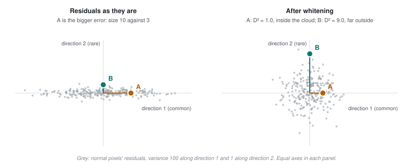

# Part 12 - From residual to score

> **The one thing this part teaches:** magnitude error and shape error find different
> anomalies, how unusual an error is matters more than how big it is, and no fixed threshold
> works across scenes.

## Where we are

Part 10 gave a reconstruction. Subtracting it from the input gives a **residual cube** -
same shape as the input, one error value per band per pixel.

That is `(165, H, W)` for hyperspectral. A decision needs one number per pixel. Collapsing
165 into 1 is what `app/utils/anomaly_detection/scoring.py` does, and how you collapse
determines what you find.

## Two ways to be wrong

Take a pixel's true spectrum and the model's reconstruction. They can differ in two
independent ways.

**Magnitude.** Same shape, different height. The model got the brightness wrong.

**Shape.** Same overall brightness, different pattern of peaks and dips. The model got the
*material* wrong.

Three bands, worked through:

```
band          1      2      3
true       0.20   0.50   0.30
recon A    0.30   0.60   0.40      brighter by 0.10 everywhere
recon B    0.30   0.40   0.30      same total, different pattern
```

Reconstruction A is off by exactly 0.10 in every band. Its *shape* is perfect.
Reconstruction B has the same sum as the truth (1.00) but the wrong pattern - band 1 up,
band 2 down.

A magnitude metric flags A strongly and B weakly. A shape metric does the reverse.

## L1: magnitude

Mean absolute residual across bands.

```
recon A:
  |0.20 - 0.30| = 0.10
  |0.50 - 0.60| = 0.10
  |0.30 - 0.40| = 0.10
  sum           = 0.30
  L1            = 0.30 / 3 = 0.100

recon B:
  |0.20 - 0.30| = 0.10
  |0.50 - 0.40| = 0.10
  |0.30 - 0.30| = 0.00
  sum           = 0.20
  L1            = 0.20 / 3 = 0.0667
```

L1 scores A **higher** (0.100 vs 0.0667), even though A's shape is perfect. A cloud, which is
bright everywhere, scores high on L1 while being spectrally uninteresting.

## SAM: shape

**Spectral Angle Mapper** treats each spectrum as a vector and measures the angle between
them. Scaling a vector does not change its direction, so SAM is **invariant to brightness**.

That invariance is the point. Illumination, slope and shadow change a spectrum's magnitude;
they do not change its shape. SAM ignores exactly the variation you do not care about.

Compute it for reconstruction A:

```
dot(true, A)  = 0.20*0.30 + 0.50*0.60 + 0.30*0.40
              = 0.06 + 0.30 + 0.12
              = 0.48

|true| = sqrt(0.20^2 + 0.50^2 + 0.30^2)
       = sqrt(0.04 + 0.25 + 0.09)
       = sqrt(0.38)
       = 0.6164

|A|    = sqrt(0.30^2 + 0.60^2 + 0.40^2)
       = sqrt(0.09 + 0.36 + 0.16)
       = sqrt(0.61)
       = 0.7810

cos    = 0.48 / (0.6164 * 0.7810)
       = 0.48 / 0.4814
       = 0.9971

angle  = arccos(0.9971) = 0.0762 rad = 4.36 degrees
```

Now reconstruction B:

```
dot(true, B)  = 0.20*0.30 + 0.50*0.40 + 0.30*0.30
              = 0.06 + 0.20 + 0.09
              = 0.35

|B|    = sqrt(0.09 + 0.16 + 0.09) = sqrt(0.34) = 0.5831

cos    = 0.35 / (0.6164 * 0.5831)
       = 0.35 / 0.3594
       = 0.9738

angle  = arccos(0.9738) = 0.2290 rad = 13.12 degrees
```

**SAM reverses the ranking: 4.36 degrees for A, 13.12 for B.** L1 said A was worse; SAM says B
is, by a factor of three. **Do this arithmetic yourself** - it is the clearest demonstration
in the course that the choice of metric decides what you find.

## Why both are offered

| method | measures | catches | misses |
|---|---|---|---|
| `L1` | magnitude | anything unusually bright or dark | odd materials at normal brightness |
| `MSE` | magnitude, squared | as L1, more sensitive to extremes | as L1 |
| `SAM` | shape | unusual materials | anything with a normal spectrum shape |
| `combined` | both | `w * L1_norm + (1-w) * SAM_norm`, `w = 0.5` | - |

A bright cloud: large L1, small SAM. A chemically odd material at ordinary brightness: small
L1, large SAM. **Reporting both lets the operator choose which kind of anomaly matters
today.**

Each is normalised by its maximum over **valid pixels only** before combining, so the two
scales are comparable. Invalid pixels are then zeroed.

## The dark-water trap, and the fade

SAM's brightness invariance has a cost. **An angle measures error relative to the signal**,
so the same small absolute error is a big angle on a dark pixel and a tiny one on a bright
pixel.

Give two pixels exactly the same residual, +0.01 / -0.01 / +0.01:

```
                 band 1   band 2   band 3    mean    L1
dark sea  true    0.02     0.03     0.01     0.02
          recon   0.03     0.02     0.02             0.010
bright    true    0.20     0.30     0.10     0.20
land      recon   0.21     0.29     0.11             0.010
```

L1 sees no difference: 0.010 for both. Now SAM.

```
dark sea:
  dot   = 0.02*0.03 + 0.03*0.02 + 0.01*0.02 = 0.0006 + 0.0006 + 0.0002 = 0.0014
  |t|   = sqrt(0.0004 + 0.0009 + 0.0001) = sqrt(0.0014) = 0.03742
  |r|   = sqrt(0.0009 + 0.0004 + 0.0004) = sqrt(0.0017) = 0.04123
  cos   = 0.0014 / (0.03742 * 0.04123) = 0.0014 / 0.001543 = 0.9075
  angle = arccos(0.9075) = 0.4335 rad = 24.84 degrees

bright land:
  dot   = 0.20*0.21 + 0.30*0.29 + 0.10*0.11 = 0.042 + 0.087 + 0.011 = 0.140
  |t|   = sqrt(0.04 + 0.09 + 0.01) = sqrt(0.14) = 0.37417
  |r|   = sqrt(0.0441 + 0.0841 + 0.0121) = sqrt(0.1403) = 0.37457
  cos   = 0.140 / (0.37417 * 0.37457) = 0.140 / 0.14015 = 0.9989
  angle = arccos(0.9989) = 0.0463 rad = 2.65 degrees
```

**Same error, nine times the angle.** The dark pixel's 0.43 rad is even larger than
reconstruction B's genuine material error earlier in this part (0.229 rad). So on a scene full
of open water, SAM ranks ordinary sea above real targets.

This is not hypothetical. PRISMA set1 is 75% sea; scored with the F001 model, the median angle is 0.34 rad on sea,
0.13 on land and 0.18 on the labelled anomalies, and SAM's ROC-AUC is 0.34 - worse than
guessing.

**The fix: fade SAM out on dark pixels.** `compute_score(..., sam_dark_fade=0.05)` multiplies
the angle by `clip(mean reflectance / 0.05, 0, 1)`, where the mean is over the input
spectrum's bands. At or above 5% the angle is untouched; below it, it shrinks linearly to 0.

```
dark sea:     weight = clip(0.02 / 0.05, 0, 1) = 0.40    faded angle = 0.4335 * 0.40 = 0.1734 rad
bright land:  weight = clip(0.20 / 0.05, 0, 1) = 1.00    faded angle = 0.0463 rad (unchanged)
```

The sea pixel now scores 0.173 rad - below the 0.229 of a real material error, so the real
error wins. It still scores above the bright pixel with the same residual, because at 2%
reflectance we genuinely cannot tell a material change from noise; the fade only stops
darkness from *dominating*.

On set1 this lifts the combined ROC-AUC from 0.712 to 0.891 for the production model (v0.2.0)
and from 0.430 to 0.683 for F001, while the three land scenes barely move (largest change
+0.006). The option is off by default (`None`); switching it on in the product is a pending
decision, because only one labelled scene contains water.

## Scoring the direction: residual Mahalanobis

L1, SAM and the fade all still measure how *big* the residual is. There is a better question:
how *unusual* is it, compared with the errors every normal pixel in this scene makes?

A real scene's normal errors are not random. The model over- or under-shoots brightness, haze
shifts every band together, PRISMA's detector leaves stripes, the sea is dark. Each of those
pushes many bands in the **same direction** at once. So normal residuals are large along a few
shared directions and tiny along all the others.

Picture two directions only. Along direction 1 (say, overall brightness), normal errors spread
by about 10 - a variance of 100. Along direction 2 (an absorption shape nothing in the scene
has), they spread by about 1 - a variance of 1. Two pixels:

```
                 residual (dir 1, dir 2)    size  sqrt(10^2 + 0^2) or sqrt(0^2 + 3^2)
A  bright roof        (10, 0)               10
B  odd material        (0, 3)                3
```

By size, A is the bigger anomaly. Now divide each direction by its normal spread before
measuring - that is the **Mahalanobis distance**:

```
A:  D^2 = 10^2 / 100 + 0^2 / 1 = 1.00 + 0.00 = 1.00
B:  D^2 =  0^2 / 100 + 3^2 / 1 = 0.00 + 9.00 = 9.00
```

B is now nine times more anomalous: a small error in a direction the background never takes.

The product does this in four steps (`app/utils/anomaly_detection/residual_mahalanobis.py`):

1. Collect the residual of every valid pixel and find its **principal components** - the
   directions in band space along which residuals vary most - keeping the top 30.
2. Express each pixel's residual in those 30 directions and divide each by its spread
   (**whitening**), exactly as in the example.
3. Subtract the average of the pixels in a **ring** around it, between 21 and 61 pixels across,
   so a slowly changing background (a field, a coast) is compared with its own neighbourhood.
4. The score is the sum of squares - the squared distance.

On the four labelled PRISMA scenes this lifts the production model's mean ROC-AUC from 0.662
(`combined`) to 0.854, and the new model's from 0.715 to 0.865 - better on every scene. It also
removes the dark-water problem without a special case: "sea is dark" is one of the shared
directions it learns and discounts. Since 2026-10-15 it is Indradhanu's default score.



*Figure 12.3 - Why direction beats size, in two dimensions. Left: normal residuals (grey) spread
widely along direction 1 and barely along direction 2; A sits far out along the common direction,
B a short way along the rare one. Right: after whitening, the cloud is round, A is inside it and B
is far outside.*

For the deep version - the principal directions and whitening worked by hand from five pixels, why
only 30 components, the ring mean and the integral-image trick that makes it fast, and the
eleven-method comparison that chose this default - see parts 45 and 46 of the Indradhanu course
(`indradhanu workings/45-scoring-the-direction.md` and `46-the-ring-and-the-comparison.md`).

## Thresholding, and why it is a human's job

You have a score map. Which pixels are anomalies?

A fixed cut cannot work. Typical residuals differ by an order of magnitude between a calm
lake scene and a fire-affected one:

```
calm scene:      typical score 0.01,  threshold 0.05  ->  almost nothing flagged
burned scene:    typical score 0.10,  threshold 0.05  ->  most of the scene flagged
```

**The same number is both far too strict and far too loose, depending on the scene.**

So the convention is a **percentile**: "the top 1% of valid pixels in this scene". That
adapts to the scene's own distribution, which is what a human would do by eye.

Work an example. 1,000,000 valid pixels, top 0.5%:

```
flagged = 1,000,000 * 0.005
        = 5,000 pixels
```

Five thousand candidates from a million. Whatever the absolute scores were.

This is why `anomaly_detection_prep` parks at `needs_threshold` (part 3): the percentile is a
judgement call about how many candidates an analyst can review, not a property of the data.

## Measuring quality when ground truth exists

Occasionally an analyst attaches a ground-truth annotation. Then `compute_roc` sweeps
thresholds and computes true and false positive rates.

One detail matters: it sweeps **percentile-spaced** thresholds, not linear ones. Score
distributions are heavy-tailed - almost every pixel sits near zero and a handful sit far out.
Linear spacing would put nearly every sample in the empty upper range and almost none where
the decision actually happens.

## Common confusions

**"SAM in degrees or radians?"**
`_sam` returns radians. The spectral-match code converts to degrees for display, with a
default confidence threshold of 15 degrees. Check units before comparing values.

**"Why normalise by the max rather than standardising?"**
Max-normalisation puts both metrics on [0, 1] so a weighted sum is meaningful. Note this is
*different* from the rank-CDF normalisation used by `StatisticalEnsembler`, which needs it
because Mahalanobis distances from two detectors are not commensurable at all.

**"Is 'combined' always best?"**
No, and since 2026-10-15 it is not even the default: `residual_mahalanobis` is. `combined` matches
the model's training loss, which is why it was the default before; if you are hunting bright hot
targets, plain L1 is more direct.

**"Isn't this just RX? Wasn't RX dropped?"**
Plain RX runs Mahalanobis on the raw cube over all 165 bands, where the covariance is nearly
singular and distances blow up - that was dropped. This runs on the *residual*, in 30 whitened
components, where the covariance is well behaved. Same mathematics, different input.

**"Why not just drop water pixels?"**
That needs a water mask, and a ship or an oil slick *on* water is exactly the kind of anomaly
you want to keep. The fade keeps L1 at full strength there - only the angle, which is
unreliable on dark pixels, is turned down.

**"Can I use accuracy to evaluate this?"**
No - part 1 showed why. With 40 anomalies in 20 million pixels, always answering "normal"
scores 99.9998%. ROC and AUC, computed over valid pixels only.

## Check yourself

<details>
<summary>1. True spectrum (0.40, 0.20, 0.40), reconstruction (0.50, 0.30, 0.50). Compute L1.</summary>

```
|0.40 - 0.50| = 0.10
|0.20 - 0.30| = 0.10
|0.40 - 0.50| = 0.10
sum           = 0.30
L1            = 0.30 / 3 = 0.100
```
</details>

<details>
<summary>2. For the same pair, compute SAM in degrees. Comment on the result.</summary>

```
dot   = 0.40*0.50 + 0.20*0.30 + 0.40*0.50
      = 0.20 + 0.06 + 0.20 = 0.46

|t|   = sqrt(0.16 + 0.04 + 0.16) = sqrt(0.36) = 0.6000
|r|   = sqrt(0.25 + 0.09 + 0.25) = sqrt(0.59) = 0.7681

cos   = 0.46 / (0.6000 * 0.7681) = 0.46 / 0.4608 = 0.9983
angle = arccos(0.9983) = 0.0583 rad = 3.34 degrees
```

Small angle despite L1 of 0.100 - the reconstruction is uniformly brighter but the shape is
nearly right. A magnitude error, not a material error.
</details>

<details>
<summary>3. Why can a fixed absolute threshold not be used across scenes?</summary>

Typical residuals differ by an order of magnitude between scenes. A cut of 0.05 flags almost
nothing in a calm scene where typical scores are 0.01, and most of a burned scene where they
are 0.10.
</details>

<details>
<summary>4. A scene has 2,400,000 valid pixels. The analyst wants the top 0.25%. How many candidates?</summary>

```
2,400,000 * 0.0025 = 6,000 pixels
```
</details>

<details>
<summary>5. With `sam_dark_fade=0.05`, a pixel of mean reflectance 0.03 has a raw angle of 0.30 rad. What is its faded angle? And for a pixel of mean 0.12?</summary>

```
mean 0.03:  weight = clip(0.03 / 0.05, 0, 1) = 0.60    0.30 * 0.60 = 0.18 rad
mean 0.12:  weight = clip(0.12 / 0.05, 0, 1) = 1.00    0.30 rad, unchanged
```
</details>

<details>
<summary>6. Normal residuals have variance 25 along direction 1 and 0.25 along direction 2. Score pixel P with residual (5, 0) and pixel Q with residual (0, 1). Which is more anomalous by size, and by Mahalanobis distance?</summary>

```
size:          P = sqrt(5^2 + 0^2) = 5.0      Q = sqrt(0^2 + 1^2) = 1.0      P looks bigger
Mahalanobis:   P: D^2 = 5^2 / 25 + 0 = 25 / 25 = 1.0
               Q: D^2 = 0 + 1^2 / 0.25 = 1 / 0.25 = 4.0                     Q is 4 times more anomalous
```
</details>

<details>
<summary>7. Why does compute_roc use percentile-spaced thresholds?</summary>

Score distributions are heavy-tailed - nearly every pixel sits near zero and a few sit far
out. Linear spacing would place almost every sample in the empty upper range and almost none
in the region where the decision is actually made.
</details>

---

Next: [part 13](13-end-to-end.md) - one scene, one anomaly, start to finish.
