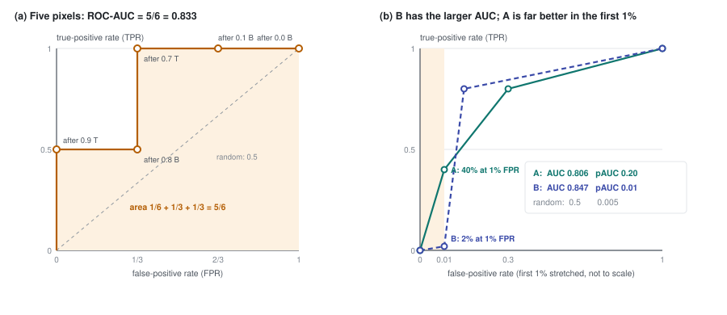

# Part 16 - Measuring detection where the analyst looks

> **The one thing this part teaches:** when anomalies are 0.1-1% of the pixels, ROC-AUC is decided
> almost entirely by how the bulk of ordinary background pixels is ranked, which an analyst never
> sees - so the repo also measures the top of the ranking: partial AUC up to 1% false alarms, the
> detection rate at 0.1% false alarms, and how many objects land in a fixed review budget, each
> read against what random scores would get.

## Where we are

Part 12 ended with `compute_roc`, which turns a score map and a ground-truth mask into one number,
the AUC. Until 2026-10-16 that number was how every model and score in this repo was judged. On
that date a second function arrived beside it, `detection_measures` in
`app/utils/evaluation/prisma_bench.py`, with its hand-worked test in
`tests/test_utils/test_detection_measures.py`. This part explains why it was needed and what each
of its numbers means.

You need part 12's percentile threshold and part 1's point that anomalies are rare. Nothing else.

## Vocabulary first

Pick a threshold. Every pixel scoring at or above it is **flagged**.

- A **positive** is a pixel the ground truth marks as anomalous (a **target**). A **negative** is
  every other valid pixel (the **background**).
- The **true-positive rate (TPR)**, also called the detection rate, is the share of targets that
  are flagged.
- The **false-positive rate (FPR)**, the false-alarm rate, is the share of background pixels that
  are flagged.
- The **ROC curve** (receiver operating characteristic) is what you get by sliding the threshold
  from the top score down to the bottom and plotting TPR against FPR at every step.
- The **AUC** is the area under that curve: 1.0 is perfect, 0.5 is random.

## Five pixels, by hand

The test file's example. Five pixels, two of them targets (T), already sorted by score:

```
score   0.9   0.8   0.7   0.1   0.0
truth    T     B     T     B     B          2 targets, 3 background
```

Lower the threshold one pixel at a time and count:

```
flag down to   targets flagged   background flagged   TPR      FPR
(nothing)            0                  0             0        0
0.9                  1                  0             1/2      0
0.8                  1                  1             1/2      1/3
0.7                  2                  1             1        1/3
0.1                  2                  2             1        2/3
0.0                  2                  3             1        1
```

The curve's points are (0, 0), (0, 1/2), (1/3, 1/2), (1/3, 1), (2/3, 1), (1, 1). The area under it,
strip by strip (each strip is width times the average of its two heights):

```
(0, 0)   -> (0, 1/2)     width 0                       area 0
(0, 1/2) -> (1/3, 1/2)   width 1/3, heights 1/2, 1/2   area 1/3 x 1/2 = 1/6
(1/3, 1/2) -> (1/3, 1)   width 0                       area 0
(1/3, 1) -> (2/3, 1)     width 1/3, heights 1, 1       area 1/3
(2/3, 1) -> (1, 1)       width 1/3, heights 1, 1       area 1/3
total                                                  1/6 + 1/3 + 1/3 = 1/6 + 4/6 = 5/6 = 0.8333
```

There is a second way to read the same number. **AUC is the chance that a randomly chosen target
scores above a randomly chosen background pixel.** There are 2 x 3 = 6 target-background pairs:

```
target 0.9 vs 0.8, 0.1, 0.0     wins 3
target 0.7 vs 0.8, 0.1, 0.0     wins 2 (loses to 0.8)
wins 5 of 6 pairs  ->  5/6 = 0.8333
```

Both give 0.8333. Keep the pair reading in mind, because it explains the problem.

## Why AUC is decided by the bulk

A PRISMA scene has about a million valid pixels. Suppose 1,000 are targets - 0.1%, typical of the
labelled bench scenes. An analyst can review perhaps the top 1% of the ranking: 10,000 pixels.

In the pair reading, AUC averages over **every** pair: 1,000 targets x 999,000 background pixels. A
target that is ranked 500,000th still beats the 499,000 or so background pixels below it, and every
one of those wins counts. **Almost all of the AUC is earned by putting targets above pixels nobody
will ever look at.** The analyst cares about one region of the curve - FPR from 0 to about 1% - and
that region is 1% of the curve's width.

Two invented detectors make the point. Their ROC curves, as straight segments between three
points:

```
detector A:  (0, 0) -> (0.01, 0.40) -> (0.30, 0.80) -> (1, 1)
detector B:  (0, 0) -> (0.01, 0.02) -> (0.10, 0.80) -> (1, 1)
```

Their AUCs, strip by strip:

```
A:  0.01 x (0    + 0.40) / 2 = 0.01 x 0.20 = 0.002
    0.29 x (0.40 + 0.80) / 2 = 0.29 x 0.60 = 0.174
    0.70 x (0.80 + 1.00) / 2 = 0.70 x 0.90 = 0.630
    total                                  = 0.806

B:  0.01 x (0    + 0.02) / 2 = 0.01 x 0.01 = 0.0001
    0.09 x (0.02 + 0.80) / 2 = 0.09 x 0.41 = 0.0369
    0.90 x (0.80 + 1.00) / 2 = 0.90 x 0.90 = 0.810
    total                                  = 0.847
```

B has the higher AUC, 0.847 against 0.806. But at 1% false alarms - the analyst's budget - A has
found 40% of the targets and B 2%. **A ranking metric can prefer the detector that is useless where
it is used.**



*Figure 16.1 - Left: the hand-worked ROC of the five pixels above, with its area shaded. Right:
detectors A and B. B has the larger total area; inside the first 1% of false alarms (the narrow
amber strip, drawn wider than scale) A is twenty times higher.*

## Measure 1 - partial AUC up to 1% false alarms

Take only the area over FPR 0 to 0.01, and divide it by 0.01 so that a perfect detector scores 1:

```
pauc_1pct = (area under the ROC between FPR 0 and 0.01) / 0.01
```

Detector A: 0.002 / 0.01 = **0.20**. Detector B: 0.0001 / 0.01 = **0.01**. The order flips to the
one the analyst would choose.

What does random get? A random detector's ROC is the diagonal, TPR = FPR. Its area from 0 to 0.01
is a triangle:

```
0.01 x 0.01 / 2 = 0.00005
0.00005 / 0.01  = 0.005
```

So **random pAUC is 0.005, not 0.5** - the docstring says so ("1 = perfect, 0.005 = random"), and
the test checks a random scorer stays below 0.05. Read every pAUC against 0.005.

The five pixels: the curve sits at TPR 1/2 from FPR 0 out to FPR 1/3, far past 0.01. So the area
up to 0.01 is `0.01 x 1/2 = 0.005`, and `0.005 / 0.01 = 0.5`. The test asserts exactly that.

### Why it is computed exactly, not from `compute_roc`

Read `compute_roc` in `app/utils/anomaly_detection/scoring.py`. It does not use every score as a
threshold. It takes evenly spaced **percentiles**:

```python
n_pts = min(max_thresholds, max(20, s.size // 10000 + 64))      # max_thresholds = 256
qs = np.linspace(0.0, 100.0, n_pts)
```

For a scene of 1,000,000 valid pixels:

```
1,000,000 // 10,000 + 64 = 100 + 64 = 164 thresholds
spacing                  = 100 / (164 - 1) = 100 / 163 = 0.613 percentile
```

So the first sampled threshold below the top flags the top 0.613% of pixels, the next the top
1.227%. Between FPR 0 and 1% the curve has about one point. Its area there is a single triangle
guessed from that point, and `score_metrics`' "TPR at 1% FPR" is a straight-line interpolation
between two samples (`np.interp(0.01, fpr, tpr)`). For the whole AUC this coarseness does not
matter much; for the first 1% it is most of the answer.

**Source and description disagree twice here, and the source wins.** You may read that the product
"samples 256 thresholds". It samples *at most* 256; the count reaches 256 only for scenes of about
1,920,000 pixels or more (`(256 - 64) x 10,000`). And `compute_roc`'s own docstring says the
thresholds are "evenly spaced over the score range plus the unique-value breakpoints sklearn would
emit". The code takes percentiles only, and no sklearn breakpoints.

`detection_measures` avoids sampling altogether. It sorts every score, highest first, and makes one
ROC point at the end of each run of tied scores:

```python
order = np.argsort(-s, kind="stable")
last = np.r_[np.flatnonzero(np.diff(s_sorted)), len(s_sorted) - 1]   # end of each run of tied scores
tpr = np.r_[0.0, np.cumsum(g_sorted)[last] / pos]
fpr = np.r_[0.0, np.cumsum(~g_sorted)[last] / neg]
```

That is the five-pixel table above, for a million pixels. The segment that crosses FPR 0.01 is cut
at 0.01 by linear interpolation, and the areas of the pieces left of it are summed. The test checks
the full exact AUC (`auc_exact`) against scikit-learn's `roc_auc_score` to nine decimal places.

## Measure 2 - detection rate at 0.1% false alarms

```python
"tpr_at_0p1pct": float(tpr[fpr <= 0.001].max())
```

The best TPR reached on any ROC point whose FPR is at most 0.001. Exact, no interpolation. On a
million-pixel scene 0.1% of the background is about 1,000 false alarms - roughly what an analyst
can actually inspect. For the five pixels, the points with FPR at most 0.001 are (0, 0) and (0, 1/2),
so the answer is 1/2.

## Measure 3 - objects caught at a fixed budget

Pixel rates have a weakness. A 20-pixel roof and a 1-pixel vehicle are two objects, but in TPR the
roof counts twenty times. An analyst needs **one** flagged pixel per object to go and look. So
`score_metrics` also counts objects:

```python
labels, n_obj = ndimage.label(gt)                         # connected groups of target pixels
hits = ndimage.binary_dilation((score >= np.percentile(score[k], 100 - top_pct)) & k, iterations=1)
return len(np.unique(labels[hits & (labels > 0)]))        # objects touched by a flagged pixel
```

Step by step:

1. Flag the top 1% (or 0.1%) of valid pixels by score - part 12's percentile threshold.
2. Grow every flagged pixel by one step to its four neighbours (up, down, left, right). This is the
   **1-pixel tolerance**: the ground-truth masks may sit about one pixel off the scene grid (the
   module docstring says so), and a detection one pixel beside a target should count.
3. An object is **caught** if any of its pixels is touched.

Both `ndimage.label` and `binary_dilation` use scipy's default 4-neighbour connectivity, so two
target pixels that touch only at a corner are two objects.

### The chance level is not 1%

Here is the trap the tolerance creates. Give every pixel a random score. Each pixel is flagged
with probability 0.01 at the 1% budget. A one-pixel object is caught if the object pixel **or any of
its four neighbours** is flagged - five pixels, each a separate chance:

```
P(none of 5 flagged) = 0.99 x 0.99 x 0.99 x 0.99 x 0.99 = 0.99^5 = 0.951
P(caught)            = 1 - 0.951 = 0.049       about 5%, from a random scorer
```

A two-pixel object (a domino) has 2 pixels plus 6 neighbours, 8 in all:

```
0.99^8 = 0.923       P(caught) = 1 - 0.923 = 0.077
```

A 3 x 3 square has 9 pixels plus 12 neighbours, 21 in all: `1 - 0.99^21 = 1 - 0.810 = 0.190`.
Bigger objects are caught by chance more often, because they have more pixels and more neighbours.
Averaged over the sizes of real labelled objects (median 2 pixels, a tenth of them 10 or more), random
scores catch **about 10% of objects at the top 1%, and about 1% at the top 0.1%**. That is measured,
not derived: `research/experiments/implant-bench/README.md` runs random scores through the same
rules and states "Chance ... 10% (1%) in every tier".

**Every "objects caught" number must be read against that 10%.** A model catching 11% of a group of
objects at the top 1% is doing almost nothing.

## Measure 4 - the 3D-ROC terms, and why they are degenerate here

The hyperspectral literature has a "3D ROC": instead of plotting TPR against FPR, it plots each
against the threshold itself. The scores are first min-max normalised to the range 0 to 1, so the
threshold `tau` runs from 0 to 1. Two areas follow:

- **AUC(D, tau)**: the area under detection rate against threshold.
- **AUC(F, tau)**: the area under false-alarm rate against threshold. Lower is better.

`detection_measures` computes them exactly with one observation, stated in its docstring: for
scores between 0 and 1, the area under "share of pixels at or above `tau`" as `tau` runs 0 to 1 is
the **mean score** of those pixels. A pixel at 0.778 is above every threshold from 0 to 0.778, so it
contributes 0.778 to the area. So:

```python
norm = (s - lo) / (hi - lo)                       # min-max normalise
d_tau, f_tau = float(norm[g].mean()), float(norm[~g].mean())
"auc_bs": auc - f_tau,                            # background suppressibility, higher is better
"snpr":   d_tau / f_tau                           # signal-to-noise probability ratio
```

The five pixels. The lowest score is 0.0 and the highest 0.9, so each normalised score is
`score / 0.9`:

```
0.9 / 0.9 = 1.000     T
0.8 / 0.9 = 0.889     B
0.7 / 0.9 = 0.778     T
0.1 / 0.9 = 0.111     B
0.0 / 0.9 = 0.000     B

AUC(D, tau) = (1.000 + 0.778) / 2         = 1.778 / 2 = 0.889   (8/9)
AUC(F, tau) = (0.889 + 0.111 + 0.000) / 3 = 1.000 / 3 = 0.333   (1/3)
AUC_BS      = 0.8333 - 0.333              = 0.500
SNPR        = 0.889 / 0.333               = 2.67                (8/3)
```

The test asserts all four.

**Why they do not help for residual Mahalanobis.** That score (part 12) is a squared distance, and it
has a heavy tail: most background pixels sit near the bottom, a few pixels sit hundreds of times
higher. Min-max normalisation divides by the single highest score in the scene. An illustration with
round numbers, not measured ones: a typical background score of 30, and one pixel at 30,000.

```
typical background, normalised:  30 / 30,000 = 0.001
```

The background mean is then about 0.001 whatever the model does, so AUC(F, tau) is about 0.001, and
`AUC_BS` is the ROC-AUC minus 0.001. The FT02b README measured exactly that on the PRISMA bench:
"the min-max-normalised background mean ~0.001 for every model (AUC_BS = ROC-AUC - 0.001), so they do
not separate models". And SNPR divides by that 0.001, so it is set mostly by the one brightest pixel.
The terms are computed and kept because the literature reports them; do not use them to choose a
model with this score.

## The measures side by side

| measure | key | perfect | random | question it answers |
|---|---|---|---|---|
| ROC-AUC | `auc` (sampled), `auc_exact` | 1 | 0.5 | are targets above background, on average over everything? |
| partial AUC to 1% FPR | `pauc_1pct` | 1 | 0.005 | how good is the top of the list? |
| TPR at 0.1% FPR | `tpr_at_0p1pct` | 1 | 0.001 | what share of target pixels is in about the top 1,000? |
| objects caught, top 1% | `objects_caught` | all | about 10% | how many objects would an analyst find in a 1% budget? |
| objects caught, top 0.1% | `objects_caught_0p1` | all | about 1% | the same, in a 0.1% budget |
| 3D-ROC terms | `auc_d_tau`, `auc_f_tau`, `auc_bs`, `snpr` | - | - | literature comparison only; degenerate for residual Mahalanobis |

`score_metrics` returns all of them for one scene; `scripts/evaluate_prisma_bench.py` runs it over
the four labelled PRISMA scenes. On those four scenes, every one of these measures tied the shipped
model with the fine-tuned ones (the FT02b README's "All bench measures" table). Part 17 explains why a
bigger benchmark was needed, and part 18 builds it.

## Common confusions

**"A pAUC of 0.15 is terrible - it is far below 0.5."**
The random level is 0.005, not 0.5. 0.15 is thirty times random. Never read pAUC on AUC's scale.

**"`auc` and `auc_exact` should be the same number."**
`auc` comes from `compute_roc`'s sampled thresholds (it is the product's number, so results match
what users see); `auc_exact` uses every score. For the whole curve the sampling error is small, but
the two are different calculations - quote which one you used.

**"Top 1% means exactly 1% of pixels are flagged."**
It means "at or above the 99th percentile". With many tied scores, more can pass. The test
`test_score_metrics_counts_objects_at_both_budgets` shows the extreme: 9,988 of its 10,000 pixels
score 0, so the 99th percentile is 0, every pixel is at or above it, and both objects are "caught" at
the 1% budget whatever the scores are. That assertion would pass for a broken scorer; only the 0.1%
assertion in that test really discriminates. Real float score maps rarely tie, but a score map with a
large block of zeros (masked pixels left in) would.

**"Objects caught at 10% means the model found one object in ten."**
It does, and so would random scores. Report it next to chance.

**"The 1-pixel tolerance applies to AUC too."**
No. The module docstring: "objects caught" allows a 1-pixel tolerance, AUC does not - it is the
product's AUC.

## Check yourself

<details>
<summary>1. Four pixels: scores 0.6 (T), 0.5 (B), 0.4 (B), 0.3 (T). Compute the ROC points, the AUC both ways, and the pAUC to 1% FPR.</summary>

```
flag down to   TPR    FPR
(nothing)      0      0
0.6            1/2    0
0.5            1/2    1/2
0.4            1/2    1
0.3            1      1

strips:  (0, 1/2) -> (1/2, 1/2)   1/2 x 1/2 = 1/4
         (1/2, 1/2) -> (1, 1/2)   1/2 x 1/2 = 1/4
         (1, 1/2) -> (1, 1)       width 0
AUC = 1/4 + 1/4 = 0.5

pairs:   0.6 beats 0.5 and 0.4   2 wins
         0.3 beats neither       0 wins
         2 of 4 pairs = 0.5

pAUC:    TPR is 1/2 from FPR 0 to 0.01: area 0.01 x 1/2 = 0.005;  0.005 / 0.01 = 0.5
```

AUC says "random"; pAUC says the top of the list is a hundred times better than random (0.5 against
0.005). Half the targets are at the very top, half at the very bottom.
</details>

<details>
<summary>2. With random scores at the top-1% budget, what is the chance of catching a 3-pixel object in a straight line?</summary>

```
pixels                  3
neighbours  above 3, below 3, left 1, right 1 = 8
total                   3 + 8 = 11
0.99^11 = 0.895
P(caught) = 1 - 0.895 = 0.105, about 10.5%
```
</details>

<details>
<summary>3. A scene has 600,000 valid pixels. How many thresholds does compute_roc use, and how many percentiles apart are they?</summary>

```
600,000 // 10,000 + 64 = 60 + 64 = 124      (between 20 and 256, so 124)
spacing = 100 / (124 - 1) = 100 / 123 = 0.813 percentile
```

The top sampled threshold below the maximum flags the top 0.813% - so between FPR 0 and 1% there is
about one sampled point.
</details>

<details>
<summary>4. Why is AUC(F, tau) about 0.001 for every model under residual Mahalanobis, and what does that do to AUC_BS?</summary>

Min-max normalisation divides by the scene's single highest score. Residual Mahalanobis is heavy
tailed, so the maximum is hundreds of times the typical background score and the background's mean
normalised score is tiny whatever the model. AUC_BS = ROC-AUC - AUC(F, tau) is then ROC-AUC minus
about 0.001: it adds nothing ROC-AUC did not already say.
</details>

<details>
<summary>5. A bench has equal numbers of 1-pixel and 2-pixel objects. A model catches 12% of them at the top 1%. How many times chance is that?</summary>

```
chance, 1 pixel  = 0.049
chance, 2 pixels = 0.077
mean             = (0.049 + 0.077) / 2 = 0.126 / 2 = 0.063
12% / 6.3%       = 1.9 times chance
```
</details>

---

Next: [part 17](17-public-benchmarks.md) - the public anomaly benchmarks, and why none of them tests
this product.
