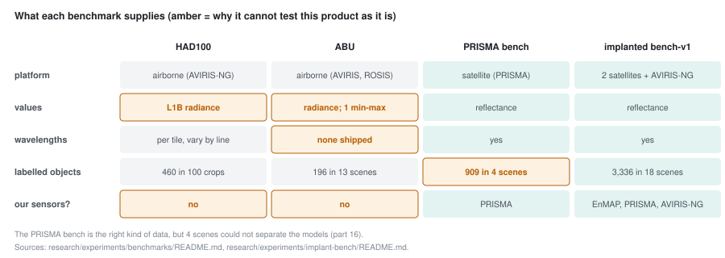

# Part 17 - The public benchmarks, and why we built our own

> **The one thing this part teaches:** the two standard public hyperspectral anomaly benchmarks,
> HAD100 and ABU, are airborne at-sensor radiance (and ABU ships no wavelengths at all), while this
> product reads satellite reflectance by wavelength - and no labelled satellite-reflectance anomaly
> set was found - so the repo built its own benchmark (part 18) rather than borrow one.

## Where we are

Part 16 gave you measures that look at the top of the ranking. On the four labelled PRISMA scenes
they still could not separate the models: every measure tied the shipped model with the fine-tuned
ones, within scene-to-scene noise (`research/experiments/indradhanu-finetune/FT02b-mixed/README.md`).
Four scenes and 909 objects are too few. The obvious move is to borrow a bigger, public benchmark.
On 2026-10-16 two were downloaded and vetted; the record is
`research/experiments/benchmarks/README.md`. Open it beside this part.

> **Analogy.** You have built a thermometer for ovens and want to test it. A lab offers you a
> large, well-labelled set of test readings - taken with a different kind of probe, in fridges, in
> a unit nobody wrote down. The set is real and careful. It is not a test of your thermometer.

## What a model needs from each scene

The benchmarks README starts from what our models read. The Indradhanu models read **any band list by
wavelength** and expect **reflectance** on a 0-1 scale (part 2). So every benchmark scene must supply
four things:

1. the cube,
2. the centre wavelength of every band,
3. a ground-truth mask,
4. the value scale - what a stored number means physically.

Miss any one and the model is either guessing or reading something it was never trained on.

## HAD100

Published with the AETNet paper (Li et al., IEEE TGRS 61, 2023). Cut from the public AVIRIS-NG
archive - AVIRIS-NG is the airborne sensor of part 4.

| item | value (benchmarks README, section 2) |
|---|---|
| what ships | 94 test tiles, their ground truth, and 522 anomaly-free training tiles |
| protocol | `main.py` crops 100 test scenes of 64 x 64 from the 94 tiles (6 tiles give two crops) |
| labels | 3,567 anomaly pixels in 460 objects; per scene median 25.5 pixels (0.6%) |
| values | **L1B at-sensor radiance**, `uW nm-1 cm-2 sr-1`, not reflectance |
| wavelengths | 425 per tile in its header - and they **differ slightly between flight lines**, so read them per tile |

Radiance is the light arriving at the sensor, atmosphere included. Reflectance is the fraction of
sunlight the ground sends back, with the sun and atmosphere taken out. Our models were trained on
reflectance. The README lists three ways to bridge the gap; the crudest is top-of-atmosphere
reflectance:

```
reflectance = pi x L / (E0 x cos(solar zenith angle))
```

with `L` the radiance and `E0` the sun's irradiance at that wavelength. Work it once with round
numbers: `L = 10`, `E0 = 186` (roughly the sun at 550 nm in the same units), solar zenith 30
degrees, `cos 30 = 0.866`:

```
pi x 10       = 31.42
186 x 0.866   = 161.1
31.42 / 161.1 = 0.195
```

That needs the solar zenith of every flight line, which is not in the tiles, and it still leaves
the atmosphere in. The preferred route - fetching the AVIRIS-NG L2 reflectance for HAD100's ten
flight lines - needs an Earthdata login and had not been done.

### The leakage check

HAD100 comes from the same archive as the 79 AVIRIS-NG flight lines our models trained on. If a
benchmark scene were cut from a training line, a model could score well by memory. The README's
check (section 3):

- **No exact line overlap.** None of HAD100's 10 lines is among our 79.
- **One near neighbour.** `ang20180227t082814`, over Kakinada in Andhra Pradesh, was flown on the
  same day as three of our training lines; one of them, 18 minutes later, ran on the parallel track
  immediately east. Their outlines are about 630 m apart and do not overlap, and the four HAD100
  tiles from that line sit 1,020-1,865 m from the nearest training footprint.
- Those 4 tiles become **6 of the 100 protocol scenes**. Verdict: no pixel-level leakage, but
  near-domain proximity. **Report HAD100 results with and without those 6 scenes.**

A second, separate trap: HAD100's own training and test tiles come from the same 10 flight lines.
If we ever trained on its anomaly-free tiles, that would leak too.

## ABU

The Airport-Beach-Urban set (Kang et al., IEEE TGRS 55(10), 2017): 13 small scenes, used by
essentially every hyperspectral anomaly paper.

| problem | detail (benchmarks README, section 4) |
|---|---|
| radiance again | 12 scenes are AVIRIS scaled at-sensor radiance with an unknown gain, not reflectance |
| one scene normalised | `beach-4` is ROSIS-03 over Pavia, 430-860 nm only, min-max normalised to 0-1 over the whole cube - not a physical quantity |
| **no wavelengths** | the files hold `data` and `map` and nothing else; which AVIRIS bands were removed was never published |
| the source page | returns 404 since 2026-10-16; our copy is from Wayback captures, identical since 2018 |

Why "radiance", when nobody wrote it down? The README's reasoning is worth following. The median
spectra peak in the blue at about 1,800 counts and fall to about 20-100 near 2.4 micrometres:

```
20 / 1,800  = 0.011     about 1%
100 / 1,800 = 0.056     about 6%
```

Airports and cities do not reflect only 1-6% as much at 2.4 micrometres as in the blue - but sunlight
itself is far weaker there. That shape is the sun's, which means the numbers still contain the
sunlight: radiance.

An attempt was made to recover the wavelengths, by aligning each scene's median spectrum to a
reference AVIRIS spectrum. The fits are loose and the README says to treat them as "low-confidence
estimates, not wavelengths to evaluate with". **A model that reads bands by wavelength cannot run on
ABU without guessing.**

## Papers do not agree on the protocol either

Even the published numbers are not comparable with each other (README, section 5). "The first 50
bands" means the first 50 of HAD100's 276 "good" bands in one paper (452-697 nm) and the first 50 of
the raw 425 in another (377-622 nm). Both are visible light only. A model that uses the short-wave
infrared, as ours does, is handicapped against any row that uses them. Quote which protocol, and do
not mix them in one table.

## And satellites?

Part 4's satellites - PRISMA, EnMAP - are what the product mainly serves. The implanted-benchmark
design (`docs/lld/implant-bench.md`) records the search: "no labelled PRISMA / EnMAP / Gaofen-5
anomaly set was found". The four PRISMA scenes in `stage1_datasets` are the only labelled satellite
anomaly scenes the repo has, and part 16 showed they are too few.



*Figure 17.1 - The four benchmarks against the four things a model needs, plus platform. Amber cells
are the reason a benchmark cannot test this product as it is.*

So the options were: convert HAD100 to reflectance (needs a login and more work, and it is still
airborne), guess ABU's wavelengths (a result resting on a guess), or put known targets into our own
held-out satellite scenes. Part 18 is the third.

## Common confusions

**"HAD100 is AVIRIS-NG, and we train on AVIRIS-NG, so it fits."**
Same sensor, different product. We train on AVIRIS-NG L2 reflectance; HAD100 ships L1B radiance.

**"No exact flight-line overlap means no leakage worries at all."**
Six scenes are 1-2 km from a training swath flown the same day over the same delta. Not pixel
leakage, but not unseen ground either. Report both ways.

**"ABU is small, so it is quick to add."**
Its size is not the problem; its missing wavelengths are. Without them, a wavelength-reading model
is reading bands it cannot place.

**"Our 4 PRISMA scenes are enough if we use better measures."**
Part 16's measures were tried on them (then `app/utils/evaluation/prisma_bench.py`, `SCENES`; now
`app/evaluation/datasets.py`, `PRISMA_SCENES`), and every
one tied. The limit is the number of scenes and objects, not the measure.

## Check yourself

<details>
<summary>1. What four things must a benchmark scene supply for an Indradhanu model, and which does ABU lack?</summary>

The cube, the band-centre wavelengths, a ground-truth mask and the value scale. ABU lacks the
wavelengths entirely, and its value scale is unknown-gain radiance (or min-max normalised, for
beach-4).
</details>

<details>
<summary>2. Compute top-of-atmosphere reflectance for L = 8, E0 = 150, solar zenith 60 degrees (cos 60 = 0.5).</summary>

```
pi x 8       = 25.13
150 x 0.5    = 75
25.13 / 75   = 0.335
```
</details>

<details>
<summary>3. How many of HAD100's 100 protocol scenes come from the Kakinada line, and what share of the benchmark is that?</summary>

6 scenes. `6 / 100 = 6%`. Small, but enough to shift a mean AUC, which is why the README asks for
results with and without them.
</details>

<details>
<summary>4. Two papers both report HAD100 on "the first 50 bands". Why can you not compare their numbers?</summary>

One takes the first 50 of the 276 good bands (452-697 nm), the other the first 50 of the raw 425
(377-622 nm). Different bands, and both visible only.
</details>

<details>
<summary>5. ABU's median spectrum is 1,800 in the blue and 40 at 2.4 micrometres. What is the ratio, and why does it suggest radiance?</summary>

```
40 / 1,800 = 0.022, about 2%
```

Surfaces like roofs and roads are not 50 times darker at 2.4 micrometres than in the blue, but
sunlight there is far weaker. A ratio that small carries the sun's spectrum, so the values still
contain the illumination: radiance, not reflectance.
</details>

---

Next: [part 18](18-the-implant-benchmark.md) - the implanted-target benchmark: real held-out
scenes, synthetic objects made to look like the real ones.
