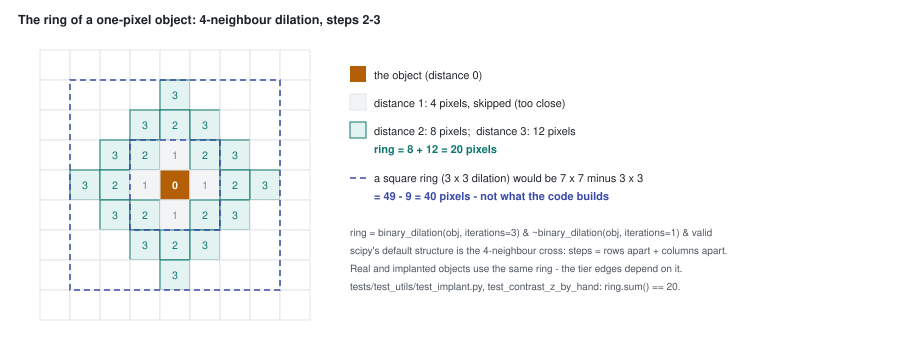
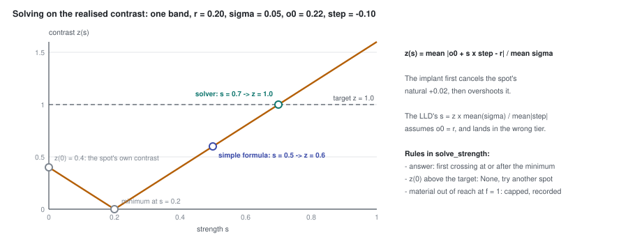

# Part 18 - The implanted-target benchmark

> **The one thing this part teaches:** put synthetic objects into real held-out satellite scenes,
> sized, placed and contrasted like the 909 real labelled objects, with the contrast measured the
> same way on both - then thousands of objects with exact ground truth sort models into "subtle,
> medium, easy" tiers, as long as you read every result against chance and remember the implants
> are harder than real objects at the same contrast.

> **Update, 2026-10-17 (later).** This part teaches bench-v1, which has since been **replaced**. Part 19
> shows that bench-v1 is biased (a model-free PCA-RX beats every model on it and loses on real objects);
> part 20 teaches bench-v2, which fixes that. Two readings below are bench-v1's only: on bench-v2 the
> subtle tier is above chance (13-15% against 10.1%), and placement still excludes water, which since
> 2026-10-17 is in scope for detection (part 21). The mechanics taught here - ring, z, tiers, strength
> solve - carry over unchanged.

## Where we are

Part 17 closed the public options. On 2026-10-17 the user asked for implanted targets "somewhat
similar to the ones we do have", in "subtle, medium, easy" categories. The pieces:

| file | what it holds |
|---|---|
| `docs/lld/implant-bench.md` | the design: interfaces, data flow, invariants, decisions |
| `app/evaluation/implant.py` | the core: ring, contrast, tiers, blob shapes, the two implants, the strength solve (in `app/utils/evaluation/implant.py` until 2026-10-17) |
| `scripts/build_implant_bench.py` | `real` measures the real objects; `build` makes the benchmark |
| `scripts/evaluate.py` with a `{"kind": "implant"}` dataset | scores models on it (part 19; `scripts/evaluate_implant_bench.py` until 2026-10-17) |
| `tests/test_evaluation/test_implant.py` | hand-worked tests of the core |
| `research/experiments/implant-bench/README.md` | bench-v1: the build, the comparison with the real objects, the results |

> **Analogy.** To test proofreaders, a publisher takes real pages and plants thirty typos of known
> difficulty: some glaring, some a single swapped letter. Real pages, so the surrounding text is
> honest; planted errors, so every one is known. The test is only fair if the planted typos look like
> the ones writers actually make - which is why you first study a pile of real typos.

## Step 1 - what the real objects look like

`build_implant_bench.py real` loads the four labelled PRISMA scenes at their own bands and measures
every ground-truth object (4-neighbour connected, as in part 16; an object whose ring has fewer than 8
pixels is skipped): its size, its **contrast** against
its surroundings, the greenness of its surroundings, and its **difference signature** - its mean
spectrum minus its surroundings' mean spectrum. The real objects (implant README):

| | 10th / 50th / 90th percentile |
|---|---|
| size, pixels | 1 / 2 / 10 |
| single-pixel objects | 42% of them |
| background NDVI (greenness, below) | -0.02 / 0.37 / 0.60 |

Most real targets are tiny: half are one or two pixels.

**NDVI** (normalised difference vegetation index) measures greenness: green plants are dark in red
light and bright in near-infrared. The script's version, `ndvi_map`, uses the mean of 450-650 nm as
"visible" and of 800-900 nm as "near-infrared":

```
NDVI = (nir - vis) / (nir + vis)
crop:       nir 0.40, vis 0.05   ->  (0.40 - 0.05) / (0.40 + 0.05) = 0.35 / 0.45 = 0.78
bare soil:  nir 0.30, vis 0.20   ->  (0.30 - 0.20) / (0.30 + 0.20) = 0.10 / 0.50 = 0.20
```

## Step 2 - contrast, and the diamond ring

"Subtle" and "easy" need a number. The repo uses **contrast z**, defined in `implant.py`'s docstring:

```
z = mean over bands of |o - r|  /  mean over bands of sigma
```

`o` is the object's mean spectrum; `r` and `sigma` are the mean and standard deviation of a **ring**
of pixels around it. It is part 8's standard-deviation idea, averaged over bands: how far the object
sits from its neighbourhood, in units of the neighbourhood's own variation.

The ring is built by growing the object one step at a time to its four neighbours:

```python
ring = binary_dilation(obj, iterations=3) & ~binary_dilation(obj, iterations=1) & valid
```

Three steps out, minus one step out: the pixels **2 or 3 steps** away. Because each step goes only
up, down, left or right, "steps" is Manhattan distance (rows apart plus columns apart), and the ring
is a **diamond**, not a square. For a one-pixel object:

```
pixels at distance 1:  4        (removed - too close, may share the object's light)
pixels at distance 2:  8
pixels at distance 3:  12
ring:                  8 + 12 = 20 pixels
```

A square ring at the same distances (growing to all eight neighbours, as a 3 x 3 block does) would be
a 7 x 7 square minus a 3 x 3 one: `49 - 9 = 40` pixels. **The ring is 20 pixels, not 40.** The test
`test_contrast_z_by_hand` pins this: `ring.sum() == 20`, and the ring equals "Manhattan distance 2 or
3". The test's own comment says the ring is a diamond "as on the real objects". According to the
session that wrote it, the first draft of this test assumed a square and failed against the code; git
holds only the corrected version, so treat that history as reported, not shown. What matters for you:
**real and implanted objects must use this same ring**, or their z values are not comparable
(the LLD's invariant 1).



*Figure 18.1 - Distance 1 (grey) is skipped; distances 2 (8 pixels) and 3 (12 pixels) form the
20-pixel ring (teal). The dashed square shows the 40-pixel ring a 3 x 3 dilation would have made.*

### Work the test's z by hand

Two bands. Band 0 is 0.1 on the 8 distance-2 pixels and 0.3 on the 12 distance-3 pixels; band 1 is
0.5 everywhere. The object pixel is (0.42, 0.5).

```
band 0 ring mean:   (8 x 0.1 + 12 x 0.3) / 20 = (0.8 + 3.6) / 20 = 4.4 / 20 = 0.22
band 0 deviations:  0.1 - 0.22 = -0.12 (8 pixels),   0.3 - 0.22 = +0.08 (12 pixels)
band 0 variance:    (8 x 0.0144 + 12 x 0.0064) / 20 = (0.1152 + 0.0768) / 20 = 0.192 / 20 = 0.0096
band 0 sigma:       sqrt(0.0096) = 0.0980
band 1:             mean 0.5, sigma 0

|o - r|:            band 0  |0.42 - 0.22| = 0.20,   band 1  |0.5 - 0.5| = 0
mean |o - r|:       (0.20 + 0) / 2 = 0.10
mean sigma:         (0.0980 + 0) / 2 = 0.0490
z:                  0.10 / 0.0490 = 2.04
```

The test asserts `0.2 / sqrt(0.0096)`, which is the same 2.04. The standard deviation is the
population one (divide by 20, not 19), as `np.nanstd` computes it.

## Step 3 - three tiers at the real terciles

On the 909 real objects z has median 0.68. Cut it into thirds:

```python
TIER_EDGES = (0.502, 0.934)      # z terciles of the 909 real PRISMA bench objects (2026-10-17)
def tier_of(z): return TIERS[int(z >= 0.502) + int(z >= 0.934)]
```

z below 0.502 is **subtle**, 0.502 up to 0.934 **medium**, 0.934 and above **easy**. By construction a
third of the real objects falls in each. The tiers say "as hard as the hardest third of what analysts
actually labelled", not some absolute difficulty.

## Step 4 - hosts and placement

**Hosts.** Six held-out test scenes per sensor - EnMAP (224 bands), PRISMA (234), AVIRIS-NG (372) -
listed in `HOSTS` in the build script, one datatake, date or flight line each. Test-split scenes were
never trained on (invariant 3). The shards store scenes as 128-pixel tiles, so `reassemble` puts each
scene back together from the tiles' `x0` / `y0`; AVIRIS-NG lines are long strips, cut to the 1,152-row
window with the most tiles.

**Where an object may go** (`place_and_implant`):

- at least 90% of the pixel's bands valid; not water, not cloud. EnMAP uses its provider labels
  (class 2 water, class 0 or the cloud layer for cloud); the others use rules: water where `nir < 0.08`
  and NDVI below 0, cloud where `vis > 0.35`;
- that area shrunk by 4 pixels, so no object touches a gap or the edge;
- not within the blocked zone of an earlier object. The LLD first said ">= 10 px apart"; the code blocks
  the object's box grown by 4, then by 10 more, so the real gap is at least about 15 pixels. The source
  won, and the LLD now says so; either way no ring can reach another object (invariant 4).

**How many.** The real density: objects per valid pixel in the four PRISMA scenes, times the host's
eligible pixels.

**Matching the greenness.** Real objects sit on a mix of backgrounds. The script cuts NDVI from -1 to 1
into 20 bins of 0.1 and weights every eligible pixel by

```
weight = (real objects' share in its bin) / (host pixels' share in its bin)
```

A bin holding 15% of real objects but 30% of the host's pixels gets weight `0.15 / 0.30 = 0.5`; one
holding 10% of real objects and 2% of the host gets `0.10 / 0.02 = 5`. Object centres are drawn with
these weights, so rare-in-the-host backgrounds are visited as often as the real objects need.

**Each object.** Tier by rotation (subtle, medium, easy, subtle, ...); source alternating in runs of
three (three signature implants, three material); size drawn from the real sizes, capped at 20
pixels; shape grown by `grow_blob` - a compact 4-connected blob that prefers cells touching more of
it, so blobs are round rather than stringy; target z drawn from the real objects of that tier.
Everything comes from one seeded generator, in a fixed host order, so the same seed rebuilds the same
benchmark (invariant 2).

## Step 5 - two kinds of implant

```python
implant_signature:  x' = max(x + a x d, 0)        # d = a real object's difference signature
implant_material:   x' = (1 - f) x x + f x t      # t = a USGS library spectrum, f = fill fraction
```

**Signature** (additive): take a real object's `o - r` from step 1, carry it to the host's bands by
interpolation (bands more than 15 nm from any PRISMA bench band are left untouched), and add `a`
times it. The `max(..., 0)` stops reflectance going negative.

**Material** (linear mixing): the pixel becomes a fraction `f` of a library material and `1 - f` of
what was there - the sub-pixel mix of part 15. The library is `data/splib07_slim`, a chapter drawn
uniformly first (artificial, minerals, organics, soils, vegetation), then a spectrum within it.

The test's arithmetic, at one pixel of 0.2 in three bands:

```
material, t = (0.6, missing, 0.0), f = 0.25:
  band 0:  0.75 x 0.2 + 0.25 x 0.6 = 0.15 + 0.15 = 0.30
  band 1:  t missing, untouched       = 0.20
  band 2:  0.75 x 0.2 + 0.25 x 0.0 = 0.15
then signature, d = (-1.0, 0.1, missing), a = 0.5:
  band 0:  max(0.30 + 0.5 x -1.0, 0) = max(-0.20, 0) = 0.00
  band 1:  0.20 + 0.5 x 0.1          = 0.25
  band 2:  untouched                 = 0.15
```

## Step 6 - solving for the strength, on the realised contrast

Each object has a target z. The implant's strength (`a` or `f`) must hit it. Both implants move the
object's mean spectrum along a straight line: `o0 + s x step`, where `o0` is the object's mean
**before** implanting, `step` is `d` (signature) or `t - o0` (material). So the contrast after
implanting is

```
z(s) = mean |o0 + s x step - r|  /  mean sigma
```

The LLD's interface list first gave the simpler formula `s = z x mean(sigma) / mean|step|`
(`strength_for_z`). **That function never existed in the source** (the LLD now lists `solve_strength`),
and the difference is the point of this step. The simple formula assumes `o0 = r` - that the spot looked
exactly like its ring before anything was added. Real pixels never do.

Work one band. Ring mean `r = 0.20`, `sigma = 0.05`. The spot's own value is `o0 = 0.22` - 0.02 above
its ring, as natural pixels are. The implant darkens: `step = -0.10`. Target z = 1.0.

```
simple formula:   s = 1.0 x 0.05 / 0.10 = 0.5
realised:         |0.22 + 0.5 x (-0.10) - 0.20| / 0.05 = |0.22 - 0.05 - 0.20| / 0.05
                = |-0.03| / 0.05 = 0.6                    -> medium, not easy
```

The natural +0.02 cancelled part of the darkening. Turn the step round (`step = +0.10`) and the same
formula overshoots:

```
realised:         |0.22 + 0.05 - 0.20| / 0.05 = 0.07 / 0.05 = 1.4
```

`solve_strength` instead solves the realised equation. With `step = -0.10`:

```
z(s) = |0.02 - 0.10 s| / 0.05
z(0) = 0.02 / 0.05 = 0.4                  the spot's own contrast, nothing implanted
falls to 0 at s = 0.2                     the implant has cancelled the natural difference
rises again:  |0.02 - 0.10 s| = 0.05  ->  0.02 - 0.10 s = -0.05  ->  s = 0.7
check:        |0.22 - 0.07 - 0.20| / 0.05 = 0.05 / 0.05 = 1.0
```

Three rules in the code follow from that shape:

1. `z(s)` is a sum of absolute values of straight lines, so it is **convex** - it can fall, then
   rises for good. The answer is the **first crossing at or after its minimum**, found on a grid of
   400 strengths and refined by linear interpolation.
2. **If the spot is already above the target with nothing implanted** (`z(0) > target`), there is no
   strength that lowers it to the target in a useful way. `solve_strength` returns `None` and the
   builder tries another spot, up to 200 times. The test: a spot 0.05 above its ring in every band
   has `z(0) = 0.05 / 0.05 = 1`, above a target of 0.5, so `None`.
3. **A material may not reach the target even at full fill** (`f = 1`). Then `f` is capped at 1 and
   the lower realised z, and its tier, are recorded. That happened to 2% of material implants.

After implanting, `contrast_z` is measured again and **the realised z is what the benchmark records**;
the tier reported is the realised one. 97% of objects landed in their targeted tier.



*Figure 18.2 - z(s) for the worked example. The simple formula's s = 0.5 lands at z = 0.6 (medium);
the solver follows the curve through its minimum at s = 0.2 and crosses the target at s = 0.7.*

**Why this mattered.** The first build ignored `o0` - the natural pixel-versus-ring difference - and
its tiers came out skewed towards easy. The numbers reported by the session that built it were 39 /
64 / 110 subtle / medium / easy, against a balanced split after the fix; they are not recorded in the
repo, so treat them as reported. The direction is what you would predict: adding a natural difference
that points in a random direction to the implant's difference raises the mean absolute difference more
often than it lowers it. The fix is recorded in the docstring of `solve_strength`: "o0 is the object's
mean spectrum before implanting, so the pixel's own natural difference from its ring counts - as it
does in the real objects' z".

One consequence to keep in mind: a subtle target of, say, z = 0.2 can only go on a spot whose own
z(0) is at most 0.2. **Subtle implants sit on the most uniform spots of the scene.**

## Step 7 - bench-v1

Built 2026-10-17 with seed 0; 11 GB at `C:/es/implant/bench-v1/` on the dev laptop, every file's
sha256 in `manifest.json`, not in S3 yet.

| sensor | hosts | objects | subtle / medium / easy |
|---|---|---|---|
| EnMAP (224 bands) | 6 | 1,179 | 385 / 412 / 382 |
| PRISMA (234 bands) | 6 | 1,318 | 429 / 463 / 426 |
| AVIRIS-NG (372 bands, 3-8 m) | 6 | 839 | 273 / 295 / 271 |
| **total** | 18 | **3,336** | 1,087 / 1,170 / 1,079 |

Does it look like the real bench? (implant README):

| | real (909) | implanted (3,336) |
|---|---|---|
| size, 10th / 50th / 90th | 1 / 2 / 10 | 1 / 2 / 9 |
| single-pixel share | 42% | 41% |
| z, subtle | 0.13 / 0.31 / 0.46 | 0.16 / 0.32 / 0.46 |
| z, medium | 0.53 / 0.69 / 0.87 | 0.54 / 0.69 / 0.87 |
| z, easy | 1.00 / 1.42 / 2.91 | 0.99 / 1.43 / 2.86 |
| ring NDVI, 10th / 50th / 90th | -0.02 / 0.37 / 0.60 | 0.26 / 0.49 / 0.64 |

Size and contrast match closely. Greenness does not: **the backgrounds are greener than the real
bench's.** The weighting can only reweight backgrounds a host has; none of the hosts has the bright bare
ground of the real `set4` scene. The README names this as the known bias, with arid hosts as a v2 fix.
Material implants are mostly sub-pixel: median fill fraction 0.05, 90th percentile 0.33.

What the design accepts (LLD, "Decisions"): no shadows, adjacency effects or texture on the implants -
the real PRISMA scenes stay as the check; real but unlabelled anomalies already in the hosts count as
false alarms, equally for every model.

## Step 8 - scoring a model

The evaluation (then `evaluate_implant_bench.py`, now `scripts/evaluate.py`, part 19), per host: apply the product's default band exclusions; drop bands that are
mostly empty; fill missing values per band from the nearest valid pixel; let each model read the scene
its own way (wavelength-reading models read the bands their trained-wavelength record covers; the
shipped v0.2.0 reads a linear resample onto the 165-band grid - "close to, not identical with" the
product's `band_filter_apply`, as its docstring warns); reconstruct; score with residual Mahalanobis
and `combined` (part 12). Then part 16's measures: objects caught at the top 1% and 0.1% by tier, by
source, by sensor, and pAUC to 1% FPR per tier - that tier's object pixels as positives, all
non-object pixels as negatives.

## Step 9 - what it showed

Residual Mahalanobis, objects caught at the top 1% (top 0.1% in brackets), and per-tier pAUC averaged
over hosts. **Chance is 10% (1%) in every tier** (part 16):

| model | all | subtle | medium | easy | easy pAUC | medium pAUC | EnMAP | PRISMA | AVIRIS-NG |
|---|---|---|---|---|---|---|---|---|---|
| v0.2.0 (shipped) | 19% (8%) | 9% (1%) | 14% (4%) | 34% (18%) | 0.257 | 0.091 | 16% | 15% | 30% |
| F001 ep109 | 25% (10%) | 11% (1%) | 21% (5%) | 45% (22%) | 0.342 | 0.112 | 15% | 30% | 32% |
| FT02 ep8 | 26% (10%) | 10% (1%) | 20% (5%) | 49% (24%) | 0.356 | 0.115 | 15% | 32% | 32% |
| FT02b ep9 | 27% (10%) | 10% (1%) | 22% (5%) | 50% (25%) | 0.367 | 0.121 | 15% | 34% | 33% |
| FT02c ep10 | 27% (10%) | 10% (1%) | 21% (5%) | 50% (25%) | 0.371 | 0.124 | 15% | 33% | 33% |
| FT03 ep10 | 27% (10%) | 10% (1%) | 21% (4%) | 50% (25%) | 0.371 | 0.121 | 15% | 33% | 33% |

The model names are Indradhanu versions and training stages; the Indradhanu course (parts 43 to 56)
explains each. For this course, four readings:

1. **It separates models the four real scenes could not.** Easy-tier pAUC rises 0.257 -> 0.342 ->
   0.356 -> 0.367 -> 0.371 through the stages, where every real-bench measure tied (part 17).
2. **Subtle is at chance for every model**: 9-11% at the top 1%, 1% at the top 0.1%, against chance
   10% and 1%. Yet on the real bench, real subtle objects are caught 40% of the time at the top 1%
   (implant README, "Real bench, by tier"). **Implants are harder than real objects at the same z.**
   The README's likely reasons: real objects are rare materials across the whole scene, and human
   labellers mark what is visible. The tiers order difficulty; they do not match the real bench's
   absolute numbers. Compare models within a tier.
3. On real objects medium is no easier than subtle (40% vs 37-40%): local contrast is not the whole
   story - how unusual an object is across the scene matters too.
4. Signature and material implants score alike (25% vs 29% for FT02c), so transplanted real
   signatures are not what makes the bench easy or hard.

`combined` is far behind throughout: 10% of objects for v0.2.0, 12% for F001, 15-16% after
fine-tuning.

## Common confusions

**"The tier is the one the builder aimed for."**
It is the realised one, measured after implanting. 97% match; the rest moved.

**"Subtle at 10% means the model finds one subtle object in ten."**
So would random scores. 10% is chance at the 1% budget (part 16).

**"Easy objects at 50% means the model catches half of all easy anomalies in the world."**
It catches half of these implants, on these greener-than-real hosts, at this budget. Real objects at
the same z are easier.

**"The ring is the 3 x 3 neighbourhood."**
It is a 20-pixel diamond at distance 2-3 for a one-pixel object. The distance-1 pixels are skipped.

**"Unlabelled real anomalies in the hosts spoil the benchmark."**
They add false alarms for every model alike. They lower all scores, not the order.

## Check yourself

<details>
<summary>1. How many pixels are in the ring of a one-pixel object? And of a two-pixel object lying horizontally? (Count the pixels at Manhattan distance 2 or 3 from either object pixel.)</summary>

One pixel: `8 + 12 = 20`.

Two pixels: everything within 3 steps (Manhattan distance up to 3) minus everything within 1 step.
Count row by row, rows -3 to +3 relative to the object's row:

```
row -3: 2      row -2: 4      row -1: 6      row 0: 8
row +1: 6      row +2: 4      row +3: 2
total within 3 steps: 2 + 4 + 6 + 8 + 6 + 4 + 2 = 32
within 1 step: the 2 object pixels + 6 neighbours = 8
ring: 32 - 8 = 24
```
</details>

<details>
<summary>2. A ring has mean 0.30 and sigma 0.06 in each of two bands. An object reads 0.36 and 0.27. What is z, and which tier?</summary>

```
|0.36 - 0.30| = 0.06,  |0.27 - 0.30| = 0.03,  mean = 0.09 / 2 = 0.045
mean sigma = 0.06
z = 0.045 / 0.06 = 0.75       ->  medium (0.502 <= 0.75 < 0.934)
```
</details>

<details>
<summary>3. One band: r = 0.40, sigma = 0.10, o0 = 0.43, step = -0.20. What strength gives z = 1.5? What would the simple formula give, and what z would it realise?</summary>

```
z(s) = |0.03 - 0.20 s| / 0.10
z(0) = 0.3, below 1.5, so solvable
rising branch:  0.03 - 0.20 s = -0.15   ->   0.20 s = 0.18   ->   s = 0.9
simple formula: s = 1.5 x 0.10 / 0.20 = 0.75
realised:       |0.03 - 0.15| / 0.10 = 0.12 / 0.10 = 1.2       (easy, but short of 1.5)
```
</details>

<details>
<summary>4. A pixel 0.20 is filled with a material of 0.80 at f = 0.05. What does it read? Why do material implants need so little fill?</summary>

```
0.95 x 0.20 + 0.05 x 0.80 = 0.19 + 0.04 = 0.23
```

A library material is usually very different from the background, so a few percent moves the pixel
by several ring sigmas. The bench's median fill is 0.05.
</details>

<details>
<summary>5. Why must the real objects' z and the implants' z use the same ring?</summary>

The tier edges are the real objects' terciles. If implants used a different ring, the same object
would get a different z, and "subtle" on the bench would no longer mean "like the hardest third of
the real objects".
</details>

---

Next: [part 19](19-running-an-evaluation.md) - running an evaluation, and what the first full run said about this benchmark.
