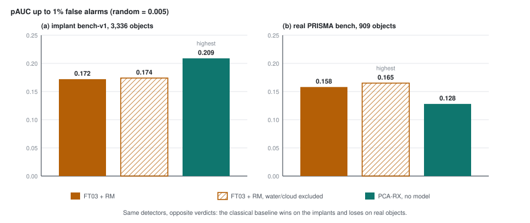

# Part 19 - Running an evaluation

> **The one thing this part teaches:** an evaluation in this repo is one JSON config - models,
> datasets, scorers, measures - run by one command that loops scene by scene, caches every score map
> and reports objects caught beside their chance level; and its first real run showed why every
> benchmark needs a model-free baseline in it: a classical detector came first on the implanted
> benchmark and clearly last on the real objects.

## Where we are

Parts 16 to 18 gave you the measures and the implanted-target benchmark. Until 2026-10-17 each was run
by its own script (`scripts/evaluate_prisma_bench.py`, `scripts/evaluate_implant_bench.py`, and code in
`app/utils/evaluation/`), and each read bands, reconstructed and counted slightly differently. On
2026-10-17 they were replaced by one subsystem (commit f6a444b). Parts 16 to 18 still name the old
files where they describe history; this part teaches the new ones.

| file | what it holds |
|---|---|
| `docs/lld/evaluation.md` | the design: interfaces, data flow, invariants, failure modes, the reference run |
| `app/evaluation/config.py` | `EvaluationConfig` and its four kinds of spec |
| `app/evaluation/datasets.py` | `PrismaBench`, `ImplantBench`, `EvalScene` |
| `app/evaluation/models.py` | `EvalModel`: reading, reconstruction, segmentation |
| `app/evaluation/scorers.py` | `score()`: every scorer kind |
| `app/evaluation/metrics.py` | part 16's measures, exact, plus the analytic chance level |
| `app/evaluation/runner.py`, `report.py` | the loop, the cache, the tables and `report.md` |
| `app/evaluation/implant.py` | part 18's implant core, moved here from `app/utils/evaluation/` |
| `scripts/evaluate.py` | the command |
| `configs/eval/stage3.json` | the reference config |
| `tests/test_evaluation/` | hand-worked tests: `test_metrics.py`, `test_runner.py`, `test_implant.py` |

> **Analogy.** A driving examiner builds a test course of cones. A go-kart, low and twitchy, weaves
> through it faster than a rally driver in a real car. On a real road the rally driver wins by a mile.
> Nothing was wrong with the stopwatch: the course rewarded what go-karts are good at. You only find
> that out if you put a go-kart on the course on purpose.

## Step 1 - the config

The command is

```bash
python scripts/evaluate.py configs/eval/stage3.json [--output <dir>]
```

and the config has five blocks (shortened from `configs/eval/stage3.json`):

```json
{"name": "stage3: ...",
 "models":   [{"name": "v0.2.0", "checkpoint": "C:/es/models/...epoch200.pt"},
              {"name": "FT03_ep10", "checkpoint": "s3://.../FT03-joint/checkpoints/best.pt"}, ...],
 "datasets": [{"kind": "prisma_bench", "path": "C:/Users/FITT/Documents/stage1_datasets"},
              {"kind": "implant", "path": "C:/es/implant/bench-v1"}],
 "scorers":  [{"kind": "residual_mahalanobis"}, {"kind": "combined"},
              {"kind": "exclude", "classes": ["water", "cloud"], "segmenter": "FT03_ep10",
               "fit_on_kept": false, "base": {"kind": "residual_mahalanobis"}}, ...,
              {"kind": "pca_rx"}],
 "metrics":  [{"kind": "roc_auc"}, {"kind": "pauc", "max_fpr": 0.01}, {"kind": "tpr_at", "fpr": 0.001},
              {"kind": "objects_caught", "top_pct": [1.0, 0.1]}],
 "group_by": ["tier", "source", "sensor"],
 "output":   "C:/es/eval/stage3"}
```

Four things in it are new to you.

**A model's reading.** Each model reads a scene its own way (`reading`, default `auto`, in
`models.py`): the wavelength-reading models read the scene's own bands, keeping those their
trained-wavelength record covers; the shipped v0.2.0 reads the 165-band common grid of part 7. For
PRISMA scenes a non-native reading reloads the scene through the product's band-filter path, so it is
exact; implant hosts are linearly resampled, "close to, not identical with" the product (the
docstring's words).

**Two new scorers.** `exclude` takes any base scorer, runs it, then sets chosen classes to 0, using a
segmentation head to find them (FT03's, here). `pca_rx` is the classical baseline: residual
Mahalanobis (part 12) handed a reconstruction of all zeros, so the "residual" is the cube itself:

```python
# scorers.py
if spec.kind == "pca_rx":
    return residual_mahalanobis(cube, np.zeros_like(cube), valid, d=spec.d, local_window=spec.local_window)
```

That is part 9's local RX, run on the top 30 whitened principal components of the scene - no model,
no training. It is in the config on purpose, as the go-kart.

**Labels.** Each scorer gets a name from its settings, which becomes its column in the report and
part of its cache key: `residual_mahalanobis(d=30,w=21x61)`, or
`exclude(water+cloud;mask)[residual_mahalanobis(d=30,w=21x61)]` - `mask` when `fit_on_kept` is false
(score the whole scene, zero the classes afterwards), `fit` when the base scorer's statistics are fitted
on the kept pixels only.

**Validation.** The config refuses to start if two models share a name, two scorers share a label, an
`exclude` lacks its classes or segmenter, or a segmenter is not one of the configured models
(`test_config_validation`).

## Step 2 - the loop

`runner.py` goes **scene first, then model**:

```
for each scene (one in memory):
  for each model:  reconstruct once -> run every model-based scorer -> free the reconstruction
  model-free scorers (pca_rx) once, on the scene's own cube
  class maps (for exclude) once per scene per segmenter
  each score map -> part 16's measures -> rows
```

Why that order: a reconstruction is as large as the cube. One PRISMA scene of about 1,000 x 1,000
pixels and 185 bands in 4-byte floats is

```
185 x 1,000 x 1,000 = 185,000,000 numbers
185,000,000 x 4 bytes = 740,000,000 bytes = about 0.74 GB
```

The old scripts held several reconstructions at once and ran out of memory (LLD, "Decisions"). Now
memory holds one scene and one reconstruction.

Count the work in the stage-3 config: 4 models, 4 model-based scorers (residual Mahalanobis,
combined, two exclusions), 1 model-free scorer; 4 PRISMA scenes plus 18 implant hosts.

```
score maps per scene:   4 models x 4 scorers + 1 = 17
scenes:                 4 + 18 = 22
score maps in all:      22 x 17 = 374
reconstructions:        22 x 4 = 88          (one per scene per model, never more)
```

`test_end_to_end_and_cache` pins the "never more": a stand-in model counts its calls, and after a run
with three model-based scorers it has been called once.

## Step 3 - the cache

Every score map is saved, as 16-bit floats, under `<output>/cache/scores/`. For the 1,000 x 1,000 scene
above that is `1,000,000 x 2 bytes = 2 MB` before compression, against 740 MB for the reconstruction
it came from - which is why score maps are cached and reconstructions are not. The test above runs the
evaluation a second time and checks that the model is not called again.

The key is: dataset kind and scene name, the model file's identity (path, size, modification time,
reading) and the scorer's full settings. Change any of them and that map is recomputed. Add a new
measure or a new `group_by` and **no model runs at all**: the measures are computed from cached maps.

**The trap.** The dataset's path and content are not in the key. Rebuild a benchmark in place, under
the same scene names, evaluate into the same output directory, and the old score maps are measured
against the new ground truth - with no error. The LLD lists this under failure modes; the fix is a new
path and output directory per benchmark version.

> **Update, 2026-10-18.** Fixed for score maps in commit 229d423, the same day this part was written:
> `EvalScene` gained a `fingerprint` (the PRISMA `.he5` file's size and modification time; an implant
> host's `cube.npy` and `gt.npy` sha256s from `manifest.json`), and `_score_path` hashes it into the key
> (`app/evaluation/runner.py`). Class maps for `exclude` are still keyed by scene name and segmenter only
> (`runner.py`, the `classes` cache path), so a host rebuilt in place keeps the class map computed on its
> old pixels. The implants change only a few hundred pixels per host, so the effect is small, but it is
> not zero.

## Step 4 - chance, per object

Part 16 gave the chance level of "objects caught": with random scores, an object whose pixels after the
1-pixel tolerance number `m` is caught at budget `q` with probability `1 - (1 - q)^m`. `metrics.py`
computes this for every object (`chance_hit`), and the report averages it.

```
one-pixel object, 4-neighbour dilation:  m = 1 + 4 = 5
  top 1%:    1 - 0.99^5  = 1 - 0.95099 = 0.0490
  top 0.1%:  1 - 0.999^5 = 1 - 0.99501 = 0.0050
two pixels side by side:  m = 2 + 6 = 8      (1 left, 1 right, 2 above, 2 below)
  top 1%:    0.99^8 = 0.9801 x 0.9801 x 0.9801 x 0.9801 = 0.92274   ->   1 - 0.92274 = 0.0773
```

Bigger objects have more chances, so the average depends on the size mix: **10.2%** at the top 1% on
the PRISMA bench, **10.0%** on bench-v1. Always read "caught" next to the chance row printed above it.

## Step 5 - reading `report.md`

`report.py` writes one section per dataset - **never pooled**, because their objects are different
populations (LLD, invariant 5). In each:

- a main table: one row per `model | scorer`, a `*chance*` row first; "caught top q%" is the share of
  all objects in that dataset; pixel measures (`pauc_0.01`, `roc_auc`, `tpr_at_0.001`) are means over
  scenes;
- one table per `group_by` attribute: caught at the **first** budget in the config (the top 1% here),
  with that group's pAUC in brackets;
- model `-` is the model-free scorer.

`roc_auc` is the product's sampled `compute_roc` (part 12), kept for continuity with every older table;
the others are exact. The run also writes `per_object.csv` (one row per object per score map: hit or
not, chance, tier, size), `per_scene.csv`, `summary.json` and `provenance.json` (commit, checkpoint
sha256s). One caution the LLD recorded: `provenance.json`'s `dirty` flag was always false, because
the git command ran from `app/evaluation/` with paths that did not exist there. **Update, 2026-10-18:**
fixed in commit 229d423 - the command now runs from the repository root (`runner.py`,
`_write_provenance`), and later runs record `"dirty": true` when they should.

## Step 6 - what stage 3 found: exclusion

The reference run's output is `C:/es/eval/stage3/` on the dev laptop; the numbers below are its
`report.md`, summarised in `research/experiments/implant-bench/README.md`.

First, **it reproduced every earlier number** - for example v0.2.0 on the PRISMA bench: pAUC 0.159,
ROC-AUC 0.854, 402 of 909 objects at the top 1%, exactly the old scripts' figures. A new evaluation
framework that disagrees with the old one tells you nothing until you know which is wrong.

Then the product rule (user, 2026-10-17): **"we don't detect anything on water and cloud."** FT03's
segmentation head marks them; `exclude` zeroes them. FT03, PRISMA bench:

| | caught top 1% | caught top 0.1% | pAUC to 1% | TPR at 0.1% | ROC-AUC |
|---|---|---|---|---|---|
| residual Mahalanobis | 45.4% | 14.3% | 0.158 | 0.058 | 0.853 |
| water and cloud excluded (mask) | 46.1% | 16.5% | 0.165 | 0.065 | 0.830 |

In objects, at the top 0.1%: `0.143 x 909 = 130` became `0.165 x 909 = 150` - 20 more objects in the
same review budget. Every model gains at the top 0.1% (v0.2.0 14.1% -> 15.3%, F001 13.2% -> 14.6%,
FT02c 14.4% -> 16.1%). Fitting the base scorer on the kept pixels only (`fit`) was no better than
zeroing afterwards (FT03: 15.7% at the top 0.1%).

**But ROC-AUC fell, 0.853 -> 0.830.** Most of that is one scene: on set1, which FT03 calls 55% water,
ROC-AUC went 0.932 -> 0.851. Two things happen when a large area is set to 0:

1. its background pixels all tie at the very bottom - harmless for the top of the list;
2. any labelled object inside it is scored 0 as well. 39 of the 909 objects (27 of them in set1) lie
   wholly inside FT03's water / cloud mask. Plain residual Mahalanobis caught 13 of them at the top 1%;
   exclusion catches 4 (their 1-pixel tolerance touches a kept pixel). Whether those 39 are boats,
   shoreline objects or FT03's mistakes had not been checked when this was written.

> **Update, 2026-10-17 (later).** They were checked, and the product rule changed: 13 of them are single
> pixels more than 3 px offshore (likely vessels), so vessels on water are in scope and **only cloud is
> excluded**. Part 21 teaches the check, the corrected claim that "no real object sits on water", and the
> cloud-only numbers (FT03 pAUC 0.158 -> 0.166, ROC-AUC 0.853 -> 0.850).

Work the mechanism in miniature. Two targets, A (land) and B (on water); four background pixels, one
of them a bright water glint. ROC-AUC is the share of (target, background) pairs in which the target
scores higher, a tie counting half (part 16):

```
before:  A 0.9, B 0.6;   background: glint 0.95 (water), 0.5, 0.2, 0.1 (water)
  A beats 0.5, 0.2, 0.1                          -> 3 of 4
  B beats 0.5, 0.2, 0.1                          -> 3 of 4
  AUC = (3 + 3) / 8 = 0.75;   top pixel = the glint: a false alarm

exclude water: glint -> 0, 0.1 -> 0, B -> 0
  A beats 0, 0.5, 0.2, 0                         -> 4 of 4
  B (0): loses to 0.5 and 0.2, ties the two 0s   -> 0 + 0 + 0.5 + 0.5 = 1
  AUC = (4 + 1) / 8 = 0.625;  top pixel = A: a hit
```

AUC fell and the top of the list got better: the same two directions as stage 3. **Exclusion is a
product decision about what the analyst is shown, not a better model**, and ROC-AUC, which counts the
whole list, is the wrong measure to judge it by.

## Step 7 - what stage 3 found: the go-kart

Now the warning. `pca_rx`, which has no model at all, against the best fine-tuned model:

| | implant: caught top 1% | implant: pAUC | real: pAUC | real: TPR at 0.1% | real: caught top 0.1% |
|---|---|---|---|---|---|
| FT03 + residual Mahalanobis | 26.9% | 0.172 | 0.158 | 0.058 | 14.3% |
| PCA-RX on the cube, no model | **30.2%** | **0.209** | 0.128 | 0.029 | 8.1% |



*Figure 19.1 - pAUC to 1% false alarms. On implant bench-v1 (a) the model-free PCA-RX (teal) is
highest; on the real PRISMA bench (b) it is lowest, and excluding water and cloud (hatched) helps the
model on both.*

On the implants PCA-RX catches `0.302 x 3,336 = 1,007` objects to FT03's `0.269 x 3,336 = 897`. On
the real objects it reaches half of FT03's detection rate at 0.1% false alarms (`0.029 / 0.058 = 0.5`)
and catches `0.081 x 909 = 74` objects at the top 0.1% to FT03's 130. If bench-v1 were your only
benchmark, you would conclude that the models add nothing a 1990s detector cannot do. The real objects
say the opposite.

**Why.** A diagnosis on the PRISMA hosts (`C:/es/implant/v2/diag.py`, on the dev laptop) measured, for
each object, its difference from its ring, `d = object mean - ring mean`, against the scene's top 10
principal directions - the ten directions in which the scene's own pixels vary most (part 8's
covariance, sorted). Its **foreign fraction** is the share of `|d|^2` (the squared length of `d`) that
lies outside those ten directions. Work the repo's test case (`test_foreignness_by_hand_and_matching`):

```
three bands; the scene's main direction is band 0 alone
d = (3, 4, 0)
|d|^2           = 3^2 + 4^2 + 0^2 = 9 + 16 = 25
inside part     = (3, 0, 0),  |.|^2 = 9
outside part    = (0, 4, 0),  |.|^2 = 16
foreign fraction = 16 / 25 = 0.64
```

The medians (dev-laptop `diag.json`, checked for this course): real objects **0.006**, bench-v1
implants **0.042** - seven times as foreign. Real objects are unusual *mixtures of the scene's own
materials*; bench-v1 implants carry a direction the scene never takes.

That is exactly what whitening rewards (part 8). Suppose the scene varies with a spread (standard
deviation) of 0.05 along a main direction and 0.002 along a minor one, and a pixel differs by 0.01
along each in turn:

```
along the main direction:   0.01 / 0.05  = 0.2 spreads,  squared 0.04
along the minor direction:  0.01 / 0.002 = 5 spreads,    squared 25
```

The same size of difference scores `25 / 0.04 = 625` times higher when it points where the scene does
not. PCA-RX needs nothing more to light up a foreign implant. A model earns its keep on real objects,
which do not point anywhere unusual, by having learnt what each place *should* look like from its
surroundings. bench-v1 does not test that.

The diagnosis found a second difference: real objects' contrast **bleeds into the pixels around them**
(the sensor blurs; light from neighbours mixes in). The 1-pixel halo around a real object has a median
contrast 0.74 times the object's own; around a bench-v1 implant, 0.60 - implants have harder edges.

So the benchmark is being rebuilt. **bench-v2 is in progress** (`docs/lld/implant-bench.md`,
"bench-v2"): each implant's contrast and foreign fraction are copied as a pair from one real object,
the difference spectrum's outside part is rescaled to match (`match_foreignness`), a third source
takes a material from elsewhere in the same scene, the footprint is blurred by a point-spread function
(`psf_weights`), and the bench is accepted only if its foreignness and halo medians fall within 25% of
the real objects', overall and per tier, **and** the models beat PCA-RX on it, as they do on real
objects. No v2 results existed when this part was written.

> **Update, 2026-10-17 (later).** bench-v2 was built and accepted: on 2,913 implants FT02c and FT03 beat
> PCA-RX (caught top 1% 32.8% / 32.3% against 30.2%). Part 20 teaches it, including three bugs found on
> the way and why the medians above (0.006, 0.74, measured on every band with a ring at distance 3-4)
> differ from bench-v2's (0.0071, 0.643, on the evaluator's bands and the bench's ring).

## Common confusions

**"PCA-RX won on the implants, so the models are no better than classical detection."**
It won on implants that were built in a way that suits it. On the 909 real objects it is clearly
last. The benchmark was wrong about real anomalies; the stopwatch was fine.

**"Exclusion lowered ROC-AUC, so it made detection worse."**
It moved 55% of set1 to a tie at 0 and lost 39 objects that sit inside the mask; the top of the list,
where the analyst looks, improved on every model. Judge it by pAUC, TPR at 0.1% and objects caught.

**"I added a measure and re-ran; the numbers can't be stale."**
When this part was written they could be, if you rebuilt a dataset in place. Since commit 229d423 the
score-map key includes the scene's file fingerprint; class maps still do not (Step 3, update).

**"`exclude` with `segmenter: FT03_ep10` only applies to FT03."**
It applies to every model in the config. The segmenter only supplies the class map.

**"The PRISMA bench and the implant bench are averaged in the summary."**
Never. Each dataset gets its own section and its own chance row.

## Check yourself

<details>
<summary>1. A config has 3 models, 3 model-based scorers and 1 model-free scorer, over 5 scenes. How many score maps and how many reconstructions does a first run make? And a second run after adding one measure?</summary>

```
score maps per scene: 3 x 3 + 1 = 10;  5 scenes -> 50
reconstructions: 5 x 3 = 15
second run: 0 score maps computed, 0 reconstructions - all 50 maps come from the cache
```
</details>

<details>
<summary>2. An object of three pixels in a row. What is m after the 4-neighbour dilation, and its chance of being caught at the top 1%?</summary>

```
neighbours: 1 left, 1 right, 3 above, 3 below = 8;   m = 3 + 8 = 11
0.99^11 = 0.99^8 x 0.99^3 = 0.92274 x 0.97030 = 0.89534
chance  = 1 - 0.89534 = 0.1047, about 10.5%
```
</details>

<details>
<summary>3. A difference d = (1, 2, 2) in a three-band scene whose main direction is band 0. What is its foreign fraction? Is it more like a real object or a bench-v1 implant?</summary>

```
|d|^2 = 1 + 4 + 4 = 9;   inside (band 0) = 1;   outside = 8
foreign fraction = 8 / 9 = 0.89
```

Far more foreign than either median (0.006 real, 0.042 bench-v1): a difference almost wholly in a
direction the scene never takes - PCA-RX's ideal target.
</details>

<details>
<summary>4. In Step 6's miniature, suppose B had been on land (not excluded) at 0.6. What are the AUC and the top pixel after excluding water?</summary>

```
after: glint 0, 0.1 -> 0; A 0.9, B 0.6
A beats 0, 0.5, 0.2, 0 -> 4;   B beats 0, 0.5, 0.2, 0 -> 4
AUC = 8 / 8 = 1.0;  top pixel A
```

With no target inside the mask, exclusion can only help: the fall in stage 3 comes from targets
inside it.
</details>

<details>
<summary>5. Why is a model-free baseline in the stage-3 config, and what would you conclude if it beat the models on bench-v2 too?</summary>

It tests whether a benchmark rewards what a model adds over the cube's own statistics. If it won on
bench-v2 while still losing on the real objects, bench-v2 would have failed its acceptance and must
not be used to train or rank models; if it won on both, the models really would be no better on that
kind of object.
</details>

Next: [part 20](20-bench-v2.md) - bench-v2, the implant benchmark rebuilt to look like the real objects, and the test that let it be trusted.
