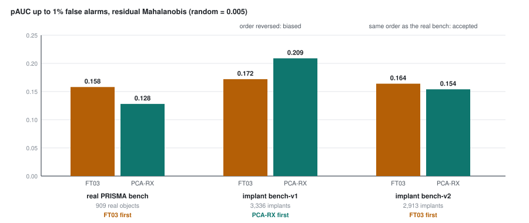

# Part 20 - bench-v2: a benchmark you can trust

> **The one thing this part teaches:** a benchmark of synthetic objects is only trustworthy once it
> reproduces something the real labels already told you - here, that the fine-tuned models beat a
> model-free PCA-RX - and bench-v2 got there by copying three measured properties of the real objects
> (contrast, foreignness, halo) and by solving for them on the object as it really ends up, not on the
> signal that was added.

> **Correction, 2026-10-18.** Two of this part's readings rested on a bug (part 22): the v0.2.0 row of
> Step 6 and the PRISMA-host climb "16.5% (v0.2.0) -> 35.2% (F001)" in Step 7 are a reading artefact, and
> every `signature` implant (a third of bench-v2) was garbled. Step 7's first explanation, the reading
> artefact, was right. bench-v2 has been rebuilt as **bench-v2.1** (fixed signatures, `--foreign-tol 1.2`):
> there v0.2.0 ties the fine-tuned models (35.5% against FT03's 34.9%), all models stay above PCA-RX at
> the top 0.1%, and "pretraining alone does not beat PCA-RX" softens to a tie at the top 1% (F001 33.1%
> against 33.2%). The method taught here - copied properties, the realised solve, the ordering test -
> stands.

## Where we are

Part 19 ended with a warning. On bench-v1 the model-free PCA-RX beat every model; on the 909 real
objects it came clearly last. bench-v1's implants pointed in spectral directions the scene never takes
(foreign fraction 0.042 against 0.006 for real objects) and had hard edges. A rebuild was planned.

On 2026-10-17 it was built and **accepted**. This part teaches what changed, the three bugs found on the
way, the two acceptance tests, and what bench-v2 still does not explain.

| file | what it holds |
|---|---|
| `research/experiments/implant-bench/README.md` | "bench-v2 (2026-10-17) - accepted": the build, both acceptance tests, the results |
| `docs/lld/implant-bench.md` | the design, section "bench-v2" |
| `app/evaluation/implant.py` | `background_subspace`, `foreign_fraction`, `match_foreignness`, `psf_weights`, `solve_realised`, `evaluation_bands` |
| `scripts/build_implant_bench.py` | `real` (now also measures foreignness and halo), `build --version 2 --psf-sigma 1.4` |
| `configs/eval/bench_v2.json` | the acceptance evaluation; output `C:/es/eval/v2/` on the dev laptop |

> **Analogy.** A school writes a new mock exam. Before using it to stream this year's pupils, it gives
> the mock to last year's pupils, whose real exam results it already knows. If the mock ranks them in
> roughly the order the real exam did, it is trusted. If the pupil who failed the real exam tops the
> mock, the mock is testing something else - however carefully its questions were written.

## Step 1 - three properties to copy

Every property starts from `d = o - r`: the object's mean spectrum minus its ring's mean (the ring is
part 18's 20-pixel diamond at distance 2 to 3).

1. **Contrast z** (part 18): how far the object stands from its ring, in ring standard deviations.
2. **Foreign fraction** (part 19): the share of `|d|^2` lying outside the scene's 10 main spectral
   directions (`FOREIGN_K = 10`).
3. **Halo ratio** - new here. The **halo** is the ring of pixels touching the object (distance 1). Its
   ratio is the halo's contrast z over the object's:

```
object z = 1.20,   halo z = 0.78
halo ratio = 0.78 / 1.20 = 0.65
```

A halo ratio of 0 means a hard edge: the neighbours look like the ring. A ratio near 1 means the object
bleeds fully into its neighbours. Real sensors blur - each pixel collects some light from next door - so
real objects have halos.

`build_implant_bench.py real` now records all three for each of the 909 real objects in `real_v2.json`
(fields `z`, `foreign`, `halo`). Medians, recomputed from that file for this part:

| | all 909 | subtle | medium | easy |
|---|---|---|---|---|
| foreign fraction | 0.0071 | 0.0238 | 0.0065 | 0.0024 |
| halo ratio | 0.643 | 0.719 | 0.655 | 0.588 |

Read the foreign row across: **subtle real objects are ten times as foreign as easy ones**
(`0.0238 / 0.0024 = 9.9`). Contrast and foreignness are related. Drawing them independently would
create objects that do not exist - an easy object as foreign as a subtle one.

So bench-v2 draws them **as a pair, from one real object** of the chosen tier: `pick["z"]` and
`pick["foreign"]` come from the same record (`implant_tile`, and `place_and_implant` in the script).

These medians differ from part 19's (0.006 foreign, 0.74 halo). Part 19's came from a diagnosis script
that used every band and a ring at distance 3 to 4; `real_v2.json` measures on the bands the evaluator
reads and on the bench's own ring. Same idea, different ruler - compare numbers only within one ruler.

## Step 2 - hitting a foreignness: `match_foreignness`

Given a difference spectrum `d0` (from a real signature, a library material, or another pixel of the
same scene), keep its inside part and rescale its outside part by `beta`:

```
d' = d_in + beta x d_out,    beta^2 = target / (1 - target) x |d_in|^2 / |d_out|^2
```

Work one by hand. Three bands, the scene's main direction is band 0, `d0 = (4, 0, 2)`, target 0.2:

```
inside part  (4, 0, 0):   |d_in|^2  = 16
outside part (0, 0, 2):   |d_out|^2 = 4
beta^2 = (0.2 / 0.8) x (16 / 4) = 0.25 x 4 = 1.0
beta   = 1.0
d'     = (4, 0, 2)            - already at the target
check: outside 4, total 16 + 4 = 20, 4 / 20 = 0.2
```

Halve the target to 0.1 and `beta^2 = (0.1 / 0.9) x 4 = 0.444`, `beta = 0.667`, `d' = (4, 0, 1.333)`:
outside `1.778`, total `17.778`, share `0.1`. The function does nothing else.

## Step 3 - the blur: `psf_weights`

bench-v1 added the signal to the object's pixels and nowhere else. bench-v2 adds it through a blurred
footprint: the object mask is smoothed by a Gaussian of standard deviation `sigma` pixels (a **point-spread
function**, PSF - the shape a single bright point takes in the image), then divided by the object's own
mean weight, so the object keeps weight 1 on average and its neighbours get the tail.

For a one-pixel object at the build's `sigma = 1.4`, a pixel at distance `(dy, dx)` gets
`exp(-(dy^2 + dx^2) / (2 x 1.4^2))`, and `2 x 1.4^2 = 3.92`:

```
halo pixel (1, 0):    exp(-1 / 3.92) = exp(-0.2551) = 0.7748
```

Running `psf_weights` on a 15 x 15 grid gives exactly that, and a mean ring weight of **0.3240** over the
20 ring pixels. So the ring is pushed up too, by about a third of the implant, and the object's contrast
against it is only `1 - 0.3240 = 0.676` of the signal. The builder passes this `shrink` into the strength
solve.

On a perfectly flat background the halo ratio would then be

```
(0.7748 - 0.3240) / (1 - 0.3240) = 0.4508 / 0.6760 = 0.667
```

close to the real 0.643. sigma 1.4 was chosen by calibration builds (`--psf-sigma`), not from this
formula: real halos also carry the background's own variation.

## Step 4 - three bugs, and what each one teaches

The first calibration build missed. Three causes were found (README, "Acceptance 1"):

**Bug 1 - measured on the wrong bands.** Foreignness and contrast were computed over every host band,
including the noisy water-absorption and detector-edge bands, which the evaluator never reads. Those
bands swamped both numbers. Now `evaluation_bands` picks the bands the evaluator reads: the product's
exclusion ranges removed, and only bands at least 60% finite over valid pixels. **Measure a benchmark
with the same ruler as the thing that will be graded on it.**

**Bug 2 - one gap deleted a band.** `background_subspace` centres the pixels by subtracting each band's
mean. With a plain mean, one missing value makes the whole band's mean missing:

```
band values:   0.20, NaN, 0.40
plain mean:    (0.20 + NaN + 0.40) / 3 = NaN      -> every centred value NaN -> band dropped
nanmean:       (0.20 + 0.40) / 2 = 0.30           -> centred: -0.10, gap, +0.10
gap set to 0 after centring = "the band mean"     -> -0.10, 0, +0.10
```

130 to 182 of the 234 PRISMA host bands had at least one gap (the docstring's count), so most of the
spectrum was silently missing from the subspace. The fix is the `nanmean` and the `centred[~finite] = 0`
line you can read in `background_subspace`.

**Bug 3 - solved on the signal, not on the object.** The first version matched the foreignness of the
*added* signal `d'`. But the implanted spot was never identical to its ring before anything was added.
Its own natural offset `o0 - r` is already there, and it is already foreign: random un-implanted spots
measured 0.009 to 0.045 (README; `C:/es/implant/v2/natural.py` on the dev laptop). The object the
evaluator sees has

```
realised difference = (o0 - r)  +  s x shrink x d'
```

Work it with two bands, scene direction band 0:

```
natural offset (o0 - r) = (0.00, 0.01)          wholly outside
signal s x shrink x d'  = (0.05, 0.00)          wholly inside: foreignness 0
realised = (0.05, 0.01)
|.|^2 = 0.0025 + 0.0001 = 0.0026;   outside 0.0001
realised foreignness = 0.0001 / 0.0026 = 0.038
```

The signal was perfectly unforeign; the object is not. Matching the signal alone overshot the real
median about 7 times (README). `solve_realised` fixes it by trying a ladder of signal foreignness levels
(`FOREIGN_LADDER`, 0 to 0.5), solving the strength for the target z at each, measuring the realised
object's foreignness, and keeping the level closest to the target (on a log scale). A spot whose own
offset is so foreign that no level comes within a factor 1.5 (`tol`) of the target is rejected and
another spot is tried.

A fourth change was speed, not correctness. `background_subspace` used to take an SVD of up to 100,000
pixels; since commit 558ff5e it takes the eigenvectors of the bands-by-bands covariance instead, which
span the same subspace: 0.25 s to about 0.02 s per 128-pixel tile. That mattered once the same code ran
inside training (Indradhanu course, part 58).

## Step 5 - acceptance 1: does it look like the real objects?

The test, written before the build: foreignness and halo medians within 25% of the real objects',
overall and in every tier. The README records the calibration build on 2 PRISMA hosts:

| median | real | bench-v2 (calibration build) |
|---|---|---|
| foreign fraction | 0.0071 | 0.0081 |
| halo ratio | 0.643 | 0.642 |
| contrast z | 0.69 | 0.74 |

"Every tier within 0.90-1.15x (limit 25%)" - passed.

**A disagreement you should know about.** That calibration build (`C:/es/implant/cal_v2`) is no longer
on disk. The accepted bench at `C:/es/implant/bench-v2` records each object's realised `foreign` and
`halo` in its `objects.json`. Recomputed from those files on the same two PRISMA hosts, for this part:

| ratio to real | subtle | medium | easy | all |
|---|---|---|---|---|
| foreign fraction | 1.19 | **1.40** | **1.27** | 1.27 (0.0090 / 0.0071) |
| halo ratio | 0.95 | 0.94 | 1.09 | 0.99 |

The halo holds everywhere. Foreignness in the accepted files sits above the 1.25 limit in two tiers.
The difference is presumably a different random draw (the final build placed EnMAP hosts first, so the
PRISMA hosts got different objects) or a code change between the two builds; neither has been checked.
The files are the source; the README's per-tier figure is about a build that no longer exists. Treat
acceptance 1 as **met for the halo, marginal for foreignness**.

## Step 6 - acceptance 2: does it reproduce the real ordering?

This is the mock-exam test. The real bench says FT03 beats PCA-RX (pAUC 0.158 against 0.128; part 19).
bench-v2 is only allowed to judge models if it says the same. `configs/eval/bench_v2.json`, 18 hosts,
2,913 objects, residual Mahalanobis (README; `C:/es/eval/v2/report.md`):

| | caught top 1% | top 0.1% | pAUC to 1% | easy | medium | subtle |
|---|---|---|---|---|---|---|
| *chance* | 10.1% | 1.1% | 0.005 | | | |
| v0.2.0 - void, reading bug (part 22) | 22.1% | 8.6% | 0.118 | 38.3% | 15.2% | 10.9% |
| F001 ep109 | 29.2% | 10.2% | 0.145 | 48.5% | 23.1% | 13.1% |
| FT02c ep10 | **32.8%** | **11.4%** | **0.166** | 52.9% | 27.6% | 14.7% |
| FT03 ep10 | 32.3% | 11.4% | 0.164 | 52.7% | 26.9% | 14.2% |
| PCA-RX (no model) | 30.2% | 9.1% | 0.154 | 47.7% | 24.9% | 15.2% |



*Figure 20.1 - pAUC to 1% false alarms for FT03 (amber) and PCA-RX (teal) on three benchmarks. The real
PRISMA bench puts FT03 first; bench-v1 reversed that order; bench-v2 restores it.*

Met: both fine-tuned models are above PCA-RX on every headline measure (subtle is a tie). In objects:

```
FT03:    0.323 x 2,913 = 940.9   about 941 objects at the top 1%
PCA-RX:  0.302 x 2,913 = 879.7   about 880
```

Two new readings that bench-v1 could not give:

- **Pretraining alone does not beat PCA-RX here** (F001 29.2%); fine-tuning on the real sensors does.
- **Subtle is no longer at chance**: 13-15% against 10.1%. bench-v1's subtle tier sat at chance for
  every model (part 18).

**Why the ordering test is the one that matters.** Acceptance 1 checks that the implants *look* right on
the properties somebody thought to measure. Acceptance 2 checks that the benchmark *behaves* right, on a
fact nobody built into it. bench-v1 would have passed a looser version of test 1 - its sizes and contrasts
matched - and still ranked a 1990s detector first. A benchmark is a model of reality; you test a model
on something you already know before you use it to learn something you do not.

## Step 7 - what bench-v2 still does not explain

**EnMAP hosts are flat.** About 16% caught at the top 1% for every model and for PCA-RX (v0.2.0 16.1%,
FT03 15.7%, PCA-RX 14.2%), while PRISMA hosts went 16.5% (v0.2.0) -> 35.2% (F001) -> 40.2% (FT02c). The
same was true on bench-v1. Unexplained.

**v0.2.0 breaks the ordering.** On the real bench the shipped v0.2.0 nearly ties FT03 (caught top 1%
44.2% against 45.4%, pAUC 0.159 against 0.158; `C:/es/eval/stage3/report.md`). On bench-v2 it is far
behind (22.1% against 32.3%). Two explanations have been raised:

- *A reading artefact.* v0.2.0 reads the 165-band grid. On the real PRISMA scenes the evaluator reloads
  through the product's band filter; implant hosts get a generic linear resample instead (part 19). One
  account says a check found the two readings give identical numbers. The only saved check on the dev
  laptop says otherwise: `C:/es/eval/resample_check/report.md` (2026-10-17 15:44) scored v0.2.0 on the
  real bench through the generic resample and got caught top 1% **15.8%**, pAUC 0.094 - against 44.2% and
  0.159 through the product path. If that run is right, the generic resample is what sinks v0.2.0 on the
  implant hosts. The disagreement is unresolved; until it is, do not read v0.2.0's implant numbers as a
  verdict on the model. **Resolved 2026-10-18: it was the resample**, a descending band list fed to
  `np.interp` unsorted. Part 22 works it through.
- *Training overlap.* v0.2.0 may have trained on scenes from the bench sites, which would flatter it on
  the real bench only. Unverified.

**No implant sits on water.** `place_and_implant` still excludes water and cloud from placement
(`eligible = ... & ~water & ~cloud`). Since 2026-10-17 vessels on water are in scope (part 21), so
bench-v2 cannot yet tell you how a model does on them.

**v2 replaces v1** as the implant benchmark. v1 stays reproducible with `--version 1 --seed 0`.

## Common confusions

**"bench-v2 passed, so its numbers are what the product will achieve."**
It passed a ranking test. Its absolute numbers are still its own: real objects are caught at 45% at the
top 1%, bench-v2's at 32%.

**"Foreignness of the added signal is the object's foreignness."**
Only on a spot identical to its ring. Every real spot has its own offset, already 0.009-0.045 foreign;
the evaluator sees the sum. That was bug 3.

**"The halo ratio and the PSF are the same number."**
The PSF sets the blur; the halo ratio is measured afterwards on the realised object, against a real,
textured background. sigma 1.4 gives 0.667 on a flat background and about 0.64 in practice.

**"PCA-RX losing on bench-v2 proves the models are better."**
The real bench proved that. bench-v2 losing PCA-RX is what earns bench-v2 the right to rank models.

**"0.0071 and part 19's 0.006 are the same measurement, one rounded."**
Different bands and a different ring. Compare within one ruler.

## Check yourself

<details>
<summary>1. An object has z 0.90 and its halo has z 0.54. What is its halo ratio, and is it nearer a real object's median or a bench-v1 implant's hard edge?</summary>

```
0.54 / 0.90 = 0.60
```

Close to the real median on `real_v2.json`'s ruler (0.643); a hard-edged implant would be near 0 on a
flat background.
</details>

<details>
<summary>2. By hand: a spot's natural offset is (0.00, 0.02); the added signal is (0.06, 0.00); band 0 is the scene's main direction. What is the realised foreignness? What did the signal alone have?</summary>

```
realised = (0.06, 0.02)
|.|^2 = 0.0036 + 0.0004 = 0.0040;   outside 0.0004
foreignness = 0.0004 / 0.0040 = 0.10
signal alone: (0.06, 0) -> 0 outside -> 0.0
```

Matching the signal would have reported 0 while the evaluator sees 0.10 - fourteen times the real
median of 0.0071.
</details>

<details>
<summary>3. Using match_foreignness, d0 = (3, 0, 3), main direction band 0, target 0.1. What are beta and d'?</summary>

```
inside 9, outside 9
beta^2 = (0.1 / 0.9) x (9 / 9) = 0.1111;  beta = 0.3333
d' = (3, 0, 1)
check: outside 1, total 10, 1 / 10 = 0.1
```
</details>

<details>
<summary>4. Is the accepted bench's medium-tier foreignness (1.40x real) inside the acceptance band? What would the band be in absolute numbers?</summary>

```
real medium 0.0065
band: 0.0065 x 0.75 = 0.0049  to  0.0065 x 1.25 = 0.0081
accepted bench medium: 0.0091 -> outside
```

The README's calibration build was inside it; the files that were evaluated are not.
</details>

<details>
<summary>5. Why is "models beat PCA-RX" a better acceptance test than a tighter match on foreignness?</summary>

A tighter match only checks the properties someone chose to copy. The ordering test checks behaviour on a
fact the builder did not put in - what the real objects say about real detectors. bench-v1 matched size
and contrast and still got the order backwards.
</details>

Next: [part 21](21-scope-and-masks.md) - what the product will not look at, and what each mask costs.
