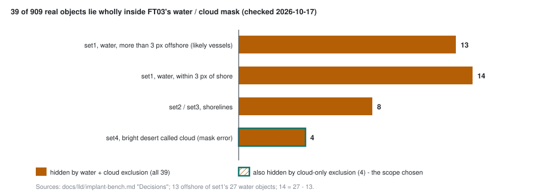

# Part 21 - Scope: what the product will not look at, and what a mask costs

> **The one thing this part teaches:** excluding a surface class is a decision about scope, and it has
> a price you can count - every labelled object inside the mask becomes unfindable, and every pixel the
> mask gets wrong is thrown away - so decide the scope first (cloud out, water in, because vessels
> matter), then count the objects it costs and audit the mask before it ships.

## Where we are

Part 19 introduced `exclude`: score a scene, then set chosen classes to 0 using a segmentation head's
class map. The first rule (user, 2026-10-17) was **"we don't detect anything on water and cloud."** Later
that day it changed: **vessels on water are in scope**, so only cloud is excluded. This part explains why
that reversal was right, what each choice costs on the real bench, and why exclusion is still not in the
product.

| file | what it holds |
|---|---|
| `C:/es/eval/cloud_only/report.md` (dev laptop) | FT03: plain, cloud-only and water + cloud exclusion on both benches |
| `C:/es/eval/cloud_only/per_scene.csv`, `per_object.csv` | the same, per scene and per object |
| `docs/lld/implant-bench.md` | "Decisions": the 39 real objects inside FT03's mask, checked |
| `docs/lld/evaluation.md` | invariant 7: excluded pixels stay in the measures |
| `research/experiments/indradhanu-finetune/README.md` | the log: the scope call and the proposed mask fine-tune (FT04) |

> **Analogy.** A security guard is told to ignore the car park, because the car park is full of
> harmless reflections. That makes her shift quieter. But the day somebody breaks into a car, nobody
> sees it - the instruction did not make the car park safe, it made it invisible. And if her map of the
> car park is drawn too large, she also ignores half the loading bay.

## Step 1 - a mask is a scope decision

`exclude` does not make a model better at anything. It changes what the analyst is shown. Invariant 7 of
the evaluation LLD spells out the bookkeeping: excluded pixels stay in the measures as negatives tied at
0, and any labelled object inside them stays a positive that can no longer be found - "the product would
not flag it either".

So the question "should we exclude water?" is not a modelling question. It is: **are objects on water
something the product is meant to find?** For vessels, the answer is yes.

## Step 2 - the claim that was wrong

Before the decision, the record said "no real object sits on water". It came from a first scan of the
real objects that called a pixel water when its visible reflectance (`VIS`, the mean over roughly
450-650 nm) was below 0.04. Clear open water is that dark. Turbid coastal water - silt, shallow bottom -
is not: around 0.08 (LLD, "Decisions").

Work one pixel. Visible 0.08, red 0.06, near-infrared (NIR) 0.03:

```
scan's rule:        VIS < 0.04 ?            0.08 < 0.04  -> no  -> "land"
NDVI = (NIR - red) / (NIR + red) = (0.03 - 0.06) / (0.03 + 0.06) = -0.03 / 0.09 = -0.33
builder's rule:     NIR < 0.08 and NDVI < 0 ?   yes and yes  -> water
```

Water is dark in the near-infrared even when it is bright in the visible, and plants do the opposite;
that is why the bench builder's rule (part 18) uses NIR and NDVI. The scan used the wrong band.

Re-checked on 2026-10-17 against FT03's water / cloud mask, **39 of the 909 real objects lie wholly
inside it**:

| where | objects | what they are |
|---|---|---|
| set1, on water, more than 3 px offshore | 13 | single pixels, NIR median 0.040 for set1's 27 - likely vessels |
| set1, on water, within 3 px of shore | 14 | single pixels near the coast |
| set2 and set3, shorelines | 8 | objects on the land-water edge |
| set4, bright desert that FT03 calls cloud | 4 | **a mask error** - FT03 calls 11% of set4 cloud |



*Figure 21.1 - The 39 labelled objects lying wholly inside FT03's water / cloud mask, by kind. Excluding
water and cloud hides all 39 (amber); excluding cloud only hides the 4 that the mask wrongly calls cloud.*

Any part of this course or the Indradhanu course written before this check that says no real object
sits on water is wrong; the dated notes in those parts point here.

## Step 3 - what each choice buys, on the real bench

FT03, residual Mahalanobis, PRISMA bench (`cloud_only/report.md`):

| | caught top 1% | caught top 0.1% | pAUC to 1% | TPR at 0.1% | ROC-AUC |
|---|---|---|---|---|---|
| plain | 45.4% | 14.3% | 0.158 | 0.058 | 0.853 |
| **cloud excluded** | 46.1% | 15.8% | **0.166** | 0.064 | **0.850** |
| water + cloud excluded | 46.1% | 16.5% | 0.165 | 0.065 | 0.830 |

Count it in objects at the top 0.1%, scene by scene, from `per_object.csv`:

```
              set1   set2   set3   set4    total
plain           56     33      7     34     130      130 / 909 = 14.3%
cloud only      56     33     13     42     144      144 / 909 = 15.8%
water + cloud   59     34     14     43     150      150 / 909 = 16.5%
```

Cloud exclusion buys 14 objects (set3 +6, set4 +8) and costs almost no ROC-AUC (0.853 -> 0.850). On set1
it changes nothing at all - every set1 number is identical to plain - so FT03's mask marks no cloud
there, or none that touches the ranking.

Adding water buys 6 more at the top 0.1%, but at the top 1% it buys none: set2 gains 4, set1 loses 3,
set3 loses 1. And it takes ROC-AUC from 0.850 to 0.830, nearly all on set1 (0.932 -> 0.851), where FT03
calls 55% of the scene water. **Water exclusion trades the vessels for a slightly tidier top of the
list.** With vessels in scope, that is a bad trade, and pAUC - the measure the analyst's view tracks -
is no better for it (0.165 against 0.166).

On bench-v2 cloud exclusion lifts FT03 from 32.3% to 33.4% caught at the top 1% (pAUC 0.164 -> 0.169),
most of it on EnMAP hosts (15.7% -> 18.6%). bench-v2 places no implant on water (part 20), so it cannot
show the vessel cost at all - one more reason the real bench decides.

## Step 4 - what a mask error costs

Cloud-only exclusion still hides the 4 set4 objects that sit on bright desert. That is not a scope
choice; it is the mask being wrong. FT03's head was trained only on EnMAP's provider labels (Indradhanu
course, parts 47 and 48), and bright bare ground looks like cloud in the visible: bright and flat.

Count what an error of that size means. If a mask wrongly covers 11% of a scene, then

```
share of the scene the analyst can no longer see:   11%
real objects there on set4 (from the check above):   4 of 230 = 1.7%
```

Small on this scene. But a desert scene full of targets would lose them in proportion, silently - the
score is 0, not "unknown". That is why the log proposes a mask fine-tune (FT04, the proposal's stage 4)
before exclusion is wired into `backend/`. Today the product excludes water and cloud only through the
optional threshold-based `keep_mask` from the `scene_segmentation` or `cloud_mask` actions (evaluation
LLD, "Decisions"); FT03's head is not used there.

## Step 5 - the order of questions

When someone proposes excluding a class, ask in this order:

1. **Scope.** Is anything we must find ever on that class? (Vessels: yes, so water stays.)
2. **Price.** How many labelled objects are inside the mask? Count them by hand on the real bench, as
   in Step 2. A metric that falls without telling you why is not enough.
3. **Mask quality.** Where does the mask fire wrongly? (Bright desert as cloud.)
4. **Measure.** Judge the result on the top of the list - pAUC, TPR at 0.1%, objects caught - and
   report ROC-AUC beside it, knowing that ties at 0 lower it by construction (part 19).

## Common confusions

**"Exclusion improved pAUC, so the model got better."**
The model is unchanged. The same mask lifts v0.2.0 as much as FT03 (part 19). It is a change of scope.

**"Cloud-only lost the 39 objects too."**
No. By the LLD's breakdown 35 of the 39 sit inside FT03's *water* mask; cloud-only hides only the 4 on
desert that FT03 calls cloud.

**"The water claim was a small slip."**
It decided a product rule. The rule was reversed once the 39 objects were actually looked at. Check a
negative claim ("nothing is there") with the same care as a positive one.

**"bench-v2 shows water exclusion is harmless."**
bench-v2 has no implants on water, so it cannot show the cost. Only the real bench has vessels.

**"Exclusion is in the product now."**
Not yet. It runs in `app/evaluation/` only. FT04 (mask fine-tune) is proposed first.

## Check yourself

<details>
<summary>1. A pixel has VIS 0.07, red 0.05, NIR 0.02. What do the scan's rule and the builder's rule each call it?</summary>

```
scan: 0.07 < 0.04? no -> land
NDVI = (0.02 - 0.05) / (0.02 + 0.05) = -0.03 / 0.07 = -0.43
builder: NIR 0.02 < 0.08 and NDVI < 0 -> water
```
</details>

<details>
<summary>2. From the per-scene table, how many objects does water exclusion add on top of cloud exclusion at the top 0.1%, and what share of the 909 is that?</summary>

```
150 - 144 = 6
6 / 909 = 0.0066, about 0.7 percentage points (15.8% -> 16.5%)
```
</details>

<details>
<summary>3. At the top 1%, cloud-only and water + cloud both catch 46.1%. Show that from the scene counts: plain 101 / 103 / 48 / 161, cloud 101 / 103 / 54 / 161, water + cloud 98 / 107 / 53 / 161.</summary>

```
cloud:         101 + 103 + 54 + 161 = 419
water + cloud:  98 + 107 + 53 + 161 = 419
419 / 909 = 0.461
```

Same total, different objects: water exclusion swaps three set1 objects for four on set2.
</details>

<details>
<summary>4. Why can bench-v2 not settle the water question?</summary>

Its builder places objects only on land: water and cloud are removed from the eligible area. It holds no
vessel-like objects, so a scorer that hides water loses nothing there.
</details>

<details>
<summary>5. Put the four questions of Step 5 in order for a proposal to exclude snow.</summary>

Scope (is anything we must find ever on snow?), price (how many labelled objects lie in the snow mask),
mask quality (where does it call bright rock or cloud snow?), then measure at the top of the list with
ROC-AUC reported beside it. Note that FT03's snow class has never been measurable (one test tile).
</details>

---

## You have finished

You can now read the source. Where to go next:

- **`docs/01-orientation.md`** through **`docs/10-code-style.md`** - the reference docs
- **`docs/lld/`** - low-level designs for individual subsystems; for the last six parts,
  `docs/lld/evaluation.md` and `docs/lld/implant-bench.md`
- **`docs/09-known-issues.md`** - what is currently broken, and what to check before trusting
  a green test run

One habit worth keeping from this course: **when a comment and the code disagree, the code
wins**, and when a summary and the data disagree, the data wins. You met several such disagreements -
the regularisation default, the `MIN_VALID_FRACTION` comment and the discarded `units` field in parts 1
to 15; `compute_roc`'s threshold docstring in part 16; the LLD's old `strength_for_z` and "10 px apart" in
part 18; the cache key and `dirty` flag in part 19, both fixed since; bench-v2's per-tier foreignness and
the saved v0.2.0 reading check in part 20; and "no real object sits on water" in this part. There will be
more.
