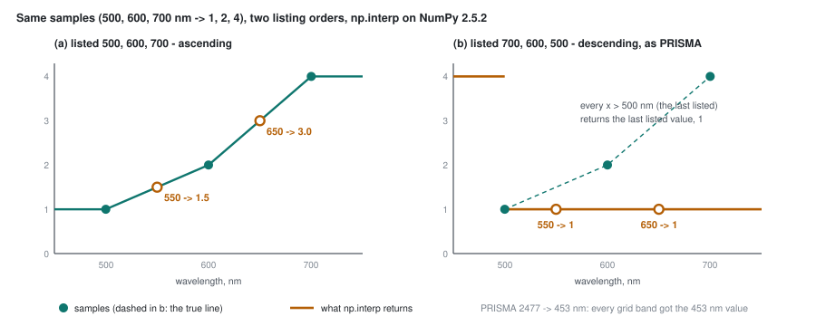

# Part 22 - How a sorting bug rewrote the scoreboard

> **The one thing this part teaches:** `np.interp` assumes its sample wavelengths go up and never
> checks; PRISMA lists its bands going down, so for the implant benchmark's whole life (2026-10-17 to
> 18) the evaluator turned every PRISMA cube it resampled into copies of one or two bands and flattened
> every transplanted signature - and the "pretraining is the big step" result built on it was the bug,
> found only when one model was read two ways on the same real scenes and the two readings compared.

## Where we are

Part 20 ended with an open question. On the real PRISMA bench the shipped v0.2.0 ties FT03 (pAUC 0.159
against 0.158). On bench-v2 it was far behind (22.1% caught against 32.3%). Part 20 listed two
explanations, "a reading artefact" and "training overlap", and left both open.

On 2026-10-18 the reading artefact was confirmed, found to be a two-line bug, and fixed (commit
b94dbfd). This part works the bug by hand, shows why nobody saw it, and shows what the scoreboard looks
like once it is fixed.

| file | what it holds |
|---|---|
| `app/evaluation/datasets.py` | `resample` - the evaluator's linear resample onto a fixed grid; sorts since b94dbfd |
| `app/evaluation/implant.py` | `interp_spectrum` - carries a real object's signature to a host's bands; new in b94dbfd |
| `tests/test_evaluation/test_implant.py` | `test_descending_band_lists` - the test that would have caught it |
| `app/utils/data_transformations/spectral_resampler.py` | the product's resampler, which always sorted (lines 70-71) |
| `C:/es/eval/resample_check/report.md`, `C:/es/eval/resample_check_fixed/report.md` (dev laptop) | v0.2.0 on the real bench through the generic resample, before and after the fix |
| `research/experiments/implant-bench/README.md` | "Corrections (2026-10-18)" and "bench-v2.1 (2026-10-18)" |

> **Analogy.** A bus timetable is printed with the last bus of the day at the top and the first at the
> bottom. A passenger who assumes the usual order checks one thing first: "is it later than the bottom
> row?" The bottom row is the 05:00 bus, so at 09:00, at noon and at 18:00 the answer is always yes -
> and she is told, every time, "you have missed the last bus". No single answer looks absurd. Only
> asking at several different times, and getting the same answer each time, gives it away.

## Step 1 - what `np.interp` promises

Linear interpolation estimates a value between two known samples by drawing a straight line between
them. `np.interp(x, xp, fp)` takes the query points `x`, the sample positions `xp` (here wavelengths)
and the sample values `fp` (here reflectances).

Work it by hand with the repo's own test numbers: samples at 500, 600 and 700 nm with values 1, 2 and
4. At 550 nm, halfway between 500 and 600:

```
fraction of the way = (550 - 500) / (600 - 500) = 50 / 100 = 0.5
value               = 1 + 0.5 x (2 - 1)        = 1 + 0.5     = 1.5
```

At 650 nm, halfway between 600 and 700:

```
fraction            = (650 - 600) / (700 - 600) = 0.5
value               = 2 + 0.5 x (4 - 2)         = 2 + 1.0     = 3.0
```

Now the promise. NumPy's own docstring for `np.interp` (version 2.5.2, the dev laptop's), section
"Warnings":

> "The x-coordinate sequence is expected to be increasing, but this is not explicitly enforced.
> However, if the sequence `xp` is non-increasing, interpolation results are meaningless."

Not an error. Not a warning at run time. Meaningless numbers, returned quietly.

## Step 2 - the same three samples, listed the other way round

Give `np.interp` the identical samples in descending order - `xp = (700, 600, 500)`, `fp = (4, 2, 1)`.
Same physics, same pairs. Here is what it returned on the dev laptop's NumPy 2.5.2, beside the correct
answer:

| query nm | correct | `np.interp` with descending `xp` |
|---|---|---|
| 450 | 1 (held at the edge) | 4 |
| 500 | 1 | 4 |
| 550 | 1.5 | **1** |
| 600 | 2 | **1** |
| 650 | 3.0 | **1** |
| 700 | 4 | **1** |
| 750 | 4 (held at the edge) | 1 |

Every query above 500 nm got 1. The pattern fits a function that first asks "is `x` beyond the last
sample?" - and the last sample in the list is 500 nm, the shortest wavelength. Anything longer than
that is "past the end", so it gets the last value. That is the bus timetable exactly.



*Figure 22.1 - The same three samples (500, 600, 700 nm; values 1, 2, 4). (a) Listed ascending,
`np.interp` draws the line and returns 1.5 at 550 nm and 3.0 at 650 nm. (b) Listed descending, it
returns the last listed value, 1, for every wavelength above 500 nm: the spectrum goes flat.*

## Step 3 - what that did to a PRISMA cube

PRISMA lists its bands from long to short within each detector. The 185 bands the PRISMA bench objects were measured on
(`C:/es/implant/real_v2.json`, field `wavelengths_nm`) start at **2477.05 nm** and end at **453.39 nm**.
The 165-band common grid of part 7 runs from 460 to 2450 nm. Every one of those 165 wavelengths is
longer than 453.39 nm, the last band listed.

The old `resample` built a weight matrix `M` (grid wavelengths x scene bands) by interpolating each
band's unit vector, then took `M x cube`:

```python
# before b94dbfd - app/evaluation/datasets.py
M = np.stack([np.interp(grid, wl, np.eye(len(wl))[i]) for i in range(len(wl))], 1)   # M: (G, C)
return np.einsum("gb,bhw->ghw", M, cube, optimize=True)                               # (C, H, W) -> (G, H, W)
```

Work one row by hand. Three scene bands listed 700, 600, 500 nm; one grid wavelength, 550 nm. The
correct row puts half the weight on the 600 nm band and half on the 500 nm band. The descending
lookup puts all of it on the last band listed:

```
bands as listed:          700    600    500
correct row for 550 nm:   0.0    0.5    0.5
unsorted row for 550 nm:  0.0    0.0    1.0

pixel reads:              4      2      1
correct value:            0 x 4 + 0.5 x 2 + 0.5 x 1 = 0 + 1.0 + 0.5 = 1.5
unsorted value:           0 x 4 + 0   x 2 + 1   x 1 = 1
```

Run the old line on the bench's 185-band list and the 165-band grid and every row of `M` has a single
weight of 1, on column 184 - the 453 nm band. **The model was handed 165 copies of the same blue
image.** It had no spectrum to reconstruct, only one band's spatial texture. That is what the real-bench
check of Step 6 measured.

The implant hosts were stranger still. A PRISMA host's `wavelengths.npy` (for example
`C:/es/implant/bench-v2.1/prisma/PRS_L2D_STD_20230311055340/`) is not one descending run but two: the
visible / near-infrared detector from 977 down to 407 nm, then the short-wave detector from 2497 down to
943 nm. The first listed is 977 nm and the last is 943 nm, so the same lookup gives

```
grid wavelength above 943 nm (the last listed)        -> the 943 nm band
grid wavelength at or below 943 nm, below 977 (first) -> the 977 nm band
```

Every grid band became a copy of one of two near-infrared images. Running the old line on that host
list confirms it: every row of `M` lands on the 977 nm or the 943 nm band, nowhere else.

Only fixed-grid models go through `resample`: the shipped v0.2.0 reads the 165-band grid; the
wavelength-reading models (F001 and every FT run) read the host's own bands directly and never touched
it. And only descending lists trip it: the EnMAP and AVIRIS-NG hosts were read correctly.

## Step 4 - what it did to the signature implants

A **signature** implant (part 18) takes a real object's difference spectrum, `d = o - r`, measured on
the 185 PRISMA bench bands, and carries it to the host's bands by interpolation. Before b94dbfd that
was a bare `np.interp(wl, rw, d)` - in the builder's `place_and_implant` and in `implant_tile` alike -
with `rw` the descending bench list.

Same mechanism. Every host band longer than 453.39 nm received **`d` at 453 nm**, one number; the few
host bands at or below 453 nm received `d` at 2477 nm. A signature with a real spectral shape arrived
as a flat step the height of its blue-band difference. bench-v2's later steps (`match_foreignness`, the
strength solve) then rescaled that step, so the garbled implants still hit their target contrast and
foreignness - but not the shape of any real object.

That hit **every signature implant in bench-v1 and bench-v2, for every model**, and half the implants
FT05 trained on (Indradhanu course, part 58). The fix is a three-line function that sorts the pairs
before interpolating:

```python
# app/evaluation/implant.py
def interp_spectrum(wl, src_wl, values):
    src_wl, values = np.asarray(src_wl, float), np.asarray(values, float)
    order = np.argsort(src_wl)                      # ascending, pairs kept together
    return np.interp(wl, src_wl[order], values[order])
```

`resample` got the same sort (`order = np.argsort(wl)`, then the weights written back into the
original band order with `M[:, order] = ...`). Sorting does not change the data: each wavelength keeps
its own value; only the order in which the pairs are listed changes.

## Step 5 - how it hid in plain sight

Five things kept it invisible for two days. Each is a habit worth breaking.

1. **No error.** `np.interp` returned numbers of the right shape and range. Nothing crashed, nothing
   was NaN.
2. **A warning that sounded like an excuse.** The resample's docstring says implant hosts are read
   "close to, not identical with" the product. A difference was expected - so a difference was not
   alarming.
3. **A story that fitted.** On bench-v1 the models lined up in training order with v0.2.0 at the
   bottom, and "pretraining helps" is what everyone expected. The Indradhanu course's part 56 even
   noted that the model and the band reading changed together between v0.2.0 and F001 - and read the
   step as the model's.
4. **A cross-check that was run and misread.** The README now says: "An earlier note here that the two
   readings were identical was a misread." The saved check said 15.8% against 44.2% (part 20 flagged the
   disagreement and left it open).
5. **The product already knew.** `spectral_resampler.py`, the product's resampler, starts with
   `# Sort source wavelengths ascending` (lines 70-71). The evaluator re-implemented a resample for
   speed and left the sort out. Every test of the new function used ascending lists, until
   `test_descending_band_lists` was added with the fix.

## Step 6 - the cross-check that found it

The real PRISMA bench can be read two ways for a fixed-grid model: through the product's
`band_filter_apply` path (what the evaluator does for PRISMA scenes), or through the generic `resample`
(what implant hosts get). If the evaluator is right, the two must agree on the same scenes. A one-off
script, `C:/es/eval/resample_check.py`, swaps the reader and scores v0.2.0:

| v0.2.0, real PRISMA bench | caught top 1% | caught top 0.1% | pAUC to 1% | ROC-AUC | TPR at 0.1% |
|---|---|---|---|---|---|
| product path (stage-3 run) | 44.2% | 14.1% | 0.159 | 0.854 | 0.058 |
| generic resample, before b94dbfd | 15.8% | 5.6% | 0.094 | 0.752 | 0.023 |
| generic resample, after b94dbfd | 44.2% | 14.1% | 0.159 | 0.854 | 0.058 |

After the fix the two paths give the same five numbers. In objects, the bug had cost v0.2.0

```
top 1%:    (0.442 - 0.158) x 909 = 0.284 x 909 = 258 objects
```

**When a benchmark has its own data path, run one model through both paths on data where both exist,
and treat any gap as a bug until it is explained.**

## Step 7 - the scoreboard, read correctly: bench-v2.1

bench-v2 was rebuilt with the fix as **bench-v2.1** (`--version 2 --psf-sigma 1.4 --foreign-tol 1.2
--seed 0`; `C:/es/implant/bench-v2.1`): 18 hosts, 2,817 objects (signature 985, material 927, host 905).
The tolerance was also tightened from 1.5 to 1.2, the candidate fix that part 20's foreignness caveat
pointed at. `configs/eval/bench_v2_1.json`, residual Mahalanobis (`C:/es/eval/v2.1/report.md`; FT04's
row from `C:/es/eval/ft04/report.md`):

| model | caught top 1% | top 0.1% | pAUC to 1% | TPR at 0.1% | EnMAP hosts | PRISMA hosts |
|---|---|---|---|---|---|---|
| *chance* | 10.5% | 1.1% | | | | |
| v0.2.0 (shipped, now read correctly) | **35.5%** | 12.6% | 0.168 | 0.082 | 21.6% | **42.2%** |
| F001 ep109 | 33.1% | 11.7% | 0.157 | 0.078 | 20.5% | 37.7% |
| FT02c ep10 | 35.1% | 12.8% | 0.169 | 0.086 | 20.7% | 40.3% |
| FT03 ep10 | 34.9% | 12.7% | 0.168 | 0.086 | 20.6% | 40.1% |
| FT04 ep10 | 35.1% | 12.7% | 0.169 | 0.083 | 20.3% | 40.4% |
| FT05 ep5 | 35.4% | 12.8% | 0.170 | 0.085 | 20.8% | 40.7% |
| PCA-RX (no model) | 33.2% | 9.8% | 0.154 | 0.069 | 19.8% | 37.7% |

Read it against the old boards:

```
v0.2.0, caught top 1%:   bench-v1 19.0%   bench-v2 22.1%   bench-v2.1 35.5%
FT03,   caught top 1%:   bench-v1 26.9%   bench-v2 32.3%   bench-v2.1 34.9%
```

v0.2.0 jumped 13.4 points; FT03 moved 2.6, the size of change a rebuilt bench brings anyway. **The
"pretraining is the big step" result (v0.2.0 19-22% -> F001 25-29%) was the reading bug.** Read
correctly, v0.2.0 ties or beats every new model on bench-v2.1, as it ties them on the real bench.

Is v0.2.0's 35.5% really ahead of FT03's 34.9%? Use the rough ruler from the Indradhanu course (part
59): treat each object as a coin caught with probability `p`:

```
p x (1 - p)      = 0.35 x 0.65 = 0.2275
0.2275 / 2,817   = 0.0000808
sqrt(0.0000808)  = 0.0090          about 0.9 points
gap              = 35.5 - 34.9 = 0.6 points = 0.7 standard errors -> a tie
```

Three more readings:

- **Every model stays above PCA-RX at the top 0.1%** (11.7-12.8% against 9.8%), as on the real bench.
  At the top 1% F001 and PCA-RX tie (33.1% against 33.2%).
- **EnMAP hosts sit near 21% for every model and for PCA-RX.** Still unexplained, as on v1 and v2.
- **Foreignness per tier is 1.05x / 1.15x / 1.60x real** (subtle / medium / easy, PRISMA hosts; halo
  0.92-1.06x). The easy tier is outside part 20's 25% limit, and the README explains why: the tighter
  tolerance rejects spots that cannot get within 1.2x of a *low* foreignness target, so the easy
  objects that survive skew high.

Work that selection effect in miniature (an illustration, not bench data). Four easy targets want
foreignness 0.001, 0.002, 0.004 and 0.008; the realised object can only get within 1.2x of the two
higher ones, so the two lower spots are skipped:

```
targets:           0.001  0.002  0.004  0.008     median (0.002 + 0.004) / 2 = 0.003
survivors:                       0.004  0.008     median (0.004 + 0.008) / 2 = 0.006
```

Nothing was implanted wrongly; the population that remains is not the one aimed at.

## Step 8 - the lesson for benchmark trust

Part 20's ordering test asked: does the benchmark reproduce something the real labels already told
you? It was applied to PCA-RX, and passed. It was not applied to v0.2.0 - and v0.2.0 failed it on
both bench-v1 and bench-v2 (a tie on real objects, far behind on implants). That failure was the bug
announcing itself.

So, before you trust a benchmark's ranking of models:

1. **Check every model's position against the real labels, not only the baseline's.** One model that
   the real bench and the benchmark disagree about is a flag on the benchmark's data path.
2. **Cross-check any re-implemented data path against the product's**, on data where both exist
   (Step 6).
3. **Test with real input orderings.** PRISMA's descending list is a property of real files; a test
   written with `[500, 600, 700]` cannot see it.
4. **Give a result you hoped for the scrutiny you would give one you feared.**

## Common confusions

**"The bug made every model's implant numbers wrong."**
Two different effects. The *reading* bug hit fixed-grid models (v0.2.0) on PRISMA hosts only. The
*signature* bug garbled one third (bench-v2) or one half (bench-v1) of the implants for every model
alike. The wavelength-reading models' rows moved with the rebuild, not with the reading fix.

**"The real bench was wrong too."**
No. For fixed-grid models the evaluator reloads PRISMA bench scenes through the product's
`band_filter_apply`, which always sorted. v0.2.0's real-bench 0.159 never changed.

**"Sorting the wavelengths reorders the data."**
It reorders the pairs. Band 453 nm keeps its own values; it is only listed first instead of last.

**"bench-v2.1 says v0.2.0 is the best model."**
It says v0.2.0 ties the best models: 0.6 points ahead of FT03 is under one standard error. The honest
reading is that no new model measurably beats it on detection.

**"bench-v2.1 failed acceptance, so it cannot be used."**
The easy tier's foreignness misses the 25% limit, by a known selection effect. The ordering test - every
model above PCA-RX at the top 0.1%, as on the real bench - still holds. Use it as a ranking with that
caveat stated, and keep the real bench as the judge.

## Check yourself

<details>
<summary>1. By hand: samples at 800, 700, 600 nm with values 0.30, 0.20, 0.10. What is the correct value at 650 nm, and what does np.interp return if the samples are listed 800, 700, 600?</summary>

```
correct: between 600 (0.10) and 700 (0.20)
fraction = (650 - 600) / (700 - 600) = 0.5
value    = 0.10 + 0.5 x (0.20 - 0.10) = 0.10 + 0.05 = 0.15

listed descending: the last sample is 600 nm; 650 > 600, so "past the end"
returned = the last value listed = 0.10
```
</details>

<details>
<summary>2. Bands listed 700, 600, 500 nm. Write the correct resample row for a grid wavelength of 620 nm, then the row the old unsorted code built, and apply both to a pixel reading (0.40, 0.30, 0.10).</summary>

```
correct: 620 lies between 600 and 700, fraction (620 - 600) / 100 = 0.2 of the way to 700
row:      700: 0.2   600: 0.8   500: 0.0
value:    0.2 x 0.40 + 0.8 x 0.30 + 0 x 0.10 = 0.08 + 0.24 + 0 = 0.32

unsorted: 620 > 500 (the last listed) -> all weight on the 500 nm band
row:      0.0   0.0   1.0
value:    0.10
```
</details>

<details>
<summary>3. Through the old generic resample v0.2.0 caught 5.6% of the 909 real objects at the top 0.1%, against 14.1% through the product path. How many objects did the bug cost at that budget?</summary>

```
14.1% - 5.6% = 8.5 points
0.085 x 909 = 77.3, about 77 objects
```
</details>

<details>
<summary>4. On bench-v2.1 FT02c catches 35.1% and F001 33.1% at the top 1%, over 2,817 objects. Using p = 0.34, how many standard errors apart are they?</summary>

```
0.34 x 0.66 = 0.2244
0.2244 / 2,817 = 0.0000797
sqrt(0.0000797) = 0.0089, about 0.9 points
35.1 - 33.1 = 2.0 points = 2.0 / 0.9 = 2.2 standard errors
```

Fine-tuning does lift F001 by a little more than noise on this bench - but only back to where v0.2.0
already was.
</details>

<details>
<summary>5. The repo's resample tests passed for weeks with the bug in place. Why, and what does test_descending_band_lists check that they did not?</summary>

They fed ascending wavelength lists, where unsorted and sorted code agree. The new test feeds the same
cube and wavelengths reversed (`up[::-1]`) and asserts the resampled result equals the ascending one, and
that `interp_spectrum` returns 1.5 and 3.0 at 550 and 650 nm from a descending list.
</details>

---

## You have finished

You can now read the source. Where to go next:

- **`docs/01-orientation.md`** through **`docs/10-code-style.md`** - the reference docs
- **`docs/lld/`** - low-level designs for individual subsystems; for the last seven parts,
  `docs/lld/evaluation.md` and `docs/lld/implant-bench.md`
- **`docs/09-known-issues.md`** - what is currently broken, and what to check before trusting
  a green test run

One habit worth keeping from this course: **when a comment and the code disagree, the code
wins**, and when a summary and the data disagree, the data wins. You met several such disagreements -
the regularisation default, the `MIN_VALID_FRACTION` comment and the discarded `units` field in parts 1
to 15; `compute_roc`'s threshold docstring in part 16; the LLD's old `strength_for_z` and "10 px apart" in
part 18; the cache key and `dirty` flag in part 19, both fixed since; bench-v2's per-tier foreignness in
part 20; "no real object sits on water" and "set4 is bright desert" in part 21; and, in this part, a
"close to, not identical" docstring that was hiding a factor of nearly three (15.8% against 44.2%), and a cross-check whose result
was misread. There will be more.
