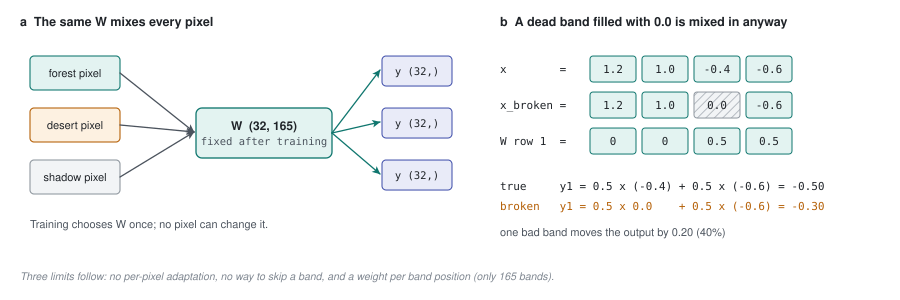

# 31 - Why the compressor is a ceiling

> **The one thing this part teaches:** today's compressor mixes bands with one fixed recipe
> for every pixel on Earth, and three things follow from that - it cannot adapt, it cannot
> skip a broken band, and it only works for exactly 165 bands.

This is the first part of the sequel (parts 31 to 38): how the next Indradhanu replaces the
spectral compressor with something smarter. It assumes the whole of parts 1 to 30, and leans
hardest on part 08 (dot products, softmax), part 10 (the compressor) and part 12 (attention).
Nothing in parts 31 to 38 is in the repository's model code yet - it is a design, studied
before it is built.

## Go back to part 10's pixel

Part 10 squeezed a four-band pixel into two numbers:

```
x = [ 1.2,  1.0, -0.4, -0.6 ]        band0 band1 band2 band3

W = [[ 0.5,  0.5,  0.0,  0.0],       <- output 0's recipe
     [ 0.0,  0.0,  0.5,  0.5]]       <- output 1's recipe

y = [1.10, -0.50]
```

Hold on to one fact about `W`: **it is the same matrix for every pixel**. The forest pixel,
the desert pixel, the cloud-shadowed pixel and the gas-flare pixel all get mixed by the same
two recipes. Training chooses `W` once; after that, nothing about an individual pixel
changes it.

That is what a 1x1 convolution is (part 08, section 4): one weighted sum, applied
identically at every position. The source says so in its own docstring
(`app/foundation_models/components/spectral_compressor.py`):

> "A learnable 1x1 Convolution to reduce spectral channels - analogous to MNF but trained
> end-to-end for the reconstruction objective."

## Consequence 1 - it cannot adapt

Suppose that for a mineral survey the interesting thing is a dip near 2200 nm, but for
vegetation it is the jump near 700 nm (the red edge). A fixed recipe has to spend its 32
outputs on a compromise that serves both everywhere. It cannot decide that *this* pixel,
which looks like bare rock, deserves more attention to 2200 nm.

The configs already show the symptom. `configs/hyperspectral_segformer_exp_2.json` carries a
red-flag note: *"SAM stuck above 0.3 after epoch 30 - Compressor bottleneck too narrow (try
compressed_channels=32)"*, and version 0.2.0 raised `D` from 24 to 32. That widens the pipe.
It does not make the pipe smarter.

## Consequence 2 - it cannot skip a broken band

Real sensors lose bands: a dead detector column, a saturated pixel, a band that is no-data
in one scene. The pipeline fills such holes with a substitute value before the model sees
them (part 07 of the anomaly-detection course, and `interpolate_spectral_gaps`). The
compressor then mixes that substitute in as if it were a measurement.

Do it by hand. Say band 2 of part 10's pixel is dead and arrives filled with `0.0`:

```
x_broken = [ 1.2, 1.0, 0.0, -0.6 ]

y1 = 0.0*1.2 + 0.0*1.0 + 0.5*0.0 + 0.5*(-0.6)
   = 0 + 0 + 0 - 0.30
   = -0.30
```

The true `y1` was `-0.50`. One bad band moved the output by `0.20`, which is 40% of its
size. **A fixed weighted sum cannot leave an input out: whatever sits in that slot gets
multiplied by its weight and added.** Every one of the 32 outputs that gives band 2 a
non-zero weight is contaminated.

## Consequence 3 - it only works for 165 bands

`Conv2d(165, 32, kernel_size=1)` has a weight for "input 0", "input 1", ... "input 164". Not
for "460 nm", "470 nm". The layer knows positions, not wavelengths.

That is the real reason the 165-band common grid exists (part 03): every sensor must be
resampled onto exactly those 165 positions before this layer can accept it. The sensors do
not agree on their own:

| source | bands as delivered |
|---|---|
| SpectralEarth (the next pretraining set) | 202 |
| EnMAP | 224 |
| PRISMA | 239 |
| AVIRIS-NG | ~425 |

(Counts from part 04 of the anomaly-detection course and `docs/03-data-pipeline.md`.)

Resampling is not free. Interpolating onto a 10 nm grid blurs narrow features and invents
values between real measurements, and the grid's gaps (920-970, 1140-1150, 1350-1450,
1800-1950 nm) are invisible to the layer: input 45 and input 46 might be 10 nm apart or
100 nm apart, and it cannot tell.



*Figure 31.1 - The ceiling of a fixed compressor. (a) Every pixel - forest, desert or shadow - is mixed by the same trained matrix W. (b) A dead band filled with 0.0 still receives its weight: with part 10's numbers the output moves from -0.50 to -0.30.*

## What the fix has to do

Turn the three consequences into requirements:

| problem | requirement |
|---|---|
| one recipe for every pixel | the mixing must **depend on the pixel's own spectrum** |
| broken bands mixed in | a band must be **skippable**, per pixel |
| tied to 165 positions | bands must be described by **wavelength**, not position |

Part 12 already showed you a mechanism whose mixing weights depend on the data: attention.
Parts 32 to 35 build the compressor out of it.

## Common confusions

**"Isn't the compressor trained? Then it adapts."** It adapts to the *training set as a
whole*, once. Inside a trained model it is frozen: every pixel of every scene meets the same
`W`. "Adaptive" here means changing per pixel, at run time.

**"Interpolation fills the dead band with a good guess, so where is the harm?"** A guess is
not a measurement, and the compressor cannot tell them apart. The cost is small for one band
in one pixel and systematic across a scene with a striped detector.

**"Could we give the conv more outputs instead?"** That is what raising `D` from 24 to 32
did. More fixed recipes are still fixed recipes, and the count is still tied to 165 inputs.

**"Does this mean the current Indradhanu is wrong?"** No. A fixed linear bottleneck is a
sensible, cheap choice that works (part 10 shows it costs under 0.2% of the parameters). It
is a ceiling, not a bug.

## Check yourself

1. In one sentence, why is a 1x1 convolution "the same recipe for every pixel"?
2. Using part 10's `W`, band 3 of `x = [1.2, 1.0, -0.4, -0.6]` arrives broken and filled with
   `0.0`. Compute `y1`, and the size of the error. Do it on paper.
3. The current compressor layer is `Conv2d(165, 32, kernel_size=1)` plus `BatchNorm2d(32)`.
   Without looking at part 10, compute its parameter count.
4. Why does the 165-band grid exist at all? Answer in terms of the compressor.
5. Which of the three consequences would hurt most when fine-tuning a SpectralEarth-pretrained
   model on PRISMA, and why?

<details>
<summary>Answers</summary>

1. It is one weighted sum over the bands, with weights fixed after training and applied
   identically at every pixel position.
2. `y1 = 0.5*(-0.4) + 0.5*0.0 = -0.20 + 0 = -0.20`. The true value is `-0.50`, so the error
   is `0.30` - 60% of the true value.
3. Conv: `165*32 + 32 = 5,280 + 32 = 5,312`. BatchNorm: `2*32 = 64`. Total `5,376`.
4. The layer has one weight per input *position*, so every sensor must be resampled onto the
   same 165 positions before the layer can accept it.
5. Consequence 3: SpectralEarth has 202 bands and PRISMA 239, at different wavelengths, so
   a position-bound layer cannot read either natively; both must be resampled to 165 first,
   and the model can never learn from their real band layouts.

</details>

---

**Next:** part 32 - cross-attention, the same four steps with someone else asking.
