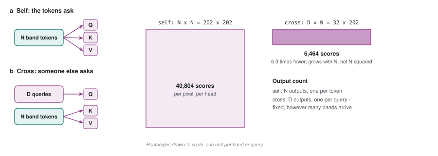

# 32 - Cross-attention: the same four steps, someone else asking

> **The one thing this part teaches:** cross-attention is part 12's attention with one change -
> the queries come from a different place than the keys and values - and that one change
> lets a fixed number of questions summarise any number of inputs.

## Part 12 in one paragraph

In part 12, every token produced three things from itself: a **query** (what am I looking
for?), a **key** (what do I offer?) and a **value** (what do I hand over if chosen?). Each
token's query was scored against every key, the scores went through softmax to become
weights summing to 1, and the token's output was the weighted average of the values.
Because queries, keys and values all came from the same set of tokens, it is called
**self**-attention. `EfficientSelfAttention` in
`app/foundation_models/components/efficient_self_attention.py` is exactly that, over spatial
tokens.

## The one change

In **cross**-attention, the queries come from somewhere else. The keys and values still come
from the tokens being read; the questions are asked by an outside party.

```
self-attention:   tokens --> Q, K, V          N questions about N tokens
cross-attention:  askers --> Q                D questions ...
                  tokens --> K, V             ... about N tokens
```

Everything else is identical: dot products, scale by `1/sqrt(head_dim)`, softmax, weighted
average of values.

> **Analogy.** Self-attention is a meeting where everyone listens to everyone and updates
> their own view. Cross-attention is a questionnaire: a fixed list of D questions is put to a
> crowd of N people, and you get back exactly D answers, each a blend of what the crowd
> said. Add more people to the crowd and you still get D answers.

That last sentence is the property we need. A pixel's spectrum is the crowd (one token per
band); the compressor's outputs are the answers. Change the number of bands and the number
of answers stays fixed.

## Worked example, by hand

One query, three key/value tokens, 2 features, 1 head. Pretend, as part 12 did, that the
projection matrices are the identity.

```
query (from the asker):   q  = [1, 0]

keys (from the tokens):   k1 = [2, 0]     values:  v1 = 10
                          k2 = [0, 1]              v2 = 20
                          k3 = [1, 1]              v3 = 30
```

`head_dim = 2`, so `scale = 1/sqrt(2) = 0.7071`.

### Step 1 - scores

```
q . k1 = 1*2 + 0*0 = 2
q . k2 = 1*0 + 0*1 = 0
q . k3 = 1*1 + 0*1 = 1

scaled: 2*0.7071 = 1.4142
        0*0.7071 = 0.0000
        1*0.7071 = 0.7071
```

### Step 2 - softmax

```
exp(1.4142) = 4.1132
exp(0.0000) = 1.0000
exp(0.7071) = 2.0281
              ------
sum:          7.1413

weights: 4.1132/7.1413 = 0.5760
         1.0000/7.1413 = 0.1400
         2.0281/7.1413 = 0.2840
```

Check: `0.5760 + 0.1400 + 0.2840 = 1.0000`.

### Step 3 - weighted average of the values

```
0.5760 * 10 =  5.760
0.1400 * 20 =  2.800
0.2840 * 30 =  8.520
              ------
answer:       17.080
```

The query asked about "feature 0". Token 1 has the most of it, so it got the largest weight
and pulled the answer towards its value of 10; token 3 has some, token 2 none. The answer is
neither an average (20) nor a copy of the best match (10): it is a **relevance-weighted
blend**. These exact numbers were reproduced with PyTorch while writing this part: weights
`[0.576, 0.140, 0.284]`, answer `17.0802`.

## Where do the outside queries come from?

Two options, and the next Indradhanu uses both:

| source of queries | example | used in |
|---|---|---|
| **learned parameters** - a table of D vectors, trained like any weight | "32 questions the model has learned to ask of every spectrum" | the compressor, part 34 |
| **computed from something else** | "what is the reflectance at 1650 nm?", built from the number 1650 | the decoder, part 37 |

Learned queries are an `nn.Parameter` of shape `(D, d)`: `D` rows, each a `d`-number vector.
They are the same for every pixel, like `W` in part 31 - but they are *questions*, not
answers. What comes back depends on the pixel, because the keys and values do.

## Self versus cross, side by side

| | self-attention (part 12) | cross-attention |
|---|---|---|
| queries from | the tokens themselves | outside: learned table or another input |
| number of outputs | N (one per token) | D (one per query) |
| score matrix | N x N | D x N |
| changing N changes the output count? | yes | **no** |
| in Indradhanu today | spatial tokens, `EfficientSelfAttention` | not yet - parts 33 to 37 |

The score matrix row is worth a number. With 202 band tokens per pixel:

```
self:   202 x 202 = 40,804 scores per pixel, per head
cross:   32 x 202 =  6,464 scores per pixel, per head
```

Part 36 turns that difference into gigabytes.



*Figure 32.1 - Where the questions come from, and what it costs. (a) In self-attention the band tokens produce queries, keys and values. (b) In cross-attention an outside set of D queries reads the tokens' keys and values. Right: score matrices for one pixel and head with 202 bands, drawn to scale: 40,804 against 6,464 scores, and a fixed number of outputs.*

## Common confusions

**"If the queries are fixed, isn't this the fixed recipe of part 31 again?"** No. In part 31
the *weights* were fixed. Here the *questions* are fixed, and the weights come from softmax
over scores that depend on the pixel's keys. Same questions, different answers per pixel.

**"Does cross-attention let the tokens talk to each other?"** Not directly. Each query reads
all tokens, but the tokens are not updated. Information flows from tokens into the D answers
only.

**"Which side is 'cross'?"** The word means queries and keys come from different sources. It
says nothing about direction; the decoder in part 37 is also cross-attention, pointed the
other way.

**"Why scale by `1/sqrt(head_dim)` here too?"** Same reason as part 12: without it, scores
grow with the vector length and softmax saturates (`exp(20) = 485,165,195` next to
`exp(-15) = 0.0000003`).

## Check yourself

1. Name the one difference between self-attention and cross-attention.
2. Redo the worked example with query `q = [0, 1]` instead. Compute the three scaled scores,
   the softmax weights, and the answer. Use a pen.
3. A crowd of 224 band tokens is read by 32 learned queries. How many answers come back, and
   how many scores are computed per head?
4. Why are learned queries not the same thing as part 31's fixed `W`?
5. With 425 band tokens (AVIRIS-NG), how many scores per pixel per head would self-attention
   compute? And cross-attention with 32 queries?

<details>
<summary>Answers</summary>

1. Where the queries come from: from the tokens themselves (self) or from outside (cross).
2. Raw dots: `0*2 + 1*0 = 0`, `0*0 + 1*1 = 1`, `0*1 + 1*1 = 1`. Scaled: `0, 0.7071, 0.7071`.
   `exp`: `1.0000, 2.0281, 2.0281`, sum `5.0562`. Weights `0.1978, 0.4011, 0.4011`.
   Answer: `0.1978*10 + 0.4011*20 + 0.4011*30 = 1.978 + 8.022 + 12.033 = 22.033`.
3. 32 answers. `32 x 224 = 7,168` scores per head.
4. `W` fixes the mixing weights; learned queries fix only the questions. The weights are
   recomputed from each pixel's own keys through softmax.
5. Self: `425 x 425 = 180,625`. Cross: `32 x 425 = 13,600`.

</details>

---

**Next:** part 33 - turning one pixel's spectrum into tokens that know their wavelength.
