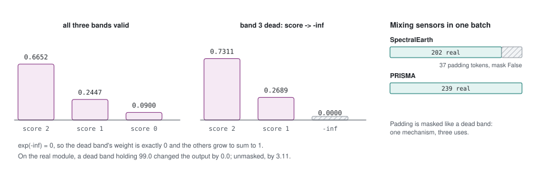

# 35 - Skipping a dead band, exactly

> **The one thing this part teaches:** setting a dead band's score to minus infinity before
> softmax gives it a weight of exactly zero, so its value - whatever garbage it holds -
> cannot reach the output; and the same trick lets pixels with different band counts share a
> batch.

## The problem, restated

Part 31 showed a fixed weighted sum cannot leave an input out: a dead band filled with `0.0`
moved part 10's output from `-0.50` to `-0.30`. Attention has a lever the convolution lacks:
the weights are *computed*, so we can force one to zero.

## Minus infinity in softmax

Softmax turns a score `s` into `exp(s)`, then divides by the sum (part 08, section 5). Two
facts:

```
exp(very large negative) -> 0
exp(-infinity)            = 0   exactly
```

So mark the dead band by replacing its score with `-inf`. Worked, three scores `[2, 1, 0]`,
first without a mask:

```
exp(2) = 7.3891
exp(1) = 2.7183
exp(0) = 1.0000
         ------
sum:    11.1074

weights: 7.3891/11.1074 = 0.6652
         2.7183/11.1074 = 0.2447
         1.0000/11.1074 = 0.0900
```

Now the third band is dead. Its score becomes `-inf`:

```
exp(2)    = 7.3891
exp(1)    = 2.7183
exp(-inf) = 0
            ------
sum:       10.1074

weights: 7.3891/10.1074 = 0.7311
         2.7183/10.1074 = 0.2689
         0     /10.1074 = 0
```

The dead band's weight is **exactly** zero, so its value is multiplied by zero, whatever that
value is. The other two weights grow to fill the gap and still sum to 1. The answer is built
only from bands that were really measured.

In code, this is the `attn_mask` argument of PyTorch's `scaled_dot_product_attention`: a
boolean mask where `False` means "this key may not be attended to". Part 34's prototype passes
`band_valid`, one boolean per pixel per band, shaped `(P, 1, 1, NB)` so the same mask applies
to every head and every query.

## Proof on the real prototype

The test: take 16 real-shaped pixels with 202 bands, mark band 100 as dead, and change band
100's value to a wild `99.0`. If masking works, the output must not move at all.

```
masked dead band:   max change in output = 0.0
unmasked dead band: max change in output = 3.1074910163879395
```

With the mask, a value of 99 in the dead band changed nothing - not "very little", nothing.
Without it, the same garbage shifted outputs by over 3. **Part 31's contamination is gone by
construction, not by hoping interpolation guessed well.**

## The same trick, a second use: mixing sensors

A training batch is one big tensor, and tensors are rectangular: every row must have the
same number of band tokens. SpectralEarth pixels have 202; PRISMA pixels 239. To put both in
one batch, pad the shorter rows up to the longest and mark the padding invalid:

```
SpectralEarth pixel:  202 real tokens + 37 padding tokens  -> 239, mask: 202 True, 37 False
PRISMA pixel:         239 real tokens                       -> 239, mask: 239 True
```

The padding gets weight zero exactly as a dead band does. One mechanism handles broken bands,
missing bands, and different sensors.



*Figure 35.1 - Minus infinity before softmax. Left: three valid scores [2, 1, 0] give weights [0.6652, 0.2447, 0.0900]. Middle: marking band 3 dead sets its score to -inf, its weight to exactly 0, and the other two renormalise to [0.7311, 0.2689]. Right: the same mask lets a 202-band SpectralEarth pixel share a batch with 239-band PRISMA pixels, its 37 padding tokens masked out.*

## What this does not fix

Masking removes a band from the *compressor*. Two things it does not decide for you:

- **What to reconstruct for that band.** If a band is dead, there is no truth to compare a
  reconstruction against, so the loss (parts 23 to 25) must skip it too. Part 37.
- **A pixel with most of its bands dead.** Masking 150 of 202 bands leaves an answer built from
  52 - honest, but thin. The existing pixel-level rule (more than 40% invalid voxels invalidates
  the pixel, `BandFilterConfig.max_invalid_voxel_fraction`) still makes sense on top.

## Common confusions

**"Why not set the dead band's value to zero instead of its score?"** A zero value still gets
a weight, and a zero is not "no information" - it is a claim that the reflectance is 0. Only
a zero *weight* removes the band.

**"Does `-inf` cause NaNs?"** Only if *every* key of a row is masked, so softmax divides 0 by
0. A pixel with no valid bands must be dropped before it reaches attention. PyTorch's fused
kernel otherwise handles `-inf` safely.

**"Is the boolean mask True for valid or invalid?"** In `scaled_dot_product_attention`, a
boolean `attn_mask` is **True where attention is allowed**. Getting this backwards masks
everything that is valid. Check with the 99.0 test above: it is ten lines and it will catch a
flipped mask immediately.

**"Do we still need the band filter's gap interpolation?"** For the compressor, no - masking
is cleaner. Interpolation may still be useful for the spatial model or for display; that is
a design choice for later, not forced by this part.

## Check yourself

1. Why does a score of `-inf` give a weight of exactly zero?
2. Scores `[3, 1, 1]`, the second band dead. Compute the weights by hand.
3. Why is masking a band better than filling it with `0.0`?
4. A batch mixes EnMAP (224 bands) and AVIRIS-NG (~425 bands; use 425). How many padding
   tokens does an EnMAP pixel get, and what are their mask values?
5. What happens if every band of a pixel is masked, and what should you do about it?

<details>
<summary>Answers</summary>

1. Softmax uses `exp(score)`, and `exp(-inf) = 0`, so that band contributes 0 to both its own
   numerator and the sum.
2. `exp(3) = 20.0855`, `exp(-inf) = 0`, `exp(1) = 2.7183`; sum `22.8038`. Weights
   `20.0855/22.8038 = 0.8808`, `0`, `2.7183/22.8038 = 0.1192`.
3. A filled value still receives a weight and is mixed in as if measured; a masked band gets
   weight exactly zero and cannot influence the output.
4. `425 - 224 = 201` padding tokens, all with mask value False (not allowed).
5. Softmax computes 0/0 and produces NaN. Drop such pixels (mark the pixel invalid) before
   they reach attention.

</details>

---

**Next:** part 36 - what all this costs, in multiply-adds and in gigabytes.
