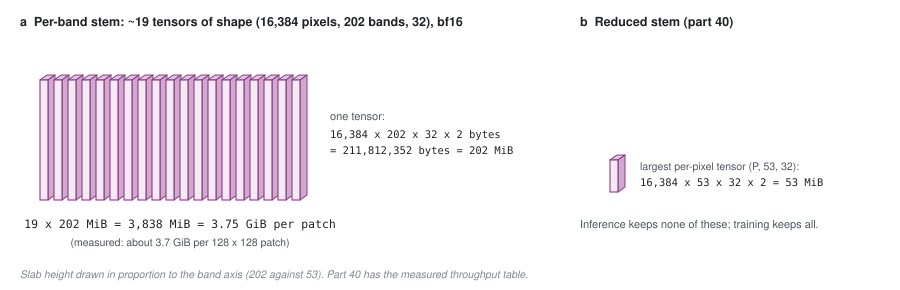

# 36 - What it costs, in multiply-adds and gigabytes

> **The one thing this part teaches:** the new compressor has the same number of parameters
> but does about 163 times the arithmetic per pixel, and the real constraint is memory - the
> keys and values alone are 808 MiB per patch - which is why the design uses cross- not
> self-attention, fused kernels, and band grouping.

## Parameters are not the cost

Part 34 found 5,345 parameters against today's 5,376. That says how much the model must
*store and learn*. It says nothing about how much *work* each pixel needs, or how much
*memory* that work occupies while it runs. Those are different numbers, and here they differ
enormously.

A **multiply-add** (MAC) is one multiplication followed by one addition - the basic unit of a
dot product. A dot product of two 32-number vectors is 32 multiply-adds.

## Today: 5,280 multiply-adds per pixel

`Conv2d(165, 32, kernel_size=1)` computes 32 dot products of length 165 per pixel:

```
165 * 32 = 5,280 multiply-adds per pixel
```

## Next: 861,184 multiply-adds per pixel

With 202 band tokens, `d = 32`, `D = 32`:

```
K and V projections:  2 * 202 tokens * (32*32)   = 2 * 202 * 1,024 = 413,696
scores (Q . K):       32 queries * 202 keys * 32  =                   206,848
weighted values:      32 queries * 202 values * 32 =                  206,848
output + to_channel:  32 * (32*32) + 32 * 32      = 32,768 + 1,024  =  33,792
                                                                     -------
total                                                                 861,184
```

(The query projection is the same for every pixel, so it is computed once, not per pixel.)

```
861,184 / 5,280 = 163.1
```

About **163 times** the arithmetic. Per 128 x 128 patch:

```
861,184 * 16,384 pixels = 14,109,638,656  ~ 14.1 billion multiply-adds
```

At batch 128 that is about 1.8 trillion per step for the compressor alone. A modern training
GPU does tens to hundreds of trillions of multiply-adds per second in half precision, so this
is significant but affordable. Arithmetic is not what breaks first.

## Memory is what breaks first

To compute attention, the scores, the softmax weights, and the keys and values must exist in
memory at the same time. Count the bytes for one patch, in 32-bit floats (4 bytes each), with
4 heads.

**Attention weights**, if stored:

```
16,384 pixels * 4 heads * 32 queries * 202 keys * 4 bytes
  = 1,694,498,816 bytes
  = 1,616 MiB per patch
```

One patch. A batch of 128 would need over 200 GB. That is not a tuning problem; it is
impossible. (A version of this estimate in an early design note came out near 400 MB: it left
out the 4 heads. Count heads.)

**Keys and values**, which must exist:

```
16,384 pixels * 2 (K and V) * 202 tokens * 32 numbers * 4 bytes
  = 847,249,408 bytes
  = 808 MiB per patch
```

## And self-attention would be far worse

Part 32 noted self-attention compares every band with every band. Its weights, per patch:

```
16,384 * 4 heads * 202 * 202 * 4 bytes = 10,696,523,776 bytes = 9.96 GiB per patch
```

Ten gigabytes per patch, just for the weights. **This is the concrete reason the design is
cross-attention**: 32 questions against 202 bands, not 202 against 202.

## Three ways the cost comes down

| technique | what it removes | effect |
|---|---|---|
| **fused attention** (`F.scaled_dot_product_attention`) | never stores the weights; computes softmax in small tiles | 1,616 MiB of weights -> near zero |
| **half precision** (bf16, 2 bytes) | halves every tensor | K+V 808 -> 404 MiB per patch |
| **band grouping** | one token per ~4 adjacent bands: 202 -> 51 tokens | K+V shrink ~4x, scores shrink ~4x |

Band grouping, worked:

```
K+V with 51 tokens: 16,384 * 2 * 51 * 32 * 4 bytes = 213,909,504 bytes = 204 MiB per patch
```

With all three, a patch's compressor activations come to roughly `204 / 2 = 102` MiB in
bf16, against 808 + 1,616 MiB naively. Grouping is a genuine trade-off: four neighbouring bands
become one token, so detail finer than about 4 bands (roughly 25-40 nm here) is mixed before
attention sees it. Whether that hurts is something to measure (part 38), not assume.

## Why the prototype ran fine anyway

Part 34's prototype ran 16 pixels, not 16,384. At that size everything is tiny. **Costs that
scale with pixels count do not show up in a toy run** - always redo the byte arithmetic at the
real patch and batch size before trusting a design.

## Measured on a real GPU

On 2026-10-14 the real module was timed at Indradhanu's real encoder size, one training step
on 128 x 128 patches, on a 20 GB laptop GPU (RTX 4000 Ada). The run is recorded in
`research/experiments/indradhanu-se-pretrain/S01-laptop-smoke/`.

| stem | best batch that fits, bf16 | patches per second | memory per patch |
|---|---|---|---|
| today's 1x1 compressor | 64 | 391 | ~0.08 GiB |
| per-pixel gate (part 39) | 64 | 282 | ~0.11 GiB |
| cross-attention | 4 | 5 | **~3.7 GiB** |

Two things the arithmetic above did not predict:

- **Training keeps more than K and V.** The backward pass needs every intermediate the forward
  pass made - the tokens, the stretched values, keys, values, the attention output - and many
  of them have the same `(pixels, 202, 32)` shape as K. One such tensor in bf16 is
  `16,384 * 202 * 32 * 2 = 211,812,352` bytes = 202 MiB; 3.7 GiB is about `3,789 / 202 = 19`
  of them. **Inference-time memory is not training-time memory.**
- **A hardware limit nobody mentions.** The GPU's fused attention puts the batch on a launch
  axis capped at 65,535. Here the "batch" is pixels, so 4 patches - `4 * 16,384 = 65,536`
  rows - failed with `invalid configuration argument`, one row over. The module now runs
  attention in chunks of 32,768 pixels; because pixels are independent, the result is
  identical.

End to end the cross-attention model is about **78 times slower** than today's, not 163: the
shared SegFormer costs the same in all three, and dilutes the difference.



*Figure 36.1 - Why training, not inference, hits the wall. (a) For backpropagation the per-band stem keeps about 19 intermediates of shape (16,384 pixels, 202 bands, 32), 202 MiB each in bf16: about 3.75 GiB per 128 x 128 patch, matching the measured 3.7 GiB. (b) The reduced stem of part 40 never builds a band-by-32 tensor; its largest per-pixel tensor has 53 bin slots, 53 MiB.*

### Measured again on a 48 GB card

The same comparison was repeated on an AWS L40S (48 GB) on 2026-10-14, with the per-band stem
at batches 4 to 32 and a fourth stem added. The per-band stem trained at 13.5 patches per
second at batch 4 and ran out of memory at batch 32; the **reduced stem** of part 40 reached
80.0 patches per second at batch 8, about six times faster, with about a quarter of the memory
per added patch. The full table, and the arithmetic that reads it, is in part 40.

## Common confusions

**"Same parameters, so same speed?"** No. Parameters are stored once; arithmetic and
activations are paid per pixel, per patch, per step.

**"Fused attention is an approximation?"** No. It computes exactly the same result in a
different order, never holding the full weight matrix at once. The 0.0 masking test of part 35
ran through it.

**"Why not compress at lower spatial resolution to save memory?"** You could run the compressor
after the first downsampling stage instead of at full resolution. That changes what the
encoder sees at its finest level, so it is a bigger architectural change; keep it as a
fallback.

**"Is 163x going to make training 163x slower?"** No. The compressor is one small part of the
model; the SegFormer encoder already dominates the arithmetic. It makes the compressor go
from negligible to noticeable.

## Check yourself

1. Why do parameter count and memory cost differ so much here?
2. Compute the multiply-adds per pixel for an EnMAP pixel (224 bands), `d = 32`, `D = 32`.
   Show each of the four lines.
3. Compute the K+V memory per patch for 224 bands in bf16 (2 bytes), in MiB. (1 MiB =
   1,048,576 bytes.)
4. Why does cross-attention need so much less memory than self-attention over bands?
5. Band grouping makes 202 bands into 51 tokens. Name one thing that could get worse.
6. Training needs ~3.7 GiB per patch. On a 48 GB card, leaving 4 GB for everything else, how
   many patches fit in one batch? How many batches of 128 x 128 patches is that in pixels, and
   does it stay under the 65,535-row attention limit without chunking?

<details>
<summary>Answers</summary>

1. Parameters are stored once; arithmetic and activations repeat for every one of the 16,384
   pixels in every patch.
2. K,V: `2 * 224 * 1,024 = 458,752`. Scores: `32 * 224 * 32 = 229,376`. Values:
   `229,376`. Output: `33,792`. Total `458,752 + 229,376 + 229,376 + 33,792 = 951,296`.
3. `16,384 * 2 * 224 * 32 * 2 = 469,762,048` bytes; `/ 1,048,576 = 448` MiB.
4. Its score matrix is 32 x N instead of N x N, so it grows linearly with band count rather
   than with its square.
5. Spectral detail narrower than a group (about 4 bands) is blended before attention can look
   at it - narrow absorption features may be harder to represent.
6. `(48 - 4) / 3.7 = 44 / 3.7 = 11.9`, so 11 patches. `11 * 16,384 = 180,224` pixel rows -
   far over 65,535, so chunking is required: `180,224 / 32,768 = 5.5`, six calls per step.

</details>

---

**Next:** part 37 - the way back out: reconstructing any sensor's bands.
