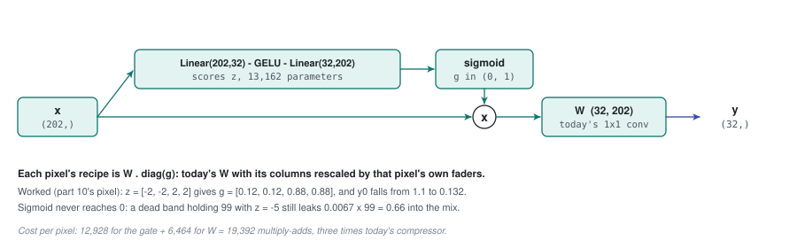

# 39 - Per-pixel gating: the cheap rival

> **The one thing this part teaches:** a gate lets each pixel turn its own bands up or down
> before today's fixed mixdown, which buys per-pixel adaptivity at about three times today's
> arithmetic instead of 133 times - and the experiment needs it to learn whether the
> expensive design is earning its cost.

## Why a rival at all

Part 38 ended with trap 3: "more sophisticated" is not evidence. If the cross-attention
compressor (variant C) beats today's compressor (variant A), you still do not know *why*.
Two very different things changed at once:

1. **adaptivity** - each pixel gets its own recipe instead of one recipe for all;
2. **wavelength awareness and masking** - bands become tokens that know their wavelength,
   and dead bands are skipped exactly.

Variant B adds only the first. If B gets most of C's gain, the gain came from adaptivity,
and B delivers it for a fraction of the cost.

## A new word: sigmoid

A **sigmoid** is a function that squashes any number into the range 0 to 1:

```
sigmoid(z) = 1 / (1 + exp(-z))
```

Work four values:

```
z = 0     exp(0)  = 1          1 / (1 + 1)       = 0.5
z = 2     exp(-2) = 0.1353     1 / (1 + 0.1353)  = 0.8808
z = -2    exp(2)  = 7.389      1 / (1 + 7.389)   = 0.1192
z = 5     exp(-5) = 0.0067     1 / (1 + 0.0067)  = 0.9933
```

Large positive scores land near 1, large negative ones near 0, zero lands at exactly 0.5.
**It never reaches 0 or 1 exactly** - keep that in mind; it matters at the end of this part.

## The gate

Today (part 10), one recipe `W` for every pixel:

```
y = W . x                       x: (bands,)   W: (32, bands)   y: (32,)
```

With a gate, each pixel first computes a volume setting per band from **its own spectrum**:

```
z  = Linear(32 -> bands)( GELU( Linear(bands -> 32)(x) ) )    # (bands,) scores
g  = sigmoid(z)                                              # (bands,) each in (0, 1)
x' = g * x                                                   # each band scaled
y  = W . x'                                                  # today's compressor, unchanged
```

The small network in front - `Linear`, then GELU (part 14), then `Linear` - squeezes the
spectrum to 32 numbers and expands back to one score per band. That is the "MLP" in
`sigmoid(MLP(x))`.

> **Analogy.** Part 10's compressor is a fixed mixdown from 48 tracks to stereo. The gate is
> a row of faders in front of the desk. The mixing desk never changes; each song - here,
> each pixel - sets its own faders before the mix.



*Figure 39.1 - Variant B. A small network reads each pixel's own spectrum and emits one score per band; sigmoid turns the scores into gates between 0 and 1, the bands are scaled by them, and today's fixed 1x1 compressor mixes the result. Each pixel therefore gets the recipe W . diag(g) - today's W with rescaled columns - at three times today's arithmetic.*

## Worked example, by hand

Part 10's pixel and recipe:

```
x = [ 1.2, 1.0, -0.4, -0.6 ]
W = [[ 0.5, 0.5, 0.0, 0.0 ],
     [ 0.0, 0.0, 0.5, 0.5 ]]
today:  y0 = 0.5*1.2 + 0.5*1.0 = 0.6 + 0.5 = 1.1
        y1 = 0.5*(-0.4) + 0.5*(-0.6) = -0.2 - 0.3 = -0.5
```

Suppose the gate network looks at this pixel and decides the first two bands are
unreliable (a shadowed pixel, say). It outputs scores `z = [-2, -2, 2, 2]`:

```
g  = [ sigmoid(-2), sigmoid(-2), sigmoid(2), sigmoid(2) ]
   = [ 0.1192, 0.1192, 0.8808, 0.8808 ]        (round to 0.12, 0.12, 0.88, 0.88)

x' = [ 0.12*1.2, 0.12*1.0, 0.88*(-0.4), 0.88*(-0.6) ]
   = [ 0.144, 0.120, -0.352, -0.528 ]

y0 = 0.5*0.144 + 0.5*0.120  = 0.072 + 0.060 = 0.132
y1 = 0.5*(-0.352) + 0.5*(-0.528) = -0.176 - 0.264 = -0.440
```

`y0` fell from 1.1 to 0.132: this pixel's first output now barely listens to bands 0 and 1.

Look at it the other way. Scaling the inputs by `g` is the same as scaling the *columns* of
`W` by `g`:

```
effective recipe for this pixel = W . diag(g)
  = [[ 0.5*0.12, 0.5*0.12, 0, 0 ],      = [[ 0.06, 0.06, 0,    0    ],
     [ 0, 0, 0.5*0.88, 0.5*0.88 ]]         [ 0,    0,    0.44, 0.44 ]]
```

**Every pixel gets its own recipe, but every recipe is today's `W` with its columns
rescaled.** That sentence is both B's strength and its limit.

## Predict the parameter count

For SpectralEarth's 202 bands, hidden width 32:

```
Linear(202 -> 32)    202*32 + 32   = 6,464 + 32  = 6,496
Linear(32 -> 202)    32*202 + 202  = 6,464 + 202 = 6,666
                                                  -----
gate total                                       13,162
```

On top of A's compressor (`Conv2d(202, 32, 1)` + BatchNorm: `6,464 + 32 + 64 = 6,560`), B's
stem has `13,162 + 6,560 = 19,722` parameters. C's compressor has 5,345 (part 34). B is the
*bigger* model and the *cheaper* one - parameters and arithmetic are different things, as
part 36 showed.

## What it costs

Multiply-adds per pixel, 202 bands:

```
A   compressor            202 * 32          =   6,464
B   gate                  2 * 202 * 32      =  12,928
    + compressor                            +   6,464  =  19,392
C   cross-attention       (part 36)                    = 861,184
```

`19,392 / 6,464 = 3.0` - B costs three times A. `861,184 / 19,392 = 44.4` - C costs 44 times
B. (Part 36's figure of 163 compared C with today's 165-band compressor, `5,280`.)

## What a gate cannot do

| | B: gate | C: cross-attention |
|---|---|---|
| each pixel its own recipe | yes | yes |
| bands influence each other | yes, through one 32-number squeeze, and only by setting volumes | yes - each output channel is its own weighted mix |
| exact skip of a dead band | no - the gate never reaches 0 | yes - `-inf` gives a weight of exactly 0 (part 35) |
| knows a band's wavelength | no - it knows "input 87" | yes - part 33's tag |
| works on another band list | no - retrain the input layers | yes - pass the new wavelengths |

The dead-band row deserves arithmetic. A dead band filled with the value 99 (part 35's
example) and gated as hard as `z = -5` still leaks `0.0067 * 99 = 0.66` into the mix - more
than most real normalised values. Even `z = -10` (`sigmoid = 0.0000454`) leaks `0.0045`.

## How to read the result

| outcome | conclusion |
|---|---|
| B about equal to C, both beat A | adaptivity was the win; prefer B on cost |
| C clearly beats B, B beats A | adaptivity helps, and wavelength awareness and masking add more |
| neither beats A | the spectral stem is not what limits detection - look elsewhere |

The decision rule in `docs/proposals/spectral-attention-bottleneck.md` was written before any
run, so the result cannot bend it.

## Common confusions

**"The gate starts at 0.5 everywhere - doesn't that halve the signal?"** At the start of
training the scores are near 0, so yes, every band is scaled by about 0.5. The BatchNorm after
the compressor (part 10) rescales its output to a standard spread, so the encoder never sees
the halving.

**"Is the gate per patch or per pixel?"** Per pixel. A per-patch version (pool the whole patch
to one spectrum, compute one gate) exists - it is called squeeze-and-excitation - but it gives
a shadowed pixel and a bright pixel in the same patch the same recipe, which is the problem
being fixed.

**"Does the gate leak a hidden pixel's information?"** No. Like C, it runs strictly inside one
pixel, and hidden pixels' tokens are removed before spatial attention (part 38, trap 1).

**"Why sigmoid and not something unbounded?"** A volume knob should not flip a band's sign or
amplify it without limit; sigmoid keeps each gate between "off" and "as is".

## Check yourself

1. Compute `sigmoid(1)` and `sigmoid(-1)`. Show each step.
2. Part 10's pixel, gate scores `z = [2, 2, -2, -2]` (round gates to 0.88 and 0.12). Compute
   `y0` and `y1`.
3. Count the gate's parameters for the 165-band grid with hidden width 32.
4. A dead band holds 50 and its gate score is -4. How much leaks into `x'`? What would C let
   through?
5. B beats A on detection by a clear margin; C ties with B. Which do you pretrain at full
   scale, and what do you give up?

<details>
<summary>Answers</summary>

1. `exp(-1) = 0.3679`, `1 / 1.3679 = 0.7311`. `exp(1) = 2.7183`, `1 / 3.7183 = 0.2689`.
   They sum to 1, as `sigmoid(z) + sigmoid(-z)` always does.
2. `x' = [0.88*1.2, 0.88*1.0, 0.12*(-0.4), 0.12*(-0.6)] = [1.056, 0.880, -0.048, -0.072]`.
   `y0 = 0.5*1.056 + 0.5*0.880 = 0.528 + 0.440 = 0.968`.
   `y1 = 0.5*(-0.048) + 0.5*(-0.072) = -0.024 - 0.036 = -0.060`.
3. `165*32 + 32 = 5,312`; `32*165 + 165 = 5,445`; total `10,757`.
4. `sigmoid(-4) = 1 / (1 + 54.598) = 0.0180`; leak `0.0180 * 50 = 0.90`. C's weight for a
   masked band is exactly 0, so nothing leaks.
5. B: it gets the same detection for about a forty-fourth of C's arithmetic. You give up
   exact dead-band skipping and the ability to change band list without retraining - the
   PRISMA fine-tune would need its input resampled to SpectralEarth's 202 wavelengths.

</details>

---

**Next:** part 40 - spectral reduction: attention over wavelength bins without losing the
bands.
