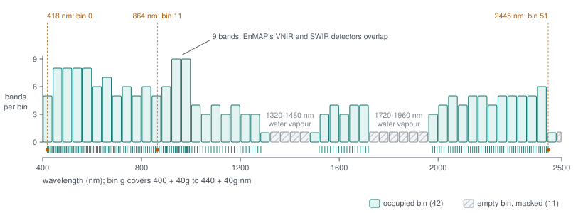
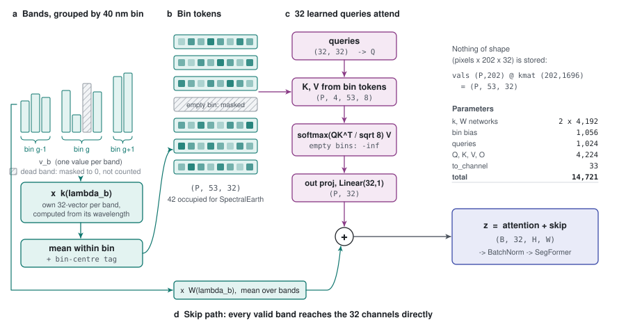
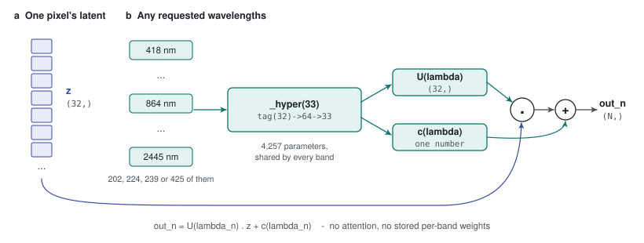
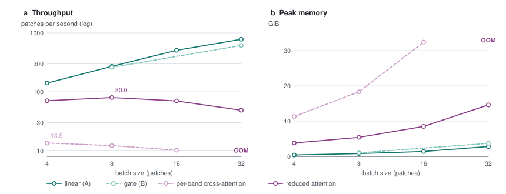

# 40 - Spectral reduction: attention over wavelength bins without losing the bands

> **The one thing this part teaches:** the reduced stem does part 13's trick along wavelength
> instead of space - attention reads about 42 fixed 40 nm bins instead of 202 band tokens - and
> three per-band pieces (a per-band weight inside each bin, a per-band skip path, a per-band
> decoder) keep the detail a plain bin average would throw away, for about a sixth of the
> per-band stem's training time.

## Where this part sits

Parts 31 to 39 were written as a design. Since then the design has been built and run, and
the modules are real files you can open:

| what | file |
|---|---|
| the per-band cross-attention stem (parts 34 to 37) | `app/foundation_models/components/spectral_attention.py` |
| the wavelength tag (part 33) | `app/foundation_models/components/spectral_tokens.py` |
| the per-pixel gate (part 39) | `app/foundation_models/components/spectral_gate.py` |
| **the reduced stem (this part)** | `app/foundation_models/components/spectral_reduced.py` |
| the model that swaps between them | `app/foundation_models/components/spectral_stem_seg_former_mae.py` |

The model takes a `stem` argument with four values: `linear` (variant A), `gate` (B),
`cross_attention` (the per-band stem of parts 34 to 37) and `reduced_attention` (this part).
On 2026-10-14 the experiment moved its attention variant to `reduced_attention`, for the
reason the next section measures. As always, if this part and the source disagree, the source
wins.

## Why: the per-band stem hits a memory wall

Part 36 predicted that memory, not arithmetic, would be the cost of the per-band stem, and
measured about 3.7 GiB per 128 x 128 patch on a laptop GPU. Recall where that comes from.
Training keeps every intermediate the forward pass made, because the backward pass needs
them. Many of those intermediates have the shape (pixels x 202 bands x 32). One of them, for
one patch, in bf16 (2 bytes per number):

```
16,384 pixels * 202 bands * 32 numbers * 2 bytes
  = 3,309,568 * 32 * 2
  = 105,906,176 * 2
  = 211,812,352 bytes
  = 211,812,352 / 1,048,576 MiB
  = 202 MiB
```

About 19 of them are kept:

```
19 * 202 MiB = 3,838 MiB = 3,838 / 1,024 GiB = 3.75 GiB per patch
```

A 48 GB card fits only a handful of patches per step, and the measured speed (below) was
about 13 patches per second. A pretraining run of tens of thousands of patches per epoch for
dozens of epochs becomes days per variant. That is the problem this part solves.

## Part 13's trick, turned sideways

Part 13 met the same kind of wall in space. Attention over 1,024 stage-1 tokens would compare
every token with every token, so SegFormer's efficient self-attention **shrinks the keys and
values** to a 4 x 4 summary before attending, and keeps the queries at full detail.

The reduced stem does the same thing along the wavelength axis:

| | part 13, spatial reduction | this part, spectral reduction |
|---|---|---|
| what is too many | 1,024 tokens on a 32 x 32 grid | 202 band tokens per pixel |
| how it shrinks | strided convolution, `R x R` tokens -> 1 | fixed 40 nm bins, the bands inside -> 1 |
| what attention reads | 16 summary tokens | about 42 bin tokens |
| who asks | every full-resolution token | 32 learned queries (part 34) |

> **Analogy.** A choir of 202 singers is too many to rehearse one at a time, so the conductor
> rehearses them in sections - sopranos, altos, tenors, basses - grouped by vocal range. But
> a good section leader does not let the section blur into one voice: each singer keeps a
> named part inside the section (fix 1), the full score still reaches the recording directly
> (fix 2), and on playback every singer's line can be rebuilt (fix 3).



*Figure 40.1 - The fixed bin grid. The 400 to 2500 nm axis is cut into 53 bins of 40 nm (top);
each tick below is one of SpectralEarth's 202 band centres, and the bar height is the number
of bands in that bin (1 to 9). 42 bins hold at least one band; the 11 empty bins (hatched) fall
in the two water-vapour gaps and at the long end, and are masked out of attention exactly like
dead bands. The tallest bars, near 920 to 1000 nm, are where EnMAP's two detectors overlap.*

## The bins

The bins are a fixed grid, the same for every sensor, starting at 400 nm. From the source:

```python
BIN_ORIGIN_NM, BIN_END_NM = 400.0, 2500.0
self.n_bins = int(math.ceil((BIN_END_NM - BIN_ORIGIN_NM) / bin_nm))      # bin_nm = 40
return ((wavelengths_nm - BIN_ORIGIN_NM) / self.bin_nm).floor().long().clamp(0, self.n_bins - 1)
```

Count the bins:

```
(2500 - 400) / 40 = 2100 / 40 = 52.5
ceil(52.5)        = 53 bins
```

Place three real SpectralEarth bands (`app/constants/spectralearth_bands.json`):

```
418.416 nm:  (418.416 - 400) / 40 = 18.416 / 40 = 0.46   floor -> bin 0   (400-440 nm)
864 nm:      (864 - 400) / 40     = 464 / 40    = 11.6   floor -> bin 11  (840-880 nm)
2445.3 nm:   (2445.3 - 400) / 40  = 2045.3 / 40 = 51.13  floor -> bin 51  (2440-2480 nm)
```

Doing that for all 202 bands (with Python, on 2026-10-14) gives:

```
bins holding at least one band:  42 of 53
bands per occupied bin:          1 to 9, average 202 / 42 = 4.8
empty bins:                      23-26 (1320-1480 nm), 33-38 (1720-1960 nm), 52 (2480-2500 nm)
```

The empty bins sit in the water-vapour gaps SpectralEarth already removed (part 03 met the same
gaps on the 165-band grid). An empty bin has a count of 0 and is masked exactly as part 35
masked a dead band, so attention effectively reads 42 tokens.

**Because the grid starts at 400 nm on every sensor, bin 11 means 840 to 880 nm on
SpectralEarth, EnMAP, PRISMA and AVIRIS-NG alike.** A bin is a wavelength range, not a slot.

## Why a plain bin average would lose detail

The obvious way to make one token per bin is to average the bin's band tokens. Try it with
the per-band stem's tokens from part 33:

```
token_b = v_b * w + b + tag(lambda_b)          w, b: the shared Linear(1, 32)
```

`w` is the **same** vector for every band. Sum two bands of a bin:

```
token_1 + token_2 = (v_1 + v_2) * w + 2b + tag(lambda_1) + tag(lambda_2)
```

The only part that depends on the measurement is `(v_1 + v_2) * w`. Everything about the
individual values is gone except their sum. Two different spectra show it on paper:

```
spectrum A, bin of two bands:  v = [0.2, 0.6]     a dip, then its shoulder
spectrum B, same bin:          v = [0.6, 0.2]     the reverse

sum A = 0.2 + 0.6 = 0.8
sum B = 0.6 + 0.2 = 0.8                           identical: the tokens are the same
```

A narrow absorption dip and its mirror image become indistinguishable. Narrow dips are exactly
what mineral and gas signatures look like, so this would throw away the signal the model
exists to learn.

## Fix 1: every band gets its own weight vector inside its bin

Instead of a shared `w`, each band's value is multiplied by a vector **computed from its
wavelength**, `k(lambda_b)`, and the bin token is the mean over the bin's valid bands:

```
token_g = mean over valid bands b in bin g of  v_b * k(lambda_b)
```

`k` is a small network (`_hyper` in the source): `Linear(32, 64) -> GELU -> Linear(64, 32)`,
fed the part 33 wavelength tag. Redo the two spectra with a two-number token and suppose
training gave `k(lambda_1) = [1, 0]` and `k(lambda_2) = [0, 1]`:

```
spectrum A:  ( 0.2 * [1, 0]  +  0.6 * [0, 1] ) / 2
           = ( [0.2, 0]      +  [0, 0.6]     ) / 2
           =   [0.2, 0.6] / 2
           =   [0.1, 0.3]

spectrum B:  ( 0.6 * [1, 0]  +  0.2 * [0, 1] ) / 2
           = ( [0.6, 0]      +  [0, 0.2]     ) / 2
           =   [0.6, 0.2] / 2
           =   [0.3, 0.1]
```

`[0.1, 0.3]` and `[0.3, 0.1]`: different tokens. With real sizes, a bin holds about 5 bands
(at most 9) and the token has 32 numbers. **Five numbers mapped into 32 through five
different vectors can be one-to-one** - nothing is forced to collide - so the dip and its
shoulder stay distinguishable inside the token.

The token then gets a second term saying where the bin sits:

```python
tok = tok + self.bin_bias(wavelength_encoding(centres, self.d))[None]   # centres: 420, 460, ... nm
```

That is a `Linear(32, 32)` of the bin centre's wavelength tag - the bin's equivalent of part
33's tag.

## Attention over the bins

From here it is part 34's compressor, with bin tokens in place of band tokens: the 32 learned
queries are projected to Q, the bin tokens to K and V, 4 heads attend, the output projection
and `Linear(32, 1)` turn each of the 32 answers into one channel.

```
bin tokens      (P, 53, 32)       P pixels; 53 slots, the empty ones masked
K, V            (P, 4, 53, 8)     4 heads x 8 = 32
Q               (P, 4, 32, 8)     the same 32 learned queries for every pixel
answers         (P, 32, 32)
channels        (P, 32)           the attention half of z
```

Attention still decides, per pixel, how much each region of the spectrum matters - part 31's
first requirement. What it no longer does is choose between individual bands; that choice is
now made at bin granularity.

## Fix 2: a per-band skip path straight to the channels

Attention over bins adds adaptivity, but it is a narrow route. So every valid band also
reaches the 32 channels directly:

```
skip = mean over valid bands b of  v_b * W(lambda_b)          W(lambda): (32,) from _hyper
z    = attention output + skip
```

Look at what that is. Part 10's compressor was `y = W . x`: each band's value times its column
of `W`, summed. Here each band's column is **computed from its wavelength** instead of stored
per slot, and the sum is divided by the band count. **The skip path is today's 1x1
compressor, made to work for any band list.**

Work it with part 10's pixel and recipe, taking the computed columns to be part 10's columns
(two channels instead of 32):

```
x = [ 1.2, 1.0, -0.4, -0.6 ]
W(lambda_0) = [0.5, 0.0]    W(lambda_1) = [0.5, 0.0]    W(lambda_2) = [0.0, 0.5]    W(lambda_3) = [0.0, 0.5]

sum = 1.2*[0.5, 0] + 1.0*[0.5, 0] + (-0.4)*[0, 0.5] + (-0.6)*[0, 0.5]
    = [0.6, 0]     + [0.5, 0]     + [0, -0.2]       + [0, -0.3]
    = [1.1, -0.5]                                   part 10's y, as promised

mean = [1.1, -0.5] / 4 = [0.275, -0.125]
```

Why divide by the count? Without it, a 239-band PRISMA pixel would sum more terms than a
202-band SpectralEarth pixel and land on a bigger scale. The mean keeps the scale independent
of the sensor; the BatchNorm in front of the encoder (part 10) absorbs the remaining factor.

## Dead bands drop out of every mean exactly

The source multiplies by validity **before** anything is summed, and counts only valid bands:

```python
vals     = _rows(x * valid)                  # (P, N), a dead band becomes 0
cnt_band = _rows(valid)                      # (P, N), 1 per valid band
cnt      = cnt_band @ onehot                 # (P, G), valid bands per bin
```

Redo the skip path with band 2 dead and holding the garbage value 99 (part 35's test):

```
vals = [1.2, 1.0, 99*0, -0.6] = [1.2, 1.0, 0, -0.6]
sum  = [0.6 + 0.5, 0 + (-0.3)] = [1.1, -0.3]
mean = [1.1, -0.3] / 3         = [0.3667, -0.1]           3 valid bands, not 4
```

The 99 never appears. Run on the real module (202 SpectralEarth wavelengths, band 100 marked
dead, its value changed to 99.0): **the largest change in the output was 0.0**, the same
exactness part 35 showed for the per-band stem. The bin tokens get the same treatment through
`cnt`, and a bin whose count falls to 0 is masked out of attention.



*Figure 40.2 - The reduced compressor for one pixel. Left: band values (teal) are masked by
validity (grey hatching marks a dead band) and multiplied by a per-band weight vector k(lambda)
computed from each band's wavelength; the products are averaged within each 40 nm bin and given
the bin centre's tag, giving about 42 bin tokens. Centre: 32 learned queries attend over the bin
tokens (plum), empty bins masked, and each answer becomes one channel. Bottom: the skip path
multiplies every valid band by W(lambda) and averages, the 1x1 compressor with wavelength-computed
columns. The two halves add into the 32-channel latent z that the unchanged SegFormer receives.*

## Fix 3: a per-band decoder

On the way out there is no attention at all. Each requested wavelength computes its own output
weights:

```
out_n = U(lambda_n) . z + c(lambda_n)          U(lambda): (32,)   c(lambda): one number
```

One `_hyper` network produces 33 numbers per wavelength: the first 32 are `U`, the last is
`c`. That is part 10's 1x1 decompressor with each output row computed from its wavelength -
so it reconstructs 202, 224 or 239 bands from the same weights, like part 37's decoder.

Worked, two channels, one wavelength. Take `z = [1.1, -0.5]`, and suppose the network gives
`U(660 nm) = [0.8, 0.1]` and `c(660 nm) = 0.05`:

```
out = 0.8*1.1 + 0.1*(-0.5) + 0.05
    = 0.88    + (-0.05)    + 0.05
    = 0.88
```



*Figure 40.3 - The wavelength-linear decoder. Each requested wavelength (any list: 202
SpectralEarth, 224 EnMAP, 239 PRISMA bands) passes through one small network that emits a
32-number weight row U(lambda) and a bias c(lambda); the band's value is the dot product of that
row with the pixel's latent z, plus the bias. No attention and no per-band stored weights: the
same 4,257 parameters serve every band list.*

## Nothing of shape (pixels x bands x 32) is stored

Fix 1 reads as "multiply every band by a 32-number vector", which sounds like it builds the
very (pixels x 202 x 32) tensor the stem exists to avoid. It does not. The per-band vectors do
not depend on the pixel, so the source folds them into one matrix first:

```python
kmat = (onehot[:, :, None] * self.band_weight(enc)[:, None, :]).reshape(n, G * self.d)
tok  = (vals @ kmat).view(p, G, self.d) / cnt.clamp(min=1)[..., None]
```

| tensor | shape | has a pixel axis? |
|---|---|---|
| `onehot` - which bin each band is in | `(202, 53)` | no |
| `band_weight(enc)` - k(lambda) per band | `(202, 32)` | no |
| `kmat` - k(lambda_b) placed in band b's bin slot | `(202, 53*32)` = `(202, 1696)` | no |
| `vals` | `(P, 202)` | yes, 1 number per band |
| `vals @ kmat` | `(P, 1696)` -> `(P, 53, 32)` | yes, but 53 slots, not 202 |

One matrix product over the band axis does the multiply, the placement into bins and the sum
in one step. The largest per-pixel tensor is now (pixels x 53 x 32). For one patch in bf16:

```
16,384 * 53 * 32 * 2 bytes = 55,574,528 bytes = 55,574,528 / 1,048,576 MiB = 53 MiB
```

against 202 MiB for one (pixels x 202 x 32) tensor. The skip path is `vals @ W` with `W` of
shape `(202, 32)`, and the decoder is one `einsum` against `U` of shape `(202, 32)`: neither
has a band axis and a 32 axis on the same pixel.

## Predict the parameter count

Every piece is a linear layer, so use `outputs x inputs + outputs` (part 08). Start with the
small network behind `k`, `W` and `U`, as the source builds it:

```python
def _hyper(out_dim, enc_dim=32, hidden=64):
    return nn.Sequential(nn.Linear(enc_dim, hidden), nn.GELU(), nn.Linear(hidden, out_dim))
```

For `out_dim = 32`:

```
Linear(32, 64)    64*32 + 64 = 2,048 + 64 = 2,112
GELU              no parameters
Linear(64, 32)    32*64 + 32 = 2,048 + 32 = 2,080
                                            -----
_hyper(32)                                  4,192
```

Now the compressor, line by line:

```
band_weight   _hyper(32)          k(lambda), fix 1            4,192
skip_weight   _hyper(32)          W(lambda), fix 2            4,192
bin_bias      Linear(32, 32)      32*32 + 32                  1,056
queries       table (32, 32)      32*32                       1,024
q, k, v, o    4 x Linear(32, 32)  4 * 1,056                   4,224
to_channel    Linear(32, 1)       32*1 + 1                       33
                                                             ------
total                                                        14,721
```

Your turn for the decoder, before reading on: it is one `_hyper` with `out_dim = 33`.

```
Linear(32, 64)    64*32 + 64 = 2,112
Linear(64, 33)    33*64 + 33 = 2,112 + 33 = 2,145
                                             -----
decoder                                      4,257
```

Counting the real modules on 2026-10-14 reported `14721` and `4257`, with `band_weight 4192,
skip_weight 4192, bin_bias 1056, q 1056, k 1056, v 1056, o 1056, to_channel 33` and the
1,024-number query table. Notice, as in part 34, that **202 appears nowhere in either count**.

| stem | compressor | decoder | depends on band count? |
|---|---:|---:|---|
| linear (A), 202 bands | 6,496 | 6,666 | yes |
| per-band cross-attention (parts 34, 37) | 5,345 | 6,401 | no |
| reduced attention (this part) | 14,721 | 4,257 | no |

(The linear row is `Conv2d(202, 32, 1)`: `202*32 + 32 = 6,496`, and `Conv2d(32, 202, 1)`:
`32*202 + 202 = 6,666`.)

## Measured on a real GPU

On 2026-10-14 all four stems were timed on an AWS L40S (48 GB), one full training step -
forward, backward and Adam update - in bf16, with the real Indradhanu encoder (embedding widths
32, 64, 160, 256) on 128 x 128 patches. Patches per second, with peak memory in brackets:

| stem | batch 4 | batch 8 | batch 16 | batch 32 |
|---|---|---|---|---|
| linear (A) | 140.8 (0.4 GiB) | 270.6 (0.8 GiB) | 506.7 (1.4 GiB) | 780.5 (2.8 GiB) |
| gate (B) | - | 260.2 (1.0 GiB) | - | 612.2 (3.7 GiB) |
| per-band cross-attention | 13.5 (11.3 GiB) | 12.2 (18.3 GiB) | 10.2 (32.4 GiB) | out of memory |
| reduced attention | 70.6 (3.8 GiB) | 80.0 (5.4 GiB) | 69.9 (8.5 GiB) | 48.6 (14.6 GiB) |



*Figure 40.4 - One training step (forward, backward, Adam) per stem on an L40S 48 GB, bf16, real
Indradhanu encoder, 128 x 128 patches. Left: patches per second against batch size (log scale).
Right: peak memory. The per-band cross-attention stem runs out of memory at batch 32; the reduced
stem is about six times faster at each stem's best batch and needs about a quarter of the memory
per added patch.*

Read the table with arithmetic, not by eye. **Speed** at each stem's best batch:

```
reduced best:   80.0 patches/s  (batch 8)
per-band best:  13.5 patches/s  (batch 4)
80.0 / 13.5 = 5.93                                      about 6 times faster
```

**Memory per patch**, at batch 16, where both run:

```
per-band:  32.4 GiB / 16 = 2.03 GiB per patch
reduced:    8.5 GiB / 16 = 0.53 GiB per patch
2.03 / 0.53 = 3.8                                       about 4 times less
```

A fairer memory figure removes the fixed cost (weights, optimiser state, the CUDA workspace)
by asking what each **extra** patch costs, from batch 4 to batch 16:

```
per-band:  (32.4 - 11.3) / (16 - 4) = 21.1 / 12 = 1.76 GiB per extra patch
reduced:   ( 8.5 -  3.8) / (16 - 4) =  4.7 / 12 = 0.39 GiB per extra patch
1.76 / 0.39 = 4.5
```

Three more honest observations. The reduced stem is still about ten times slower than the
linear stem (`780.5 / 80.0 = 9.8`): attention is not free. Its speed falls at batch 32 (48.6
against 80.0 at batch 8); the cause was not investigated, so treat batch 8, the fastest
measured, as its operating point. And the gate stem costs little more than the linear one, as part
39 predicted.

## Where the saving did not come from

You might guess the reduced stem is faster because it does less arithmetic. Count it.
Multiply-adds per pixel, 202 bands, `d = D = 32`, 53 bin slots (the dense matrix product
computes all 53, empty or not):

```
per-band cross-attention (parts 36, 37)
  compressor (part 36's count)                                     861,184
  decoder: channel tokens 32*32 = 1,024; K, V 2*32*1,024 = 65,536;
           scores 202*32*32 = 206,848; values 206,848;
           output 202*1,024 = 206,848; to_value 202*32 = 6,464     693,568
                                                                  ---------
                                                                 1,554,752
reduced attention
  bin tokens   vals @ kmat      202 * 1,696        = 342,592
  K, V         2 * 53 * 1,024                      = 108,544
  scores       32 * 53 * 32                        =  54,272
  values       32 * 53 * 32                        =  54,272
  output + to_channel   32,768 + 1,024             =  33,792
  skip path    202 * 32                            =   6,464
  decoder      202 * 32                            =   6,464
                                                    ---------
                                                      606,400
```

`1,554,752 / 606,400 = 2.6`: less arithmetic, but not six times less. Most of `vals @ kmat` is
multiplying by zero - each band's row of `kmat` has 32 non-zeros out of 1,696 - which the code
accepts in exchange for one fast dense kernel and no per-band intermediate. **The six-times
speed-up comes mostly from what is no longer written to and read back from memory**, which is
what part 36 said would bind first.

## What the reduction gives up

This is a genuine trade-off, not a free win.

| | per-band stem (parts 34-37) | reduced stem |
|---|---|---|
| per-pixel choice between individual bands | yes | no - between bins; within a bin, weights are fixed per wavelength |
| narrow dip inside one bin preserved | yes | yes, through fix 1's one-to-one map and fix 2 |
| feature straddling a bin edge | one token per band | split across two bin tokens |
| dead bands skipped exactly | yes | yes |
| any band list | yes | yes |
| different band lists inside one batch (part 35's padding) | yes, wavelengths `(B, N)` | **no** - wavelengths must be `(N,)`, else `ValueError` |
| measured training speed (L40S, best batch) | 13.5 patches/s | 80.0 patches/s |

The last structural row is worth remembering: the source rejects a per-sample wavelength table
(`"reduced stem takes one band list per batch: wavelengths (N,)"`). SpectralEarth always has one
band list, so the experiment is unaffected; a future mixed-sensor batch would need the per-band
stem or one batch per sensor.

## Common confusions

**"Is a bin token a plain average of its bands?"** No. It is the mean of `v_b * k(lambda_b)`,
each band times its own 32-number vector. A plain average would keep only the bin's sum
(the section on why it loses detail).

**"Are the bins learned?"** No. They are a fixed 40 nm grid from 400 nm, the same on every
sensor and every run. What is learned is `k`, `W`, `U`, the bin bias, the queries and the
projections.

**"53 or 42 bin tokens?"** The tensor has 53 slots, because the grid has 53 bins. For
SpectralEarth 11 are empty and masked, so attention effectively reads 42. Another sensor would
fill a different set.

**"Does the skip path make the attention pointless?"** It makes it optional. The skip path
alone is a wavelength-aware 1x1 compressor - variant A that can read any sensor. Attention adds
per-pixel adaptivity on top. Whether that addition earns its time is exactly what the
experiment measures (part 38, trap 3).

**"Why is the decoder not attention any more?"** Part 37's attention decoder was 693,568
multiply-adds per pixel and kept per-band intermediates for backprop. A linear readout whose
rows are computed from wavelength keeps the property that mattered - any band list, one set of
weights - for 6,464.

**"Does this change the spatial model?"** No. All stems hand the SegFormer the same
`(B, 32, H, W)` through the same BatchNorm; parts 11 to 21 are untouched.

## Check yourself

1. How many bins would the grid from 400 to 2500 nm have with `bin_nm = 50`? Which bin
   would 864 nm fall in? Show the steps.
2. A bin holds two bands. With the per-band stem's shared value weight, spectra `[0.3, 0.5]`
   and `[0.5, 0.3]` give the same value part after summing. With `k(lambda_1) = [1, 0]` and
   `k(lambda_2) = [1, 1]`, compute both bin tokens (remember to take the mean).
3. Derive `skip_weight`'s parameter count from `_hyper(32)` without looking. Then derive what
   `_hyper` would cost with `hidden = 32` instead of 64.
4. Skip path, part 10's pixel and columns, band 0 dead (holding 99). Compute the skip output.
5. From the measured table, what does each extra patch cost the linear stem in memory, between
   batch 4 and batch 32? How many times less than the reduced stem's 0.39 GiB is that?
6. Why can the reduced stem not train on a batch that mixes EnMAP and PRISMA pixels, while the
   per-band stem can?

<details>
<summary>Answers</summary>

1. `(2500 - 400) / 50 = 2100 / 50 = 42`, `ceil(42) = 42` bins. `(864 - 400) / 50 = 464 / 50 =
   9.28`, floor 9: bin 9, which covers 850 to 900 nm.
2. Spectrum `[0.3, 0.5]`: `(0.3*[1, 0] + 0.5*[1, 1]) / 2 = ([0.3, 0] + [0.5, 0.5]) / 2 =
   [0.8, 0.5] / 2 = [0.4, 0.25]`. Spectrum `[0.5, 0.3]`: `(0.5*[1, 0] + 0.3*[1, 1]) / 2 =
   ([0.5, 0] + [0.3, 0.3]) / 2 = [0.8, 0.3] / 2 = [0.4, 0.15]`. Different, so the order of the
   values survives.
3. `Linear(32, 64)`: `64*32 + 64 = 2,112`; `Linear(64, 32)`: `32*64 + 32 = 2,080`; total
   `4,192`. With `hidden = 32`: `Linear(32, 32)`: `32*32 + 32 = 1,056`, twice, `2,112`.
4. `vals = [0, 1.0, -0.4, -0.6]`. Sum `= 1.0*[0.5, 0] + (-0.4)*[0, 0.5] + (-0.6)*[0, 0.5] =
   [0.5, 0] + [0, -0.2] + [0, -0.3] = [0.5, -0.5]`. Three valid bands: `[0.5, -0.5] / 3 =
   [0.1667, -0.1667]`.
5. `(2.8 - 0.4) / (32 - 4) = 2.4 / 28 = 0.086` GiB per extra patch. `0.39 / 0.086 = 4.5` times
   less.
6. The reduced stem builds one `onehot` and one `kmat` per batch from a single wavelength list
   `(N,)`, and raises `ValueError` for `(B, N)`. The per-band stem tags each band token
   separately, so it accepts a wavelength row per sample and padding masks (part 35).

</details>

---

**Next:** part 41 - the number that ranks epochs, and the trap in scoring it with a ramped
weight.
