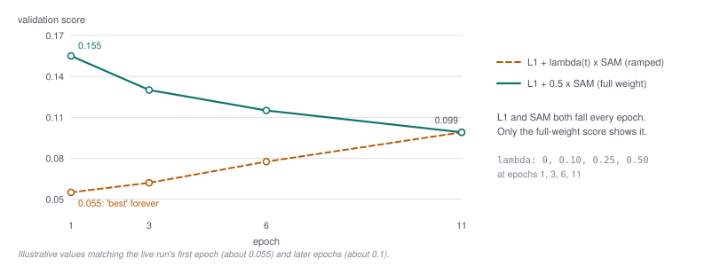

# 41 - Scoring validation on one scale

> **The one thing this part teaches:** the number that ranks epochs must be measured the same
> way every epoch; scoring validation with the training loss's ramped SAM weight made the
> first epoch look best forever, so the trainer now scores validation at the full SAM weight
> from epoch 1.

## Two jobs for one number

Part 25 built the training loss as `L1 + lambda(t) * SAM`, with `lambda` ramping from 0 to its
final value so that the early, noisy SAM gradients do not swamp L1. Part 28 showed the loop
computing a **validation loss** at the end of every epoch: the same measurement, on patches
the model never trains on.

The SpectralEarth runs give that validation number a second job. It decides two things:

- **best.pt** - which epoch's weights are kept as "the best";
- **early stopping** - stopping a run once it has stopped improving, instead of paying for
  every remaining epoch.

A new word, so define it. **Early stopping** means: remember the best validation score so
far; count the epochs since it last improved; stop when that count reaches a limit called the
**patience**. The rule in `app/foundation_models/trainers/spectral_stem_mae_trainer.py`:

```python
if self._best_val == math.inf or avg_val < self._best_val * (1 - cfg.early_stop_min_delta):
    self._best_val, self._bad_epochs = avg_val, 0
else:
    self._bad_epochs += 1
self._stop = bool(cfg.early_stop_patience) and epoch >= cfg.early_stop_min_epochs \
    and self._bad_epochs >= cfg.early_stop_patience
```

The experiment's configs (`research/experiments/indradhanu-se-pretrain/E00*/config.json`) set:

| field | value | meaning |
|---|---|---|
| `sam_weight` | 0.5 | final `lambda` |
| `sam_ramp_epochs` | 10 | epochs to reach it |
| `early_stop_patience` | 10 | flat epochs before stopping |
| `early_stop_min_delta` | 0.01 | an improvement must beat the best by 1% |
| `early_stop_min_epochs` | 20 | never stop before epoch 20 |

A score improves only if it is below `best * (1 - 0.01) = best * 0.99`.

## The trap

**Ranking needs a fixed ruler; training needs a moving one.** The first validation code used
the training formula, ramp included, so the ruler moved.

The trainer's epoch index starts at 0 (part 28 saves epoch index 0 as `epoch1`), so the run's
epoch `e` uses `lambda = 0.5 * min(1, (e - 1) / 10)`:

```
epoch 1:   0.5 * min(1, 0/10)  = 0.5 * 0.0 = 0.00
epoch 3:   0.5 * min(1, 2/10)  = 0.5 * 0.2 = 0.10
epoch 6:   0.5 * min(1, 5/10)  = 0.5 * 0.5 = 0.25
epoch 11:  0.5 * min(1, 10/10) = 0.5 * 1.0 = 0.50
```

At epoch 1, `lambda` is 0, so the validation score is L1 alone. From then on a growing share
of SAM is added. SAM in radians is several times larger than L1 in reflectance, so the score
**rises** even while the model improves on both measurements.

> **Analogy.** A golf club records each member's best round. The first round of the season is
> scored on putts only; from the second round on, every stroke counts. The first round is
> everyone's "best round" for the rest of the year, however much their game improves.

## Worked example

These are illustrative values, chosen to match what the live run showed (a first-epoch score
of about 0.055, every later epoch about 0.1). L1 and SAM both improve every epoch:

| epoch | L1 | SAM (rad) | `lambda` |
|---|---|---|---|
| 1 | 0.055 | 0.20 | 0.00 |
| 3 | 0.045 | 0.17 | 0.10 |
| 6 | 0.040 | 0.15 | 0.25 |
| 11 | 0.034 | 0.13 | 0.50 |

**Scored with the ramp** (`L1 + lambda * SAM`):

```
epoch 1:   0.055 + 0.00 * 0.20 = 0.055 + 0.000  = 0.055
epoch 3:   0.045 + 0.10 * 0.17 = 0.045 + 0.017  = 0.062
epoch 6:   0.040 + 0.25 * 0.15 = 0.040 + 0.0375 = 0.0775
epoch 11:  0.034 + 0.50 * 0.13 = 0.034 + 0.065  = 0.099
```

**Scored at the full weight** (`L1 + 0.5 * SAM`, every epoch):

```
epoch 1:   0.055 + 0.5 * 0.20 = 0.055 + 0.100 = 0.155
epoch 3:   0.045 + 0.5 * 0.17 = 0.045 + 0.085 = 0.130
epoch 6:   0.040 + 0.5 * 0.15 = 0.040 + 0.075 = 0.115
epoch 11:  0.034 + 0.5 * 0.13 = 0.034 + 0.065 = 0.099
```

The model is identical in both columns. With the ramp the score gets **worse** every epoch;
at the full weight it gets better every epoch. Only the second tells the truth.



*Figure 41.1 - The same four epochs scored two ways (the worked example). With the training
ramp (amber, dashed) the validation score climbs from 0.055 to 0.099 as lambda grows from 0 to
0.5, although L1 and SAM both fall; epoch 1 stays "best" forever. Scored at the full SAM weight
(teal) the score falls monotonically from 0.155 to 0.099. The two curves meet once the ramp ends
at epoch 11, when both use lambda = 0.5.*

## What early stopping would have done

Run the rule on the ramped scores. Epoch 1 sets `best = 0.055`, so a later epoch must score
below `0.055 * 0.99 = 0.05445`. None does, because every later score is near 0.1:

```
epoch 2:   not below 0.05445    bad_epochs = 1
epoch 3:   not below 0.05445    bad_epochs = 2
...
epoch 11:  not below 0.05445    bad_epochs = 10    patience reached, but epoch 11 < 20
...
epoch 20:  not below 0.05445    bad_epochs = 19    epoch 20 >= 20 and 19 >= 10: STOP
```

The run would have stopped at epoch 20 - **the first epoch the rule allows** - and kept epoch
1's weights as best.pt, whatever the model had learned. The source records the finding in its
own comment, in `compute_validation_loss`:

> "Full SAM weight, not the training ramp: the validation score ranks epochs for early
> stopping and best.pt, so it must be on one scale. With the ramp, epoch 1 (lambda 0) scored
> ~0.055 and every later epoch ~0.1 - early stop would have fired at the first allowed epoch
> whatever the model did (found in E003 on 2026-10-14 ...)."

## The fix

One line. Training keeps the ramp; validation uses the final weight from the start:

```python
return l1 + cfg.sam_weight * sam, n          # validation: lambda = 0.5 at every epoch
```

Two smaller pieces make the fix safe to resume into:

- **A checkpoint remembers how it was scored.** The early-stop state saved inside each
  checkpoint carries `"score": "l1+full_sam"` (the constant `VAL_SCORE`). A checkpoint scored
  the old way has no such tag, so on resume its best score is ignored rather than compared
  with numbers on a different scale.
- **The parts are logged separately.** `metrics.csv` records `val_l1`, `val_sam_deg` and
  `sam_weight` for every epoch, so you can recompute any score by hand (convert the angle
  first: radians = degrees / 57.30).

## Common confusions

**"Should training use the full weight from epoch 1 too, then?"** No. The ramp exists for the
gradients (part 25): early SAM gradients are noisy and large. The fix changes only the number
used to compare epochs, not what the model learns from.

**"Isn't `early_stop_min_epochs = 20` already protection?"** It delays the stop until the ramp
has finished, but the damage is in the comparison: epoch 1's 0.055 is still the best on record
at epoch 20, so the stop fires there.

**"Would logging L1 and SAM separately have been enough?"** For a human reading the log, yes.
The machine that picks best.pt and stops the run reads only the combined number.

**"Are the old runs' checkpoints wrong?"** Their weights are fine. Their stored best-score is
on the old scale, which is why it is ignored on resume.

## Check yourself

1. In your own words, why can a ramped weight not be used to rank epochs?
2. Using the table, compute epoch 6's score with the ramp and at the full weight. Show the
   steps.
3. Epoch 1 scores 0.155 at the full weight. What must a later epoch score to count as an
   improvement under `early_stop_min_delta = 0.01`?
4. With the ramped scores, on which epoch does `bad_epochs` first reach the patience of 10, and
   why does the run not stop there?
5. A run is resumed from a checkpoint saved before the fix. What happens to its stored best
   score, and why is that the right behaviour?

<details>
<summary>Answers</summary>

1. The weight grows from epoch to epoch, so the same model would get a different score at
   different epochs; a difference between epochs then mixes "the model changed" with "the
   ruler changed".
2. Ramp: `lambda = 0.25`; `0.040 + 0.25 * 0.15 = 0.040 + 0.0375 = 0.0775`. Full: `0.040 + 0.5 *
   0.15 = 0.040 + 0.075 = 0.115`.
3. Below `0.155 * (1 - 0.01) = 0.155 * 0.99 = 0.15345`.
4. Epoch 11 (epochs 2 to 11 are ten flat epochs). The rule also requires `epoch >= 20`, so the
   stop waits until epoch 20.
5. It is ignored, because the checkpoint lacks the `"l1+full_sam"` tag; comparing a 0.055
   measured with `lambda = 0` against full-weight scores near 0.1 would repeat the trap.

</details>

---

**Next:** part 42 - why a stem that can read any band list read PRISMA's badly, and the fix.
