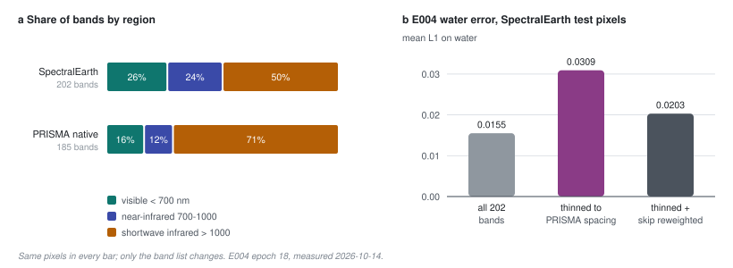

# 42 - One band list is not any band list

> **The one thing this part teaches:** a stem that *can* read any band list only reads them
> well if it was *trained* on many; E004 was pretrained on SpectralEarth's one list of 202
> bands, so on PRISMA's own 185 it lost the coast of set1 - and a plain per-band average in its
> skip path made that worse.

## The symptom

Part 41 ended with the runs under way. When E004 (the reduced-attention stem of part 40) was
scored on the four labelled PRISMA scenes, one number was wrong in an interesting way. A
**ROC-AUC** (part 30) of 0.5 means "no better than a coin"; set1 scored **0.217** - worse than a
coin, so the model was ranking the real anomalies *below* ordinary background.

Set1 is 75% sea. Splitting its reconstruction error by surface showed where the 0.217 came from:

| | mean L1 on water | on land |
|---|---|---|
| E004, PRISMA's native bands | 0.0462 | 0.0282 |
| v0.2.0 (production) | 0.0046 | 0.0113 |

E004's error on water was ten times production's. 93% of its highest-scoring pixels were sea,
so the sea outranked the anomalies, which sit on land.

## The obvious explanation, and why it was wrong

The obvious story: SpectralEarth is land, so the model never learned water. It is a good story
and it is testable, so we tested it before acting on it. A **census** counted water pixels:
EnMAP tiles by their provider labels, SpectralEarth patches by a water index checked against
those labels (right 98% of the time when it says "water").

| | patches with > 30% water | water share of all pixels |
|---|---|---|
| EnMAP train tiles (labels) | 6.8% | 6.9% |
| SpectralEarth sample, 3,000 patches | 6-12% | 6-11% |

SpectralEarth has as much water as EnMAP. The model had seen plenty. **Measure the cheap
explanation before you build the fix for it** - adding water patches would have cost a run and
fixed nothing.

The clue that did explain it was already on the table. The PRISMA bench
(`scripts/evaluate_prisma_bench.py`) scores each scene two ways: on its **native** bands, and
**resampled** onto SpectralEarth's 202 wavelengths. At epoch 18:

| set1 combined ROC-AUC | |
|---|---|
| native (185 bands) | 0.205 |
| resampled to SpectralEarth's 202 | 0.725 (production: 0.712) |

Same scene, same model. Only the band list changed.

## The mechanism: one vote per band

Recall part 40's reduced stem. It has two routes from a pixel's spectrum to the 32 channels,
added together:

```
route 1  bins -> attention   average inside each 40 nm bin, attend across ~42 bin tokens
route 2  skip path           every band straight to the channels:
                             skip = (1/N) x sum over bands of  v_b x W(lambda_b)
```

`W(lambda)` is a weight vector computed from the band's wavelength, so the skip path works for
any list. But look at the `1/N`: every band gets **one equal vote**. A region sampled by more
bands gets more say.

Work it by hand, one channel, every weight `W = 1`. The spectrum is the same for both sensors:
value 2 in the visible, -1 in the shortwave infrared.

```
sensor A  bands 500, 505, 2000 nm   values 2, 2, -1
          skip = (2 + 2 + (-1)) / 3 = 3 / 3 = 1.0

sensor B  bands 500, 2000 nm        values 2, -1
          skip = (2 + (-1)) / 2 = 1 / 2 = 0.5
```

One spectrum, two answers, because A samples the visible twice as densely. Route 1 does not
have this problem: it averages *inside* a bin first, so 500 and 505 become one bin value of 2
for both sensors.

The real band lists differ by much more than the toy:

| | bands | visible (< 700 nm) | near-infrared (700-1000) | shortwave infrared (> 1000) |
|---|---|---|---|---|
| SpectralEarth (trained on) | 202 | 53 (26%) | 48 (24%) | 101 (50%) |
| PRISMA native (set1) | 185 | 30 (16%) | 23 (12%) | 132 (71%) |

On PRISMA's own list the skip path hears the visible at about **0.6 times** the volume it was
trained with (`16 / 26 = 0.62`). Water's signal is almost all in the visible - beyond about
750 nm water is nearly black - so water pixels are distorted most.



*Figure 42.1 - Left: how each sensor's bands divide between the visible, near-infrared and
shortwave infrared. PRISMA's native list gives the visible 16% of the bands against
SpectralEarth's 26%. Right: E004's reconstruction error on water, on SpectralEarth test patches
with all 202 bands, and on the same pixels thinned to PRISMA's spacing; then with the skip path
reweighted at inference. Thinning alone doubles the error; reweighting recovers about two thirds.*

## Proving it, one variable at a time

Two experiments isolate the band list from everything else (all measured on E004's epoch-18
checkpoint, 2026-10-14, recorded in `research/experiments/indradhanu-se-pretrain/E004-reduced-attention/`).

**Thinning.** Take SpectralEarth test patches - the model's own sensor, its own wavelengths -
and keep only the 151 of the 202 bands nearest PRISMA's. No new sensor, no new wavelength: only
fewer bands, spaced like PRISMA.

**Reweighting.** Change the skip path at inference so each band's vote is scaled to restore its
bin's training share: weight `n_train(bin) / n_now(bin)`. If a bin had 8 bands in training and
has 5 now, each of the 5 counts `8 / 5 = 1.6`.

| condition (mean L1) | water | land |
|---|---|---|
| SpectralEarth, all 202 bands | 0.0155 | 0.0157 |
| same pixels, thinned to PRISMA spacing | 0.0309 | 0.0226 |
| thinned + skip reweighted | 0.0203 | 0.0205 |
| set1 native | 0.0462 | 0.0282 |
| set1 native + skip reweighted | 0.0352 | 0.0200 |
| set1 native minus 20 bands at wavelengths SpectralEarth never had | 0.0327 | 0.0221 |
| set1 resampled to SpectralEarth's wavelengths | 0.0138 | 0.0160 |

Read it in order. Thinning **doubles** the water error (`0.0309 / 0.0155 = 2.0`), so the
sensitivity is to the band list itself. Reweighting the skip path closes about two thirds of
that gap on water - `(0.0309 - 0.0203) / (0.0309 - 0.0155) = 0.0106 / 0.0154 = 0.69` - so the
one-vote-per-band average is a real cause. But not the only one: neither fix, nor both, brings
set1 down to the resampled 0.0138.

## The root cause

Every wavelength-dependent piece of the stem - the in-bin kernel `k(lambda)`, the skip weights
`W(lambda)`, the decoder's `U(lambda)` - is a small network fed the band's wavelength. In
pretraining those networks were only ever evaluated at **one** list: the same 202 wavelengths,
every batch, for 18 epochs. Nothing ever asked them what a missing neighbour means, or how a
bin with five bands should compare with the same bin holding eight.

So "reads any band list" was a property of the **architecture**, never of the **training**. The
model fitted the one list it saw. Resampling every sensor onto that list hides the problem; it
does not remove it, and it ties the model back to a fixed grid - the thing this stem was built
to escape.

There is a second, smaller gap. PRISMA's native list has 20 bands where SpectralEarth has
none: inside SpectralEarth's dropped water-vapour regions (1306-1502 and 1727-1959 nm) and past
its last band (2463-2477 nm). There the wavelength networks are extrapolating from nothing.

## The fixes

Adopted 2026-10-14 for the final pretraining run, to be verified in a 10-epoch run against
E004 at the same epoch before anything longer is trained:

1. **Train on many band lists.** Each batch draws a different subset of the 202 bands: random
   thinning, random gaps like other sensors' excluded regions, and random even spacings (a
   PRISMA-like 10 nm, an EnMAP-like 6.5 nm). The model still reconstructs **all** 202 bands, so
   it also learns to fill in the ones it was not given. This is masking along the spectrum -
   the same idea as part 18's spatial masking - and it is the general fix: the model learns to
   handle any list instead of being patched to a known one.
2. **One vote per nanometre, not per band.** Weight each band by the width of spectrum it
   covers (half the distance to each neighbour), in the skip path and inside bins. Each average
   then approximates an integral over wavelength. Redo the toy with widths - in A each visible
   band covers 5 nm, in B the one visible band covers 10; each infrared band covers 10:

   ```
   sensor A   (2 x 5 + 2 x 5 + (-1) x 10) / (5 + 5 + 10) = (10 + 10 - 10) / 20 = 10 / 20 = 0.5
   sensor B   (2 x 10 + (-1) x 10) / (10 + 10)           = (20 - 10) / 20      = 10 / 20 = 0.5
   ```

   Same spectrum, same answer. No new parameters.
3. **Ignore wavelengths the model never trained on.** The checkpoint already carries its
   training wavelengths (the normalisation curve of part 40), so a band far from all of them is
   dropped when a scene is loaded. That rule comes from the checkpoint, not from a fixed grid -
   and the bands it drops are water-vapour bands with little ground signal.

## Common confusions

**"So the stem was a mistake?"** No. The architecture is what makes fix 1 possible: a fixed
1x1 compressor cannot even be *asked* to read a different list. What was missing was training
that exercised it.

**"Why not resample everything to 202 and move on?"** It works on PRISMA today (set1 0.725), but
it makes SpectralEarth's grid a permanent part of the product, and every new sensor inherits it.
The point of a wavelength-aware stem is not to need that.

**"Doesn't route 1 have the same problem?"** Less. It averages within each 40 nm bin, so the
number of bands per bin cancels. But its in-bin kernel was also only trained on one list, which
is why thinning hurts even with the skip path fixed.

**"Part 38 said hide pixels, never bands. Isn't fix 1 band masking?"** It hides bands from the
*input*, but the loss is only ever taken on pixels the token mask hid completely, and a hidden
pixel's own bands are never an input - it is rebuilt from its neighbours' band subsets. Trap 1 was
a pixel learning to fill in its *own* missing bands, which would let an anomaly rebuild itself;
that never happens here, and scoring never augments. If the loss were ever extended to visible
pixels, the augmentation would have to be switched off for it.

**"Was the water census wasted?"** It ruled out the fix we were about to build. That is the
cheapest result an experiment can give.

## Check yourself

1. Using the toy, a sensor C samples the visible three times (bands 500, 505, 510 nm, value 2)
   and the infrared once (2000 nm, value -1). What does the plain `1/N` skip path give? Show
   the steps.
2. Redo question 1 with widths: each visible band covers 5 nm, the infrared band 10 nm.
3. A bin had 8 bands in pretraining and has 4 on a new sensor. What weight does each band get
   under the reweighting test?
4. Why did thinning SpectralEarth's own bands make a stronger experiment than comparing
   SpectralEarth with PRISMA directly?
5. From the table, what fraction of the land gap (all 202 -> thinned) did reweighting close?

<details>
<summary>Answers</summary>

1. `(2 + 2 + 2 + (-1)) / 4 = 5 / 4 = 1.25` - different again from A's 1.0 and B's 0.5.
2. `(2 x 5 + 2 x 5 + 2 x 5 + (-1) x 10) / (5 + 5 + 5 + 10) = (30 - 10) / 25 = 20 / 25 = 0.8`.
   Not 0.5, because C covers 15 nm of visible where A and B cover 10: width weighting makes
   the answer depend on *how much spectrum* is covered, not on how many bands cover it.
3. `8 / 4 = 2`.
4. It changes one thing - the band list - and keeps the sensor, the wavelengths, the pixels and
   the processing identical. Any change in error is then the band list's doing.
5. Gap `0.0226 - 0.0157 = 0.0069`; closed `0.0226 - 0.0205 = 0.0021`; `0.0021 / 0.0069 = 0.30`,
   about a third.

</details>

---

That is the sequel so far. The agreed design is written up in
`docs/proposals/spectral-attention-bottleneck.md`; the runs that test it are recorded in
`research/experiments/indradhanu-se-pretrain/`.
