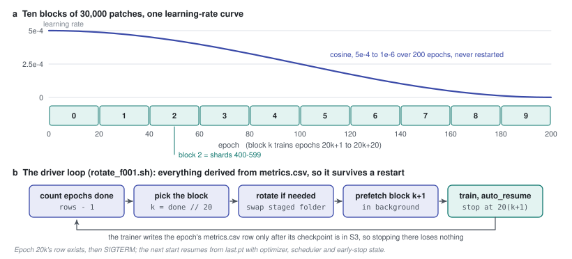
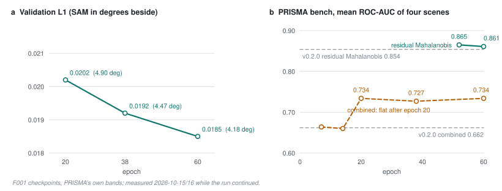

# 43 - F001: two hundred epochs on rotating data

> **The one thing this part teaches:** a run that needs more data than the disk can hold is a
> loop of 20-epoch blocks on one unbroken learning-rate schedule, driven by a script that reads
> all its state from the run's own records. F001's reconstruction kept improving block after
> block while its detection score stood still, and that stall was the score's fault, not the
> model's.

## Where this part sits

Part 42 ended with three fixes for reading any band list. E005 tested them and passed three of its
four criteria. Extended to 20 epochs, it read PRISMA's own bands as well as E004 had read the
resampled ones (mean ROC-AUC 0.752 against 0.754, recorded in
`research/experiments/indradhanu-se-pretrain/E005-band-robust/README.md`).

That made E005's configuration the one to train properly. **F001** is that run: the final
SpectralEarth pretraining of the next Indradhanu, and the checkpoint all fine-tuning starts from
(parts 47 to 49). Its record is
`research/experiments/indradhanu-se-pretrain/F001-final-pretrain/`.

| | E001 to E005 | F001 |
|---|---|---|
| configuration | varies | E005's exactly (`config.json`) |
| epochs | capped at 20 | 200 |
| training patches | the same 30,000 every epoch | 30,000 per epoch, a new set every 20 epochs |
| distinct patches seen | 30,000 | 300,000 |
| early stopping | on | off |

Two new words first. An **epoch** here is one pass over `train_samples_per_epoch` patches - 30,000
(part 27). A **block** is a set of 200 SpectralEarth shards; at 150 patches per shard that is
`200 x 150 = 30,000` patches, exactly one epoch's worth.

## Why more data, not only more epochs

The cheap way to train for 200 epochs is to show the same 30,000 patches 200 times. A network
with 5 million knobs (part 26) can then start to **memorise**: get better at those exact patches
without getting better at patches it has never seen. Validation would catch that eventually, but
by then the epochs are paid for.

F001 instead walks through ten blocks, 20 epochs each:

```
block k   = train shards k x 200 .. k x 200 + 199
block 0   = shards    0 -  199   epochs   1 -  20
block 1   = shards  200 -  399   epochs  21 -  40
block 2   = shards  400 -  599   epochs  41 -  60
...
block 9   = shards 1800 - 1999   epochs 181 - 200
```

Each patch is still seen 20 times, as in E001 to E005, but the run as a whole sees `10 x 30,000 =
300,000` different patches - 58% of SpectralEarth's training split.

> **Analogy.** A mobile library visits a village once a month. Readers do not need a building big
> enough for every book the library owns; they need shelf space for this month's crate and room
> by the door for next month's, which is unloaded while they are still reading. Over a year they
> read twelve crates.

## Why not put all ten blocks on the disk

Because they do not fit. Work it from the shard layout in `docs/lld/spectralearth.md`: each patch
is 202 bands of 128 x 128 pixels, stored as int16 (2 bytes per number).

```
one patch   202 x 128 x 128 x 2 bytes = 202 x 16,384 x 2 = 6,619,136 bytes, about 6.6 MB
one shard   150 patches x 6.6 MB                          = about 0.99 GB
one block   200 shards x 0.99 GB                          = about 198 GB
all ten     10 blocks x 198 GB                            = about 1.98 TB
```

The L40S instance's local NVMe disk holds about 412 GB. It fits two blocks - the one training and
the one being downloaded for next time - at about `2 x 198 = 396` GB, and not ten.

## One schedule across all ten blocks

The **learning rate** is the size of each weight update (part 28). F001 uses the cosine schedule of
part 28 with `learning_rate = 0.0005`, `min_lr = 1e-6` and `num_epochs = 200`, so the curve is
computed over all 200 epochs (`T_max` comes from `data.num_epochs` in
`app/abstract_classes/foundation_trainer.py`):

```
lr(t) = min_lr + 0.5 x (lr_0 - min_lr) x (1 + cos(pi x t / 200))
```

At the first three rotations:

```
t = 20:  cos(0.1 pi) = 0.9511
         lr = 0.000001 + 0.5 x 0.000499 x 1.9511 = 0.000001 + 0.0004868 = 0.000488
t = 40:  cos(0.2 pi) = 0.8090
         lr = 0.000001 + 0.5 x 0.000499 x 1.8090 = 0.000001 + 0.0004513 = 0.000452
t = 60:  cos(0.3 pi) = 0.5878
         lr = 0.000001 + 0.5 x 0.000499 x 1.5878 = 0.000001 + 0.0003962 = 0.000397
```

The data changes at each rotation; the schedule does not. A rotation resumes the scheduler from
the checkpoint exactly where it stopped, so epoch 21 continues from epoch 20's learning rate rather
than jumping back to 0.0005.



*Figure 43.1 - (a) The ten 30,000-patch blocks along F001's 200 epochs, under the one cosine
learning-rate curve that runs through all of them. (b) The loop in `rotate_f001.sh`. Every
decision is computed from `metrics.csv` and two marker files, so the script can be killed and
restarted at any point.*

**A note on warm-up, where the record and the source disagree.** The F001 README describes "one
cosine schedule over 200 epochs (5 warm-up)". The run's `config.json` sets `warmup_epochs: 0`, and
part 28 showed that the trainer never reads that field anyway. The source wins: F001 has no
warm-up. Its first epoch ran at the full 0.0005.

## Early stopping is off

Part 41 built early stopping: stop once the validation score has not improved by 1% for
`early_stop_patience` epochs. F001's config sets `early_stop_patience: null`, which turns it off.

The reason is the rotation. Within a block the model sees the same 30,000 patches 20 times, so it
can flatten out near the end of the block and then improve again when fresh data arrives. Suppose
a run with patience 10 had its best score at epoch 30:

```
epochs 31 to 40   no 1% improvement   bad_epochs climbs 1 .. 10
epoch 40          patience reached, epoch 40 >= 20   STOP
epoch 41          block 2 would have arrived - never trained
```

`best.pt` still tracks the lowest validation score, so the best epoch is kept either way.

## The driver

`research/experiments/indradhanu-se-pretrain/F001-final-pretrain/rotate_f001.sh` runs on the
instance. Its header explains why no trainer change was needed: with
`hot_storage.skip_sync_if_exists`, the trainer trains on whatever `*.tar` files sit in its local
train folder, and `auto_resume` (part 28 and `docs/lld/spectral-stem.md`) continues from `last.pt`
with the optimiser, scheduler and early-stop state. So a rotation is only: stop, swap the folder's
contents, start again.

Each pass of its loop does five things.

1. **Count the epochs done.** `metrics.csv` has a header plus one row per finished epoch, so
   `done = lines - 1`.
2. **Pick the block.** `k = done // 20` (integer division) and `stop_at = 20 x (k + 1)`.
3. **Rotate if needed.** A marker file `BLOCK` says which block the train folder holds. If it is
   not `k`, the script swaps in the staged copy - but only if a second marker says the stage holds
   block `k` and the stage really contains 200 tar files. Otherwise it downloads block `k` there
   and then.
4. **Prefetch the next block** in the background: block `k + 1` downloads into a staging folder,
   16 shards at a time, while block `k` trains. `fetch_block` fails unless all 200 arrive.
5. **Train.** Start `train_foundation_model.py`, poll every 30 seconds, and send it `SIGTERM` once
   `done >= stop_at`. If the trainer dies early, retry up to three times; after the third failure
   the script stops.

Work one pass by hand. The instance restarts after a crash; `metrics.csv` has 41 lines.

```
done     = 41 - 1    = 40
k        = 40 // 20  = 2
stop_at  = 20 x 3    = 60
BLOCK says 1, not 2  -> rotate: swap in block 2 (shards 400-599)
prefetch block 3     -> shards 600-799 into the staging folder
train                -> resume from last.pt (epoch 40), run 41..60, SIGTERM at 60
```

**Why stopping is safe.** In `spectral_stem_mae_trainer.py`, `_run_epoch` calls the parent epoch,
which saves the checkpoint and uploads `last.pt` to S3, and only then appends the `metrics.csv` row.
So by the time the driver sees row 60, epoch 60's checkpoint is already in S3. Killing the trainer
there loses nothing.

A separate background loop copies `metrics.csv`, `train.log` and the driver's own log to S3 every
five minutes, so the record survives the instance too.

## What it costs

About 9.2 minutes per 30,000-patch epoch on the L40S (`docs/lld/spectral-stem.md`), at $2.69 per
hour for the g6e.2xlarge:

```
200 epochs x 9.2 min = 1,840 min
1,840 / 60           = 30.7 hours
30.7 x $2.69         = $82.5
```

The README's estimate before launch was "roughly 30 hours, ~$82".

## What the curves showed

**Two scores, two different questions.** Validation L1 and SAM ask how well the model redraws
SpectralEarth patches it has never trained on (parts 23, 24, 41). The **PRISMA bench**
(`scripts/evaluate_prisma_bench.py`) asks how well it finds anomalies: four labelled PRISMA scenes,
read on PRISMA's own bands, scored by ROC-AUC (part 30), and also by **objects caught** - how many
of the 909 labelled objects have at least one pixel among the top 1% of scores, allowing one pixel
of slack because the labels may sit a pixel off (`score_metrics` in
`app/utils/evaluation/prisma_bench.py`).

| epoch | val L1 | val SAM | bench, combined score (mean AUC) | objects caught (combined) |
|---|---|---|---|---|
| 20 | 0.0202 | 4.90 deg | 0.734 | |
| 38 | 0.0192 | 4.47 deg | 0.727 | 226 |
| 60 | 0.0185 | 4.18 deg | 0.734 | 233 |
| v0.2.0 (production) | | | 0.662 | 194 |

Reconstruction improved steadily. From epoch 20 to 60:

```
L1:   0.0202 - 0.0185 = 0.0017     0.0017 / 0.0202 = 0.084   about 8% better
SAM:  4.90 - 4.18     = 0.72 deg   0.72 / 4.90     = 0.147   about 15% better
```

Detection under the `combined` score did not move: 0.734, 0.727, 0.734. Already at epoch 20 F001
beat production by `0.734 - 0.662 = 0.072`, and forty more epochs added nothing.



*Figure 43.2 - (a) F001's validation L1 falls at every checkpoint, SAM with it. (b) The PRISMA bench
under the `combined` score (amber) jumps above production by epoch 20 and then stays flat. The same
reconstructions scored by residual Mahalanobis (teal, measured from epoch 52) sit 0.13 higher.*

There are two ways to read a stall like that: the model has stopped learning what matters, or the
ruler cannot see the improvement. The scoring comparison of 2026-10-15 (part 46) answered it. The
same F001 reconstructions scored with **residual Mahalanobis** - parts 45 and 46 - gave:

| | mean AUC | objects caught |
|---|---|---|
| F001 epoch 52, residual Mahalanobis | 0.865 | 383 |
| F001 epoch 60, residual Mahalanobis | 0.861 | 386 |
| v0.2.0, residual Mahalanobis | 0.854 | 403 |

**The stall was the ruler.** The `combined` score was dominated by errors every pixel shares -
PRISMA's detector stripes, haze, dark sea - so reducing the model's error on ordinary ground barely
moved it. Part 45 shows why. It also shows a humbling detail in that table: once both models are
scored properly, production's v0.2.0 is only `0.865 - 0.854 = 0.011` behind F001's epoch 52 on AUC, and catches more
objects.

## One scene can swing a mean

Read single-scene numbers with care. Set1, the coastal scene that broke E004 (part 42), scored
0.430 at epoch 14 and 0.702 at epoch 20 under `combined` - a swing of 0.27 from one block of
training. Four scenes cannot give a reliable average when one of them moves that much, which is
why every gate in part 49 compares runs on the same four scenes with the same score, never against
a number measured another way.

## Common confusions

**"Does rotating the data restart the training?"** No. The weights, optimiser state and learning
rate all continue from `last.pt`. Only the files in the train folder change.

**"Why 20 epochs per block, not 1?"** One block is one epoch's worth of patches, so 1 epoch per
block would be a download of about 198 GB every 9 minutes. Twenty epochs per block gives the
prefetch about three hours to finish, and keeps each patch's repeat count equal to E001 to E005's.

**"If early stopping is off, how is the best epoch chosen?"** By `best.pt`, which is rewritten
whenever the validation score reaches a new low, whatever early stopping is doing.

**"The README says 5 warm-up epochs."** It is wrong; see the warm-up note above. The field is not
read, and the config sets it to 0 anyway.

**"So F001 is no better than v0.2.0?"** It reconstructs better and is far ahead under `combined`;
under residual Mahalanobis the two are close (0.861 against 0.854). F001's real advantage is that it
reads any sensor's own bands (part 42), which fine-tuning builds on.

## Check yourself

1. Which shards make up block 6, and which epochs train on it?
2. After a restart, `metrics.csv` has 128 lines. Work out `done`, `k` and `stop_at`.
3. Compute the learning rate at `t = 100`. Show the steps.
4. Why is it safe for the driver to kill the trainer as soon as row `stop_at` appears?
5. Validation SAM fell from 4.90 to 4.18 degrees while the combined bench stayed at 0.734. Give the
   two possible explanations and say which one the evidence supports.

<details>
<summary>Answers</summary>

1. `6 x 200 = 1200` to `1200 + 199 = 1399`; epochs `20 x 6 + 1 = 121` to `20 x 7 = 140`.
2. `done = 128 - 1 = 127`; `k = 127 // 20 = 6`; `stop_at = 20 x 7 = 140`. The run resumes at epoch
   128 on block 6.
3. `cos(pi x 100 / 200) = cos(pi / 2) = 0`, so `lr = 0.000001 + 0.5 x 0.000499 x (1 + 0) = 0.000001 +
   0.0002495 = 0.0002505`.
4. The trainer appends the row only after saving the checkpoint and uploading it to S3, so the
   epoch's weights are already safe.
5. Either the model stopped improving at what matters for detection, or the score could not see the
   improvement. The same reconstructions under residual Mahalanobis scored 0.865 (epoch 52) against
   0.715 for `combined`, so the score was the limit.

</details>

---

**Next:** part 44 - the three sensors fine-tuning will read, and the quirks of each.
