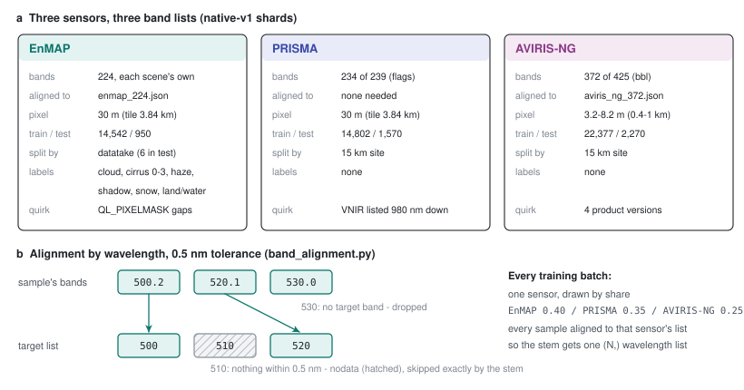

# 44 - Three sensors at their own bands

> **The one thing this part teaches:** fine-tuning reads EnMAP, PRISMA and AVIRIS-NG exactly as
> each sensor delivered them - own bands, own pixel size, nothing resampled - and every quirk of
> each sensor (a renumbered band, a defect map, four product versions) is handled by one rule:
> match bands by wavelength, and turn anything missing into nodata that the stem already skips.

## Why new data at all

F001 (part 43) has only ever seen SpectralEarth, which is EnMAP data that DLR cut into patches and
put onto one fixed list of 202 bands. The product scores three hyperspectral sensors - PRISMA,
EnMAP and AVIRIS-NG - each on its own band list and at its own pixel size. The fine-tuning plan
(`docs/proposals/fine-tuning-and-segmentation.md`) gives three reasons to train on them directly:
real sensors, the wavelengths SpectralEarth dropped (including the hydrocarbon band near 1730 nm),
and EnMAP's cloud and water labels for a segmentation head (part 47).

A word you need: **native** means the sensor's own band list and pixel grid, untouched. The
opposite is **resampled**: values interpolated onto some other list, such as the 165-band grid of
part 03 or SpectralEarth's 202.

All three sets share one sample layout, the one SpectralEarth uses (part 27):

| member | contents |
|---|---|
| `pixels.npy` or `pixels.i16dz` | int16 `(bands, 128, 128)`; multiply by 0.0001 for reflectance; -32768 = nodata |
| `wavelengths.npy` | float32 `(bands,)`, the centre of each band in nm, in the same order |
| `meta.json` | scene id, date, tile position, and sensor facts |
| `label_*.npy` | EnMAP only: the provider's quality layers |

Tiles are 128 x 128 pixels, and a tile is kept only if at least 10% of its pixels are valid.



*Figure 44.1 - (a) The three shard sets as they stand on 2026-10-16. Colours here identify the
sensor only. (b) The one rule that lets mixed band lists share a trainer: match by wavelength
within 0.5 nm; a target band with no match becomes nodata, a source band with no target is
dropped.*

## EnMAP: 224 bands, labels, and a defect map

`docs/lld/enmap-shards.md`, `app/utils/enmap/`. 210 EnMAP L2A scenes from the inventory became
14,542 training tiles and 950 test tiles. Each tile keeps all 224 bands at the scene's own
wavelengths.

**A renumbered band.** Five early-2023 scenes (processor version V010502) number their shortwave
bands one off: in those scenes band 142 is 1530.29 nm, elsewhere it is 1518.87 nm. Reading "band
142" by position would silently mix two different wavelengths. The shards therefore carry
`wavelengths.npy` with every sample, and everything downstream matches **by wavelength, never by
band number** (the LLD's first invariant). Across all scenes the stats file lists 227 distinct
wavelengths: 224 per scene, plus the renumbered scenes' shifted ones.

**Labels.** EnMAP's L2A product ships quality layers: cloud, cirrus (levels 0 to 3), haze, cloud
shadow, snow, and a class map (1 land, 2 water, 3 no data; code 0 turned out to be EnMAP's cloud class,
though the LLD calls it no data - part 48). They are stored exactly as delivered and are **never
applied to the pixels**: a cloudy tile stays in, because cloudy tiles
are what a segmentation head learns from.

**The split.** A **datatake** is one continuous recording; consecutive scenes from it border each
other. If two neighbouring scenes landed on opposite sides of the split, the test set would contain
ground the model trained on a few pixels away. So whole datatakes go to one side: 6 of the 66 went
to test (13 scenes), with both cloudy and clear ones represented.

**The pixel mask.** EnMAP also delivers `QL_PIXELMASK`: one 0/1 flag per band per pixel. The tiler
turns every flagged voxel (one band of one pixel) into nodata. A probe of three scenes on
2026-10-15 found what the flags are:

- Bands 131 to 135 (about 1343-1390 nm) are flagged in every pixel - the L2A water-vapour blank.
  They are nodata in the cube anyway and are not among SpectralEarth's 202.
- About 200 other bands carry scattered flags, and each band's flagged share is the same in all
  three scenes to 0.01% (band 187: 5.31%; band 183: 5.01%). A share that does not change with the
  scene follows the **detector**, not the ground: it is a fixed defect map.
- Flagged voxels hold real readings, mostly ordinary; in one scene band 183's flagged values jump
  about 20 times more than their neighbours (2,122 DN against 100), so some flags do mark bad
  values.

Net effect, in the LLD's words: 85-95% of pixels lose 2-4 of their 224 bands. That sounds alarming
until you recall part 35: a dead band drops out of the wavelength stem exactly, and out of the loss
too. A pixel with 221 of 224 bands is not a hole in the data; it is a slightly thinner spectrum.
Masking was kept as the provider intends (recommended 2026-10-15, pending the user's decision).

## PRISMA: reading the file without the product pipeline

`docs/lld/prisma-shards.md`, `app/utils/prisma/scene.py`. 223 PRISMA L2D scenes became 14,802
training and 1,570 test tiles.

The product reads PRISMA through `PrismaDatasetBuilder`, which runs the band pipeline of part 03:
excluded bands, gap filling, the 165-band grid. Shards must keep the sensor's bands untouched, so
`read_scene` opens the HDF5 file directly and applies only what the builder applies *before* its
pipeline. The module docstring gives the three rules:

```
reflectance = DN / 65535 x (L2Scale<Det>Max - L2Scale<Det>Min) + L2Scale<Det>Min
nodata      = DN == 0, or the detector's PIXEL_L2_ERR_MATRIX != 0
dropped     = bands whose List_Cw_<Det>_Flags is 0 (5 of 239: no real band)
```

**DN** (digital number) is the raw stored integer, 0 to 65535. `<Det>` is the detector: VNIR
(visible and near-infrared) or SWIR (shortwave infrared), each with its own scale factors stored in
the file. Work one value with illustrative factors Min = 0.0 and Max = 1.0:

```
DN = 13,107
reflectance = 13,107 / 65,535 x (1.0 - 0.0) + 0.0 = 0.2 x 1.0 = 0.2
stored      = round(0.2 / 0.0001)             = 2,000   (int16)
```

The LLD records the check: on set1 at 860 nm the result differs from the builder's own read by at
most 0.00005 reflectance - int16 rounding.

**Odd band order.** The file lists the VNIR bands from about 980 nm *downwards*, then the SWIR
bands upwards, and the two detectors overlap between about 920 and 980 nm. Nothing is sorted or
de-duplicated. That would be a trap for anything that assumes ascending wavelengths; the stem takes
bands in any order because each carries its wavelength.

**One band list everywhere.** All 234 centres were identical to 0.000 nm across 8 inventory scenes
from 2023 to 2026 and the four benchmark scenes from 2020 to 2024. PRISMA batches therefore need no
alignment at all.

A trap to note: **the shards hold 234 PRISMA bands; the bench reads 185.** The bench's "native"
mode is PRISMA's own bands *after* the product's default band filter (`app/utils/evaluation/prisma_bench.py`),
which removes noisy and overlapping bands. Part 42's "185 native bands" is that list. Both are
native - neither is resampled - but they are not the same list.

**No labels.** PRISMA L2D has no cloud or water mask, so PRISMA batches teach reconstruction only.

**The split, by site.** PRISMA revisits places. Two dates of one place on opposite sides of the split
would leak, so `app/utils/prisma/split.py` groups scenes into **sites**: scenes whose centres lie
within 15 km of each other, chained. "Chained" (single-link) matters - work it:

```
scene P to scene Q   10 km    <= 15   same site
scene Q to scene R   12 km    <= 15   same site
scene P to scene R   21 km    >  15   - but P and R are already joined through Q
result: one site {P, Q, R}
```

Then any site within 30 km of a benchmark scene (set1, set2, set3+set4) is **excluded** from train
and test, so training never sees the bench's ground on another date. The bench scenes themselves are
not in the inventory; the rule guards against other dates of the same place. On the real run it
excluded nothing (0 scenes): no inventory scene lies within 30 km of a benchmark site. Of the rest,
10% of sites went to test: 21 scenes against 202 for training.

## AVIRIS-NG: an airborne sensor, four product versions

`docs/lld/aviris-shards.md`, `app/utils/aviris/`. AVIRIS-NG flies on an aircraft, so its pixels are
far smaller than a satellite's. The 79 flight lines of the ISRO-NASA India campaign became 22,377
training and 2,270 test tiles.

**Getting it.** The lines lived in a shared Google Drive folder. A one-off instance ran `rclone` with
a read-only token, copied 638 files (770.9 GiB) into a staging area, checked every file against
Drive's MD5 checksum (0 differences), uploaded its logs and powered itself off - it was launched to
terminate on shutdown, so nothing was left running
(`research/experiments/aviris-ng-ingest/copy_userdata.sh`). Each line was then registered in the
inventory with every byte re-hashed.

**Strip by strip.** A flight line's cube reaches about 11 GB, too big to load comfortably.
`AvirisScene.strip` memory-maps the file - the operating system pages in only what is touched - and
reads 128 lines (one tile row) at a time.

**Bands.** Each line has 425 bands; the header's `bbl` ("bad band list") marks 53 of them, the
water-vapour windows, as bad. 372 remain in every line. One more trap from the module docstring: the
header describes the cube as "Measured Radiances", but the `_corr_` cube is surface reflectance
(median 0.08 at 550 nm). The data wins over the header.

**Four product versions.** The campaign ships versions v2m2, v2m3, v2s1 and v2s2, and the product's
`AvirisNgDatasetBuilder` only looks for `_corr_v2m2`. The shard reader finds the reflectance file by
pattern instead. The versions place the 372 band centres up to 0.42 nm apart, so across all lines
the stats list 1,116 distinct wavelengths that fall into 372 tight groups. The fine-tuning band list
`research/experiments/indradhanu-finetune/band_lists/aviris_ng_372.json` takes the **median** of each
group; every variant is within 0.5 nm of it, so alignment pairs them correctly.

**Pixel size.** 3.2 to 8.2 m, depending on the line, and deliberately not resampled to 30 m
(decided 2026-10-15: fine-tuning should see airborne texture). A tile is always 128 pixels across,
so the ground it covers changes:

```
EnMAP, PRISMA   128 x 30 m  = 3,840 m
AVIRIS-NG       128 x 3.2 m =   410 m      128 x 8.2 m = 1,050 m
```

An AVIRIS-NG tile shows a field; a satellite tile shows a district. Whether the encoder needs
anything special for that scale gap is an open question in the proposal.

## Making it fit: band-delta compression

`app/utils/shard_codec.py`. Neighbouring bands of one pixel are similar, so storing each band as its
**difference from the previous band** leaves small numbers, which a general compressor (zstd) packs
far better. The format is called `.i16dz`. Work one pixel's four bands:

```
values      1000   1012   1020   1015
deltas      1000     12      8     -5      (first band kept as is)
decode      1000   1000+12=1012   1012+8=1020   1020-5=1015
```

One subtlety: the differences are taken in int16, which holds -32,768 to 32,767. Next to nodata
(-32,768), a difference overflows - and the codec lets it **wrap around** on purpose:

```
nodata -32768, then 1000:   1000 - (-32768) = 33,768    too big for int16
                            33,768 - 65,536 = -31,768   stored (wrapped)
decode:   -32768 + (-31768) = -64,536    wraps: -64,536 + 65,536 = 1000   exact
```

Because encoding and decoding wrap the same way, the round trip is exact. AVIRIS-NG tiles were
written compressed from the start. EnMAP and PRISMA were re-encoded on 2026-10-16 so that all three
sets fit on the L40S's 412 GB disk, about 2.1 times smaller, as the fine-tuning README records for
the re-encoded `native-v1z` sets. The proposal and the comments in `recompress_shards.py`,
`recompress_ft.sh` and `shard_codec.py` still quote ~1.9x and ~245 GB - SpectralEarth's ratio. From
the sizes in the three LLDs:

```
GiB          EnMAP                PRISMA                AVIRIS-NG
raw          100.9 + 6.6 = 107.5  105.8 + 11.2 = 117.0  116.0 + 11.2 = 127.2
re-encoded   107.5 / 2.1 = 51.2   117.0 / 2.1 = 55.7    127.2 (already compressed)

total raw          107.5 + 117.0 + 127.2 = 351.7 GiB    no room to work on a 412 GB disk
total re-encoded    51.2 +  55.7 + 127.2 = 234.1 GiB    fits, all on local disk
```

## One batch, one band list

Part 40's reduced stem takes **one wavelength list per batch** - a single `(N,)` vector, not one per
sample - and refuses per-sample lists. A batch is a stack of samples, so every sample in it must
carry the same bands in the same order. Two rules make that true:

1. **One sensor per batch.** The fine-tuning loader draws each batch from one sensor (part 49).
2. **Within a sensor, align by wavelength** (`app/utils/band_alignment.py`, run in the loader
   workers). Each target band takes the nearest source band within 0.5 nm; a target band with no
   match becomes nodata; a source band with no target is dropped. Nothing is interpolated.

Work the toy of Figure 44.1b. Target list 500, 510, 520 nm; a sample with bands at 500.2, 520.1 and
530.0 nm:

```
target 500   nearest source 500.2   distance 0.2  <= 0.5   take it
target 510   nearest source 500.2   distance 9.8  >  0.5   nodata
target 520   nearest source 520.1   distance 0.1  <= 0.5   take it
source 530   no target near it                             dropped
```

Each sensor's own list:

| sensor | aligned onto | effect |
|---|---|---|
| EnMAP | `enmap_224.json`: the 224 centres of the standard scenes | the five renumbered scenes' shifted bands are dropped, and standard bands they lack become nodata |
| PRISMA | nothing | one list in every scene already |
| AVIRIS-NG | `aviris_ng_372.json`: medians of the version groups | every variant within 0.42 nm, so every band pairs |

The 0.5 nm tolerance is chosen so it "only absorbs rounding in the metadata and never pairs two
neighbouring bands" (comment in `band_alignment.py`): EnMAP's bands are 6-12 nm apart, AVIRIS-NG's
about 5 nm.

## Common confusions

**"Does nodata mean zero?"** No. Nodata is -32,768 in the file and becomes a `band_valid = False`
voxel in the trainer. The stem skips it exactly; a zero would be read as "black in this band".

**"Why not resample everything to one grid and skip all this?"** Part 42: a stem trained on one list
reads others badly, and resampling ties the product to that grid. Native lists are the point.

**"PRISMA has 234 bands or 185?"** Both. The shards hold all 234 valid bands; the bench and the
product read 185 after the default band filter.

**"Why is AVIRIS-NG's band list made of medians?"** Because no single version's centres are "right".
The median sits inside every group's 0.42 nm spread, so all versions align to it.

**"Are AVIRIS-NG and PRISMA labels coming later?"** Neither product has a cloud or water mask. The
head learns from EnMAP's labels; stage 4 of part 49 may add confident predictions as pseudo-labels.

## Check yourself

1. A PRISMA SWIR voxel has DN 32,768 with Min = 0.0 and Max = 0.5. What reflectance and what stored
   int16 value does it get? Show the steps.
2. Delta-encode the bands 2000, 2010, 1990, 1995, then decode them again.
3. Scenes A to B are 14 km apart, B to C 16 km, A to C 25 km. How many sites? Now B to C is 15 km.
4. How wide on the ground is an AVIRIS-NG tile at 5.0 m pixels?
5. Align a sample with bands 500.3, 509.6, 525.0 onto the list 500, 510, 520. Which bands are kept,
   which become nodata, which are dropped?

<details>
<summary>Answers</summary>

1. `32,768 / 65,535 = 0.50001`; `0.50001 x (0.5 - 0.0) + 0.0 = 0.25`; stored `round(0.25 / 0.0001) = 2,500`.
2. Deltas: `2000, 10, -20, 5`. Decode: `2000; 2000 + 10 = 2010; 2010 - 20 = 1990; 1990 + 5 = 1995`.
3. A-B is within 15 km, so A and B are one site; B-C at 16 km joins nothing, and A-C is too far: two
   sites, {A, B} and {C}. At exactly 15 km the rule is `<= 15`, so all three become one site.
4. `128 x 5.0 = 640` m.
5. 500 takes 500.3 (0.3 nm); 510 takes 509.6 (0.4 nm); 520 has nothing within 0.5 nm (525.0 is 5 nm
   away), so it becomes nodata; 525.0 matches no target and is dropped.

</details>

---

**Next:** part 45 - why the old scores measured the wrong thing, and how residual Mahalanobis
measures direction instead of size.
