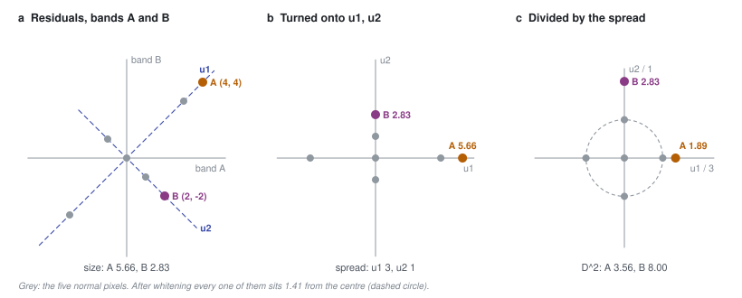

# 45 - Scoring the direction, not the size

> **The one thing this part teaches:** L1, SAM and `combined` measure how *big* a pixel's
> reconstruction error is, but in a real scene most big errors are shared by thousands of normal
> pixels - detector stripes, haze, dark sea. Residual Mahalanobis finds the directions those
> normal errors take, divides each by its normal spread, and scores what is left, so an error is
> high only if it is *unusual*, however small it is.

## Where we are

Part 30 turned the **residual** - the original spectrum minus the reconstruction, one number per
band - into a score per pixel, four ways: L1, MSE, SAM and `combined`. Part 43 ended with a puzzle:
F001's reconstruction kept improving while its `combined` score on the PRISMA bench stood still.
This part explains why, and builds the replacement that became Indradhanu's default score on
2026-10-15: `residual_mahalanobis`, in `app/utils/anomaly_detection/residual_mahalanobis.py`.

The shorter introduction in the anomaly course (`docs/training/anomaly-detection/12-residual-to-score.md`,
"Scoring the direction") gives the idea in two dimensions. This part does every step by hand and
then reads the code.

## Big errors that are not anomalies

Each of the scores in part 30 is a *size*:

| score | measures |
|---|---|
| L1 | the mean of the residual's absolute values across bands |
| SAM | the angle between the original and reconstructed spectra |
| `combined` | `0.5 x L1 / max(L1) + 0.5 x SAM / max(SAM)`, maxima over the scene's valid pixels |

Size is the right question only if every large error is rare. On the four labelled PRISMA scenes,
the score maps showed three kinds of large error that are not rare at all:

- **Detector stripes.** An imaging spectrometer like PRISMA records each image column with its own
  detector element. One element calibrated slightly off makes every pixel in its column err the
  same way, so the score map shows a stripe. On set4 the `combined` map was dominated by them.
- **Haze.** Thin atmosphere over part of a scene lifts the blue end of every spectrum beneath it.
  The model, trained mostly on clear ground, under-predicts all of those pixels by a similar amount.
  Set4 again.
- **Dark sea.** On set1, 75% sea, the map was dominated by the sea - the SAM trap below.

In each case thousands of pixels share one *kind* of error. A size score ranks all of them above a
small real target. The model is not at fault: the score is asking the wrong question.

## The dark-sea trap, and a patch for it

SAM is an angle, so it measures error *relative to* the signal. The anomaly course works the same
residual (+0.01, -0.01, +0.01) on a dark sea pixel and a bright land pixel: the land pixel's angle
is 0.046 rad, the sea pixel's 0.434 rad - nine times larger for the same absolute error. Measured on
set1 with F001, the median angle is 0.34 rad on sea, 0.13 on land, and 0.18 on the labelled
anomalies (`docs/05-detectors.md`), so ordinary sea outranks the targets.

`compute_score(..., sam_dark_fade=t)` (`app/utils/anomaly_detection/scoring.py`) multiplies the angle
by a weight that fades it out on dark pixels:

```
w = clip(mean reflectance of the pixel / t, 0, 1)        t = 0.05

sea,  mean 0.02:   w = clip(0.02 / 0.05, 0, 1) = clip(0.4, 0, 1) = 0.4    angle x 0.4
land, mean 0.20:   w = clip(0.20 / 0.05, 0, 1) = clip(4.0, 0, 1) = 1.0    angle unchanged
```

It works on set1 - F001 at epoch 52 went from 0.731 to 0.887 - and leaves the other three scenes
almost untouched. **That is exactly the problem.** It is a patch:

1. Only set1 has water, so four scenes cannot tell whether 0.05 is right. And the result is steep in
   `t`: F001 at epoch 14 scores 0.524 on set1 with `t = 0.03` and 0.810 with `t = 0.08`.
2. It fixes darkness only. Stripes and haze are untouched, and set4 stays at 0.698.
3. It is a special case per failure. The next failure would need another.

The fade is opt-in (`None` by default) and the product does not pass it; residual Mahalanobis
superseded it.

## A residual is a direction

At 185 bands, a residual is a list of 185 numbers. Think of it as an arrow in a 185-dimensional
space: one axis per band. Its **length** is what L1 roughly measures. Its **direction** says which
bands erred, and how they erred together.

Now look at what the shared errors above have in common. Haze pushes many bands the same way at
once: one direction. A miscalibrated detector column pushes its pixels another way: one direction. A
scene's normal errors are large along **a few shared directions** and tiny along all the others.
A real anomaly - a material the model never saw - errs in a direction the background rarely takes,
even if the arrow is short.

> **Analogy.** A doctor reads twenty blood tests. A dehydrated patient has every concentration a
> little high - but they all rise *together*, because there is less water, so the doctor reads them
> as one finding, not twenty. One test far outside its own normal range, while the rest are
> ordinary, is the result that matters. Residual Mahalanobis reads residuals the same way: shared
> movements are one ordinary finding; a movement nobody else makes is the alarm.

## Worked by hand: two bands, five normal pixels

Do this on paper; it takes about five minutes. Two bands, A and B. Five normal pixels have these
residuals:

| pixel | r_A | r_B |
|---|---|---|
| 1 | 3 | 3 |
| 2 | -3 | -3 |
| 3 | 1 | -1 |
| 4 | -1 | 1 |
| 5 | 0 | 0 |

Two test pixels: **A** = (4, 4) and **B** = (2, -2). By size, A is the bigger error:

```
length of A = sqrt(4^2 + 4^2) = sqrt(32) = 5.66        L1 of A = (4 + 4) / 2 = 4
length of B = sqrt(2^2 + 2^2) = sqrt(8)  = 2.83        L1 of B = (2 + 2) / 2 = 2
```

**Step 1 - the mean.** `(3 - 3 + 1 - 1 + 0) / 5 = 0` for both bands. The mean residual is (0, 0).

**Step 2 - variance and covariance.** The **variance** of a band is the average squared distance from
its mean; the **covariance** of two bands is the average of their products, positive when they move
together. The code uses `np.cov`, which divides by `N - 1 = 4`:

```
var_A  = (3^2 + 3^2 + 1^2 + 1^2 + 0^2) / 4 = (9 + 9 + 1 + 1 + 0) / 4 = 20 / 4 = 5
var_B  = (9 + 9 + 1 + 1 + 0) / 4                                     = 20 / 4 = 5
cov_AB = (3x3 + (-3)(-3) + 1(-1) + (-1)1 + 0) / 4 = (9 + 9 - 1 - 1) / 4 = 16 / 4 = 4
```

Band by band the two look equally noisy (variance 5 each). The covariance of 4 says that most of
that noise is shared.

**Step 3 - the principal directions.** A **principal direction** is a direction along which the
normal residuals spread out; the first is the direction of greatest spread, the next is
perpendicular to it. For two bands with equal variance the directions are the diagonals, and the
spreads are easy:

```
u1 = (0.7071,  0.7071)  "both bands together"    eigenvalue = var + cov = 5 + 4 = 9
u2 = (0.7071, -0.7071)  "the bands disagreeing"  eigenvalue = var - cov = 5 - 4 = 1
```

(0.7071 is `1 / sqrt(2)`, which makes each direction one unit long.) You can check u1: multiply the
covariance table `[[5, 4], [4, 5]]` by it and you get `(5 x 0.7071 + 4 x 0.7071, 4 x 0.7071 + 5 x 0.7071)
= (9 x 0.7071, 9 x 0.7071)` - u1 stretched 9 times. That stretch is the **eigenvalue**; `np.linalg.eigh`
finds these pairs for any number of bands.

**Step 4 - turn each residual onto those directions.** A pixel's coordinate along a direction is
`r_A x 0.7071 + r_B x (+/-0.7071)`:

| pixel | along u1: (r_A + r_B) x 0.7071 | along u2: (r_A - r_B) x 0.7071 |
|---|---|---|
| 1 (3, 3) | 6 x 0.7071 = 4.24 | 0 |
| 2 (-3, -3) | -4.24 | 0 |
| 3 (1, -1) | 0 | 2 x 0.7071 = 1.41 |
| 4 (-1, 1) | 0 | -1.41 |
| 5 (0, 0) | 0 | 0 |
| **A** (4, 4) | 8 x 0.7071 = 5.66 | 0 |
| **B** (2, -2) | 0 | 4 x 0.7071 = 2.83 |

Check the spread along u1 over the five normal pixels: `(4.24^2 + 4.24^2) / 4 = (18 + 18) / 4 = 9`.
Along u2: `(1.41^2 + 1.41^2) / 4 = (2 + 2) / 4 = 1`. They match the eigenvalues.

**Step 5 - whiten.** Divide each coordinate by its direction's **standard deviation**, the square root
of the eigenvalue: `sqrt(9) = 3` along u1, `sqrt(1) = 1` along u2. This is **whitening**: afterwards
the normal pixels spread equally in every direction.

```
pixel 1:  (4.24 / 3, 0 / 1)    = (1.41, 0)
pixel 3:  (0 / 3,    1.41 / 1) = (0, 1.41)
A:        (5.66 / 3, 0 / 1)    = (1.89, 0)
B:        (0 / 3,    2.83 / 1) = (0, 2.83)
```

**Step 6 - the score.** The squared length in whitened space is the **Mahalanobis distance**, `D^2`:

```
normal pixels 1-4:  1.41^2 = 2.0          pixel 5: 0
A:                  1.89^2 + 0^2 = 3.56
B:                  0^2 + 2.83^2 = 8.00
```

**The ranking flips.** A is twice B's size, but it errs along the direction every normal pixel errs
along, only a little further. B is small, but its error lies in a direction where the background
barely moves. Every normal pixel scores at most 2.0; B scores 8.0.



*Figure 45.1 - The worked example. (a) The residuals of five normal pixels (grey) spread along the
diagonal u1 far more than along u2. A (amber) lies further out along u1; B (plum) lies along u2.
(b) The same points turned onto u1 and u2. (c) After dividing by each direction's spread, the normal
pixels sit on one circle of radius 1.41, A is a little outside it, and B is far outside.*

## The same steps in the code

`whitened_pca` does steps 1 to 5 for a whole scene:

```python
X = residual[:, keep].T.astype(np.float64)        # (N, C): one row per valid pixel
mu = X.mean(0)                                     # step 1
sub = X[rng.choice(len(X), size=min(len(X), 200_000), replace=False)] - mu
evals, evecs = np.linalg.eigh(np.cov(sub.T))       # steps 2 and 3, on a sample
order = np.argsort(evals)[::-1][:d]                # the d largest spreads
P = ((X - mu) @ evecs[:, order]) / np.sqrt(np.maximum(evals[order], 1e-12))
                                                   # steps 4 and 5
```

and with no local window (part 46) the score is `(X ** 2).sum(0)` - step 6. Three details:

- **A sample, with a fixed seed.** The covariance comes from at most 200,000 valid pixels drawn
  with seed 0, so the score is deterministic and the cost does not grow with the scene.
- **The floor.** An eigenvalue below `1e-12` is raised to `1e-12` before the square root, so a
  perfectly flat direction cannot divide by zero.
- **The mean is the scene's own.** Every scene gets its own directions and spreads. A stripe or a
  haze bank that dominates *this* scene is learned and discounted *here*.

## Why only the top 30 directions

`PCA_COMPONENTS = 30`. With 185 bands there are 185 directions, but the smallest spreads are not
signal - they are noise in the estimate itself, and dividing by them explodes. Suppose one direction
has an estimated eigenvalue of `1e-10` (a standard deviation of 0.00001) and a pixel errs along it by
a mere 0.001:

```
contribution = 0.001^2 / 1e-10 = 0.000001 / 0.0000000001 = 10,000
```

One meaningless direction now outscores everything. This is why **plain RX** - Mahalanobis on the
raw cube over all bands - was dropped from the product on 2026-05-11, with distances reaching about
1e11 (CLAUDE.md). Keeping the 30 largest directions keeps the ones that carry real variance. A 30 x
30 covariance has `30 x 31 / 2 = 465` distinct numbers to estimate, from up to 200,000 pixels: well
determined.

## Why on the residual, and how much the model adds

RX - Reed and Yu's 1990 detector, part 08 of the anomaly course - is exactly this distance, applied
to the *cube*. The difference here is the input. A raw scene is a mixture of very different surfaces
(sea, crops, towns), so one set of directions fits it badly. The model has already explained "what
surface is this"; what it leaves behind is closer to one cloud of ordinary errors, which is what
Mahalanobis assumes.

Be honest about the size of that effect. On the four PRISMA scenes with production v0.2.0
(`research/experiments/dual-window-mahalanobis/README.md`):

| | mean ROC-AUC |
|---|---|
| L1 on the residual | 0.702 |
| Mahalanobis, top 30, on the **cube** | 0.831 |
| Mahalanobis, top 30, on the **residual** (global mean) | 0.839 |

```
gain from scoring the direction:     0.839 - 0.702 = 0.137
gain from using the residual:        0.839 - 0.831 = 0.008
```

Most of the improvement comes from whitening, not from the model. The README's own words: the
residual "adds a small, consistent edge on top of a strong classical baseline".

## Common confusions

**"Is this a new model?"** No. The model and its reconstruction are unchanged; only the step that
turns a residual into a score is different. A checkpoint does not need retraining to use it.

**"Plain RX was dropped for exploding. Why is this allowed back?"** Two changes: only the 30 largest
directions are used, and it runs on the residual. The explosion came from dividing by the smallest,
noisiest eigenvalues, which are now discarded.

**"Is a high score a big error?"** Not necessarily, and that is the point. Pixel B above has the
smaller error and the higher score.

**"There is already a `mahalanobis` in the product."** That is the classical detector on the cube
(MNF-RX, thermal GRX). The new method is deliberately called `residual_mahalanobis` so the two are
never confused in configs or the UI (`docs/lld/residual-mahalanobis.md`).

**"Can I threshold it at, say, 10?"** No. Scores are squared distances with a heavy right tail. Like
every score in the product, it is thresholded by percentile (part 30) and drawn with a square-root
stretch.

## Check yourself

1. Using the five normal pixels above, score a new pixel with residual (3, -1). Show every step.
2. Five normal pixels have residuals (2, 2), (-2, -2), (2, -2), (-2, 2), (0, 0). Compute var_A, var_B
   and cov_AB (divide by 4). What are the two spreads, and which test pixel would score higher, (3, 3)
   or (3, -3)?
3. Why divide by the square root of the eigenvalue, not by the eigenvalue itself?
4. How many distinct numbers does a 40 x 40 covariance table hold?
5. Why does the SAM fade not help set4?

<details>
<summary>Answers</summary>

1. Along u1: `(3 + (-1)) x 0.7071 = 2 x 0.7071 = 1.41`; along u2: `(3 - (-1)) x 0.7071 = 4 x 0.7071 =
   2.83`. Whitened: `1.41 / 3 = 0.47` and `2.83 / 1 = 2.83`. `D^2 = 0.47^2 + 2.83^2 = 0.22 + 8.00 = 8.22`.
2. `var_A = (4 + 4 + 4 + 4 + 0) / 4 = 4`, `var_B = 4`, `cov_AB = (4 + 4 - 4 - 4 + 0) / 4 = 0`. No shared
   direction: both spreads are 4 (`4 + 0` and `4 - 0`). The two test pixels are the same length and
   score the same: `D^2 = (3^2 + 3^2) / 4 = 18 / 4 = 4.5` each. With no correlation, Mahalanobis is
   size divided by the spread.
3. The eigenvalue is a variance - a squared spread. Coordinates are in the residual's own units, so
   they must be divided by a spread in the same units: the standard deviation. Squaring afterwards
   then gives `coordinate^2 / eigenvalue`, as in the research README's formula.
4. `40 x 41 / 2 = 820`.
5. Set4's large ordinary errors are stripes and haze over land, not dark pixels. Its pixels are bright,
   so the fade weight is 1 and nothing changes.

</details>

---

**Next:** part 46 - comparing each pixel with its neighbourhood instead of the whole scene, a fast way
to sum a ring of 3,280 pixels, and the eleven-way comparison that chose the default.
