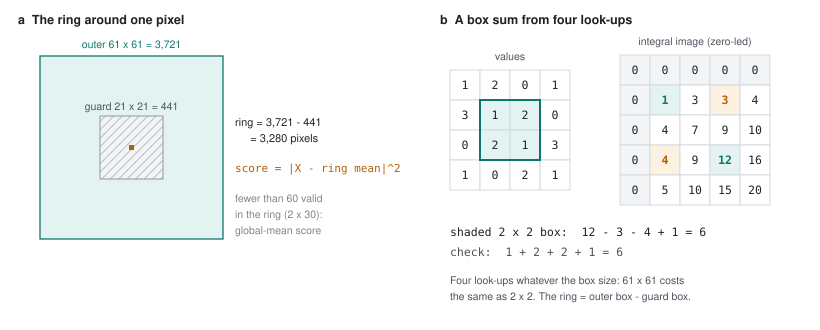
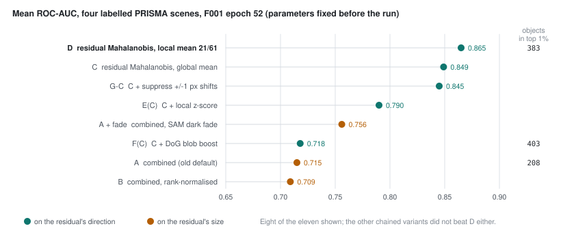

# 46 - The ring, and choosing a default from eleven scores

> **The one thing this part teaches:** the default score compares each pixel's whitened residual
> with the average of a ring of neighbours 21 to 61 pixels across, not with the whole scene, which
> removes the model's per-surface bias; integral images make that ring cost four look-ups instead
> of 3,280 additions; and of eleven scores compared with parameters fixed in advance, this one won
> on every scene - with the honest caveat that its window was chosen on those same scenes.

## The global mean assumes one centre

Part 45 scored each pixel by its squared length in whitened space, measured from the **scene's**
mean residual. That assumes every normal pixel's error scatters around one centre. It does not
quite. The dual-window research README puts it this way: "The model has a per-land-cover bias: its
residual over water is not centred where its residual over crops is."

Work it on one whitened coordinate (a single direction, to keep it small). Along it, a coast scene's
sea pixels sit around +1.5 and its land pixels around 0 - the model is consistently a little off
over sea. Score two pixels:

```
               value   global (from 0)    ring mean   local (from the ring mean)
ordinary sea    1.8    1.8^2 = 3.24       1.5         (1.8 - 1.5)^2 = 0.3^2 = 0.09
land target     1.6    1.6^2 = 2.56       0.0         (1.6 - 0.0)^2 = 1.6^2 = 2.56
```

Measured from the scene's centre, the ordinary sea pixel outranks the target. Measured from its own
neighbourhood, it drops to almost nothing and the target stands out.

> **Analogy.** Judging a child's height against every child in a school flags all the eldest class
> as unusually tall. Judging each child against their own classmates flags the one who really is.
> The spread (how much heights vary) can still be learned from the whole school; only the
> *average* needs to be local.

That last sentence is the design. `local_mean_score` subtracts a **local mean** but keeps the
**global covariance**: directions and spreads still come from the whole scene (part 45), because a
ring of a few thousand pixels cannot estimate them well (below).

## The ring and its guard

`LOCAL_WINDOW = (21, 61)` gives two full widths, both odd so they centre on the pixel:

```
outer box    61 x 61 = 3,721 pixels
guard box    21 x 21 =   441 pixels
ring         3,721 - 441 = 3,280 pixels
```

The **guard** is the inner box left out of the average. Without it, a target several pixels wide
would sit partly in its own "background" and pull the ring mean towards itself, shrinking its own
score. With a 21-pixel guard, anything within 10 pixels of the centre is excluded.

Two edge rules from the code:

- Only **valid** pixels count, so the ring mean is a sum of valid values divided by a count of valid
  pixels.
- If fewer than `MIN_RING_FACTOR x d = 2 x 30 = 60` valid pixels remain in the ring - at a scene
  edge, or beside a nodata hole - that pixel falls back to its global-mean score.



*Figure 46.1 - (a) The 61 x 61 window minus the hatched 21 x 21 guard leaves a ring of 3,280 pixels
whose mean is subtracted from the centre pixel (amber). (b) The toy of this part: a 4 x 4 grid of
values and its zero-led integral image. The shaded 2 x 2 box sums to 6 from four entries of the
table: plus the teal ones, minus the amber ones.*

**Why not a local covariance too?** That is the classical dual-window RX: both mean and spread
from the ring. The research tried it on the residual and it scored 0.814 against the local mean's
0.854 (`research/experiments/dual-window-mahalanobis/EXPERIMENT_LOG.md`, step 4). A ring of a few
hundred to a few thousand pixels cannot estimate 465 covariance numbers reliably, and it soaks up
nearby targets. "The local covariance is the problem, not locality."

## Summing a ring fast: integral images

The ring mean needs, for every pixel, the sum of 3,280 values in each of 30 whitened channels, plus
a count of valid pixels - 31 channels. Done directly, for a scene of one million pixels:

```
3,280 additions x 31 channels x 1,000,000 pixels = 101,680,000,000 additions
```

About 10^11. An **integral image** reduces any box sum to four look-ups. It is a table in which each
entry holds the sum of everything above and to the left of it, with an extra row and column of zeros
in front ("zero-led").

Take the 4 x 4 grid of Figure 46.1b:

```
values               integral image I (zero-led, 5 x 5)
1  2  0  1           0  0  0  0  0
3  1  2  0           0  1  3  3  4
0  2  1  3           0  4  7  9 10
1  0  2  1           0  4  9 12 16
                     0  5 10 15 20
```

Build it one entry at a time: `I[r+1][c+1] = value[r][c] + I[r][c+1] + I[r+1][c] - I[r][c]`. For
example, the entry for value row 1, column 1:

```
I[2][2] = value[1][1] + I[1][2] + I[2][1] - I[1][1] = 1 + 3 + 4 - 1 = 7
```

(Check: the top-left 2 x 2 block is `1 + 2 + 3 + 1 = 7`.) The last entry, 20, is the whole grid.

**A box sum** over rows `r0..r1` and columns `c0..c1` is

```
I[r1+1][c1+1] - I[r0][c1+1] - I[r1+1][c0] + I[r0][c0]
```

The shaded box, rows 1-2 and columns 1-2:

```
I[3][3] - I[1][3] - I[3][1] + I[1][1] = 12 - 3 - 4 + 1 = 6
check: 1 + 2 + 2 + 1 = 6
```

The big entry holds everything above-left of the box's far corner; the two subtractions remove the
strips above and to the left; they both removed the top-left corner, so it is added back once.

**A ring is one box minus another.** Shrink the windows to a toy ring around value row 1, column 1:
a 3 x 3 outer box and a 1 x 1 guard.

```
outer, rows 0-2, cols 0-2:   I[3][3] - I[0][3] - I[3][0] + I[0][0] = 12 - 0 - 0 + 0 = 12
guard, row 1, col 1:         I[2][2] - I[1][2] - I[2][1] + I[1][1] =  7 - 3 - 4 + 1 =  1
ring sum = 12 - 1 = 11       ring count = 9 - 1 = 8       ring mean = 11 / 8 = 1.375
```

Each box costs four look-ups whatever its size, so a 61 x 61 box costs the same as a 2 x 2.

## The code

`local_mean_score` in `residual_mahalanobis.py`, annotated:

```python
d, H, W = X.shape                              # X: (30, H, W), whitened, 0 outside keep
r = outer // 2                                 # 30
F = np.concatenate([keep[None], X * keep], 0)  # (31, H, W): channel 0 counts valid pixels
I = np.pad(np.pad(F, ((0, 0), (r, r), (r, r))).cumsum(1).cumsum(2),
           ((0, 0), (1, 0), (1, 0)))           # integral image, zero-led
A = _box(I, outer // 2, r, H, W) - _box(I, inner // 2, r, H, W)   # ring, (31, H, W)
n = A[0]                                            # valid pixels in each ring
ok = keep & (n >= MIN_RING_FACTOR * d)              # at least 60
s = ((X - A[1:] / np.maximum(n, 1)) ** 2).sum(0)    # |X - ring mean|^2
return np.where(ok, s, (X ** 2).sum(0)) * keep      # fallback: global-mean score
```

Three things make it exact:

- **Counts ride along as channel 0.** `keep` is 1 for valid pixels, so its box sum is the valid
  count. Invalid pixels were set to 0 in `X * keep`, so they add nothing to the sums either.
- **Padding by `r`** extends the scene with zeros, so a box hanging over the edge counts fewer
  pixels - which the count channel records.
- **`cumsum` twice** (down, then across) builds the integral image, and the second `np.pad` adds the
  zero row and column in front. `_box` then does the four-look-up formula for every pixel at once.

The whole score takes about 3-4 seconds per scene on a CPU, against about 46 seconds for F001's
reconstruction (`docs/lld/residual-mahalanobis.md`).

## Eleven scores, fixed before the run

On 2026-10-15 eleven scoring methods were compared on F001's epoch-52 reconstructions (and v0.2.0's)
with their parameters **fixed before the run** - nothing was tuned on the results. The comparison
scripts are not in the repo; the methods are named in `docs/lld/residual-mahalanobis.md`, and the
numbers below are the measured results. Letters in brackets mean "applied on top of": E(C) is method
E run on C's score map.

| method | set1 | set2 | set3 | set4 | mean AUC | objects in top 1% |
|---|---|---|---|---|---|---|
| A `combined` (the old default) | 0.731 | 0.755 | 0.677 | 0.698 | 0.715 | 208 |
| A + SAM dark fade (part 45) | 0.887 | 0.755 | 0.685 | 0.698 | 0.756 | |
| B `combined`, rank-normalised | | | | | 0.709 | |
| C residual Mahalanobis, top 30, global mean | 0.921 | 0.848 | 0.751 | 0.876 | 0.849 | |
| **D** residual Mahalanobis, local mean 21/61 | **0.929** | **0.859** | **0.787** | **0.885** | **0.865** | 383 |
| E(C) local z-score of the score map | | | | | 0.790 | |
| F(C) difference-of-Gaussians blob boost | | | | | 0.718 | 403 |
| G-C suppress errors explained by a +/-1 px shift | | | | | 0.845 | |

Eight of the eleven are shown; the rest were chained variants, and none of them beat D on AUC
either. Blank cells were not recorded.



*Figure 46.2 - The rows of the table as a dot plot, F001 epoch 52. Teal: scores built on the
residual's direction (C and the filters applied to it); amber: scores built on its size. Object
counts are shown where they were recorded.*

**How to read it.**

- **Size versus direction is the big step.** Every direction-based score except the blob boost is
  above every size-based score. A to C is `0.849 - 0.715 = 0.134`.
- **D beats C on every scene**, not only on average: `0.929 > 0.921`, `0.859 > 0.848`, `0.787 >
  0.751`, `0.885 > 0.876`. A gain on every scene is far more convincing than a gain in the mean.
- **Spatial post-filters did not help AUC.** A local z-score (each score re-expressed against its
  neighbourhood's spread), a blob boost (a difference of two blurs that favours compact blobs) and
  shift suppression (meant to discount errors that vanish if the reconstruction moves by one pixel)
  all scored below C.
- **AUC and object counts can disagree.** F(C) catches the most objects, 403 against D's 383, but its
  AUC is 0.718. AUC judges the ranking of *every* pixel; the object count looks only at the top 1%
  and gives one point per object touched. A blob boost lifts compact objects into the top 1% while
  scrambling the ranking everywhere else. The product needs the ranking: an analyst moves the
  threshold, so the whole order matters.
- The maps agree with the numbers: `combined` was dominated by PRISMA's stripes and haze on set4
  and by the sea on set1; residual Mahalanobis discounts all three.

D became Indradhanu's default on 2026-10-15 (roadmap row OB-13): `resolver.py` lists
`residual_mahalanobis` first for `hyperspectral_segformer_mae`, and `combined`, `L1` and `SAM` stay
selectable through the per-model override.

## The caveat: the window was chosen on these scenes

The LLD says it plainly: "The window was the best of four in the original sweep on the same four
scenes, so the margin is slightly flattering." When you pick the best of four settings on a test,
part of its lead is luck that will not repeat on new scenes. D's lead over C (+0.016) is small enough
that some of it may be that luck. That is why `local_window=None` - the global version, which has no
window to choose - stays one argument away.

There is a second limit. Four scenes are very few. The research README notes that with four scenes
the smallest possible p-value from a paired test is 0.125. Work out why: if the two methods were
truly equal, each scene would be a coin flip for which one wins.

```
chance all 4 go to D          = (1/2)^4 = 1/16
chance all 4 go one way or
the other (two-sided)         = 2 x 1/16 = 2/16 = 0.125
```

Even a clean sweep, four out of four, happens one time in eight by chance. The evidence is the
consistency and the size of the gap, not a significance test.

A third: the ground-truth masks may sit about one pixel off. AUC counts that against every method
equally; the object count allows one pixel of slack.

## Common confusions

**"Local mean - so the covariance is local too?"** No. Only the mean is from the ring. The whitening
directions and spreads are the whole scene's, from part 45.

**"Why does a ring pixel's own validity matter if X is already 0 there?"** A zero *value* would still
be counted in the denominator. The count channel makes the mean divide by valid pixels only.

**"The default has a window tuned on the bench. Isn't that cheating?"** It is a small, declared
advantage, and the fallback without any window (C) scores 0.849, still far above A. The gates in
part 49 compare runs on the same score, so the bias is the same on both sides of every comparison.

**"Why was the blob boost not chosen when it found more objects?"** Because, against D, it gave up
`0.865 - 0.718 = 0.147` of AUC for `403 - 383 = 20` more objects. The product ranks pixels for a person to threshold, which is
what AUC measures.

## Check yourself

1. How many pixels are in the ring of an (11, 31) window?
2. Using the integral image above, compute the sum of value rows 2-3, columns 2-3. Check it by adding
   the four values.
3. Compute the toy ring mean around value row 2, column 2 (3 x 3 outer, 1 x 1 guard).
4. A pixel near the scene's corner has 45 valid pixels in its ring. Which score does it get, and why?
5. In whitened space the ring mean along one direction is 0.9 and the pixel's value is 1.2; along the
   only other direction both are 0. What are its local and global scores?

<details>
<summary>Answers</summary>

1. `31 x 31 - 11 x 11 = 961 - 121 = 840`.
2. `I[4][4] - I[2][4] - I[4][2] + I[2][2] = 20 - 10 - 10 + 7 = 7`. Check: `1 + 3 + 2 + 1 = 7`.
3. Outer, rows 1-3, cols 1-3: `I[4][4] - I[1][4] - I[4][1] + I[1][1] = 20 - 4 - 5 + 1 = 12`. Guard, row 2,
   col 2: `I[3][3] - I[2][3] - I[3][2] + I[2][2] = 12 - 9 - 9 + 7 = 1`. Ring sum `12 - 1 = 11`, count 8,
   mean `11 / 8 = 1.375`.
4. Its global-mean score, `|X|^2`: 45 is below `2 x 30 = 60`, too few to trust the ring mean.
5. Local: `(1.2 - 0.9)^2 + 0^2 = 0.3^2 = 0.09`. Global: `1.2^2 + 0^2 = 1.44`.

</details>

---

**Next:** part 47 - a second head on the shared encoder that labels water, cloud, thin cloud, shadow
and snow, and how it learns from labels that are sometimes wrong.
