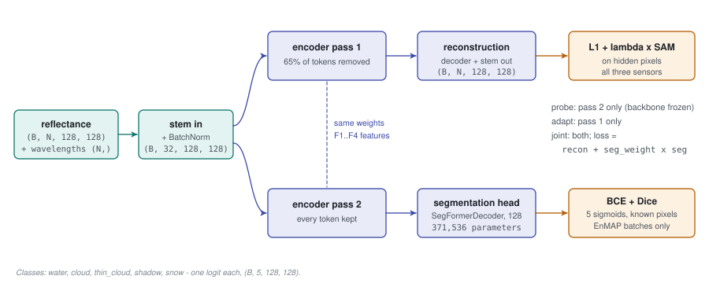
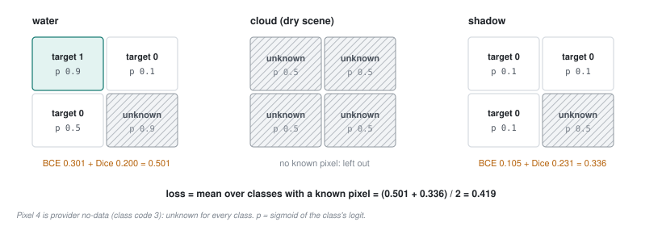

# 47 - A second head: labelling water, cloud, shadow and snow

> **The one thing this part teaches:** fine-tuning adds a small segmentation head to the shared
> encoder - five independent yes/no outputs per pixel - trained on EnMAP's provider labels with a
> loss that counts only pixels whose label is trusted, so a scene with untrustworthy cloud labels
> still teaches water; and the head reads the encoder unmasked, in a second pass separate from the
> masked reconstruction.

## Why a segmentation head

**Segmentation** means giving every pixel a label - "water", "cloud" - rather than one label per
image. The product already segments: the `scene_segmentation` action computes spectral indices
(NDVI for vegetation, NDWI for water, a brightness measure) and applies thresholds to them
(`backend/allotrope/action_types/scene_segmentation.py`). Its masks decide which pixels
`anomaly_scoring` looks at.

Thresholds on indices are blunt. Cloud edges, thin cloud and shadows slip through and get scored as
anomalies - a cloud is, after all, something the model rarely redraws well. The fine-tuning plan
(`docs/proposals/fine-tuning-and-segmentation.md`) replaces those rules with a learned head on the
same encoder Indradhanu already has. It is judged by detection: nothing ships that lowers the
PRISMA bench.

> **Analogy.** A radiologist who has spent years reading scans for "anything odd" has also, without
> trying, learned what a lung and a liver look like. Teaching them to outline the organs takes far
> less than training a new radiologist - and knowing which organ a spot sits in makes "odd" easier
> to judge. The encoder is the trained eye; the head is the new, small skill.

## The head is the decoder of part 21, smaller

In `app/foundation_models/components/spectral_stem_seg_former_mae.py`:

```python
self.seg_head = (SegFormerDecoder(embed_dims=list(embed_dims), decoder_dim=seg_decoder_dim,
                                  out_channels=seg_classes) if seg_classes else None)
```

It is the same `SegFormerDecoder` class that reconstructs (part 21), built with `decoder_dim = 128`
instead of 256 and `out_channels = 5` (one per class) instead of 32. Pretrained models have
`seg_classes = 0`, so no head. Fine-tuning sets 5.

**Source and design disagree here.** The proposal describes the head as "1x1 projections to a common
width, upsample to 1/4, fuse, 1x1 to classes, bilinear to full size". The code reuses
`SegFormerDecoder`, which ends in two 3x3 convolutions and a PixelShuffle (part 21), not a 1x1 and a
bilinear upsample. The source wins: the head predicts each of a 4 x 4 block's pixels separately, exactly
as the reconstruction does.

**Predict the parameter count before reading it.** Use part 26's method with width 128:

```
projections (1x1, each in -> 128, plus 128 biases)
    32  -> 128:   32 x 128 + 128 =  4,096 + 128 =   4,224
    64  -> 128:   64 x 128 + 128 =  8,192 + 128 =   8,320
    160 -> 128:  160 x 128 + 128 = 20,480 + 128 =  20,608
    256 -> 128:  256 x 128 + 128 = 32,768 + 128 =  32,896
fuse (1x1, 4 x 128 = 512 -> 128)
                 512 x 128 + 128 = 65,536 + 128 =  65,664
refine 1 (3x3, 128 -> 128)
           128 x 128 x 9 + 128 = 147,456 + 128 = 147,584
refine 2 (3x3, 128 -> 5 x 16 = 80 sub-pixel channels)
            128 x 80 x 9 + 80  =  92,160 + 80  =  92,240
                                                -------
total    4,224 + 8,320 + 20,608 + 32,896 + 65,664 + 147,584 + 92,240 = 371,536
```

Building the head and counting its parameters gives **371,536** - exactly. Against the reconstruction
decoder's 2,164,736 (part 26), the head is about a sixth: `371,536 / 2,164,736 = 0.17`.

For a 128 x 128 patch the shapes are:

```
from the encoder: F1 (B, 32, 32, 32)   F2 (B, 64, 16, 16)
                  F3 (B, 160, 8, 8)    F4 (B, 256, 4, 4)
  -> project each to 128, upsample to 32 x 32, stack   (B, 512, 32, 32)
  -> fuse                                              (B, 128, 32, 32)
  -> refine 1, refine 2                                (B, 80, 32, 32)
  -> PixelShuffle(4)                                   (B, 5, 128, 128)  logits
```

A **logit** is a raw score, any real number; the sigmoid below turns it into a probability.



*Figure 47.1 - The head in context: the shared stem and encoder feed two heads. Pass 1 removes 65% of the tokens and
reconstructs; pass 2 keeps every token and segments. Which passes run depends on the training mode
(part 49).*

## Five classes, each its own yes/no

`app/utils/segmentation/targets.py` defines the classes and how each is read from EnMAP's layers:

| index | class | target is 1 where | notes |
|---|---|---|---|
| 0 | water | `label_classes == 2` | 1 = land; 3 = provider no-data |
| 1 | cloud | `label_cloud == 1`, or `label_classes == 0` | code 0 is EnMAP's cloud class (part 48) |
| 2 | thin_cloud | `label_cirrus >= 2` or `label_haze == 1` | cirrus has levels 0-3; level 1 is unknown |
| 3 | shadow | `label_cloud_shadow == 1` | |
| 4 | snow | `label_snow == 1` | |

There is no "land" or "background" class. Land is "not water, where labelled".

**Why independent sigmoids and not a softmax.** A **softmax** turns a pixel's five logits into five
probabilities that sum to 1 - the right choice when exactly one class is true. A **sigmoid**,
`1 / (1 + e^(-logit))`, turns each logit into its own probability, with no link between them. The
classes here overlap: thin cloud over water is both. Give a pixel logits of +2.197 for water and
thin_cloud and -2.197 for the other three (`e^2.197 = 9`, `e^-2.197 = 0.111`):

```
softmax:  sum = 9 + 0.111 + 9 + 0.111 + 0.111 = 18.333
          water = 9 / 18.333 = 0.49      thin_cloud = 0.49      - each must give up half
sigmoid:  water = 1 / (1 + 0.111) = 0.90      thin_cloud = 0.90  - both can be confident
```

With a softmax the head could never say "certainly water, and certainly under thin cloud".

## Labels you cannot fully trust

EnMAP's labels come from the provider's own automatic tests, and they are not always right. A clear
desert scene checked on 2026-09-30 was labelled 57% cirrus and 14% cloud. Train on that and the head
learns "bare desert equals cloud".

Dropping every doubtful scene would also throw away its water, shadow and snow labels, which may be
fine. So the targets carry a second array: a **known mask**, one per class, saying which pixels'
labels count. `enmap_targets` builds it (simplified names):

```python
known = np.repeat((cls != 3)[None], 5, axis=0)  # class 3 = provider no-data
known[[0, 2, 3, 4]] &= ~cloud_class             # class-0 pixels: only cloud known
known[2] &= ~((cirrus == 1) & ~haze)            # cirrus level 1: unsure
known[1] &= ~snow                               # snow wins over cloud
known[0] &= ~(cloud | (cirrus >= 2))            # no water truth under cloud
if dry:                                         # water vapour below 0.75 g/cm2
    known[1] = known[2] = False                 # cloud, thin_cloud unknown
```

In words:

1. **Provider no-data** (class code 3): unknown for every class.
2. **Under EnMAP's cloud class** (class code 0): cloud is known and true; the other four are unknown.
3. **Cirrus level 1** is unknown for thin_cloud, neither positive nor negative.
4. **Overlaps**: where snow is set, cloud is unknown; where cloud or cirrus 2+ is set, water is
   unknown.
5. **Dry scenes**: below 0.75 g/cm2 of water vapour, cloud and thin_cloud are unknown for the whole
   scene; water, shadow and snow still count. (An elevation rule, 3,500 m and above, is kept as a
   guard but affects no scene.)

Each of these rules comes from a label audit run on 2026-10-16, and several overturn what the first
draft assumed - including that class 0 meant "no data". Part 48 shows the evidence and how the
thresholds were chosen. The policy values (`LabelPolicy`) are run configuration, fixed before training
and never tuned on results.

The trainer adds one more rule: a pixel that is nodata in the cube is unknown for every class
(`seg_known & mask` in `FinetuneTrainer._seg_batch`), and a tile with less than 40% valid pixels is
left out of the segmentation loss altogether.

## The loss: cross-entropy plus Dice, over known pixels only

`masked_bce_dice(logits, targets, known)` adds two measures per class and averages over classes.

**Binary cross-entropy (BCE)** scores one pixel's probability `p` against its 0/1 target `t`:

```
BCE = -( t x ln(p) + (1 - t) x ln(1 - p) )
t = 1, p = 0.9:   -ln(0.9) = 0.105      confident and right: small
t = 0, p = 0.5:   -ln(0.5) = 0.693      unsure
t = 0, p = 0.9:   -ln(0.1) = 2.303      confident and wrong: large
```

It is averaged over the class's known pixels.

**Soft Dice** scores a whole class at once by its overlap with the target:

```
Dice loss = 1 - (2 x sum(p x t) + 1) / (sum(p) + sum(t) + 1)     sums over known pixels
```

The `+ 1` on both sides keeps it defined when a class is absent. Why both? BCE is per pixel, so a
rare class - shadow on 1% of pixels - barely moves it; predicting "never shadow" costs almost
nothing. Dice is per class, so missing the rare class costs the whole term. With 10 shadow pixels in
the batch and a head that predicts 0 everywhere:

```
Dice loss = 1 - (2 x 0 + 1) / (0 + 10 + 1) = 1 - 1/11 = 1 - 0.091 = 0.909
```

**Worked by hand** (Figure 47.2; about five minutes). A 2 x 2 tile from a dry scene, three classes.
Pixel 4 is provider no-data (class code 3), so it is unknown for every class; on a dry scene cloud is
unknown everywhere.

```
pixel            1      2      3      4
water  target    1      0      0      -
       p        0.9    0.1    0.5    (0.9, ignored)
shadow target    0      0      0      -
       p        0.1    0.1    0.1    (0.5, ignored)
cloud            unknown in all four pixels
```

Water:

```
BCE:   -ln(0.9) = 0.1054     -ln(1 - 0.1) = 0.1054     -ln(1 - 0.5) = 0.6931
       mean = (0.1054 + 0.1054 + 0.6931) / 3 = 0.9039 / 3 = 0.3013
Dice:  sum(p x t) = 0.9 x 1 = 0.9      sum(p) = 0.9 + 0.1 + 0.5 = 1.5      sum(t) = 1
       1 - (2 x 0.9 + 1) / (1.5 + 1 + 1) = 1 - 2.8 / 3.5 = 1 - 0.8 = 0.2
water loss = 0.3013 + 0.2 = 0.5013
```

Shadow:

```
BCE:   -ln(1 - 0.1) = 0.1054 for each of three pixels      mean = 0.1054
Dice:  sum(p x t) = 0      sum(p) = 0.3      sum(t) = 0
       1 - (0 + 1) / (0.3 + 0 + 1) = 1 - 1 / 1.3 = 1 - 0.7692 = 0.2308
shadow loss = 0.1054 + 0.2308 = 0.3362
```

Cloud has no known pixel, so it is left out of the average entirely, not counted as zero:

```
loss = (0.5013 + 0.3362) / 2 = 0.8375 / 2 = 0.419
```

Calling `masked_bce_dice` on these numbers returns 0.4187. Notice the unknown pixel 4: its water
probability of 0.9 would have cost `-ln(0.1) = 2.30` if it had been treated as "not water". Unknown
means *no opinion*, not *no*.



*Figure 47.2 - The worked example. Hatched cells are unknown and contribute nothing. Cloud, unknown on
a dry scene, drops out of the class average; the loss is the mean of water's and shadow's terms.*

## Measuring it: intersection over union

**IoU** (intersection over union) is the usual segmentation score: of the pixels that are the class in
the prediction *or* the target, the fraction that are the class in *both*. A pixel counts as
predicted when `p > 0.5`, which is `logit > 0`. `IoUTally` adds up intersections and unions over the
whole validation set, known pixels only, and divides once at the end.

```
target water:   pixels {1, 2, 3, 4}       predicted water: pixels {2, 3, 4, 5, 6}
intersection = {2, 3, 4}    = 3
union        = {1, ..., 6}  = 6       IoU = 3 / 6 = 0.50
```

A smoke test of the probe stage (part 49) on a single EnMAP shard took water IoU from 0 to 0.16, 0.38
and 0.42 over four small epochs - the head learning on a frozen encoder, which is the first evidence
that F001's features already separate water.

## Two passes through one encoder

Reconstruction trains by hiding: part 19 removes 65% of the tokens (`mask_ratio: 0.65` in F001's
config) and asks the decoder to redraw them. Segmentation cannot work that way. To label a pixel as
cloud, the head must see the cloud; a hidden token's features are empty.

So `segment` calls the encoder with no keep mask:

```python
def segment(self, x, wavelengths_nm, band_valid=None):
    # no keep_mask: the encoder sees every token
    return self.seg_head(self.encode(x, wavelengths_nm, band_valid))
```

while `forward` - reconstruction - passes `keep_mask`. On a labelled batch in joint training, the
encoder runs twice: once masked for the reconstruction loss, once unmasked for the segmentation loss.
Same weights, two inputs (Figure 47.1). The second pass costs one more encoder forward and backward, but only on
batches that carry labels, which are EnMAP's alone.

One more difference: the reconstruction pass may read a random subset of the bands (band-list
augmentation, part 42); the segmentation pass reads the batch's full band list.

## Common confusions

**"Is there a 'clear' or 'land' output?"** No. Five classes, each yes/no. Land is water's "no" where
the pixel is labelled. Clear sky is cloud's and thin_cloud's "no".

**"Unknown pixels are counted as negatives, then?"** No - that is the whole point of the known mask.
They contribute nothing to BCE, to Dice or to IoU.

**"Why not only drop the dry scenes?"** Their water, shadow and snow labels still teach; dropping the
scenes would lose them, and the head would never see dry ground at all.

**"Does adding the head change reconstruction?"** Not by itself: an untrained head leaves the
reconstruction pass untouched (`test_segmentation_head_is_optional_and_leaves_reconstruction_alone`).
Training the encoder on the segmentation loss can - which is why every stage is gated on the bench.

**"Why decoder width 128 and not 256?"** Five output channels need far less than 32; the head is a
sixth of the reconstruction decoder's size.

## Check yourself

1. Compute the head's parameter count if `decoder_dim` were 64. Show each layer.
2. A pixel has logits water +1.0, thin_cloud +1.0, the other three -3.0. What does the sigmoid give for
   water? (`e^-1 = 0.368`.)
3. Redo the water term of the worked example with pixel 3's probability at 0.2 instead of 0.5.
4. Target cloud covers 8 pixels, the prediction 10 pixels, 6 of them correct. What is the IoU?
5. Why can the segmentation pass not reuse the reconstruction pass's encoder output?

<details>
<summary>Answers</summary>

1. Projections `32 x 64 + 64 = 2,112`, `64 x 64 + 64 = 4,160`, `160 x 64 + 64 = 10,304`, `256 x 64 + 64 =
   16,448`; fuse `256 x 64 + 64 = 16,448`; refine 1 `64 x 64 x 9 + 64 = 36,928`; refine 2 `64 x 80 x 9 + 80
   = 46,160`. Total `2,112 + 4,160 + 10,304 + 16,448 + 16,448 + 36,928 + 46,160 = 132,560`.
2. `1 / (1 + 0.368) = 1 / 1.368 = 0.73`, and the same for thin_cloud, independently.
3. BCE: `-ln(0.8) = 0.2231`; mean `(0.1054 + 0.1054 + 0.2231) / 3 = 0.4339 / 3 = 0.1446`. Dice: `sum(p) = 0.9 +
   0.1 + 0.2 = 1.2`; `1 - 2.8 / (1.2 + 1 + 1) = 1 - 2.8 / 3.2 = 1 - 0.875 = 0.125`. Water loss `0.1446 +
   0.125 = 0.2696`.
4. Union `8 + 10 - 6 = 12`; IoU `6 / 12 = 0.50`.
5. That output was computed with 65% of the tokens removed; the hidden pixels have no features to label.
   Segmentation needs every token, so it runs the encoder again without the mask.

</details>

---

**Next:** part 48 - how EnMAP's labels were audited without any ground truth, and what the audit
changed.
