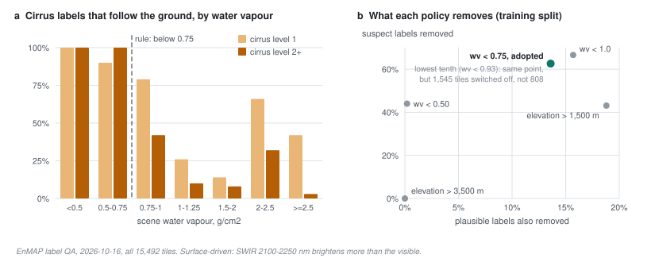

# 48 - Checking labels when there is no ground truth

> **The one thing this part teaches:** provider labels are the output of automatic tests and can
> be wrong in systematic ways. With no ground truth you can still audit them - check that what is
> labelled "cloud" looks like cloud, find what predicts the failures, and turn that into a rule
> chosen by its trade-off. On EnMAP the audit found that dry air, not altitude, produces false
> cloud labels, and that a code the documentation calls "no data" is the cloud class.

## Where we are

Part 47 gave every class a **known mask** and listed the rules that make a label unknown. This part
is where those rules come from: a label QA (quality audit) run on 2026-10-16 over every EnMAP
fine-tuning tile - 104 shards, 15,492 tiles, 210 scenes. Its summary is in
`research/experiments/indradhanu-finetune/README.md` ("Stage 0 records"); the rules are in
`app/utils/segmentation/targets.py`.

The audit overturned the first draft in three places. The draft (and the first version of
`targets.py`) treated class code 0 as no-data, switched off cloud labels on scenes above 3,500 m,
and treated cirrus level 1 as "not thin cloud". All three were wrong.

## Why labels need auditing

EnMAP's labels are not drawn by people. They are **quality layers**: masks the provider's processor
computes for every scene with automatic tests - is this pixel bright, cold, high? A head trained on
them learns their mistakes along with their truths. A check on 2026-09-30 had already found one: a
clear desert scene in Western Tibet labelled 57% cirrus and 14% cloud. That prompted the draft's
rule, "ignore cloud labels above 3,500 m".

Nobody has a second, correct set of labels to compare with. So the audit asks a weaker question
that can still be answered: **does what is labelled "cloud" look like cloud?**

> **Analogy.** You suspect a thermometer is faulty but own no reference thermometer. You can still
> check it against physics: if it reads 35 degrees while the pond outside is frozen, the reading is
> wrong. You cannot say what the right temperature was, but you can find *when* it goes wrong - and
> if that is always on frosty mornings, you know what to distrust.

## Test 1: is this "cloud" bright and flat?

A cloud is white. That gives two measurable properties:

- **Bright**: the mean reflectance over 450-650 nm (the visible) is above 0.2. Most ground is far
  darker in the visible; clear land in EnMAP averages 0.070.
- **Flat**: take the mean reflectance in four narrow windows - 460-500, 540-580, 640-680 and 840-880
  nm - and divide the smallest by the largest. White means roughly equal in all four, so the ratio is
  at least 0.7.

A labelled cloud pixel that passes both is **plausible**. Work it on four spectra (illustrative
values; do this by hand):

| | 460-500 | 540-580 | 640-680 | 840-880 | visible mean | min / max | verdict |
|---|---|---|---|---|---|---|---|
| cloud | 0.31 | 0.30 | 0.30 | 0.37 | about 0.30 | 0.30 / 0.37 = 0.81 | bright, flat |
| vegetation | 0.04 | 0.08 | 0.05 | 0.40 | about 0.06 | 0.04 / 0.40 = 0.10 | dark |
| bright dry soil | 0.18 | 0.25 | 0.32 | 0.38 | about 0.25 | 0.18 / 0.38 = 0.47 | bright, not flat |
| snow | 0.55 | 0.54 | 0.52 | 0.48 | about 0.54 | 0.48 / 0.55 = 0.87 | bright, flat |

Snow passes, because snow is white too. The audit separates it with a third measure, the
**normalised difference snow index**: snow is bright in green but dark near 1600 nm, where cloud is
still bright.

```
NDSI = (green - SWIR at 1550-1680) / (green + SWIR)
snow,  SWIR 0.086:  (0.54 - 0.086) / (0.54 + 0.086) = 0.454 / 0.626 = 0.73
                    above 0.4: snow-like
cloud, SWIR 0.34:   (0.30 - 0.34) / (0.30 + 0.34) = -0.04 / 0.64 = -0.06
                    not snow-like
```

(The SWIR values are the audit's group means: snow 0.086, EnMAP's cloud class 0.339.)

These are **plausibility** tests, not truth. A thin cloud over dark sea can fail "bright" and still be
real. The audit uses them to find *where* failures concentrate, not to relabel pixels.

## Finding 1: class 0 is the cloud class

EnMAP's land/water map, `label_classes`, has four codes. `docs/lld/enmap-shards.md` describes them as
"classes 0 and 3 no-data, 1 land, 2 water", and the first `targets.py` followed it. The audit
looked at the pixels:

- every one of the 1,414,747 class-0 pixels has `label_cloud = 1`;
- they hold 79% of all cloud-labelled pixels;
- their mean visible reflectance is 0.30, against 0.07 for clear land - bright, as cloud is.

Class 0 is EnMAP's cloud class. Only class 3 is no-data. **The data wins over the description**, and
the LLD's line is now out of date. Treating class 0 as no-data would have thrown away most of the
cloud the head is supposed to learn:

```
training tiles with at least 1% cloud:   755 counting class 0      269 without it
lost:                                     1 - 269 / 755 = 1 - 0.356 = 0.644, about 64%
```

`targets.py` now marks class-0 pixels as cloud (target 1, known) and makes every *other* class
unknown there: under a cloud, the provider's water, shadow and snow labels describe nothing the
sensor saw.

## Test 2: is this "cirrus" cloud, or the ground?

**Cirrus** is thin, high ice cloud. A thin cloud adds scattered light to whatever is below it, and
that added light shows most where the ground is dark. Over land the visible is dark (0.07) and the
shortwave infrared at 2100-2250 nm is brighter (about 0.16), so real thin cloud brightens the
visible *more* than the SWIR.

The audit compares, inside one tile, the pixels labelled cirrus with the clear-land pixels (at least
200 of each). If the cirrus pixels differ from clear land mainly at 2100-2250 nm, or hardly at all
in the visible (less than 0.005), the label is following the ground - brighter, drier soil - not a
cloud. It is **surface-driven**. Two tiles:

```
                clear land   "cirrus" pixels   change
tile X  visible   0.070          0.074         +0.004
        SWIR      0.160          0.210         +0.050   SWIR rose more: surface-driven
tile Y  visible   0.070          0.110         +0.040
        SWIR      0.160          0.175         +0.015   visible rose more: cloud-like
```

## Finding 2: dry air, not altitude

The draft rule switched off cloud labels on scenes above 3,500 m. The audit found that **no scene in
the set reaches it**: every scene is in India, and the highest scene-mean elevation is 2,776 m. The
rule removes nothing. It stays in `LabelPolicy` only as a guard for future data.

What does predict surface-driven cirrus is the scene's **water vapour**: the amount of water in the
air column above the ground, in grams per square centimetre. If all of it condensed it would form a
layer of liquid water; 1 g/cm2 is a layer 1 cm deep, so 0.75 g/cm2 is 7.5 mm. The audit's table:

| scene water vapour (g/cm2) | scenes | cirrus level 1 surface-driven | cirrus >= 2 surface-driven |
|---|---|---|---|
| below 0.5 | 3 | 100% | 100% |
| 0.5-0.75 | 8 | 90% | 100% |
| 0.75-1.0 | 20 | 79% | 42% |
| 1.0-1.25 | 33 | 26% | 10% |
| 1.5-2.0 | 60 | 14% | 8% |
| 2.0-2.5 | 33 | 66% | 32% |
| 2.5 and above | 32 | 42% | 3% |

Below 0.75 g/cm2, cirrus labels are almost all the ground. Above 1.0, most are not - though not all,
and the 2.0-2.5 row shows the relationship is not tidy. A likely physical reason, consistent with the
table: cirrus tests usually rely on a band near 1380 nm, where water vapour normally absorbs so
strongly that the ground is invisible and only high cloud shows. In very dry air the ground shows
through and looks like cirrus. The high scenes that prompted the draft rule were also dry; altitude
was standing in for dryness.



*Figure 48.1 - (a) Share of cirrus labels that are surface-driven, by the scene's water vapour, for
cirrus level 1 and level 2 or more; below 0.75 g/cm2 (dashed) nearly all are. (b) Candidate
policies: share of suspect labels each removes against share of plausible labels it also removes.
The adopted rule removes 62.6% of suspect labels for 13.6% of plausible ones.*

## Choosing the rule by its trade-off

Any rule that removes bad labels also removes some good ones. The audit scored each candidate on the
training split by the share of **suspect** labels it removes (surface-driven cirrus, implausible
cloud) and the share of **plausible** labels it removes too:

| policy | scenes | tiles affected | suspect removed | plausible removed |
|---|---|---|---|---|
| water vapour below 0.50 | 3 | 1.5% | 44.0% | 0.2% |
| **water vapour below 0.75 (adopted)** | **11** | **5.6%** | **62.6%** | **13.6%** |
| water vapour below 0.93 (lowest tenth of scenes) | 21 | 10.6% | 62.6% | 13.6% |
| water vapour below 1.0 | 30 | 15.2% | 66.6% | 15.7% |
| elevation above 1,500 m | 13 | 6.6% | 43.1% | 18.8% |
| elevation above 3,500 m (the draft) | 0 | 0% | 0% | 0% |

Read the adopted row as a ratio:

```
62.6% / 13.6% = 4.6 suspect labels removed for every plausible one
elevation > 1,500 m:   43.1% / 18.8% = 2.3      half as selective
```

The **lowest-tenth rule** (below 0.93) removes exactly the same labels as the fixed 0.75 - the scenes
between 0.75 and 0.93 have no suspect labels to remove - but switches off cloud labels on 1,545 tiles
instead of 808, nearly twice as many. A fixed value wins. The adopted rule touches 11 training scenes
and no test scene: the test split's driest scene has 0.94 g/cm2.

In the code, `meta.json` stores `scene_wv` in g/cm2 times 1000, so the threshold is 750:

```python
low_water_vapour: float | None = 750.0   # scene_wv is g/cm2 x 1000
...
dry = (... elev >= policy.plateau_elevation_m) or (... wv < policy.low_water_vapour)
if dry:
    known[1] = known[2] = False          # cloud, thin_cloud unknown for the whole scene
```

The rule was fixed from the audit **before** any training, and it is never tuned on results. A rule
tuned on IoU would quietly drop whatever labels the head found hard - the opposite of an audit.

## Finding 3: overlaps, and a cirrus level nobody can read

**Cirrus level 1 is neither yes nor no.** Over water the audit measured the share of pixels brighter
than 0.05 at 1550-1680 nm, where water is black and cloud is not:

```
clear water        3.9%
cirrus level 1     1.45%     no brighter than clear water
cirrus level >= 2  89%       clearly something above the water
```

Level 1 does not look like cloud, so it cannot be a positive. It is a label that says "maybe", so it
cannot be a clean negative either. `targets.py` makes it **unknown** for thin_cloud (unless haze is
also set).

**Snow wins over cloud.** 122,815 pixels are labelled both. Snow is white too (test 1), so the
provider's cloud test fires on it; where snow is set, cloud is unknown.

**No water truth under cloud.** Pixels labelled water *and* cirrus level 2 or more have a mean
near-infrared reflectance of 0.179 (water and cloud: 0.162), against 0.024 for clear water -
land-bright, not water. The
water label there probably comes from a map of where water usually is, not from what the sensor saw.
Water is unknown where cloud or cirrus 2+ is set.

## Finding 4: four scenes counted twice

Four scenes appear twice, processed under two processor versions: 576 tiles, all in training. Left in,
those places count double. The fix is a list,
`research/experiments/indradhanu-finetune/band_lists/enmap_drop_duplicate_scenes.json`, read through a
source's `skip_scenes_path`; `keep_sample` in `finetune_trainer.py` drops matching samples in the loader
workers by their `meta.json` scene id.

## Finding 5: some classes are rare

After the policy, in the training split:

| class | share of labelled pixels | tiles with at least 1% |
|---|---|---|
| water | 6.9% | 4,315 |
| thin cloud | 1.97% | 1,679 |
| cloud | 0.66% | 629 |
| snow | 0.094% | 81 (from 6 datatakes) |
| shadow | 0.086% | 245 |

Shadow is about one pixel in 1,160 (`100 / 0.086 = 1,163`). Part 47's Dice term helps, but expect
rare classes to need extra weight or oversampling. Snow has one tile in the test split (639 pixels),
too few to measure an IoU at all; it needs a separate held-out check. And the audit notes that 53% of
shadow pixels have no cloud within 900 m in the same tile - an upper bound, since the cloud may sit in
the neighbouring tile, but a reason to treat shadow labels with care too.

## Common confusions

**"The audit says these labels are wrong. Why not relabel them?"** The tests are plausibility checks,
not truth. They are good at finding *where* failures concentrate; they are not good enough to say what
each pixel really is. "Unknown" is the honest answer.

**"Why a whole-scene rule rather than per pixel?"** Water vapour is a scene property, and the failures
follow it. Per-pixel tests would bake the audit's own heuristics into the training targets.

**"Does the dry-air rule throw away those scenes?"** No. Only cloud and thin_cloud become unknown;
their water, shadow and snow labels still teach, as in part 47's worked example.

**"The LLD says class 0 is no-data."** It does, and the audit shows it is wrong. The source
(`targets.py`) follows the audit.

## Check yourself

1. A labelled cloud pixel has window means 0.22, 0.24, 0.25, 0.36 and visible mean 0.24. Is it
   plausible? Show the flatness ratio.
2. A tile's clear land has visible 0.065 and SWIR 0.150; its cirrus pixels have 0.068 and 0.175. Is the
   cirrus surface-driven?
3. A scene's `meta.json` has `scene_wv: 812`. Are its cloud labels used? And at 698?
4. What ratio of suspect to plausible labels does "water vapour below 1.0" achieve? Why was it not
   chosen, though it removes more suspect labels?
5. Why can cirrus level 1 not be used as a negative for thin_cloud?

<details>
<summary>Answers</summary>

1. Flatness `0.22 / 0.36 = 0.61`, below 0.7: not flat, so not plausible, although it is bright (0.24 >
   0.2). It looks more like bright soil than cloud.
2. Visible change `0.068 - 0.065 = 0.003`, SWIR change `0.175 - 0.150 = 0.025`. SWIR rose more (and the
   visible change is below 0.005): surface-driven.
3. `812 / 1000 = 0.812` g/cm2, not below 0.75: cloud labels are used. `698 / 1000 = 0.698`, below 0.75:
   cloud and thin_cloud are unknown for the whole scene.
4. `66.6 / 15.7 = 4.2`. It removes 4 points more of suspect labels than 0.75 but touches 15.2% of tiles
   instead of 5.6% and removes more plausible labels (15.7% against 13.6%), at a slightly worse ratio.
5. Over water, level-1 pixels are no brighter at 1550-1680 nm than clear water, so they are not clearly
   cloud - but the provider flagged them, so they are not clearly clear either. Counting them as "no
   thin cloud" would teach the head a label nobody trusts.

</details>

---

**Next:** part 49 - the fine-tuning curriculum end to end: stages, gates, mixing sensors, and how the
masks will feed back into detection.
