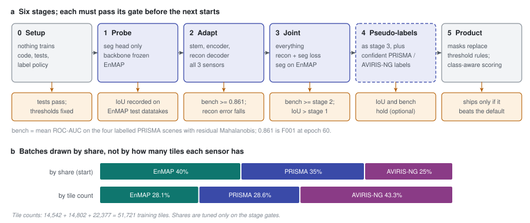

# 49 - The fine-tuning curriculum, end to end

> **The one thing this part teaches:** fine-tuning runs as a sequence of stages - probe the frozen
> encoder, adapt it to the three sensors, then train reconstruction and segmentation together -
> and no stage starts until the previous one passes a gate written down in advance, the main one
> being that detection on the PRISMA bench must not fall below F001's 0.861. Along the way the
> model keeps a record of every wavelength it has trained on, mixes sensors by fixed shares, and
> writes one line of evidence per epoch.

## Where everything comes together

Parts 43 to 48 built the pieces: F001, the pretrained starting point; three native-band datasets;
residual Mahalanobis, the score every stage is judged by; the segmentation head; and the audited
label policy it learns from. This part puts them in order. The plan is `docs/proposals/fine-tuning-and-segmentation.md` (agreed
2026-10-16; stage 0 in progress when this was written). The code is
`app/foundation_models/trainers/finetune_trainer.py` with its config `SpectralStemFinetuneConfig` in
`app/models/training/training_config.py`. Runs live in `research/experiments/indradhanu-finetune/`, one
folder per run, each with its pass criteria written before launch. When this part was written the first
three had configs and none had started (update, 2026-10-16: FT01 and FT02 have since run, and FT02 missed its
gate - part 50 reads the results):

| run | stage | starts from | sources | epochs x samples | learning rate |
|---|---|---|---|---|---|
| FT01-probe | 1 | F001 epoch 109 (`F001_ep109.pt`) | EnMAP only | 15 x 14,542 | 0.001 (head only) |
| FT02-adapt | 2 | F001 epoch 109 (`F001_ep109.pt`) | all three, 0.40 / 0.35 / 0.25 | 20 x 30,000 | 0.0001 |
| FT03-joint | 3 | FT02's `best.pt`, head fresh | all three, 0.40 / 0.35 / 0.25 | 20 x 30,000 | 0.0001 |

Note what FT03 starts from: the *adapted* backbone, not the probe's head. The probe is a measurement,
not a warm start.

**Update, 2026-10-17 - the FT03 row above is the plan, not what ran.** FT03 started from FT02c's
`best.pt`, took FT01's head as a warm start (`seg_head_from`), used mixed batches, `seg_weight` 0.1 and
10 epochs. So the probe became a warm start after all. Part 55 gives the reasons and the results.

> **Analogy.** An experienced surgeon moving to a new operating robot does not start with the new
> procedure. First they watch through the robot's camera without operating (probe). Then they
> repeat operations they already know, on the new machine (adapt). Only then do they learn the new
> procedure, still doing the old ones (joint). Before each step they are examined on the *old*
> operations, because the worst outcome is a new skill that costs an old one.

## The stages

| stage | `mode` | trains | data | gate before the next |
|---|---|---|---|---|
| 0 Setup | - | nothing | - | everything exists and is tested; label thresholds fixed |
| 1 Probe (FT01) | `probe` | the segmentation head only | EnMAP | per-class IoU on EnMAP's held-out datatakes recorded |
| 2 Adapt (FT02) | `adapt` | stem, encoder, reconstruction decoder | all three, by share | bench (residual Mahalanobis) >= 0.861; test reconstruction falls on every sensor |
| 3 Joint (FT03) | `joint` | everything | all three; segmentation loss on EnMAP batches | bench not below stage 2; IoU above stage 1 |
| 4 Pseudo-labels (optional) | `joint` | as stage 3 | plus PRISMA / AVIRIS-NG pixels the stage-3 head labels confidently | IoU holds; bench holds; visual check |
| 5 Product | - | - | - | masks replace `scene_segmentation`'s thresholds; class-aware scoring ships only if it beats the default |

The **bench** throughout is the mean ROC-AUC on the four labelled PRISMA scenes with the default
score, residual Mahalanobis (parts 45 and 46). 0.861 is F001 at epoch 60 (part 43). Using one score
for every gate matters: part 46 showed that the window of that score was chosen on these scenes,
and the bias cancels only if both sides of a comparison carry it.



*Figure 49.1 - (a) The six stages, what each trains, and the gate (amber) it must pass; stage 4 is
optional. (b) Batches are drawn by fixed shares (top), not in proportion to each sensor's tile count
(bottom), which would give AVIRIS-NG 43% of training.*

## Stage 0: what must exist first

The proposal's checklist, with where each piece lives:

1. **The trained-wavelength record** - a buffer in the model (below).
2. **Label QA and policy** - done 2026-10-16 (part 48): class 0 is cloud, the dry-air rule at 0.75
   g/cm2, cirrus level 1 unknown, the overlap rules; written into the run configs (`LabelPolicy`).
3. **A multi-sensor loader** - one dataset per sensor, one band list per batch (part 44; `_MixedLoader`
   below).
4. **The head, its loss and its metric** - `seg_head`, `masked_bce_dice`, `IoUTally` (part 47).
5. **Evaluation** - per-class IoU each epoch; the PRISMA bench at checkpoints.
6. **Infrastructure** - read access for the GPU role, EnMAP and PRISMA recompressed
   (`research/experiments/indradhanu-finetune/recompress_ft.sh`), staging onto the L40S.
7. **This course** - parts 43 to 49.

## Starting from F001: `init_from`

`build_model` loads the pretrained checkpoint's weights into a model that now has a head:

```python
missing, unexpected = model.load_state_dict(state, strict=False)
if unexpected or any(not k.startswith("seg_head.") for k in missing):
    raise ValueError(...)
```

Everything except the head must match exactly; the head's tensors are the only ones allowed to be
missing, and they start fresh. A typo in the config that loads the wrong architecture fails here,
loudly, instead of training half a model from scratch.

**The normalisation curve comes from the checkpoint, never from the new data.** Part 09's
normalisation turns each band's reflectance into "standard deviations from that band's mean", using a
mean and spread per wavelength. `docs/lld/spectral-stem.md` (invariant 6) fixes that curve at
pretraining. See why with one band whose pretraining mean is 0.20 and spread 0.10, and a pixel at
0.25:

```
pretraining curve:            (0.25 - 0.20) / 0.10 = 0.05 / 0.10 = 0.50
recomputed on EnMAP, say      (0.25 - 0.22) / 0.12 = 0.03 / 0.12 = 0.25
mean 0.22, spread 0.12:
```

The same pixel would reach the weights as 0.25 instead of the 0.50 they learned to read. Every input
would shift at once. So the config's docstring says it outright: "the normalisation curve comes from
init_from's checkpoint, never from data (frozen at pretraining)".

## Stage 1: the probe, and why BatchNorm must be frozen too

A **probe** trains a small head on top of frozen features to measure what the features already know.
If water and cloud separate well with the encoder untouched, F001 learned them during pretraining.

In probe mode the trainer freezes everything but the head and gives the optimiser only the head's
parameters:

```python
for name, p in self.model.named_parameters():
    p.requires_grad = name.startswith("seg_head.")
self.optimizer = torch.optim.Adam(
    [p for p in self.model.parameters() if p.requires_grad], lr=config.learning_rate)
```

That is not quite enough. **BatchNorm** - the `BatchNorm2d(32)` between the stem and the encoder,
which part 10 introduced and every stem variant shares - keeps two
*running statistics*, a mean and a variance, that it updates on every training batch whether or not
any gradient flows. They are buffers, not parameters, so `requires_grad` does not touch them. PyTorch
updates them as `new = 0.9 x old + 0.1 x batch value` (its default momentum, 0.1). Suppose a
channel's running mean is 0.00 after pretraining and EnMAP batches have mean 0.50:

```
after 1 batch:    0.9 x 0.00  + 0.1 x 0.50 = 0.050
after 2 batches:  0.9 x 0.050 + 0.1 x 0.50 = 0.045 + 0.050 = 0.095
after n batches:  0.50 x (1 - 0.9^n)
after 10:         0.50 x (1 - 0.349) = 0.50 x 0.651 = 0.326
```

Ten batches and the "frozen" model normalises its input differently from the one that was
pretrained. The probe would then be measuring a drifted encoder. So the trainer puts the whole model in
evaluation mode for the training pass and switches only the head back:

```python
def _train_pass_mode(self):
    # frozen backbone: keep its BatchNorm statistics
    if self.config.model_config_.mode == "probe":
        self.model.eval()
        self.model.seg_head.train()
```

Evaluation mode also turns off dropout (`drop_rate: 0.4` in F001's config), so the probe sees exactly
the features inference would see.

Two more probe details. A batch without labels contributes nothing (loss 0, zero samples), so the
probe's source list is EnMAP alone. And in probe mode the validation score that ranks epochs for
`best.pt` is the segmentation loss, since nothing else is being trained.

The smoke test of part 47 - water IoU 0, 0.16, 0.38, 0.42 over four small epochs on one shard - was a
probe.

## Stage 2: adapt

Reconstruction only (`mode: adapt`) on all three sensors, at a low learning rate, with band-list
augmentation on (part 42). The question: does F001 learn PRISMA's and AVIRIS-NG's own bands, and
EnMAP's native ones, without forgetting how to detect? The gate asks two things: test reconstruction
falls for each sensor, **and** the bench under residual Mahalanobis stays at or above F001's 0.861.

What happened: reconstruction fell on all three sensors, but the bench ended at 0.855 - gate not met. Part 50
reads the run; parts 51 and 52 follow the see-saw it showed to the next run, FT02b.

## Stage 3: joint

`mode: joint` trains every parameter on

```
loss = reconstruction loss + seg_weight x segmentation loss      (seg_weight default 1.0)
```

(FT03 set `seg_weight` to 0.1, because the segmentation loss was about eight times the reconstruction
loss - part 55.)

The segmentation term exists only on batches that carry labels - EnMAP's - and uses the second,
unmasked pass of part 47. PRISMA and AVIRIS-NG batches contribute reconstruction only.

**Source and design disagreed here.** The first draft of the proposal said stage 3 trains with the
"encoder unfrozen from the top stage down" - gradual unfreezing. `finetune_trainer.py` has no such
mechanism: `joint` trains everything from the first step. The source won, and the proposal now says so
("gradual top-down unfreezing is not implemented"); if it is wanted, it is still to be built.

Stage 4 (optional) would add the stage-3 head's most confident predictions on PRISMA and AVIRIS-NG as
extra labels, so-called **pseudo-labels**, if EnMAP-trained masks do not transfer well enough on their
own. (It ran on 2026-10-18 as FT04, the release candidate - part 60.)

## Mixing sensors by share

Every batch comes from one sensor, because the stem takes one band list per batch (part 44). That was
true for FT01 and FT02; from FT02b a `mixed_batches` option puts every sensor in every batch, and the
rule becomes one band list per stem pass (part 52).
`_MixedLoader` picks the sensor for each batch at random, weighted by its share:

```python
name = self.rng.choices(self.names, self.weights)[0]     # e.g. weights 0.40, 0.35, 0.25
```

It keeps one iterator per sensor, restarts a sensor's iterator when its shards run out, and tags each
batch with its source. Its random generator is seeded with the starting epoch, so a run resumed at
epoch 40 draws a fresh but reproducible sequence.

Why shares rather than one shuffled pool? Count the tiles:

```
total = 14,542 + 14,802 + 22,377 = 51,721
EnMAP     14,542 / 51,721 = 0.281
PRISMA    14,802 / 51,721 = 0.286
AVIRIS-NG 22,377 / 51,721 = 0.433
```

A pool would give AVIRIS-NG 43% of the training - one airborne campaign, about 200 tiles per flight
line - and the product's two satellites less than a third each. The starting shares are EnMAP 0.40,
PRISMA 0.35, AVIRIS-NG 0.25, tuned later only against the stage gates. Over 1,000 batches that is
about 400, 350 and 250.

Two budgeting rules from the module docstring: the epoch's training budget,
`train_samples_per_epoch[128]`, counts samples across **all** sources together; and validation runs
every test source to the end, in order (`_SequentialLoader`), with `test_samples_per_epoch` capping
the total. That cap is a trap: the test sets hold `950 + 1,570 + 2,270 = 4,790` tiles, and a cap
below that cuts off whichever sensor comes last, so its per-sensor column would rest on part of its
test set or none of it. FT02 and FT03 set it to 5,000, above 4,790.

## The trained-wavelength record

Part 42's third fix dropped, at load time, any band more than 15 nm from every wavelength the model
had trained on - `trained_band_mask`. For F001 that list is SpectralEarth's 202. On the bench's 185
PRISMA bands, 165 pass and 20 are dropped (those inside SpectralEarth's water-vapour gaps and beyond
its last band).

Fine-tuning trains on PRISMA's own 234 bands, so after it those 20 are no longer untrained. The
model therefore keeps a record, a buffer called `trained_wl`, that starts as the pretraining
wavelengths and grows:

```python
# starts as the normalisation curve's wavelengths
self.register_buffer("trained_wl", self.stats.wl.clone())
```

Each time a batch arrives with a band list the trainer has not seen, `_note_band_list` calls
`extend_trained_wavelengths`, which adds every wavelength not within 0.5 nm of one already recorded,
counting near-duplicates among the new ones once. Work it with a record of 500, 510, 520 nm and a new
list 500.3, 515.0, 515.2, 530.0:

```
500.3   nearest recorded 500, 0.3 nm away   <= 0.5   already known, skipped
515.0   nearest recorded 510 or 520, 5 nm    > 0.5   new
515.2   new, but 0.2 nm from 515.0           <= 0.5   counted once with 515.0
530.0   nearest recorded 520, 10 nm          > 0.5   new
record -> 500, 510, 515, 520, 530        returns 2
```

`trained_band_mask` then accepts a band within **15 nm** of anything in the record. The two tolerances
do different jobs: 0.5 nm decides "is this the same wavelength?"; 15 nm decides "is this close enough
to trained wavelengths for the wavelength networks to read it?" With the record above, a band at 544
nm is 14 nm from 530 and accepted; one at 546 nm is 16 nm away and dropped.

On PRISMA: 165 of 185 bands accepted before fine-tuning, all 185 after.

Older checkpoints have no record. `_load_from_state_dict` fills it in from the checkpoint's curve, so
they behave exactly as before; a newer checkpoint may hold a longer record than a freshly built model,
so the buffer is resized from the checkpoint. The test `test_trained_wavelength_record_grows_and_survives_a_reload`
pins both.

One honest limit: the record grows the first time a band list is *seen*, not once it is *learned*
well. A record says "trained on", which is the most the code can know.

## The per-epoch record

Besides part 41's `metrics.csv`, fine-tuning appends one row per epoch to `finetune_metrics_csv`:

| column | meaning |
|---|---|
| `epoch` | 1-based |
| `trained_wavelengths` | size of the record |
| `<sensor>_val_l1`, `<sensor>_val_sam_deg` | validation reconstruction, per sensor (e.g. `enmap_val_l1`) |
| `iou_water` ... `iou_snow` | per-class IoU on labelled test tiles |
| `iou_mean` | mean over classes that had any pixel in prediction or target |

The row is written in a `finally` block, so an epoch that ends the run by early stopping still leaves
its line. A per-sensor column is what makes stage 2's gate checkable: "reconstruction falls on every
sensor" cannot be read off one mixed number.

## How segmentation will improve detection

Stage 5 is where the head pays back.

**1. Better masks.** `scene_segmentation` produces the keep-mask that tells `anomaly_scoring` which
pixels to score. Learned masks for cloud, thin cloud and shadow remove the commonest false alarms -
cloud edges and shadows the model never redraws well - before scoring.

**2. Class-aware residual Mahalanobis.** Part 46's local mean already removes the model's per-surface
bias, but the *spread* - the covariance - is still the whole scene's, mixing sea and land. With a
water mask, each class can have its own normal. Work one whitened direction on a set1-like scene, 75%
sea. Land residuals centre on 0 with spread 1 (variance 1); sea residuals centre on 2 with spread 0.5
(variance 0.25). Pooled over the scene:

```
mean      0.25 x 0 + 0.75 x 2                       = 1.5
variance  within classes:
            0.25 x 1 + 0.75 x 0.25                  = 0.25 + 0.1875   = 0.4375
          between classes:
            0.25 x (0 - 1.5)^2 + 0.75 x (2 - 1.5)^2 = 0.5625 + 0.1875 = 0.75
          total 0.4375 + 0.75                       = 1.1875
```

Two pixels, both with residual 3.0 along this direction - a land target, and an ordinary sea pixel
two spreads above the sea's mean:

```
                pooled score                         per-class score
land target     (3.0 - 1.5)^2 / 1.1875 = 1.89        (3.0 - 0)^2 / 1    = 9.0
sea pixel       (3.0 - 1.5)^2 / 1.1875 = 1.89        (3.0 - 2)^2 / 0.25 = 4.0
```

Pooled, they are indistinguishable. Per class, the target scores more than twice the sea pixel. This
is why the proposal says class-aware scoring solves the dark-water problem "by design" rather than
with a fade.

Treat it as a hypothesis. Whether to use hard classes or probability-weighted ones is an open question,
and a related idea - a local ring restricted to the pixel's product class, with a local covariance -
scored 0.795 against the plain local mean's 0.854 in the dual-window research (step 4). That was a
different method (local covariance), so it does not refute this one, but it is a reason the gate says
"ships only if it beats the default on the bench".

> **Update, 2026-10-17/18 - how stage 5 actually went.** Class-aware scoring was tested and **not
> shipped**: water's tight statistics made water noise dominate (set1 water share of false alarms 14% ->
> 92%; part 57). Exclusion by FT03's masks was chosen instead, first of water and cloud, then - once 13
> real objects turned out to be likely vessels offshore - of **cloud only** (FT03 real-bench pAUC 0.158
> -> 0.166). Neither is in `backend/` yet; a mask fine-tune (FT04) is proposed first because FT03 calls
> 11% of the desert scene set4 cloud. *(Corrected 2026-10-18: set4's "cloud" is haze, not desert. Stage 4
> ran as FT04 - pseudo-labels for PRISMA and AVIRIS-NG plus rare-class weights - and passed: part 60.)* A detection-driven fine-tune, FT05, was added after stage 3
> (part 58). Parts 57 to 59 carry the story on.

## Open questions

From the proposal, to be decided as the stages report: hard or soft class statistics; whether
pseudo-labels are needed at all; the sensor shares after stage 2, and whether AVIRIS-NG's 3-8 m
pixels need their own handling; the epochs and learning-rate schedule per stage, written into each
run's README before launch.

## Common confusions

**"Does `requires_grad = False` freeze a layer?"** It freezes its *parameters*. BatchNorm's running
statistics are buffers and keep updating in training mode; only `eval()` stops them.

**"Is the normalisation curve updated for the new sensors?"** No, never. The *record* of trained
wavelengths grows; the curve that normalises inputs does not.

**"Shares of batches or of samples?"** Of batches - but every batch has the same size, so the two are
the same.

**"Why gate on PRISMA when PRISMA has no labels?"** Because the bench is about detection, which is
the product's job. IoU is measured on EnMAP, which has labels; detection on PRISMA, which has the
labelled anomalies.

**"Joint training unfreezes the encoder gradually?"** The proposal's first draft said so; the code
does not, and the proposal has been corrected. Joint trains everything at once.

## Check yourself

1. A BatchNorm channel's running mean is 0.10; training-mode batches all have mean 0.30. What is it
   after 3 batches? Show each step.
2. The record holds 1000, 1010 nm. Extend it with 999.8, 1004.6, 1005.0, 1030.0. What is the record,
   and what does the call return? Is a band at 1018 nm then accepted by `trained_band_mask`?
3. Over 2,000 training batches, how many do you expect from each sensor at the starting shares? How
   many would AVIRIS-NG get in a single pooled shuffle?
4. Redo the class-aware example for a land pixel at 1.0 and a sea pixel at 1.0. Which does pooling
   rank higher, and which does per-class scoring?
5. Why does the probe use EnMAP only?

<details>
<summary>Answers</summary>

1. `0.9 x 0.10 + 0.1 x 0.30 = 0.09 + 0.03 = 0.12`; `0.9 x 0.12 + 0.03 = 0.108 + 0.03 = 0.138`;
   `0.9 x 0.138 + 0.03 = 0.1242 + 0.03 = 0.1542`.
2. 999.8 is 0.2 nm from 1000: skipped. 1004.6 is new; 1005.0 is 0.4 nm from it: counted once. 1030.0
   is new. Record 1000, 1004.6, 1010, 1030; returns 2. A band at 1018 nm is 8 nm from 1010 - within
   15 nm, accepted.
3. EnMAP `0.40 x 2,000 = 800`, PRISMA `0.35 x 2,000 = 700`, AVIRIS-NG `0.25 x 2,000 = 500`. Pooled,
   AVIRIS-NG would get about `0.433 x 2,000 = 866`.
4. Pooled: both `(1.0 - 1.5)^2 / 1.1875 = 0.25 / 1.1875 = 0.21` - the same. Per class: land `(1.0 -
   0)^2 / 1 = 1.0`; sea `(1.0 - 2)^2 / 0.25 = 1 / 0.25 = 4.0`. Per class, the sea pixel is the more
   unusual one: it sits two spreads below the sea's normal.
5. Only EnMAP carries labels; a PRISMA or AVIRIS-NG batch in probe mode gives a zero loss and trains
   nothing.

</details>

---

**Next:** part 50 - what FT01 and FT02 showed: the probe's IoUs, FT02's gate miss, and why `combined`
caught up.
