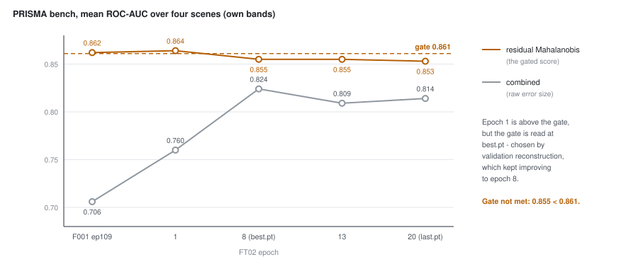

# 50 - What the first two runs showed

> **The one thing this part teaches:** the probe (FT01) found that F001's frozen encoder already
> separates water and cloud, and the adaptation run (FT02) made reconstruction better on all three
> sensors yet missed its detection gate by 0.006 - while the older `combined` score, which had
> lagged far behind, nearly caught up. Better reconstruction and better detection are not the same
> thing, and a gate is read at one checkpoint chosen by a different rule.

## Where we are

Part 49 laid out the curriculum: probe, adapt, joint, each with a gate written before launch. On
2026-10-16 the first two stages ran on the L40S (`g6e.2xlarge`). This part reads their results. The
numbers are in the run folders - `research/experiments/indradhanu-finetune/FT01-probe/README.md` and
`FT02-adapt/README.md` - and the running log is the "Log" section of
`research/experiments/indradhanu-finetune/README.md`. Open them beside this part.

> **Analogy.** A pianist moves from an upright to a concert grand. After a week of practice the
> scales are cleaner on every octave (reconstruction), but in the recital - the only thing the
> audience hears - one piece is very slightly worse (detection). Cleaner scales are evidence of
> progress, not a guarantee of a better recital. You still have to play the recital.

## First, why F001 stopped at 113

Part 43 described F001 as a 200-epoch run. It did not finish. The PRISMA bench under residual
Mahalanobis (part 45) read 0.861 at epoch 60 and 0.862 at epoch 109
(`research/experiments/indradhanu-se-pretrain/F001-final-pretrain/README.md`, rows 60 and 109). Forty-nine
epochs for 0.001: the run was stopped at epoch 113 by decision, and fine-tuning starts from the
epoch-109 checkpoint, `F001_ep109.pt`. Both FT01's and FT02's `config.json` name it in `init_from`.

## FT01: the probe

Recall part 49: a **probe** trains only the small segmentation head (about 372k parameters) on top
of a frozen encoder, so it measures what the encoder already knows. FT01 ran 15 epochs on EnMAP in
1.4 hours. **IoU** (intersection over union, part 47) on EnMAP's 950 test tiles, best checkpoint
(epoch 14):

| class | IoU | expected before launch | verdict |
|---|---|---|---|
| water | 0.82 | >= 0.80 | met |
| cloud | 0.80 | >= 0.5 | well above |
| thin cloud | 0.09 | 0.3-0.5 | far below, and flat all run |
| shadow | 0.20 | < 0.3 | as expected (0.09% of pixels) |
| snow | (0.17) | not measurable | one test tile - not a measurement |

The gate was "water >= 0.6, or the plan is revisited". 0.82 passed.

The interesting row is thin cloud. Every other class climbed over the 15 epochs; thin cloud sat at
0.06 to 0.09 from start to end. Part 48's label audit had already found that EnMAP's cirrus labels
are often driven by the surface, not by cloud. **A head that cannot improve on a class while it
improves on every other class is usually hitting the labels' ceiling, not the encoder's.** So the
FT01 README says: do not tune FT03 on thin cloud.

## FT02: adaptation

FT02 continued F001's masked reconstruction on all three sensors - EnMAP, PRISMA, AVIRIS-NG at
shares 0.40 / 0.35 / 0.25, one sensor per batch, 20 epochs of 30,000 samples, learning rate 0.0001,
4.25 hours. Its three pass criteria, written before launch:

1. Bench mean (residual Mahalanobis) >= 0.861 at the best checkpoint.
2. No scene below F001's epoch-60 score by more than 0.03.
3. Each sensor's test reconstruction lower at the end than after epoch 1.

The results table, rearranged (SAM in degrees, bench as mean ROC-AUC over the four PRISMA scenes):

| epoch | SAM EnMAP | SAM PRISMA | SAM AVIRIS-NG | residual Mahalanobis | combined |
|---|---|---|---|---|---|
| F001 ep109 | - | - | - | 0.862 | 0.706 |
| 1 | 4.81 | 7.30 | 7.94 | **0.864** | 0.760 |
| 8 (best.pt) | 4.17 | 5.93 | 6.07 | 0.855 | 0.824 |
| 13 | 4.16 | 6.04 | 6.49 | 0.855 | 0.809 |
| 20 (last.pt) | 4.07 | 6.31 | 6.19 | 0.853 | 0.814 |

*Figure 50.1 - Residual Mahalanobis (amber) starts above the 0.861 gate at epoch 1 and settles
below it; `combined` (grey) climbs from F001's 0.706 to 0.824. best.pt is epoch 8, chosen by
validation reconstruction, not by the bench.*

Criterion 3 passed on every sensor. Criterion 2 passed (you will check it below). Criterion 1
failed: 0.855 against 0.861. **Gate not met.**

## Three things the table says

**1. The bench peaked at epoch 1.** 0.864 is above the gate. It does not count, because the gate is
read at the best checkpoint, and `best.pt` is chosen by the mean validation reconstruction score
(part 41's fixed ruler), which kept improving until epoch 8. Reconstruction and detection pulled
apart after the first epoch. Writing "at the best checkpoint" before launch was deliberate: picking
whichever epoch scores best on four scenes would tune the run to those four scenes.

**2. Part of the change is more bands, not better weights.** The trained-wavelength record of part
49 grew from 202 to 733 wavelengths during FT02: AVIRIS-NG added 337, PRISMA 177, EnMAP 17. So from
epoch 1 on, the bench reads all 185 of the PRISMA scenes' bands, where F001 read 165. Twenty bands
inside SpectralEarth's water-vapour gaps are now scored too. Any comparison with F001 mixes the two
effects, and the FT02 README says so.

**3. `combined` nearly caught up.** Part 45 explained why `combined` - half L1, half SAM, each
divided by the scene's maximum - lagged: it measures how *big* a pixel's error is, and F001 made
large ordinary errors on PRISMA's background, which bury the targets. FT02 trained on PRISMA itself,
and PRISMA's validation SAM fell from 7.30 to 5.93 degrees. A smaller background error floor leaves
the targets standing out more. Residual Mahalanobis had already removed that floor - it subtracts the
local mean residual and whitens by the scene's covariance (parts 45 and 46) - so it had little to gain. That
reading is an interpretation, consistent with the numbers, not something FT02 tested directly. Part
51 adds a second reason to be careful with `combined`'s rise.

## The see-saw

The per-sensor validation did not fall smoothly. In epochs 11-12 and 15-17, PRISMA improved while
EnMAP and AVIRIS-NG got worse, then the reverse. At epoch 17, PRISMA's SAM was 5.04 degrees (its best)
and AVIRIS-NG's 8.24 (worse than at epoch 1). Validation tiles are fixed and unshuffled, so the data
did not change between epochs: the weights did. Part 51 traces this to the model's one BatchNorm.

## What was decided

FT02 is not thrown away. The user decided on 2026-10-16 to **build on it**: its reconstruction is
better on every sensor, and the gate miss is small. The next run, FT02b, continues from FT02's
epoch-8 weights with every batch holding all three sensors (part 52). Regularisation against
forgetting - shelved; part 54 says why.

## Common confusions

**"FT02 forgot how to detect."** Not shown. Reconstruction improved on every sensor, and the bench
moved 0.862 to 0.855 - smaller than some single-scene swings. The larger implanted-target benchmark,
built the next day, settles it the other way: FT02 catches more easy implants than F001 (49% against 45%
at the top 1%) - part 56. (Both rows were read on bench-v1, half of whose implants had garbled
signatures - anomaly course, part 22; FT02 itself was not re-run on bench-v2.1, where its descendant
FT02c leads F001 by 2 points.) "Forgetting" would predict worse
reconstruction on what F001 knew; EnMAP, the closest sensor to SpectralEarth, got better.

**"Epoch 1 passed the gate, so FT02 passed."** No. The gate names the checkpoint: the best by
validation reconstruction. Choosing a checkpoint by the bench would turn the bench into training data.

**"The probe's 0.82 water IoU is the head's final quality."** It is the floor with a frozen encoder.
FT03 (joint) was meant to beat it, and did: water 0.841, cloud 0.815 (part 55).

**"Thin cloud failed, so the encoder cannot see thin cloud."** The labels are the likelier limit;
part 48's audit found them surface-driven in many scenes.

## Check yourself

1. Compute FT02's best.pt bench mean from its four scenes: 0.931, 0.852, 0.757, 0.879. Show the sum
   and the division.
2. F001 at epoch 60 scored 0.930 / 0.860 / 0.775 / 0.881 on the four scenes. Did FT02's best.pt pass
   criterion 2 ("no scene below by more than 0.03")? Show each difference.
3. The trained-wavelength record started at 202 and gained 337, 177 and 17. What is its size? Why
   did EnMAP add so few?
4. By how many degrees did each sensor's SAM fall from epoch 1 to epoch 20? Which sensor improved
   most, and was that the one the README expected?
5. Why is a class that stays flat while all others improve a hint about labels rather than features?

Answers

1. `0.931 + 0.852 = 1.783`; `1.783 + 0.757 = 2.540`; `2.540 + 0.879 = 3.419`; `3.419 / 4 = 0.85475`,
   which rounds to 0.855.
2. set1 `0.931 - 0.930 = +0.001`; set2 `0.852 - 0.860 = -0.008`; set3 `0.757 - 0.775 = -0.018`; set4
   `0.879 - 0.881 = -0.002`. The largest drop is 0.018, under 0.03: passed.
3. `202 + 337 = 539`; `539 + 177 = 716`; `716 + 17 = 733`. SpectralEarth is EnMAP L2A, so most of
   EnMAP's native wavelengths were within 0.5 nm of ones already recorded.
4. EnMAP `4.81 - 4.07 = 0.74`; PRISMA `7.30 - 6.31 = 0.99`; AVIRIS-NG `7.94 - 6.19 = 1.75`.
   AVIRIS-NG improved most and started worst - as written before launch.
5. The encoder and head are the same for every class; if they were the limit, the class would
   still move a little. A class whose targets are partly wrong cannot be fit past the share that is
   right, whatever the features.

---

**Update, 2026-10-17.** The gate in criterion 1 was read on four scenes that, it later turned out,
could not separate any of these models under residual Mahalanobis (FT02b README). On 3,336 implanted
objects FT02 is ahead of F001 on easy-tier pAUC, 0.356 against 0.342 (on bench-v1, later found to
carry garbled signature implants; part 59 has the corrected board). Part 56 reads those results; the
miss by 0.006 above is a fact about the four scenes, not evidence that FT02 detects worse.

---

**Next:** part 51 - the see-saw, and the one BatchNorm whose running statistics depend on which
sensor ended the epoch.
