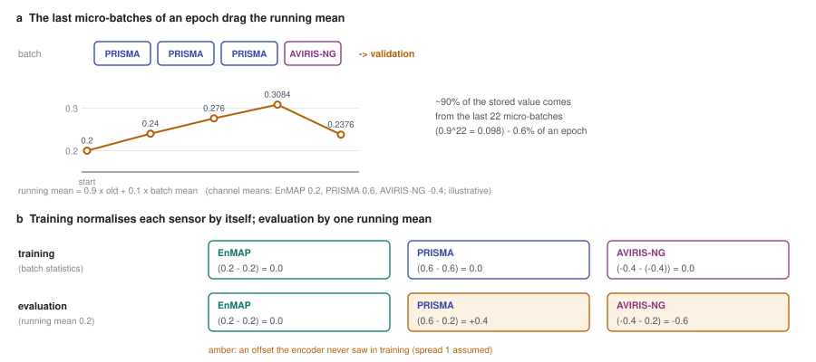

# 51 - The see-saw and the one BatchNorm

> **The one thing this part teaches:** when every training batch holds one sensor, the model's
> single BatchNorm normalises each sensor by its own statistics during training, but evaluation
> uses one stored estimate that is mostly set by the last couple of dozen batches of the epoch - so
> what the encoder sees at evaluation depends on which sensors happened to come last. That matches
> FT02's per-sensor see-saw, and a per-scene test showed the raw-error score is very sensitive to it
> while residual Mahalanobis is not.

## The symptom

Part 50 ended on FT02's see-saw: in epochs 11-12 and 15-17 PRISMA's validation improved while
EnMAP's and AVIRIS-NG's got worse, and then it reverted. Epoch 17: PRISMA SAM 5.04 degrees,
AVIRIS-NG 8.24, against 5.93 and 6.07 at epoch 8. The validation tiles are fixed and read in the same
order every epoch (`_SequentialLoader` in `app/foundation_models/trainers/finetune_trainer.py`), so the
swing is in the model.

Two explanations fit a see-saw between sensors. **Gradient competition**: each optimiser step leans
towards whichever sensors were in it. **Normalisation drift**: something in the model that is not a
weight changes with the most recent sensor. This part is about the second, because it was measured.

## The one BatchNorm

Open `app/foundation_models/components/spectral_stem_seg_former_mae.py`:

```python
self.norm = nn.BatchNorm2d(D)      # D = compressed_channels = 32
...
return self.encoder(self.norm(self._stem(x, wavelengths_nm, band_valid)), keep_mask=keep_mask)
```

It sits between the spectral stem and the SegFormer encoder: every pixel's 32 stem channels pass
through it. The encoder has LayerNorms (part 15), which normalise each token on its own and keep no
statistics. **This is the model's only BatchNorm**, and the only layer whose behaviour depends on the
other samples in a batch.

Recall from parts 10 and 49 what BatchNorm does, per channel:

| mode | normalises with | also does |
|---|---|---|
| training (`model.train()`) | this batch's mean and variance, over all its pixels | updates the running mean and variance: `new = 0.9 x old + 0.1 x batch` (momentum 0.1, PyTorch's default) |
| evaluation (`model.eval()`) | the stored running mean and variance | nothing - the statistics are frozen |

`FoundationTrainer._run_epoch` (`app/abstract_classes/foundation_trainer.py`) calls `model.train()`
before the training pass and `model.eval()` before validation. Inference also runs in evaluation mode
(`foundation_inferencer.py`). So training and evaluation normalise by different numbers. That is
normal and harmless when every batch looks like the whole data set. Here it did not.

## Training: each sensor normalised to itself

Take one channel and give the three sensors different typical values after the stem (illustrative):
EnMAP around 0.2, PRISMA around 0.6, AVIRIS-NG around -0.4, each with spread 1.

With sensor-pure batches, a PRISMA batch's own mean is about 0.6. A PRISMA pixel at 0.6 becomes

```
(0.6 - 0.6) / 1 = 0.0
```

and an AVIRIS-NG pixel at -0.4, in its own batch, also becomes `(-0.4 - (-0.4)) / 1 = 0.0`. **In
training, the encoder never sees the sensors' offsets** - BatchNorm removes them batch by batch.

## Evaluation: one blended estimate

At evaluation the same PRISMA pixel is normalised by the running mean. If that is 0.2:

```
(0.6 - 0.2) / 1 = 0.4
```

The encoder now receives 0.4 where in training it always received about 0.0 for that kind of pixel -
an offset it was never trained on. And the running mean is not a fixed 0.2: it is an exponential
average that forgets fast. The weight it still gives to the most recent `k` batches is `1 - 0.9^k`:

```
k = 1    1 - 0.9          = 0.10
k = 10   1 - 0.349        = 0.651
k = 22   1 - 0.098        = 0.902
```

About 90% of the stored mean comes from the last 22 micro-batches. FT02's epoch is 30,000 samples in
micro-batches of 8, so `30,000 / 8 = 3,750` micro-batches; the last 22 are `22 / 3,750 = 0.6%` of the
epoch. Which sensors those were is chance.

Work it with an end of epoch where the running mean is 0.20 and the last four micro-batches are
PRISMA, PRISMA, PRISMA, AVIRIS-NG:

```
PRISMA     0.9 x 0.20   + 0.1 x 0.6    = 0.18   + 0.06 = 0.24
PRISMA     0.9 x 0.24   + 0.1 x 0.6    = 0.216  + 0.06 = 0.276
PRISMA     0.9 x 0.276  + 0.1 x 0.6    = 0.2484 + 0.06 = 0.3084
AVIRIS-NG  0.9 x 0.3084 + 0.1 x (-0.4) = 0.27756 - 0.04 = 0.23756
```

Four batches moved it from 0.20 to 0.31 and back to 0.24. Validation then runs with whatever the
last batch left, and the next epoch ends on a different sequence.



*Figure 51.1 - (a) The last micro-batches of an epoch, one sensor each, and the running mean they
drag around; validation uses wherever it ends. (b) In training each sensor is normalised by its own
batch mean (top); at evaluation every sensor is normalised by the one running mean (bottom), so each
arrives with an offset the encoder never saw.*

**Does gradient accumulation help?** FT02 accumulated gradients over 4 micro-batches before each
step. That mixes sensors in the *gradient* - only `0.40^4 + 0.35^4 + 0.25^4 = 0.0256 + 0.0150 +
0.0039 = 0.0445`, about 4.5% of steps, were a single sensor. But BatchNorm's statistics are computed
per micro-batch, in the forward pass, before any accumulation. **Accumulation cannot mix what
BatchNorm sees.**

## The per-scene test

On 2026-10-16 the BatchNorm was tested directly on FT02's epoch-20 checkpoint (FT02 README,
"BatchNorm sensitivity"; the script, `C:/es/bn/adabn.py`, is on the dev laptop and not in the repo).
The idea, known as **AdaBN** (adaptive BatchNorm), is to replace the stored running statistics by
statistics measured on the scene being scored, then score again.

| | stored statistics | re-estimated per scene |
|---|---|---|
| how far they moved | - | 0.35-0.76 standard deviations |
| residual Mahalanobis, mean | 0.853 (410 objects) | 0.858 (402) |
| combined, set1 | 0.943 | 0.755 |
| combined, set4 | 0.780 | 0.642 |

Two readings:

1. **The stored statistics are far from any one PRISMA scene's** - up to three quarters of a
   standard deviation, the same size as the offsets in the worked example.
2. **The raw-error score depends on them heavily; residual Mahalanobis barely.** A BatchNorm offset
   shifts the reconstruction error of a whole scene in a systematic way. Residual Mahalanobis
   subtracts the local mean residual and whitens by the scene's covariance (parts 45, 46), which
   removes most of a systematic shift. `combined` measures raw size, so it moves with it.

So BatchNorm is consistent with the see-saw, but it does not explain FT02's gate miss: the gated
score hardly moves with it. And it adds a caution to part 50: some of `combined`'s rise to 0.824 may
be the luck of where the running statistics ended, not only better reconstruction.

Per-scene re-estimation is not a product option: `combined` fell, and the product scores one scene
at a time with no batch to measure.

## The options, and the decision

The FT02 README listed two fixes: keep BatchNorm in evaluation mode during adapt (as the probe does,
part 49), so the statistics stay F001's from SpectralEarth; or re-estimate them on a balanced sensor
mix before each validation. The first leaves statistics that match none of the three sensors; the
second fixes what evaluation sees but not the training-time habit of normalising each sensor to
itself.

The user chose a third: **mixed-sensor batches** - every micro-batch holds all three sensors. Then
the batch statistics in training are the mix's, the running statistics are the mix's, and training
and evaluation agree. The same change balances each step's gradient. Part 52 is how it was built.

> **Analogy.** A teacher marks three classes' exams and adjusts each to a class average of 60%
> before grading. The adjusted marks look comparable. Then the head of school rescales everything
> using the average of whichever class was marked last. Every class's marks shift, by an amount
> nobody chose. Marking the three classes' papers shuffled together fixes it: one average, used
> every time.

## Common confusions

**"BatchNorm is in every SegFormer block."** Not in this model. The blocks use LayerNorm. The one
BatchNorm is `self.norm`, in front of the encoder.

**"Evaluation mode turns BatchNorm off."** It turns its *updating* off and switches it to the stored
statistics. It still normalises.

**"x4 accumulation means a batch of 32, so BatchNorm sees 32."** It sees 8. Accumulation adds
gradients after four separate forward passes of 8.

**"AdaBN fixed it, so use per-scene statistics."** It moved residual Mahalanobis by 0.005 and broke
`combined` on two scenes. It is a diagnosis, not a fix.

**"The see-saw is proven to be BatchNorm."** It is consistent with it. Gradient competition would
also produce a see-saw; mixed batches address both, which is why one run cannot tell them apart.

## Check yourself

1. A channel's running mean is 0.10. The last three micro-batches are AVIRIS-NG (batch mean -0.4),
   EnMAP (0.2), PRISMA (0.6). Compute the running mean after each.
2. What fraction of the stored mean comes from the last 5 micro-batches? Use `0.9^5 = 0.59`.
3. With batch statistics, a PRISMA pixel at 0.6 in a PRISMA batch (mean 0.6, spread 1) is
   normalised to what? At evaluation with running mean 0.3 and spread 1?
4. Over 4 accumulated micro-batches with shares 0.40 / 0.35 / 0.25, what is the chance all four are
   EnMAP? All four PRISMA?
5. Why does a whole-scene BatchNorm offset hurt `combined` more than residual Mahalanobis?

<details>
<summary>Answers</summary>

1. AVIRIS-NG: `0.9 x 0.10 + 0.1 x (-0.4) = 0.09 - 0.04 = 0.05`. EnMAP: `0.9 x 0.05 + 0.1 x 0.2 =
   0.045 + 0.02 = 0.065`. PRISMA: `0.9 x 0.065 + 0.1 x 0.6 = 0.0585 + 0.06 = 0.1185`.
2. `1 - 0.59 = 0.41`, about 41%.
3. In its batch: `(0.6 - 0.6) / 1 = 0.0`. At evaluation: `(0.6 - 0.3) / 1 = 0.3`.
4. EnMAP: `0.40^4 = 0.40 x 0.40 x 0.40 x 0.40 = 0.0256`. PRISMA: `0.35^4 = 0.1225 x 0.1225 = 0.0150`.
5. The offset changes every pixel's error in the same direction. Residual Mahalanobis subtracts each
   pixel's local mean residual and divides by the scene's covariance, so a shared shift mostly
   cancels; `combined` divides by the scene maximum but keeps each pixel's raw size, so the ranking
   of background against targets changes.

</details>

---

**Next:** part 52 - mixed batches: three band lists through one stem call each, one BatchNorm, one
encoder.
