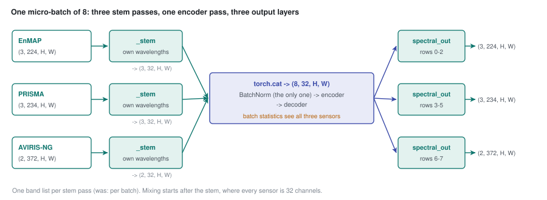

# 52 - Mixed batches: three band lists, one encoder pass

> **The one thing this part teaches:** the stem can read only one band list per call, but nothing
> after the stem cares about band lists - so a mixed batch runs the stem once per sensor,
> concatenates the 32-channel outputs, sends them through BatchNorm, encoder and decoder together,
> and splits them again for each sensor's own output bands. One change, two effects: every step's
> gradient is balanced across sensors, and BatchNorm sees the same mix in training and evaluation.

## The rule that had to bend

Part 44 stated a rule, and part 49's loader obeyed it: **one band list per batch.** The reason is in
the stem. `SpectralReducedCompressor` reads a pixel's bands as tokens that carry their wavelengths
(parts 33 and 40), and its `forward` takes the batch's wavelengths as one `(N,)` list. EnMAP has 224
bands, PRISMA 234, AVIRIS-NG 372; you cannot stack a `(3, 224, H, W)` tensor and a `(3, 234, H, W)`
tensor into one batch.

But look at what comes out of the stem: `(B, 32, H, W)`, whatever went in. Thirty-two channels per
pixel, for every sensor. From there on, the model has no idea which sensor a pixel came from. So the
rule only ever needed to be **one band list per stem pass**. That is the invariant
`docs/lld/finetune.md` now states.

> **Analogy.** Three delegations at a conference speak German, Hindi and Portuguese. Each has its
> own interpreter (the stem pass) who renders everything into English. After interpretation the
> three groups can sit in one room and hold one discussion (the encoder); at the end each
> interpreter carries the conclusions back into their own language (the output layer). You do not
> need three conference rooms - only three interpreters.

## `forward_mixed`

In `app/foundation_models/components/spectral_stem_seg_former_mae.py` (commit 9ae3215):

```python
def forward_mixed(self, groups: list) -> list:
    # groups: [(x, wavelengths_nm, band_valid, keep_mask, out_wavelengths_nm), ...] - one per sensor
    if self.stem not in WAVELENGTH_STEMS:
        raise ValueError(f"{self.stem} stem reads one band list only")
    z = torch.cat([self._stem(x, wl, bv) for x, wl, bv, _, _ in groups])   # (8, 32, H, W)
    keep = None if groups[0][3] is None else torch.cat([g[3] for g in groups])
    z_hat = self.decoder(self.encoder(self.norm(z), keep_mask=keep))      # (8, 32, H, W)
    out, start = [], 0
    for x, wl, _, _, out_wl in groups:
        wl_out = wl if out_wl is None else out_wl
        part = self.spectral_out(z_hat[start:start + len(x)], wl_out)      # (B_g, M_g, H, W)
        out.append(self.stats.denormalize(part, wl_out))
        start += len(x)
    return out
```

Trace a batch of 8 with 128 x 128 tiles and no band augmentation:

| step | EnMAP | PRISMA | AVIRIS-NG |
|---|---|---|---|
| input | `(3, 224, 128, 128)` | `(3, 234, 128, 128)` | `(2, 372, 128, 128)` |
| `_stem` (normalise, zero dead voxels, stem) | `(3, 32, 128, 128)` | `(3, 32, 128, 128)` | `(2, 32, 128, 128)` |
| `torch.cat` | `(8, 32, 128, 128)` | | |
| `norm` -> `encoder` -> `decoder` | `(8, 32, 128, 128)` | | |
| slice rows | rows 0-2 | rows 3-5 | rows 6-7 |
| `spectral_out` at own wavelengths | `(3, 224, 128, 128)` | `(3, 234, 128, 128)` | `(2, 372, 128, 128)` |

The fixed-band stems (`linear`, `gate`) are built for one band count, so `forward_mixed` refuses
them. The MAE keep masks (part 19) are concatenated in the same order, so each sample keeps its own.



*Figure 52.1 - Three sensors, three stem passes (teal), one concatenated batch through the single
BatchNorm, encoder and decoder (indigo), split by row ranges and decoded at each sensor's own
wavelengths.*

## Where the batch comes from: `_AllSourcesLoader`

In `app/foundation_models/trainers/finetune_trainer.py`, with `mixed_batches: true`:

```python
size = self.config.data.batch_size                                   # 8
train = _AllSourcesLoader({s.name: self._source_loader(s, "train", max(1, round(s.share * size)))
                           for s in cfg.sources})
```

Each sensor gets its own DataLoader with its own batch size, and `_AllSourcesLoader` yields one
sub-batch from every sensor per step, as `{"_groups": [(name, batch), ...]}`. Like the old loader, it
restarts a sensor whose shards run out. The sizes:

```
EnMAP      round(0.40 x 8) = round(3.2) = 3
PRISMA     round(0.35 x 8) = round(2.8) = 3
AVIRIS-NG  round(0.25 x 8) = round(2.0) = 2
total                                     8
```

**The shares are now 3/8, 3/8, 2/8 = 0.375, 0.375, 0.25** - not exactly 0.40 / 0.35 / 0.25. PRISMA
gains 2.5 points and EnMAP loses 2.5. Nothing forces the rounded sizes to sum to `batch_size` for
other shares; at 8 with these shares they happen to.

## The loss: `_mixed_loss`

`compute_loss` sends any batch with `"_groups"` to `_mixed_loss`. Per sensor it does what the
one-sensor path did: drop tiles with too few valid pixels, build that sensor's MAE mask, and flip
its own coin for band-list augmentation (part 42). Then one `forward_mixed` call, then L1 + ramped
SAM per sensor, combined weighted by kept samples:

```python
total, kept = total + (l1 + self._get_sam_weight(self._current_epoch) * sam) * n, kept + n
...
return total / kept, kept
```

Weighting by `n` means every tile counts equally, whichever sensor it is from. The config validator
(`SpectralStemFinetuneConfig._mixed_batches_in_adapt_only` in `app/models/training/training_config.py`)
allows `mixed_batches` in `mode: adapt` only: joint mode's segmentation pass (part 47) is a second,
unmasked pass that was not built for mixed groups.

## Why this fixes two things at once

**BatchNorm.** Every micro-batch now holds all three sensors. Training normalises by the mix's
statistics; the running statistics are averages of mixes; evaluation uses those. The offsets of
part 51 are no longer removed in training and reintroduced at evaluation - they are present in both.

**Gradient balance.** Every optimiser step now contains `3 x 4 = 12` EnMAP, 12 PRISMA and
`2 x 4 = 8` AVIRIS-NG tiles. A toy problem shows why that matters. One weight `w`; sensor A wants
`w = 1` (loss `(w - 1)^2`), sensor B wants `w = -1` (loss `(w + 1)^2`); learning rate 0.25.

Alternating, one sensor per step, starting from 0 (gradient of `(w - 1)^2` is `2(w - 1)`):

```
start            w = 0
A step   0   - 0.25 x 2 x (0 - 1)        = 0 + 0.5           = 0.5
B step   0.5 - 0.25 x 2 x (0.5 + 1)      = 0.5 - 0.75        = -0.25
A step  -0.25 - 0.25 x 2 x (-0.25 - 1)   = -0.25 + 0.625     = 0.375
B step   0.375 - 0.25 x 2 x (0.375 + 1)  = 0.375 - 0.6875    = -0.3125
```

It never settles: it swings between about +1/3 and -1/3, and where you read it depends on which
sensor went last. Mixed, both losses averaged in every step (gradient `2(w - 1) + 2(w + 1) = 4w`, halved for
the average: `2w`), starting from 0.5 so there is something to watch (from 0 it would never move):

```
w = 0.5 -> 0.5 - 0.25 x 2 x 0.5 = 0.25 -> 0.125 -> 0.0625 -> ... -> 0
```

It settles at the compromise, 0, and stays there. Real training is not this extreme - FT02's x4
accumulation already mixed most steps (part 51) - so expect the BatchNorm effect to be the larger
of the two.

## What else changed in FT02b - read before comparing

FT02b (`research/experiments/indradhanu-finetune/FT02b-mixed/`) is "FT02's config plus
`mixed_batches: true`", from FT02's epoch-8 weights, for 10 epochs. But `init_from` loads **weights
only** (`_load_init_state` returns `model_state_dict`), and the epoch counter starts at 0. So:

| | FT02 at its epoch 8 | FT02b, epoch index 0 -> 9 |
|---|---|---|
| optimiser state (Adam moments) | warm | fresh |
| learning rate | partway down a 20-epoch cosine: `0.0001 x (1 + cos(7/20 x 180 deg)) / 2 = 0.0001 x (1 + 0.454) / 2`, about 0.000073 | back to 0.0001, then a new 10-epoch cosine |
| SAM weight in the training loss | `0.5 x 7 / 10 = 0.35` | `0.5 x 0 / 10 = 0` in the first epoch, rising to `0.5 x 9 / 10 = 0.45` |

**Source and config disagree on the warm-up.** FT02's and FT02b's configs set `lr_schedule.warmup_epochs: 1`,
and their READMEs say "1 warm-up epoch". `FoundationTrainer._build_scheduler`
(`app/abstract_classes/foundation_trainer.py`) builds a plain `CosineAnnealingLR` stepped once per epoch, and no
code reads `warmup_epochs` (grep it: only `training_config.py` mentions it). There is no warm-up: FT02b's first
epoch runs at the full 0.0001. The source wins.

The SAM weight follows `sam_weight x min(1, epoch / sam_ramp_epochs)` with a 0-based epoch
(`_get_sam_weight` in `hyperspectral_segformer_mae_trainer.py`). Validation always uses the full
SAM weight (part 41), so `best.pt` is still ranked on one ruler. But if FT02b moves, mixed batches
are not the only change, and its README should be read with that in mind.

## Status

FT02b launched on 2026-10-16 at 10:15 UTC. Its pass criteria, written before launch: bench >= 0.861;
reconstruction no worse than FT02's epoch 8 on any sensor; per-sensor validation moving together (no
epoch where one sensor improves by more than 0.3 degrees of SAM while another worsens by more than
0.3). Scored at epochs 3, 6 and 10. **Results: pending** - when they arrive, they go in the FT02b
README and the log.

| epoch | SAM EnMAP / PRISMA / AVIRIS-NG | residual Mahalanobis | combined |
|---|---|---|---|
| 3 | pending | pending | pending |
| 6 | pending | pending | pending |
| 10 | pending | pending | pending |

## Common confusions

**"Mixed batches mean the stem reads three band lists at once."** It is still called once per band
list. Mixing starts after the stem.

**"The batch is still 8, so nothing changed for BatchNorm."** The size is the same; the contents are
not. Eight tiles from three sensors give the mix's statistics, eight from one sensor give that
sensor's.

**"Validation should be mixed too."** It does not need to be. Validation runs in evaluation mode, so
BatchNorm uses its stored statistics, not the batch's; a sensor-pure validation batch is normalised
exactly as a mixed one would be.

**"FT02b differs from FT02 only in mixing."** Its optimiser, learning-rate warm-up and SAM ramp all
restart. See the table above.

## Check yourself

1. With `batch_size` 4 and shares 0.40 / 0.35 / 0.25, what are the sub-batch sizes? Do they sum to 4?
2. With `batch_size` 16, the same shares?
3. In the toy problem, start at `w = 1` and alternate B, A, B. Write each step.
4. FT02b's training SAM weight in its sixth epoch (index 5)?
5. Why does `forward_mixed` concatenate the keep masks in the same order as the stem outputs?

<details>
<summary>Answers</summary>

1. `round(1.6) = 2`, `round(1.4) = 1`, `max(1, round(1.0)) = 1`; `2 + 1 + 1 = 4`. Yes.
2. `round(6.4) = 6`, `round(5.6) = 6`, `round(4.0) = 4`; `6 + 6 + 4 = 16`. Shares 0.375 / 0.375 / 0.25
   again.
3. B: `1 - 0.25 x 2 x (1 + 1) = 1 - 1 = 0`. A: `0 - 0.25 x 2 x (0 - 1) = 0.5`. B: `0.5 - 0.25 x 2 x
   (0.5 + 1) = 0.5 - 0.75 = -0.25`.
4. `0.5 x min(1, 5 / 10) = 0.5 x 0.5 = 0.25`.
5. Row `i` of the concatenated batch must be masked with sample `i`'s own mask; the stem outputs and
   the masks are both concatenated group by group, so the rows line up.

</details>

---

**Next:** part 53 - edges: why correcting the score map for edges fails, and why a training-time
edge term under the blind spot is a different thing.
