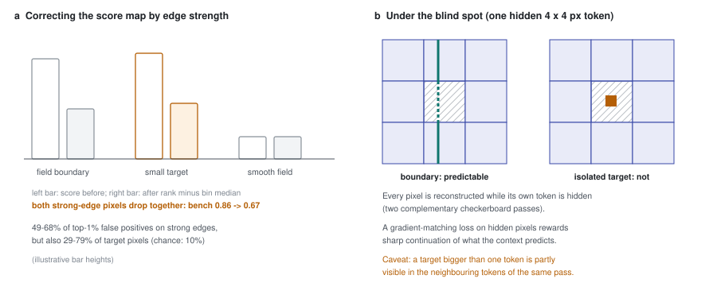

# 53 - Edges: why fixing the score map fails, and what training could do instead

> **The one thing this part teaches:** most of Indradhanu's false alarms sit on strong spatial
> edges, but so do most small targets - a small target *is* an edge - so any correction applied to
> the finished score map pushes targets down with the false alarms. A loss applied in training, on
> pixels the model cannot see, is different: a field boundary that runs on through a hidden patch can
> be predicted from its visible ends, while a target alone inside the patch cannot.

## The problem

Look at a residual Mahalanobis score map of a PRISMA bench scene and you see lines: field
boundaries, roads, coastlines. The model reconstructs a sharp boundary slightly blurred or slightly
shifted, the error on both sides is large, and those pixels rank among the top scores. On
2026-10-16 this was measured (FT02 README, "Edge diagnosis"; script `C:/es/edges/edges.py` on the dev
laptop, rules fixed before the results).

**Edge strength** of a pixel: average its bands into one brightness number, then take the largest
absolute difference to any of its four neighbours (up, down, left, right) that is valid. **Strong**
means in the scene's top 10% by edge strength. Work a 3 x 3 patch of band means:

```
0.10  0.10  0.30
0.10  0.12  0.30
0.10  0.10  0.31
```

The centre pixel, 0.12: neighbours up 0.10, down 0.10, left 0.10, right 0.30.

```
|0.12 - 0.10| = 0.02   (up)
|0.12 - 0.10| = 0.02   (down)
|0.12 - 0.10| = 0.02   (left)
|0.12 - 0.30| = 0.18   (right)
edge strength = max = 0.18
```

The top-left pixel, 0.10, has only two neighbours inside the patch: right 0.10, down 0.10, so edge
strength 0.00. A field boundary runs down the middle of this patch, and every pixel next to it is
an edge pixel.

## What was measured

| measurement (F001 epoch 109 and FT02 epoch 13) | range over the four scenes | by chance |
|---|---|---|
| top-1% false positives on strong edges | 49-68% | 10% |
| ground-truth target pixels on strong edges | 29-79% | 10% |
| detected target pixels (hits) on strong edges | 39-91% | 10% |

The first row says **edges are the main source of false alarms** - five to seven times chance. The
second row is the trap. A target a few pixels across, brighter or darker than its field, has a large
difference to its neighbours on every side. By this definition it is an edge.

## Correcting the score map

The obvious fix: compare each pixel only with pixels of similar edge strength. The measured version
sorted the scene into 20 bins by edge strength and scored each pixel by **its rank minus the median
rank of its bin**. A pixel on a strong edge then has to beat other strong-edge pixels, not the
smooth field.

It collapsed detection: bench mean **0.86 -> 0.67**. Earlier attempts to sharpen the score map on
F001's epoch 52 (`C:/es/postscore/`, part 46's table) agree:

| method, applied to the score map | bench AUC | objects caught of 909 |
|---|---|---|
| **D** residual Mahalanobis, no post-processing | **0.865** | 383 |
| F(C) difference-of-Gaussians blob boost | 0.718 | 403 |
| E(C) local z-score of the score map (ring) | 0.790 | - |
| G-C suppress errors explained by a +/-1 px shift | 0.845 | - |

The blob boost found 20 more objects and gave up 0.147 of AUC to do it: it lit up many more
non-targets along the way. **None beat plain residual Mahalanobis.** The conclusion in the FT02
README: edge strength, measured on the score map or the image, cannot tell a field boundary from a
target, because at the scale of a few pixels they look the same.

> **Analogy.** A smoke alarm goes off mostly in the kitchen, so you fit the kitchen alarm with a
> less sensitive sensor. False alarms drop - and so does warning of the one real fire most likely to
> start there. You have not told toast from fire; you have only listened less to the room where both
> happen.



*Figure 53.1 - (a) Edge-strength correction (amber) pushes down everything on strong edges, the
field boundary and the target alike. (b) Under the blind spot: a boundary passing through a hidden
token (grey hatching) can be continued from its visible ends; a target entirely inside the hidden
token leaves no trace in the context.*

## Why training is a different place to act

Recall how inference works (part 29, and `app/foundation_models/inferencers/spectral_stem_inferencer.py`,
docstring line 9): two complementary checkerboard masks, so **every pixel is reconstructed while its
own token is hidden**. A token here is a 4 x 4 pixel square (stage 1's patch embedding, kernel 4,
stride 4 - part 11). The model predicts the hidden token's pixels from the visible tokens around it.

Now compare the two things that look alike on the score map:

- **A field boundary** that crosses the hidden token continues on both sides of it. Its direction
  and its contrast are visible in the neighbouring tokens. A model that has learned to continue
  straight boundaries sharply can predict it.
- **A small target** sitting inside the hidden token has no continuation. Nothing in the visible
  tokens says it is there. The model predicts the field, and the error is large - which is the
  detection.

So a loss that rewards *sharp* reconstruction of hidden pixels can teach the first without being
able to teach the second, because the second is not predictable from what the model sees. That is the
asymmetry a score-map correction does not have: the score map has already lost the information about
which edges were predictable.

## The planned edge term (FT02c)

FT02c was planned to run after FT02b, from mixed batches plus an edge term (it has since run - see
"What FT02c showed" below). Its folder is
`research/experiments/indradhanu-finetune/FT02c-edges/` (pass criteria in its README). The code landed as
commit 9ff0484 while this part was being written: `gradient_l1` in
`app/foundation_models/trainers/finetune_trainer.py`, added to `_mixed_loss` with weight
`grad_loss_weight` (config field in `training_config.py`; mixed batches only, 0 = off). Its docstring:
"mean |d x_hat - d x| over horizontal and vertical neighbour differences, per band, on pairs whose two
pixels are both in loss_mask ... and valid in that band. Blur shows up as a gradient mismatch." The
`loss_mask` is the same one the L1 and SAM use: hidden pixels, valid, eroded (part 20).

The term is a **gradient-matching loss**: on hidden pixels, compare the *spatial gradients* - the
differences between neighbouring pixels - of the reconstruction with those of the input, and
penalise the L1 difference. L1 on the values themselves (part 23) punishes blur only mildly; a loss
on differences punishes it directly. Work a row of four hidden pixels across a boundary:

```
input           0.10  0.10  0.50  0.50
reconstruction  0.10  0.20  0.40  0.50      (the boundary, blurred)

value L1:      |0| + |0.10| + |0.10| + |0|          = 0.20,  mean 0.20 / 4 = 0.05

input gradients           0.00   0.40   0.00
reconstruction gradients  0.10   0.20   0.10
gradient L1:   |0.10| + |0.20| + |0.10|              = 0.40,  mean 0.40 / 3 = 0.133
```

The same blur costs 0.05 in value L1 and 0.133 in gradient L1: the edge term is what notices that a
step became a ramp.

## Two caveats

**1. Targets larger than one token are partly visible.** A target 6 pixels across, or a 2 x 2 target
that happens to straddle a token corner, covers more than one token. In each pass of the
checkerboard some of those tokens are visible, so part of the target is in the context, and a
better edge-continuer could "continue" it into the hidden part. The edge term could then lower the
score of exactly the larger targets. That is a reason to judge FT02c on the bench, objects caught as
well as AUC.

**A note on where the leak comes from - source wins.** It has been said that overlapping patch
embeddings leak 1-2 pixels of a hidden token into its neighbours. In this model they do not, at the
stage that hides tokens: stage 1's embedding is non-overlapping, kernel 4, stride 4, padding 0
(`app/foundation_models/components/seg_former_encoder.py`, "Stage 1: kernel=4, stride=4 (NON-OVERLAPPING
- zero information leakage"), hidden tokens are restored as zeros after stage 1, and the spectral stem
in front of it works on one pixel at a time. Stages 2-4 do overlap, but by then the hidden tokens hold
zeros, not their pixels. The leak is the one in caveat 1 - a target spanning several tokens - not
the patch embedding.

**2. The term needs a weight.** Too small does nothing; too large and the model learns to draw
sharp edges everywhere, including where the context does not justify them. The run's README must
fix the weight and the pass criteria before launch.

## What FT02c showed

FT02c ran on 2026-10-16, 12:25-14:39 UTC (2.2 hours, code 9ff0484), from FT02b's `best.pt`, with
`grad_loss_weight` 1.0 and the SAM weight held at 0.5 throughout. From `FT02c-edges/README.md`:

| | FT02b ep9 | FT02c ep10 |
|---|---|---|
| validation SAM, EnMAP / PRISMA / AVIRIS-NG (deg) | 3.99 / 4.37 / 5.57 | 3.93 / 4.21 / 5.41 |
| the edge term, `train_grad_l1` | - | 0.01163 (epoch 1) -> 0.01153 (epoch 10) |
| bench ROC-AUC, residual Mahalanobis | 0.856 | 0.855 |
| bench pAUC to 1% / caught top 1% / top 0.1% | 0.158 / 411 / 128 | 0.159 / 413 / 131 |
| top-1% false alarms on strong edges, set1-4 | 69 / 52 / 52 / 60% | 69 / 52 / 52 / 61% |
| bench `combined` ROC-AUC (caught) | 0.819 (320) | 0.806 (296) |

**The edge term barely moved.** Work the change:

```
0.01163 - 0.01153 = 0.00010
0.00010 / 0.01163 = 0.0086, about 1%
```

One percent in ten epochs, while L1 and SAM kept falling. **The edges did not get sharper, and the edge
false-alarm share is unchanged on all four scenes.** Verdict: not met (the criterion was "down on at
least 3 of 4").

Why the term could not be reduced - the README's reading: the decoder fuses all stages at H/4 and
PixelShuffle(4) turns **one** feature vector into a whole 4 x 4 pixel block
(`app/foundation_models/components/seg_former_decoder.py`). Where an edge falls inside that block has to
be carried in that one quarter-resolution vector, and with the loss switched on it was not learned. The
likely fix is architectural - a higher-resolution path into the decoder, masked so it cannot see hidden
tokens - not a loss term. Nobody has built it yet.

Caveat 1 above (larger targets partly visible) did not show up as a loss of objects: caught went 411 to
413. That is no evidence either way, since the edge term changed almost nothing.

The reconstruction gains over FT02b (3.99 / 4.37 / 5.57 to 3.93 / 4.21 / 5.41) are, in the README's
words, "more plausibly from the constant SAM weight 0.5 (FT02b ramped it from 0) than from the edge term".
On the larger implanted benchmark FT02c has the best easy- and medium-tier pAUC of any model (0.371,
0.124), by a small margin (part 56).

## Common confusions

**"Edges are false alarms, so suppress edges."** Edges are the main false alarm, and a common shape
of a true target. Suppressing them costs both.

**"The edge term teaches the model to reconstruct targets."** It cannot, for a target wholly inside a
hidden token: nothing visible predicts it. It can for the visible parts of larger targets - caveat 1.

**"The blob boost caught more objects, so it is better."** It caught 20 more and ranked far more
non-targets above them; AUC fell from 0.865 to 0.718. Part 46 discusses the two measures.

**"Strong edge means bright."** It means a large difference to a neighbour - dark-next-to-bright as
much as bright-next-to-dark.

## Check yourself

1. Compute the edge strength of the right-hand centre pixel (0.30) in the 3 x 3 patch above. Its
   neighbours inside the patch are up 0.30, down 0.31, left 0.12.
2. If edges were irrelevant, what share of the top-1% false positives would you expect on strong
   edges? How many times that did the worst scene show?
3. Redo the gradient example for a reconstruction `0.10 0.10 0.45 0.50`. Value L1 mean and gradient
   L1 mean?
4. A target is 3 x 3 pixels. Can it lie wholly inside one 4 x 4 token? Can it be split across four?
5. Why does a score-map correction lose the information the edge term uses?

<details>
<summary>Answers</summary>

1. `|0.30 - 0.30| = 0.00`, `|0.30 - 0.31| = 0.01`, `|0.30 - 0.12| = 0.18`; max 0.18.
2. 10%, because "strong" is defined as the top 10%. The highest scene was 68%: `68 / 10 = 6.8` times.
3. Value: `|0| + |0| + |0.50 - 0.45| + |0| = 0.05`, mean `0.05 / 4 = 0.0125`. Gradients: input 0.00,
   0.40, 0.00; reconstruction 0.00, 0.35, 0.05; L1 `0 + 0.05 + 0.05 = 0.10`, mean `0.10 / 3 = 0.033`.
4. Yes, if it is aligned inside (it fits: 3 < 4). Yes, if it sits across a corner - then two of its
   four tokens are visible in each checkerboard pass.
5. The score map records only how large the error was, not whether the context could have predicted
   the structure. The edge term acts during reconstruction, where hidden and visible are known.

</details>

---

**Next:** part 54 - the options discussed and not taken yet: a teacher head, per-sensor heads,
synthetic targets, and regularisation.
