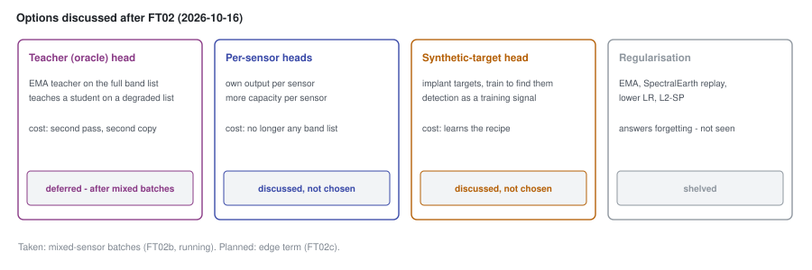

# 54 - The options not taken yet

> **The one thing this part teaches:** after FT02 four other directions were discussed - a teacher
> ("oracle") head that distils a full-spectrum view into a degraded one, a head per sensor, a head
> trained on synthetic targets, and regularisation against forgetting - and each was set aside for a
> stated reason, not because it is wrong. Knowing what each would cost is what lets you pick one up
> later without repeating the discussion.

## Where we are

Part 50 read FT02's gate miss; part 51 found the BatchNorm effect; part 52 built mixed batches
(FT02b, running); part 53 planned the edge term (FT02c). On 2026-10-16 the user also weighed the
options below. The decisions are recorded in `docs/lld/finetune.md` ("Decisions"),
`docs/proposals/fine-tuning-and-segmentation.md` ("Open questions") and the log in
`research/experiments/indradhanu-finetune/README.md`. None of them existed in code when this was written
(implanted targets have since been built as a benchmark - see the update at the end).

> **Analogy.** A ward round ends with a list: "start this drug now; consider these three if it
> does not work; this one we are not doing, here is why." The list of what was *not* done is as
> useful to the next doctor as the prescription, because it saves re-arguing the case at 3 a.m.



*Figure 54.1 - The four options, what each would add, its main cost, and where it stands.*

## 1. A teacher ("oracle") head - deferred until after mixed batches

**The idea: cross-sensor distillation.** A **teacher** is a copy of the model that sees more; a
**student** is the model being trained, which sees less and is trained to match the teacher's output.
Here the teacher reads a sensor's full band list and the student reads a degraded list - fewer bands,
or another sensor's bands - and the student is trained to reproduce the teacher's reconstruction (or
its features), not only the raw input.

The teacher would be an **EMA** (exponential moving average) of the student's own weights: after
each step,

```
teacher = 0.999 x teacher + 0.001 x student
```

so it changes slowly and smooths out the student's step-to-step swings. Work one weight: teacher
0.50, student 0.80:

```
0.999 x 0.50 + 0.001 x 0.80 = 0.4995 + 0.0008 = 0.5003
```

A 0.30 gap between them moves the teacher by 0.0003 per step.

Why it is attractive: the product reads PRISMA scenes with some bands dropped, and AVIRIS-NG's 372
bands are not PRISMA's 234. A student taught "what the full spectrum would have said" from a thinner
one learns exactly the transfer the product needs. Part 42's band-list augmentation already thins
the input; a teacher would give it a better target than the raw bands, which are noisy.

The cost: a second forward pass per step (the teacher), memory for a second copy of the weights, and
one more thing that can drift. It was deferred, not rejected: mixed batches change the training
dynamics first, and a teacher built on FT02's swings would inherit them.

## 2. Per-sensor heads - discussed, not chosen

**The idea:** keep the stem and encoder shared, but give each sensor its own decoder or its own
output layer. Each sensor gets capacity tuned to it, and the see-saw (part 51) has less to fight
over.

The cost is the whole point of the design. The wavelength stem and `WavelengthLinearDecoder` take
any band list (parts 37 and 40): one set of weights reconstructs EnMAP, PRISMA, AVIRIS-NG or a sensor nobody
has trained on. A head per sensor works only for the sensors that have one; a new sensor would need
its own fine-tuning. It also splits the training data: each head learns from its sensor's share
alone. And the effects mixed batches address - BatchNorm and gradient balance - sit before the
heads, so separate heads would not fix them.

## 3. A synthetic-target detection head - discussed, not chosen

**The idea:** implant artificial targets into training tiles and train a head to find them.
Detection, the product's actual job, becomes a training signal instead of something measured only
on four scenes.

An implanted target is usually a **linear mixture**: the pixel becomes a fraction of a target
spectrum plus the rest of the background. At one band, background 0.20, target spectrum 0.50,
fraction 0.30:

```
0.70 x 0.20 + 0.30 x 0.50 = 0.14 + 0.15 = 0.29
```

The cost is in the word "synthetic". The head learns whatever the implanting recipe makes
detectable - its spectra, sizes, mixing fractions, edges. Real targets that do not look like the
recipe may be missed, and the head may learn the recipe's artefacts (a perfectly linear mix, a
sharp square outline) instead of "unusual". It also changes what the model is: Indradhanu detects by
failing to reconstruct the unexpected; a detection head learns what is expected to be a target.
Both were reasons not to take it now.

## 4. Regularisation - shelved

Four standard ways to stop fine-tuning from drifting away from what pretraining learned:

| method | what it does | cost |
|---|---|---|
| EMA of the weights | evaluate an average of recent weights instead of the latest | memory for a copy; smooths, does not redirect |
| SpectralEarth replay | keep a share of each batch from the pretraining data | less room for the three sensors; staging another data set on the L40S |
| lower learning rate | smaller steps from F001 | slower adaptation of what *should* change |
| L2-SP | add a penalty on distance from the pretrained weights | one more weight to tune; pulls back useful change too |

**L2-SP** ("L2 towards the starting point") adds `alpha / 2 x sum of (w - w_start)^2` to the loss.
With two weights that moved from (0.5, -0.2) to (0.6, -0.1), and `alpha = 0.01`:

```
(0.6 - 0.5)^2 + (-0.1 - (-0.2))^2 = 0.01 + 0.01 = 0.02
0.01 / 2 x 0.02 = 0.0001
```

All four answer one question: "is the model forgetting?" FT02 does not look like forgetting.
Reconstruction improved on every sensor, EnMAP included - the sensor closest to SpectralEarth - and
the bench moved by 0.007 from F001. The FT02 evidence points at the sensors' interaction in training
(part 51), not at drift from F001. So they were shelved: worth taking down again only if a later run
shows reconstruction getting worse on what F001 already knew.

## How they relate

Mixed batches came first because they fix a mechanism that was measured (BatchNorm) with one change
and no new hyperparameter. The edge term comes next because it targets the false alarms part 53
measured. The teacher head is the natural follow-on to both, if the bench still needs lifting;
regularisation waits for evidence of forgetting; per-sensor heads and synthetic targets would change
what the model is, and were not chosen.

## Update, 2026-10-17 - where things stand

The day after this part was written, three things moved:

- **The edge term failed** (part 53): it fell 1% in ten epochs and the edge false alarms did not change.
  The FT02c README points the next attempt at the architecture - a masked, higher-resolution path into the
  decoder - which is a fifth option, not one of the four above.
- **Synthetic targets now exist - as a benchmark, not a training head.** `app/utils/evaluation/implant.py`
  (now `app/evaluation/implant.py`) and `scripts/build_implant_bench.py` implant objects into held-out test scenes and score models on them
  (part 56). Option 3's objection was about *training* on a recipe; a benchmark built from one has the same
  weakness in a milder form, and its README says so: implants are harder than real objects at the same
  contrast. The detection head itself is still not chosen.
- **Joint training ran** (FT03, part 55) and passed, without any of the four options.

The teacher head and regularisation are unchanged: deferred and shelved. Neither has code.

## Update, 2026-10-18 - option 3, in a different form

Option 3's objection - the head learns whatever the implanting recipe makes easy - was measured on
bench-v1 (part 57) and then answered by bench-v2, whose implants copy the real objects' contrast,
foreignness and halo (anomaly course, part 20). Detection-supervised training then went ahead, but **not
as a head**: FT05 (part 58) keeps the model and the score unchanged, puts implants in the input, and
trains against the clean tile. The proposal (`docs/proposals/detection-supervised-finetuning.md`) keeps
the detection head as a second alternative, "more direct, but a new score and a higher risk of learning
the implants' appearance". The recipe risk is guarded by holding one implant source (`host`) out of
training and letting only the real bench pass the run.

## Common confusions

**"Are the teacher head and the oracle head two proposals?"** No. They were names for the same idea in the
discussion: a full-spectrum view teaching a degraded one.

**"The EMA teacher and EMA regularisation are the same thing."** Both keep an average of weights.
The regularisation version evaluates with the average; the teacher version trains the student to
match the average's output on a richer input. Only the second adds a learning signal.

**"Shelved means rejected."** It means: not now, for a stated reason, revisit if the reason changes.

**"A synthetic-target head would replace residual Mahalanobis."** Not as discussed. It would be a
separate output; the product's score would still have to be chosen on the bench.

## Check yourself

1. Teacher 0.50, student 0.80, rate 0.001. Compute the teacher after two steps, assuming the student
   stays at 0.80.
2. Background 0.30, target 0.10, fraction 0.25. What is the mixed value?
3. L2-SP with `alpha = 0.1`, weights moved from (1.0, 0.0) to (1.2, -0.1). What is the penalty?
4. Name the evidence that made regularisation less urgent.
5. Why would per-sensor heads not have fixed the BatchNorm effect of part 51?

<details>
<summary>Answers</summary>

1. Step 1: `0.999 x 0.50 + 0.001 x 0.80 = 0.4995 + 0.0008 = 0.5003`. Step 2: `0.999 x 0.5003 + 0.0008
   = 0.4997997 + 0.0008 = 0.5005997`, about 0.5006.
2. `0.75 x 0.30 + 0.25 x 0.10 = 0.225 + 0.025 = 0.25`.
3. `(1.2 - 1.0)^2 + (-0.1 - 0.0)^2 = 0.04 + 0.01 = 0.05`; `0.1 / 2 x 0.05 = 0.0025`.
4. FT02's reconstruction improved on all three sensors, including EnMAP; the bench moved only 0.007
   from F001 epoch 109 (0.862 -> 0.855).
5. The BatchNorm sits between the stem and the encoder, before any head. Separate heads change what
   happens after it.

</details>

---

**Next:** part 55 - FT03, reconstruction and segmentation trained together on mixed batches.
