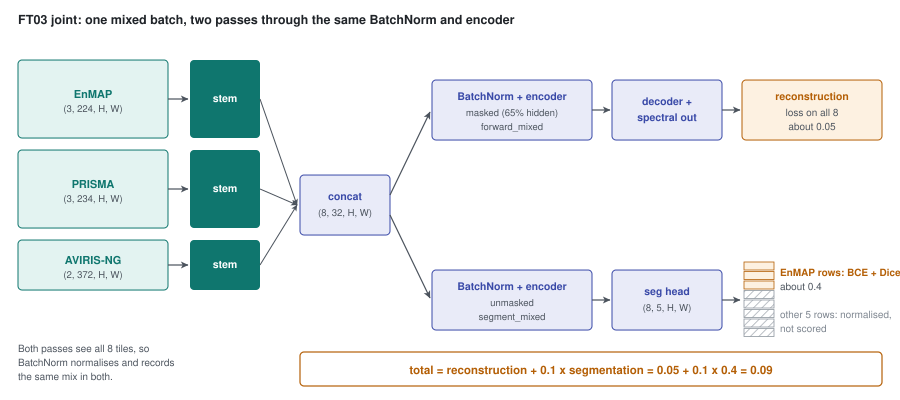

# 55 - FT03: reconstruction and segmentation together

> **The one thing this part teaches:** joint training adds the segmentation loss to the
> reconstruction loss, and three choices make it safe - the segmentation pass runs over the whole
> mixed batch so the one BatchNorm sees every sensor, the segmentation loss is weighted 0.1 so it
> does not take over the shared encoder, and the head starts from FT01's probe. FT03 beat the probe
> (water 0.841, cloud 0.815) while reconstruction and detection held, and that is all joint training
> was expected to do: it does not lift detection by itself.

## Where we are

Part 49 laid out stage 3, `mode: joint`. Parts 52 and 53 followed FT02b (mixed batches) and FT02c (the
edge term); their results are now in those parts. FT03 ran on 2026-10-16 from 19:49 to 22:48 UTC, 3.0
hours on the L40S, about $8. Its record is `research/experiments/indradhanu-finetune/FT03-joint/`
(README and `config.json`); the code is commit ea4652c. Open the README beside this part.

> **Analogy.** A choir learns a new piece (segmentation) while still singing the old repertoire
> every evening (reconstruction). Rehearse only the new piece, at full volume, and the old one slips.
> So the new piece gets ten minutes a night, not the whole evening; the whole choir rehearses it
> together, not one section alone in the corner; and they start from the sight-reading they already
> did (the probe), not from a blank page.

## What was planned, and what ran

Part 49's table had FT03 starting from FT02's `best.pt` with a fresh head and `seg_weight` 1.0. The
README says FT03 was "prepared 2026-10-16 with one-sensor batches, FT02 init and seg_weight 1.0 - all
three changed":

| | part 49's plan | what ran (`FT03-joint/config.json`) |
|---|---|---|
| backbone starts from | FT02's `best.pt` | FT02c `best.pt` (epoch 10) |
| head starts from | fresh (random) | FT01's probe head (`seg_head_from`) |
| batches | one sensor per batch | mixed: EnMAP 3 / PRISMA 3 / AVIRIS-NG 2 of 8, x4 accumulation |
| `seg_weight` | 1.0 (the default) | 0.1 |
| epochs | 20 x 30,000 | 10 x 30,000 |
| SAM weight | ramped | 0.5 throughout (`sam_ramp_epochs: 0`) |
| edge term | - | off (`grad_loss_weight: 0.0`) |

The learning rate was 0.0001 on a cosine schedule, as before. The SAM ramp was switched off because
`init_from` restarts the epoch counter (part 52), and restarting the ramp would have trained the first
epoch on L1 alone.

## The loss

Joint mode adds one term to part 52's mixed reconstruction loss (`_mixed_loss` in
`app/foundation_models/trainers/finetune_trainer.py`):

```python
loss = total / kept                                  # reconstruction: L1 + SAM weight x SAM, per tile
if cfg.mode == "joint":
    seg = self._mixed_seg_loss(groups, model)
    if seg is not None:
        loss = loss + cfg.seg_weight * seg           # 0.1 x masked BCE + Dice
```

The segmentation loss is part 47's `masked_bce_dice`, on EnMAP tiles only - EnMAP is the only sensor
with labels - under part 48's label policy (cloud and thin cloud unknown in dry air).

## Choice 1 - the segmentation pass sees the whole mixed batch

Segmentation needs a **second** forward pass: the reconstruction pass hides 65% of the tokens, and a
mask predictor must see the whole tile (part 47). That second pass is the danger, because of the
model's one BatchNorm (part 51). In training mode BatchNorm does two things on **every** forward call:
it normalises with the batch's own statistics, and it nudges its stored running statistics towards
them (momentum 0.1).

If the segmentation pass held only the 3 EnMAP tiles, every step would run one mixed pass and one
EnMAP-only pass. Work one channel's running mean. Say the mixed batches have mean 0.2 and EnMAP-only
batches 0.5, and the running mean starts at the mix's 0.2:

```
step 1, mixed pass:      0.9 x 0.200 + 0.1 x 0.2 = 0.180 + 0.020 = 0.200
step 1, EnMAP-only pass: 0.9 x 0.200 + 0.1 x 0.5 = 0.180 + 0.050 = 0.230
step 2, mixed pass:      0.9 x 0.230 + 0.1 x 0.2 = 0.207 + 0.020 = 0.227
step 2, EnMAP-only pass: 0.9 x 0.227 + 0.1 x 0.5 = 0.2043 + 0.050 = 0.2543
```

It keeps climbing. Where does it settle? Call the settled value `m`; one full step must leave it
unchanged:

```
after the mixed pass:      0.9 m + 0.02
after the EnMAP-only pass: 0.9 (0.9 m + 0.02) + 0.05 = 0.81 m + 0.018 + 0.05 = 0.81 m + 0.068
settled:                   m = 0.81 m + 0.068   ->   0.19 m = 0.068   ->   m = 0.358
```

The stored mean would settle at 0.358, about halfway from the mix (0.2) towards EnMAP (0.5). Evaluation
uses the stored value, so every sensor would be normalised by statistics that match none of them - the
fault FT02b had removed one run earlier.

So the segmentation pass runs over **all eight tiles**, through `segment_mixed` in
`app/foundation_models/components/spectral_stem_seg_former_mae.py`:

```python
def segment_mixed(self, groups: list) -> list:
    # groups: [(x, wavelengths_nm, band_valid), ...] - one per sensor
    z = torch.cat([self._stem(x, wl, bv) for x, wl, bv in groups])    # (8, 32, H, W)
    logits = self.seg_head(self.encoder(self.norm(z)))               # (8, 5, H, W), no keep mask
    return list(torch.split(logits, [len(x) for x, _, _ in groups])) # (3,5,..), (3,5,..), (2,5,..)
```

It is `forward_mixed` (part 52) without a keep mask and with the segmentation head in place of the
decoder. The PRISMA and AVIRIS-NG rows get logits that no loss reads; they are in the pass so that
BatchNorm normalises, and records, the same mix as the reconstruction pass. The test
`test_segment_mixed_matches_segment_per_group` checks that in evaluation mode the mixed pass gives
each group exactly what `segment` would give it alone.

The README's words: "one unmasked `segment_mixed` pass over the whole mixed batch (BatchNorm sees every
sensor)". Part 52 said joint mode could not use mixed batches because this pass "was not built for
mixed groups"; commit ea4652c built it.

### The argument-order trap

`_mixed_seg_loss` collects each group's inputs with `_seg_inputs`, which returns them in this order:

```python
return pixels[keep], band_valid[keep], wl, t, k          # (pixels, band_valid, wavelengths, targets, known)
```

`segment_mixed` wants `(x, wavelengths, band_valid)` - wavelengths second. So the call reorders:

```python
logits = model.segment_mixed([(p[0], p[2], p[1]) for p in parts])   # (x, wl, band_valid)
```

Pass `p[:3]` instead and the stem receives a `(B, N, H, W)` validity mask where it expects an `(N,)`
list of wavelengths. According to the session that wrote it, the first version had exactly this
mistake and the laptop smoke run caught it before launch; the repo holds only the fixed line and its
`# (x, wl, band_valid)` comment, so treat the history as reported. The lesson stands either way: two
neighbouring functions that order the same three arguments differently is a trap, and a short smoke run
on real batches is cheaper than a failed three-hour run.

## Choice 2 - `seg_weight` 0.1, not 1.0

The README: "laptop smoke: segmentation loss ~0.4 against reconstruction ~0.05 (L1 + 0.5 SAM)". Where
does 0.05 come from? Per-sensor validation in FT02b had L1 about 0.016 and SAM about 4.2 degrees.
`SAMLoss` returns radians (`app/foundation_models/components/sam_loss.py`):

```
4.2 degrees  = 4.2 x 3.1416 / 180 = 0.0733 rad
reconstruction = L1 + 0.5 x SAM = 0.016 + 0.5 x 0.0733 = 0.016 + 0.0367 = 0.0527
```

Now the two weights:

```
seg_weight 1.0:  0.05 + 1.0 x 0.4 = 0.45     segmentation is 0.40 / 0.45 = 89% of the loss
seg_weight 0.1:  0.05 + 0.1 x 0.4 = 0.09     segmentation is 0.04 / 0.09 = 44% of the loss
```

At 1.0 the shared encoder would be trained mostly to segment EnMAP, and reconstruction - which is what
detection reads - would become a side task. At 0.1 the two are "comparable, as the proposal's 'MAE
dominant' intends" (README). Share of the loss value is a rough guide, not the share of the gradient,
but an order-of-magnitude imbalance is what it catches.

## Choice 3 - FT01's head as a warm start

`seg_head_from` (field in `SpectralStemFinetuneConfig`, `app/models/training/training_config.py`)
names a checkpoint whose `seg_head.*` weights replace the fresh head after `init_from` has loaded the
backbone:

```python
if cfg.seg_head_from:                            # e.g. FT01's probe head instead of a fresh one
    head = {k[len("seg_head."):]: v for k, v in self._load_init_state(cfg.seg_head_from, "seg_head.pt").items()
            if k.startswith("seg_head.")}
    model.seg_head.load_state_dict(head)
```

**This reverses part 49**, which said "The probe is a measurement, not a warm start." It became both.
The README is careful about what that buys: FT01 "learned on F001 features and the encoder has moved
since, so it is a warm start, not a fit". FT02, FT02b and FT02c all changed the encoder after FT01's
head was trained. Epoch 1's IoUs (water 0.819, cloud 0.785) sit close to FT01's final 0.82 / 0.80, which
fits the head carrying most of what it knew across - an interpretation, not something FT03 tested
against a fresh head.

## The results

From the README, EnMAP test IoU and per-sensor validation SAM in degrees:

| epoch | water | cloud | thin cloud | shadow | SAM EnMAP / PRISMA / AVIRIS-NG |
|---|---|---|---|---|---|
| 1 | 0.819 | 0.785 | 0.063 | 0.133 | 4.03 / 4.49 / 6.27 |
| 4 | 0.833 | 0.811 | 0.059 | 0.174 | 3.96 / 4.30 / 5.80 |
| 7 | 0.838 | 0.802 | 0.102 | 0.185 | 3.94 / 4.21 / 5.51 |
| **10 (best.pt)** | **0.841** | **0.815** | 0.108 | 0.205 | **3.92 / 4.21 / 5.48** |

The three pass criteria, written before launch:

1. **Water and cloud IoU at or above FT01's 0.82 / 0.80** - met: 0.841 and 0.815.
2. **Per-sensor SAM within 0.1 degree of FT02c's 3.93 / 4.21 / 5.41** - met: `3.92 - 3.93 = -0.01`,
   `4.21 - 4.21 = 0`, `5.48 - 5.41 = +0.07`. AVIRIS-NG had been 0.46 worse at epoch 6 and recovered.
3. **Detection not below FT02c beyond noise** - met, and essentially identical:

| | implant bench: all / easy / medium caught, top 1% | easy pAUC | medium pAUC | PRISMA bench pAUC to 1% | PRISMA bench caught, top 1% / 0.1% |
|---|---|---|---|---|---|
| FT02c ep10 | 27% / 50% / 21% | 0.371 | 0.124 | 0.159 | 413 / 131 |
| **FT03 ep10** | 27% / 50% / 21% | 0.371 | 0.121 | 0.158 | 413 / 130 |

Snow stayed at 0.0 throughout - there is one snow tile in the EnMAP test set, so it is not a
measurement. Thin cloud rose from 0.06 to 0.11 and shadow from 0.13 to 0.21 as the encoder adapted;
both stay low, which parts 48 and 50 put down to label quality and rarity. **Verdict: passed all
three.** FT03 is the stage-3 model.



*Figure 55.1 - One mixed batch of 8 tiles (teal stem passes per sensor) goes through the shared
BatchNorm and encoder (indigo) twice: masked, to the decoder, for the reconstruction loss on all 8;
unmasked, to the segmentation head, for the segmentation loss on the 3 EnMAP tiles only (the other 5
rows, grey hatching, are normalised but not scored). Total loss = reconstruction + 0.1 x segmentation.*

## Why joint training did not lift detection - and was not expected to

The detection score is residual Mahalanobis on the **reconstruction** (part 45). The segmentation head
is a separate output that reads the encoder's features; nothing in the score reads it. Joint training
could only change detection by changing the encoder, and at `seg_weight` 0.1 the encoder "kept
reconstructing as before" (README). The pre-launch expectation said "detection unchanged within noise",
and that is what happened.

**The head's value comes later**, at stage 5 of part 49's curriculum: its masks replacing
`scene_segmentation`'s threshold rules, and class-aware scoring if it beats the default. FT03 produced
the head for that; it was never the step meant to raise detection.

> **Update, 2026-10-18.** Stage 5 went differently: class-aware scoring was not shipped, and the head's
> first job became a **cloud exclusion mask** (water was kept, because vessels are in scope), which lifts
> FT03's real-bench pAUC 0.158 -> 0.166. The same head over-fires on bright desert (11% of set4 called
> cloud), so a mask fine-tune (FT04) is proposed before it ships. Parts 57 and 59; anomaly-detection
> course, part 21.

## Common confusions

**"Joint means the PRISMA and AVIRIS-NG tiles are trained to segment too."**
They pass through the segmentation pass but no loss reads their logits. They are there for BatchNorm.

**"seg_weight 0.1 means segmentation hardly matters."**
It makes the segmentation term about 0.04 against reconstruction's 0.05 - comparable, not negligible.
At 1.0 it would have been eight times reconstruction.

**"FT03 starts from the probe."**
Only its head does. The backbone starts from FT02c epoch 10.

**"FT03 passed, so detection improved."**
Criterion 3 was "not below FT02c beyond noise". It held. Nothing moved.

**"The validator called `_mixed_batches_in_adapt_only` means joint cannot use mixed batches."**
The name is stale; the body now rejects only `probe` ("mixed_batches is implemented for modes 'adapt'
and 'joint'"). The source wins. `docs/lld/finetune.md` still says "mode adapt only" in four places.

## Check yourself

1. A sensor's validation L1 is 0.015 and its SAM 4.5 degrees. Compute the reconstruction loss with SAM
   weight 0.5.
2. Redo the running-mean fixed point with mixed mean 0.1 and EnMAP-only mean 0.6.
3. With segmentation loss 0.3 and reconstruction 0.06, what share of the loss is segmentation at
   `seg_weight` 1.0, 0.1 and 0.2?
4. Which three of part 49's FT03 settings changed before launch, and why each?
5. Why is the segmentation head's real test at stage 5 rather than in FT03's detection numbers?

<details>
<summary>Answers</summary>

1. `4.5 x 3.1416 / 180 = 0.0785` rad. `0.015 + 0.5 x 0.0785 = 0.015 + 0.0393 = 0.0543`.
2. After the mixed pass `0.9 m + 0.01`; after the EnMAP-only pass `0.9 (0.9 m + 0.01) + 0.06 = 0.81 m +
   0.009 + 0.06 = 0.81 m + 0.069`. Settled: `0.19 m = 0.069`, `m = 0.363`. With `segment_mixed` both
   passes see 0.1 and it stays at 0.1.
3. 1.0: `0.3 / (0.06 + 0.3) = 0.3 / 0.36 = 83%`. 0.1: `0.03 / (0.06 + 0.03) = 0.03 / 0.09 = 33%`.
   0.2: `0.06 / (0.06 + 0.06) = 0.06 / 0.12 = 50%`.
4. Mixed batches instead of one sensor per batch (so BatchNorm sees the mix, part 51-52); start from
   FT02c instead of FT02 (the latest stage-2 model); `seg_weight` 0.1 instead of 1.0 (the smoke run's
   0.4 vs 0.05). The head also started from FT01 instead of fresh.
5. Detection reads the reconstruction, not the head. The head pays back when its masks replace the
   threshold rules in `scene_segmentation` or feed class-aware scoring, which is stage 5.

</details>

---

**Next:** part 56 - what the implanted-target benchmark says about every stage from v0.2.0 to FT03.
