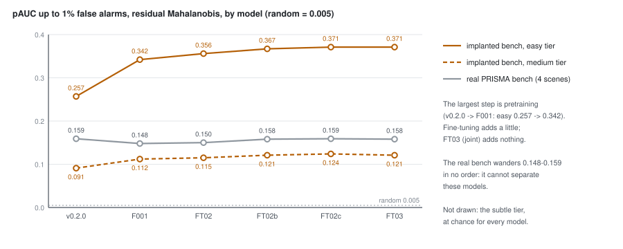

# 56 - What the implanted-target benchmark says about the training stages

> **The one thing this part teaches:** on 3,336 implanted objects the models line up in the order
> they were trained - the largest step is pretraining (v0.2.0 to F001), fine-tuning adds a few points
> more, joint training adds nothing to detection - while the four real PRISMA scenes had shown none of
> it; and three things limit the reading: subtle objects sit at chance for every model, EnMAP hosts do
> not move at all, and the later steps are small enough that you should ask whether they are noise.

## Where we are

Part 50 onwards judged every run on the four labelled PRISMA scenes, and from FT02 on those scenes
could not tell the models apart: under residual Mahalanobis every measure, from ROC-AUC to objects
caught, tied the shipped v0.2.0 with the fine-tuned models (FT02b README, "All bench measures"). On
2026-10-17 a larger benchmark was built, and every model so far was scored on it. This part reads
those results as a verdict on the training stages.

The benchmark itself is taught in full in the anomaly-detection course, parts 16 to 18
(`docs/training/anomaly-detection/`). The summary below is enough to read this part; go there for the
arithmetic of the measures and of the implanting.

> **Analogy.** Six runners were timed on a 100 m track with a hand stopwatch. They all came in at
> "about 12 seconds" - the stopwatch could not separate them. Put them on a 1,500 m course with chip
> timing and an order appears. The longer course is not the race they will run in the end, and it may
> flatter some runners, but at last it can tell them apart.

## The benchmark in one page

- **Hosts:** 18 real held-out test scenes - 6 each from EnMAP, PRISMA and AVIRIS-NG, never trained on
  (`HOSTS` in `scripts/build_implant_bench.py`).
- **Objects:** 3,336 synthetic objects, sized, placed and contrasted like the 909 real labelled PRISMA
  objects: median 2 pixels, 41% single pixels. Half are a real object's difference spectrum added in
  (**signature**), half a USGS library material mixed in (**material**).
- **Contrast z:** the object's mean absolute difference from a ring of pixels 2-3 steps away, divided
  by the ring's mean standard deviation (`contrast_z` in `app/evaluation/implant.py`).
- **Tiers:** cut at the real objects' z terciles, 0.502 and 0.934: **subtle**, **medium**, **easy**.
- **Measures:** objects **caught** - at least one pixel within one step of a pixel in the top 1% (or
  0.1%) of scores - and **pAUC**, the area under the ROC curve up to 1% false alarms divided by 0.01.
- **Chance:** random scores catch **10%** of objects at the top 1% and **1%** at the top 0.1% (the
  one-pixel tolerance gives every object several chances); random pAUC is **0.005**.
- **Each model reads the hosts its own way:** the wavelength models read the bands their
  trained-wavelength record covers (part 49); v0.2.0 reads a linear resample onto its fixed 165-band
  grid (then `scripts/evaluate_implant_bench.py`; now `scripts/evaluate.py`, part 57).

## The results

Residual Mahalanobis, from `research/experiments/implant-bench/README.md`. Objects caught at the top
1% (top 0.1% in brackets); pAUC averaged over hosts; the last three columns are objects caught at the
top 1% on each sensor's hosts:

| model | stage | all | subtle | medium | easy | easy pAUC | medium pAUC | EnMAP | PRISMA | AVIRIS-NG |
|---|---|---|---|---|---|---|---|---|---|---|
| v0.2.0 | shipped (part 01-30) | 19% (8%) | 9% (1%) | 14% (4%) | 34% (18%) | 0.257 | 0.091 | 16% | 15% | 30% |
| F001 ep109 | pretraining (43) | 25% (10%) | 11% (1%) | 21% (5%) | 45% (22%) | 0.342 | 0.112 | 15% | 30% | 32% |
| FT02 ep8 | adapt (50) | 26% (10%) | 10% (1%) | 20% (5%) | 49% (24%) | 0.356 | 0.115 | 15% | 32% | 32% |
| FT02b ep9 | mixed batches (52) | 27% (10%) | 10% (1%) | 22% (5%) | 50% (25%) | 0.367 | 0.121 | 15% | 34% | 33% |
| FT02c ep10 | edge term (53) | 27% (10%) | 10% (1%) | 21% (5%) | 50% (25%) | 0.371 | 0.124 | 15% | 33% | 33% |
| FT03 ep10 | joint (55) | 27% (10%) | 10% (1%) | 21% (4%) | 50% (25%) | 0.371 | 0.121 | 15% | 33% | 33% |

And on the four real PRISMA scenes, the same models (FT02b and FT03 READMEs; FT03's ROC-AUC was not
reported there - the stage-3 evaluation of part 57 measured it at 0.853):

| model | ROC-AUC | pAUC to 1% | caught of 909, top 1% |
|---|---|---|---|
| v0.2.0 | 0.854 | 0.159 | 402 |
| F001 ep109 | 0.861 | 0.148 | 400 |
| FT02 ep8 | 0.855 | 0.150 | 401 |
| FT02b ep9 | 0.856 | 0.158 | 411 |
| FT02c ep10 | 0.855 | 0.159 | 413 |
| FT03 ep10 | - | 0.158 | 413 |



*Figure 56.1 - Easy-tier and medium-tier pAUC on the implanted benchmark (amber, solid and dashed)
rise from v0.2.0 to FT02c and stay at FT03; the real bench's pAUC (grey) wanders between 0.148 and
0.159 with no order. Random pAUC is 0.005, at the bottom of the axis.*

## Stage by stage

**Pretraining is the big step.** v0.2.0 to F001: easy caught 34% to 45%, easy pAUC 0.257 to 0.342,
and on PRISMA hosts 15% to 30% - double. Two things changed at once, and the bench cannot separate
them: a new model (SpectralEarth pretraining, the reduced-attention stem of part 40) and a new way of
reading the scene (the host's own bands, against v0.2.0's resample onto 165). The README's own words:
"The largest step is pretraining".

**Adaptation adds a little.** F001 to FT02: easy 45% to 49%, PRISMA 30% to 32%. Part 50 noted that FT02
also grew the trained-wavelength record from 202 to 733, so FT02 reads more bands than F001; some of
this step may be bands, not weights.

**Mixed batches and the constant SAM weight add a little more.** FT02b: easy pAUC 0.367, PRISMA 34%.
FT02c: easy pAUC 0.371, medium 0.124 - the best numbers in the table. Part 53 records that FT02c's edge
term itself moved by 1% and did not change the edge false alarms, and that its reconstruction gains are
more plausibly from the constant SAM weight; the small detection gain fits that reading.

**Joint training adds nothing to detection.** FT03 equals FT02c within a point everywhere, as part 55
said it should.

In total, fine-tuning added about 5 points on easy (45% to 50%) and 3-4 on PRISMA hosts (30% to
33-34%). The real bench showed none of it: its pAUC put F001 *below* v0.2.0 (0.148 against 0.159).

## Three limits on the reading

**1. Subtle is at chance for every model.** 9-11% at the top 1%, 1% at the top 0.1% - exactly what
random scores get. That is not because the tier is impossible: on the real bench, real objects in the
subtle tier are caught 40% of the time at the top 1% (implant README, "Real bench, by tier"). **The
implants are harder than real objects at the same contrast.** The README's likely reasons: real objects
are rare materials across the whole scene, not only against their ring, and human labellers mark what
they can see. So compare models within a tier; do not read the tier's absolute numbers as the product's
expected performance.

**2. EnMAP hosts do not move.** 16% for v0.2.0 and 15% for every later model, while PRISMA hosts
double. Not yet explained. The README's candidates: the EnMAP hosts' greener, more uniform backgrounds;
their pixel-mask defects (2-4 missing bands per pixel, filled); or that pretraining on SpectralEarth,
which *is* EnMAP, had already given everything there was to give.

**3. Are the late steps real?** The README gives no error bars, so here is a rough check of your own.
If a model truly catches a share `p` of `n` objects, the share it shows on one draw of objects wobbles
by about `sqrt(p x (1 - p) / n)` - the binomial standard error. For the easy tier, `p` = 0.50 and `n`
= 1,079:

```
p x (1 - p)         = 0.50 x 0.50 = 0.25
0.25 / 1,079        = 0.000232
sqrt(0.000232)      = 0.0152       about 1.5 points
```

So F001 to FT02c on easy, 45% to 50%, is about `5 / 1.5 = 3.3` standard errors - unlikely to be luck.
FT02 to FT02b, 49% to 50%, is under one. Every model is scored on the **same** objects, which makes
differences between models less noisy than this single-model figure suggests, so it is a cautious
check, not a test. It is this course's arithmetic, not a figure from the README. The safe summary:
pretraining clearly helped, fine-tuning as a whole probably helped, and the order among FT02b, FT02c and
FT03 is not established.

## `combined` tells the same story, lower

Under the older `combined` score (part 30): all objects 10% (v0.2.0) to 12% (F001) to 15-16% (FT02,
FT02b, FT02c); easy 19% to 30%. Still far below residual Mahalanobis at every stage - the default
chosen in part 46 holds on the bigger benchmark too.

## What this changes

The question that ran through parts 50 to 55 - "did this stage improve detection?" - could not be
answered on four scenes. Now it can, at least for the easy and medium tiers. Two consequences:

- The stage-2 gate of part 49 (real-bench ROC-AUC at or above 0.861) was read on a ruler that could not
  separate the models it judged. FT02 and FT02b "failed" it by 0.006 and 0.005, while on the larger
  benchmark both beat F001, the model the gate was set from.
- Future runs have a measure that moves. FT02c's README already points the next step at the decoder's
  H/4 bottleneck (part 53); the implanted benchmark is where such a change would have to show itself,
  tier by tier.

## Common confusions

**"The benchmark proves fine-tuning made the product 5 points better."**
It shows 5 points more easy implants caught, on hosts greener than the real bench. Real objects at the
same contrast are easier, and the real bench did not move.

**"Subtle at 10% means the models are a little better than nothing on subtle."**
10% is nothing: it is chance, because of the one-pixel tolerance.

**"F001 beat v0.2.0 because pretraining on SpectralEarth is better."**
That and a different band reading changed together. The benchmark measures the pair.

**"The real bench was wrong."**
It was too small, not wrong. Its 909 objects in four scenes give differences smaller than the
scene-to-scene noise.

## Check yourself

1. Compute the binomial standard error for the medium tier: `p` = 0.21, `n` = 1,170. Is FT02b's 22%
   against FT02's 20% more than two standard errors apart?
2. By how many points did easy caught rise from v0.2.0 to F001, and from F001 to FT03? What share of
   the total rise from v0.2.0 to FT03 came from pretraining?
3. PRISMA hosts went 15% to 30% from v0.2.0 to F001. How many times chance were they before and after?
4. Name the two things that changed together between v0.2.0 and F001.
5. Why can subtle-tier numbers not show whether a training stage helped?

<details>
<summary>Answers</summary>

1. `0.21 x 0.79 = 0.1659`; `0.1659 / 1,170 = 0.000142`; `sqrt(0.000142) = 0.0119`, about 1.2 points.
   `22 - 20 = 2` points is `2 / 1.2 = 1.7` standard errors - less than two.
2. `45 - 34 = 11` points; `50 - 45 = 5` points; total `50 - 34 = 16`. Pretraining: `11 / 16 = 0.69`,
   about 69%.
3. Chance is 10%. Before: `15 / 10 = 1.5` times. After: `30 / 10 = 3` times.
4. The model (SpectralEarth pretraining with the reduced-attention stem) and the band reading (the
   host's own bands instead of a resample onto 165).
5. Every model sits at chance there (9-11% at the top 1%, 1% at the top 0.1%), so there is no signal
   for a stage to move.

</details>

---

Next: [part 57](57-stage-3-and-what-comes-next.md) - the stage-3 evaluation, water and cloud, and bench-v2.

The authoritative records for this stretch are the run READMEs under
`research/experiments/indradhanu-finetune/`, `research/experiments/implant-bench/README.md` and
`docs/lld/implant-bench.md`; new results will land there first.
