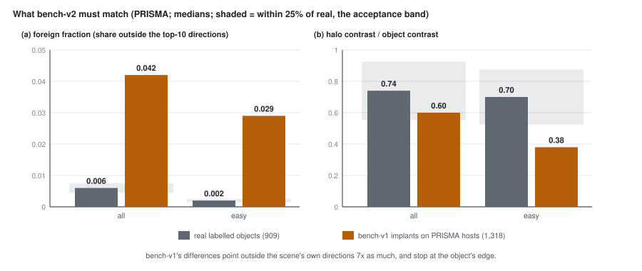

# 57 - Stage 3, water and cloud, and why the implants must change first

> **The one thing this part teaches:** the stage-3 evaluation confirmed part 56's ordering and the real
> bench's tie, put FT03's segmentation head to work as a water / cloud mask that helps every model
> about equally - a product decision, not a better Indradhanu - and showed that a model-free detector
> beats every Indradhanu on bench-v1 while losing on real objects, which is why no model is trained on
> detection until the implants look like real objects (bench-v2).

## Where we are

Part 56 read the implanted-target benchmark (bench-v1) as a verdict on the training stages. On
2026-10-17 every number was re-run through the new evaluation subsystem (`app/evaluation/`,
`scripts/evaluate.py`, `configs/eval/stage3.json`), with two additions: a scorer that drops water and
cloud using FT03's head, and a classical baseline with no model at all. The machinery - the config, the
loop, the cache, chance - is taught in the anomaly-detection course, part 19
(`docs/training/anomaly-detection/19-running-an-evaluation.md`). This part reads the results as a
verdict on the model and on what to train next.

Sources: `docs/lld/evaluation.md` ("Reference run: stage 3"), `research/experiments/implant-bench/README.md`
("Stage-3 evaluation through app/evaluation"), the log at the end of
`research/experiments/indradhanu-finetune/README.md`, and `docs/lld/implant-bench.md` ("bench-v2").

> **Analogy.** A tutor coaches a student on past papers from one examiner, who happens always to hide
> the answer in the first sentence. The student's marks climb. Then a different examiner sets the real
> exam. Coaching on a quirky paper teaches the quirk; you have to fix the papers before you coach on
> them.

## 1. The numbers held

The new framework reproduced every earlier figure: on the four real PRISMA scenes, v0.2.0 pAUC 0.159 /
ROC-AUC 0.854 / 402 of 909 objects at the top 1%, F001 0.148 / 0.861 / 400, FT03 0.158 / 0.853 / 413.
That also fills the gap in part 56's second table: **FT03's ROC-AUC on the real bench is 0.853.** The
picture of part 56 stands - the implants order the stages, the real bench ties them.

## 2. Water and cloud: FT03's head goes to work

Stage 5 of the curriculum (part 49) planned two uses for the segmentation head: replace the threshold
rules of `scene_segmentation`, and offer **class-aware scoring** - a separate "normal" per surface class.
Class-aware scoring was tested on 2026-10-17 and **not shipped**: it removed cloud false alarms (on the
implants 8% -> 1% of them) but water's tight statistics made water noise dominate (set1: water's share of
false alarms 14% -> 92%; PRISMA pAUC 0.158 -> 0.134; finetune README log).

The user's rule settled it: **"we don't detect anything on water and cloud."** So the head marks them and
the scorer sets them to 0 after scoring (`exclude` in `app/evaluation/scorers.py`). The mask comes from
FT03, but it is applied to **every** model's scores. PRISMA bench, residual Mahalanobis, with and
without the exclusion:

| model | caught top 0.1%, plain | caught top 0.1%, excluded | pAUC, plain | pAUC, excluded |
|---|---|---|---|---|
| v0.2.0 | 14.1% | 15.3% | 0.159 | 0.165 |
| F001 ep109 | 13.2% | 14.6% | 0.148 | 0.155 |
| FT02c ep10 | 14.4% | 16.1% | 0.159 | 0.167 |
| FT03 ep10 | 14.3% | 16.5% | 0.158 | 0.165 |

Work the pAUC gains:

```
v0.2.0:  0.165 - 0.159 = 0.006
F001:    0.155 - 0.148 = 0.007
FT02c:   0.167 - 0.159 = 0.008
FT03:    0.165 - 0.158 = 0.007
```

Between 0.006 and 0.008 for every model, including v0.2.0, which has no segmentation head and was never
fine-tuned. **The gain belongs to the mask, not to any model's reconstruction.** That is what makes it
a product decision: whatever Indradhanu ships next, it will be scored this way. It also gives the
segmentation head (parts 47, 55) its first job: joint training added nothing to detection (part 55),
but the head it trained now lifts the top of every model's ranking.

Two costs, both from `docs/lld/evaluation.md`: ROC-AUC falls (FT03 0.853 -> 0.830, mostly on set1,
which FT03 calls 55% water - excluded pixels all tie at 0), and **39 of the 909 real objects lie wholly
inside FT03's water / cloud mask** (27 in set1), so they cannot be found any more. Whether those are
boats, shoreline objects or FT03's mistakes is unchecked. And it is not in the product yet: `backend/`
excludes water and cloud only through the older threshold-based `keep_mask`.

## 3. The model-free detector

The config also ran `pca_rx`: the same residual Mahalanobis, handed a reconstruction of zeros, so it
scores the cube itself - classical local RX on the top 30 principal components. No Indradhanu involved.

| | bench-v1: caught top 1% | bench-v1: pAUC | real: pAUC | real: TPR at 0.1% FPR |
|---|---|---|---|---|
| FT03 + residual Mahalanobis | 26.9% | 0.172 | 0.158 | 0.058 |
| PCA-RX, no model | **30.2%** | **0.209** | 0.128 | 0.029 |

On bench-v1 the classical detector beats every Indradhanu - on PRISMA hosts by the widest margin (42.0%
caught against FT03's 33.4%). On the real objects it finds half as many target pixels at 0.1% false
alarms (`0.029 / 0.058 = 0.5`).

Two readings for the model:

- **Good news, from the real bench:** Indradhanu is doing work a classical detector cannot - twice the
  detection rate where the analyst looks. That was never shown this plainly before, because no baseline
  had been run beside the models.
- **A caution, about part 56:** bench-v1 rewards something PCA-RX has more of than any model. When a
  stage rose on bench-v1, some of that rise may be the model getting *more like PCA-RX*, not better at
  real objects. Part 56's ordering is still the best evidence there is, but it is evidence about
  implants.

## 4. What is wrong with the implants

A diagnosis on the six PRISMA hosts (`C:/es/implant/v2/diag.py` and `diag.json` on the dev laptop;
medians re-computed from `diag.json` for this part) compared the 909 real objects with bench-v1's 1,318
PRISMA implants on two numbers. Both start from `d`, an object's mean spectrum minus its ring's.

**Foreign fraction** - the share of `|d|^2` (the squared length of `d`) lying outside the scene's 10 main
spectral directions (`foreign_fraction` in `app/evaluation/implant.py`). Real **0.006**, bench-v1
**0.042**; easy tier real 0.002, bench-v1 0.029. Real objects are unusual mixtures of materials the scene
already has; the implants point somewhere the scene never goes, and PCA-RX's whitening multiplies
exactly that (part 45's argument for residual Mahalanobis, turned round).

**Halo / object contrast** - the contrast of the 1-pixel ring touching the object, over the object's own.
Real **0.74**, bench-v1 **0.60**; easy tier real 0.70, bench-v1 **0.38**. Real objects bleed into their
neighbours - the sensor's blur and light mixed in from next door. Implants stop dead at their edge.



*Figure 57.1 - Medians on PRISMA, real objects (grey) against bench-v1 implants (amber), overall and
in the easy tier; the shaded band is within 25% of the real value. bench-v1 is outside it everywhere
except the overall halo.*

## 5. Why not train on detection yet

Part 54's option 3 - implant synthetic targets and train a head (or the model) to find them - is the
obvious next step now that a benchmark separates models. It is **deferred until bench-v2 passes its
acceptance** (proposal, stage table). The reason is part 54's own objection, now measured: a loss that
rewards finding bench-v1's implants rewards foreign directions and hard edges. The cheapest way for a
network to lower that loss is to become a better PCA-RX - which the real bench says is the wrong
direction. And a benchmark built the same way would then grade the model on the quirk it was taught.

## 6. bench-v2, in progress

Four changes, in `app/evaluation/implant.py` and `scripts/build_implant_bench.py` (being written on
2026-10-17; no v2 bench built, no results):

1. **Contrast and foreignness as a pair** from one real object of the tier. In the diagnosis the two are
   related - real subtle objects are more foreign (median 0.025) than real easy ones (0.002) - and drawing
   them separately would break that.
2. **Rescale the outside part** of the difference to that foreignness, keeping the inside part
   (`match_foreignness`).
3. **A third source, `host`**: the difference between a land pixel of the same scene, at least 100 pixels
   away, and the ring - a material the scene really contains.
4. **Blur the footprint** with a Gaussian point-spread function (`psf_weights`): the object gets weight 1
   on average, its neighbours the blur's tail.

Work `match_foreignness` by hand with the repo's test case: scene direction = band 0, `d = (3, 4, 0)`,
target foreignness 0.1. It keeps the inside part `(3, 0, 0)` and scales the outside part `(0, 4, 0)` by
`beta`, chosen so the outside share is the target:

```
inside |.|^2 = 9,  outside |.|^2 = 16
beta^2 = target / (1 - target) x inside / outside = (0.1 / 0.9) x (9 / 16) = 0.1111 x 0.5625 = 0.0625
beta   = 0.25
d'     = (3, 0.25 x 4, 0) = (3, 1, 0)
check:   outside 1^2 = 1,  total 9 + 1 = 10,  1 / 10 = 0.1
```

Now the blur, for a one-pixel object at `sigma = 1` pixel. `psf_weights` blurs the footprint and divides
by the object's own weight, so a neighbour at offset `(dy, dx)` gets `exp(-(dy^2 + dx^2) / (2 x 1^2))`:

```
halo (distance 1, 4 pixels):  exp(-0.5) = 0.6065 each
ring (part 18's 20-pixel diamond, distances 2 and 3):
  4 at (2, 0):  exp(-2)   = 0.1353      4 x 0.1353 = 0.5413
  4 at (1, 1):  exp(-1)   = 0.3679      4 x 0.3679 = 1.4715
  4 at (3, 0):  exp(-4.5) = 0.0111      4 x 0.0111 = 0.0444
  8 at (2, 1):  exp(-2.5) = 0.0821      8 x 0.0821 = 0.6567
  sum = 2.7139;  mean = 2.7139 / 20 = 0.1357
```

Both match the code (`psf_weights` on a 15 x 15 grid gives 0.6065 and 0.1357). The ring is pushed up
too, by 0.1357 of the implant, so the object's contrast against it is only `1 - 0.1357 = 0.864` of the
implant - which is why the builder solves the strength with step `(1 - mean ring weight) x d'`. On a
perfectly uniform background the halo's contrast over the object's would be

```
(0.6065 - 0.1357) / (1 - 0.1357) = 0.4708 / 0.8643 = 0.545
```

Real objects show 0.74, but real halos also carry their own natural differences from the ring, so sigma
is to be calibrated against the measured halo median (the `--psf-sigma` and `--hosts` options exist for
calibration runs), not solved from this formula.

**Acceptance, fixed before the build:** foreignness and halo medians within 25% of the real objects',
overall and in every tier; and every model above PCA-RX on v2, as on the real bench. Read "within 25%"
as relative to the real value:

```
foreign, overall:  0.006 x 0.75 = 0.0045  to  0.006 x 1.25 = 0.0075     bench-v1 0.042: fails
halo, overall:     0.74 x 0.75  = 0.555   to  0.74 x 1.25  = 0.925      bench-v1 0.60:  passes
halo, easy:        0.70 x 0.75  = 0.525   to  0.70 x 1.25  = 0.875      bench-v1 0.38:  fails
```

The overall halo would have passed; the easy tier exposes it. That is why the test is per tier.

## Common confusions

**"Exclusion is FT03's improvement."**
It lifts v0.2.0 by as much as FT03. It is a product rule using FT03's head, not a better reconstruction.

**"PCA-RX beat the models, so the fine-tuning was wasted."**
On real objects PCA-RX is clearly last. It beat them on implants built in a way that favours it.

**"bench-v1 is useless now."**
It still orders the models the same way every time. It must not be a training target, and its absolute
numbers must not be read as the product's.

**"bench-v2 will tell us the fine-tuned models are better."**
It may not. Its acceptance asks only that it look like real objects and rank models above PCA-RX; what it
then says about FT02c against FT03 is open.

**"The 25% band is on the absolute number."**
It is read here as relative to the real median (0.006 +/- 0.0015, not +/- 0.25). The plan states
"within 25% of real"; the code that checks it is not yet written.

## Check yourself

1. Excluding water and cloud lifted FT03's top-0.1% catch from 14.3% to 16.5% of 909 objects. How many
   objects is that, before and after?
2. Use `match_foreignness` by hand: `d = (2, 0, 3)`, scene direction band 0, target foreignness 0.5.
   What are `beta` and `d'`?
3. At `sigma = 1`, how much larger must the implant strength be, with the blur, to give a one-pixel object
   the same contrast against its ring as without it?
4. bench-v1's easy-tier foreignness is 0.029; real is 0.002. Is it inside the 25% band? By what factor is
   it off?
5. Why would training a detection head on bench-v1's implants be expected to move the model towards
   PCA-RX?

<details>
<summary>Answers</summary>

1. `0.143 x 909 = 130.0`, about 130; `0.165 x 909 = 150.0`, about 150 - 20 more objects in the same budget.
2. Inside `(2, 0, 0)`, `|.|^2 = 4`; outside `(0, 0, 3)`, `|.|^2 = 9`.
   `beta^2 = (0.5 / 0.5) x (4 / 9) = 0.444`; `beta = 0.667`; `d' = (2, 0, 3 x 0.667) = (2, 0, 2)`.
   Check: outside `4`, total `4 + 4 = 8`, `4 / 8 = 0.5`.
3. The contrast is `0.864` of the implant, so the strength must be `1 / 0.864 = 1.157` times larger -
   about 16% more.
4. Band: `0.002 x 0.75 = 0.0015` to `0.002 x 1.25 = 0.0025`. 0.029 is outside; `0.029 / 0.002 = 14.5`
   times too foreign.
5. The implants differ from their surroundings mainly in directions the scene never takes and with hard
   edges. The cheapest features for finding them are the cube's own unusual directions - what PCA-RX
   already scores - rather than the spatial context the real bench shows Indradhanu adds.

</details>

---

That is the course so far. New results will land first in `research/experiments/implant-bench/README.md`
(bench-v2), `docs/lld/implant-bench.md` and the log in `research/experiments/indradhanu-finetune/README.md`.
