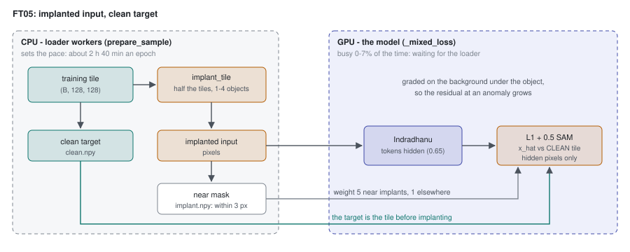

# 58 - FT05: implant-denoising

> **The one thing this part teaches:** put anomalies into the model's input and keep the clean tile as
> its target, and the training loss itself starts rewarding "draw the background, not the anomaly" -
> which is exactly what the detection score needs - with a weight to stop a few hundred implanted pixels
> drowning in millions of ordinary ones, a held-out implant source to catch the model learning the recipe,
> and a bill paid on the CPU, not the GPU.

## Where we are

Part 57 deferred any training on detection until the implants looked like real objects. On 2026-10-17
they did: bench-v2 was accepted (anomaly-detection course, part 20) - its implants copy the real objects'
contrast, foreignness and halo, and on it the fine-tuned models beat PCA-RX, as on the real bench. That
unblocked part 54's option 3 in a new form. FT05 was launched the same night on the user's go
("Go for it").

Sources: `docs/proposals/detection-supervised-finetuning.md` (the design),
`research/experiments/indradhanu-finetune/FT05-implant-denoise/README.md` and `config.json` (the run),
`app/foundation_models/trainers/finetune_trainer.py` (`implant_sample`, `_mixed_loss`),
`app/evaluation/implant.py` (`implant_tile`), `app/models/training/training_config.py` (the `implant_*`
fields).

> **Analogy.** A restorer is trained on old paintings. In one course the teacher shows a painting with a
> coffee stain and asks for the painting back - stain included. The student learns to copy faithfully,
> stains and all. In the other course the teacher adds the stain to a clean photograph of the painting,
> shows the stained version, and asks for the clean one. Now the student learns what a painting looks
> like *under* a stain. The detection score only works with the second student.

## 1. Why the old target works against detection

Every run so far (parts 23 to 25, 49 to 55) used the input as the target: hide most tokens, reconstruct
them, compare with what was there. Anomalies in the training tiles are in the target too.

Inference reconstructs each pixel while its own 4 x 4 token is hidden (part 29). An object smaller than a
token is invisible to its own reconstruction. But an object larger than a token, or one with a blurred
halo (anomaly course, part 20), leaks into the visible neighbouring tokens. A model trained on input
targets is rewarded for carrying that leak into its prediction.

Work one band of one pixel. The background under it would be 0.20; an object makes it 0.50; the model
sees part of the object in a neighbouring token.

```
                         prediction 0.20 (background)    prediction 0.50 (copies the object)
input target  (0.50):    loss |0.20 - 0.50| = 0.30        loss |0.50 - 0.50| = 0.00   <- rewarded
clean target  (0.20):    loss |0.20 - 0.20| = 0.00   <-   loss |0.50 - 0.20| = 0.30
score at inference
 = |input - prediction|: |0.50 - 0.20| = 0.30 (found)     |0.50 - 0.50| = 0.00 (missed)
```

With the input as target, the loss prefers the prediction that hides the object from the score. With
the clean tile as target, it prefers the prediction that exposes it. **FT05 changes only the target, and
that flips which prediction the loss rewards.** Nothing about scoring changes: residual Mahalanobis, and
cloud exclusion where configured.

## 2. Where the implants come from

`prepare_sample` runs in the loader workers (part 44). With FT05's config it calls `implant_sample` on
every **training** tile (`implant=self._implant if split == "train" else None`; validation tiles stay
clean):

```python
# finetune_trainer.implant_sample, condensed
sample["clean.npy"] = pix                                   # (B, 128, 128) int16: the target
rng = np.random.default_rng([cfg["seed"], crc32(key)])      # seeded by the tile's key
if rng.random() < cfg["prob"]:                              # prob 0.5: half the tiles
    gt = implant_tile(rng, refl, wl, real, library, rng.integers(1, max_objects + 1), psf_sigma, sources)
    sample[pixels] = implanted cube                         # the input
    near = binary_dilation(gt > 0, iterations=3)            # (128, 128): within 3 px of an implant
sample["implant.npy"] = near                                # all zeros on the clean half
```

Four things to notice:

- **1 to 4 objects** per implanted tile: `rng.integers(1, 5)` draws 1, 2, 3 or 4.
- **The same implants every epoch.** The generator is seeded from the tile's key, so tile X always gets
  the same objects in the same places. FT05 trains on one fixed implanted copy of the data, not on fresh
  implants each epoch.
- **Placed anywhere valid, water included** (`implant_tile`'s docstring: "vessels on water are in scope,
  user 2026-10-17"). bench-v2's builder still places only on land (anomaly course, part 21), so the
  training implants cover ground the benchmark does not.
- **The same solve as bench-v2**: contrast and foreignness paired from one real object in
  `real_v2.json`, solved on the realised object (`solve_realised`), PSF sigma 1.4.

`implant_tile` is the per-tile twin of bench-v2's `place_and_implant`: a 7 px margin, objects capped at
20 px, 10 px spacing, 30 tries per object, and a fresh `background_subspace` for each 128 px tile.

## 3. The loss: clean target, near weight

In `_mixed_loss`, when a batch carries `clean.npy`:

```python
target, target_valid = decode(clean.npy)                  # (B, C, H, W): learn the clean tile
near = implant.npy                                        # (B, 1, H, W): 1 within 3 px of an implant
loss_mask = hidden_pixels * eroded_valid                  # as in every earlier run
loss_mask = loss_mask * (1.0 + (implant_near_weight - 1.0) * near)    # weight 5 near implants
```

The model still reads `pixels` - the implanted tile - so it sees the anomaly through its neighbours and
is graded on the background.

**Why a weight.** Implants are tiny. A one-pixel object dilated 3 times (4-neighbour steps) covers
`1 + 4 + 8 + 12 = 25` pixels; `scipy` agrees (25, and 32 for a two-pixel object). A tile has
`128 x 128 = 16,384` pixels, and only the hidden ones count (mask ratio 0.65):

```
hidden pixels per tile:             0.65 x 16,384 = 10,650
hidden pixels near one implant:     0.65 x 25     = 16.25
their share of the loss, weight 1:  16.25 / 10,650 = 0.0015     (0.15%)
```

Now weight them 5. `_masked_l1_sam` divides by the sum of the mask, so the weight changes shares, not the
loss's overall size:

```
weighted near:       16.25 x 5            = 81.25
weighted total:      10,650 - 16.25 + 81.25 = 10,715
their share:         81.25 / 10,715       = 0.0076     (0.76%)
```

**x5 moves the near pixels from 0.15% of the loss to 0.76%** - still small, by design. The rest of the
tile, and the clean half of the data, keep teaching plain reconstruction, so the model does not unlearn
it (pass criterion 3). The weight 5 was fixed before launch; it was not tuned.

## 4. The held-out source, and why it is held out

bench-v2 implants come from three sources in thirds: `signature` (a real object's difference spectrum),
`material` (a USGS library spectrum) and `host` (a pixel from elsewhere in the same scene). FT05 trains on
`signature` and `material` only (`implant_sources`), with seed 1 where bench-v2 used 0, and only into
training-split tiles - bench-v2's hosts are test-split scenes.

The risk is the one part 54 raised: a network rewarded for handling implants may learn **the implanting
recipe** rather than anomalies in general. The guards:

1. the **real PRISMA bench decides** (pass criterion 1) - it has no implants at all;
2. the `host` source is never trained on, so its row of bench-v2 is an out-of-recipe check - **it must
   not fall** (criterion 2);
3. bench-v2 overall is reported but cannot pass the run on its own: same generator family, optimistic.

Do not confuse the two "held-outs". Held-out **hosts** means the benchmark's scenes were never in
training. Held-out **source** means one way of making an implant was never in training.

## 5. The bill: the data loader

FT03 ran 10 epochs in 3.0 h (FT03 README) - about 18 minutes an epoch. FT05 ran at about **2 h 40 min an
epoch**, with the GPU at 0-7% busy (FT05 README, Results, "Pace"). The
proposal had estimated 3.5 h for the whole run.

```
FT03 epoch:   3.0 h x 60 / 10 = 18 min
FT05 epoch:   2 h 40 min       = 160 min
ratio:        160 / 18         = 8.9
GPU work unchanged, so GPU busy at most about 18 / 160 = 0.11   (11%; seen: 0-7%)
10 epochs:    10 x 160 min     = 1,600 min = 26.7 h
```

The GPU waits for the loader. All the implant work - the subspace, up to four objects, up to 30 tries
each, the ladder of twelve foreignness levels in `solve_realised`, each with a 400-point strength search -
is NumPy on the CPU, inside the loader workers. Two details make it worse:

- **Lockstep sensors.** `_AllSourcesLoader` takes one sub-batch from each sensor's loader per step, so a
  step waits for the slowest of the three. AVIRIS-NG tiles carry 372 bands to EnMAP's 224, so their
  implant arithmetic is the heaviest.
- **More workers than cores.** The config asks for `num_workers: 6`, and the trainer builds one loader per
  sensor, so by the code there are 18 worker processes; the g6e.2xlarge has 8 vCPUs. The run was observed
  with about 12 busy workers. Either way, more processes than cores do not add throughput - they share it.

One fix was already in before the relaunch: `background_subspace` took an SVD of up to 100,000 pixels;
commit 558ff5e replaced it with the eigenvectors of the bands-by-bands covariance - the same subspace, at
0.25 s -> about 0.02 s per tile. Why the same: for centred pixels `X` (N pixels x B bands), the right
singular vectors of `X` are the eigenvectors of `X^T X` (B x B), with eigenvalues the squared singular
values. For a 128 px tile, N = 16,384 and B = 224, so the eigendecomposition works on a 224 x 224 matrix
instead of the 16,384 x 224 one. The loader is still CPU-bound after that fix; the cause was being
diagnosed on 2026-10-18.



*Figure 58.1 - One FT05 step. The loader workers (CPU) implant half the tiles and keep the clean copy;
the model (GPU) reads the implanted tile and is graded against the clean one, x5 near the implants. The
CPU side sets the pace.*

## 6. Status at epoch 5

Pass criteria, fixed before launch (FT05 README):

1. **Real PRISMA bench decides:** not below FT03 on pAUC to 1%, TPR at 0.1% and caught top 0.1%, and above
   on at least two of the three (FT03: 0.158 / 0.058 / 14.3%).
2. bench-v2: above FT03 on caught top 1% and pAUC (32.3%, 0.164); the held-out `host` source must not
   fall.
3. Per-sensor validation SAM within 0.1 deg of FT03 (3.92 / 4.21 / 5.48) on clean tiles; water / cloud IoU
   within 0.02 of FT03 (0.841 / 0.815).

At epoch 5 (FT05 README, Results):

```
SAM, deg     FT05 ep5   FT03    difference
EnMAP          3.94     3.92     +0.02
PRISMA         4.20     4.21     -0.01
AVIRIS-NG      5.33     5.48     -0.15     (better)
IoU water     0.838    0.841    -0.003
IoU cloud     0.818    0.815    +0.003
```

Every difference is inside its limit (0.1 deg; 0.02 IoU): **criterion 3 holds at epoch 5.** Learning the
clean tile has not cost clean reconstruction - AVIRIS-NG is even a little better.

Detection at epoch 5 - `configs/eval/ft05_ep5.json`, output `C:/es/eval/ft05_ep5/report.md` (finished
2026-10-18), FT05 epoch 5 against FT03, residual Mahalanobis:

| | FT03 ep10 | FT05 ep5 | criterion |
|---|---|---|---|
| real bench pAUC to 1% | 0.15805 | 0.15801 | 1: tie (a hair below) |
| real bench TPR at 0.1% | 0.0582 | 0.0594 | 1: above |
| real bench caught top 0.1% | 130 of 909 (14.3%) | 130 of 909 (14.3%) | 1: tie |
| real bench caught top 1% | 413 (45.4%) | 407 (44.8%) | reported |
| bench-v2 caught top 1% | 32.3% | 32.8% | 2: above |
| bench-v2 pAUC to 1% | 0.164 | 0.167 | 2: above |
| bench-v2 `host` source, caught top 1% | 29.4% | 29.6% | 2: did not fall |

Work criterion 1 by hand. It needs "not below on all three, above on at least two":

```
pAUC        0.15801 - 0.15805 = -0.00004    below by 4 in the fifth decimal
TPR         0.0594  - 0.0582  = +0.0012     above
caught 0.1% 130     - 130     =  0          equal
above on 1 of 3 -> criterion 1 NOT met at epoch 5
```

**At the halfway point FT05 ties FT03 on the real bench and is a little ahead on bench-v2** - the pattern
the pre-launch note called "optimistic" for bench-v2. The run has five more epochs; the verdict belongs
to its end, and to the FT05 README, which records the same epoch-5 reading: "Implant-denoising has not
moved real detection by mid-run."
With cloud excluded the picture is the same: real-bench pAUC 0.166 for both, caught top 0.1% 142 against
FT03's 144.

## Common confusions

**"With a clean target the model never sees anomalies."**
It sees them in every implanted input. It is graded on what was underneath.

**"x5 makes the loss five times bigger."**
The weighted mean divides by the weighted count. x5 shifts the share of the loss from 0.15% to 0.76% for
one small implant; the total stays a mean.

**"Implants are fresh every epoch, like band augmentation."**
No. They are seeded by the tile's key: the same tile gets the same objects every epoch.

**"If bench-v2 goes up, FT05 worked."**
bench-v2 is built by the same generator. Only the real bench can pass the run; the held-out `host` row
is the check that the gain is not the recipe. At epoch 5 exactly this happened: bench-v2 up half a point,
the real bench tied.

**"The GPU is slow."**
It is idle. The CPU-side implanting is the bottleneck, and the three sensor loaders move in lockstep.

## Check yourself

1. In section 1's example, the clean background is 0.30 and the object makes the input 0.45. Give the
   loss of predicting 0.30 and of predicting 0.45, under each target.
2. A two-pixel implant has 32 pixels within 3 px. With mask ratio 0.65 and weight 5, what share of a
   128 x 128 tile's loss do they carry? (Use 10,650 hidden pixels.)
3. FT03 took 3.0 h for 10 epochs. If FT05's epoch fell to 40 minutes after a loader fix, how long would
   the remaining 5 epochs take, and what GPU busy share would you expect?
4. Why is `host` the held-out source and not, say, `material`?
5. At epoch 5 FT05's PRISMA SAM is 4.20 and FT03's 4.21. Can that difference pass criterion 1?

<details>
<summary>Answers</summary>

1. Input target 0.45: predicting 0.30 costs `|0.30 - 0.45| = 0.15`, predicting 0.45 costs 0. Clean target
   0.30: predicting 0.30 costs 0, predicting 0.45 costs 0.15. Same flip as section 1.
2. Hidden near pixels: `0.65 x 32 = 20.8`; weighted `20.8 x 5 = 104`; total `10,650 - 20.8 + 104 =
   10,733.2`; share `104 / 10,733.2 = 0.0097`, about 1.0%.
3. `5 x 40 = 200` minutes, 3 h 20 min. GPU busy about `18 / 40 = 0.45`, 45%.
4. Any one of the three could have been held out; what matters is that one bench-v2 third is made in a
   way the model never trained on, so it is an out-of-recipe check inside the same benchmark. The
   proposal names `host`; it does not say why `host` rather than another.
5. No. Criterion 1 is detection on the real bench; SAM is criterion 3 and only says reconstruction held.

</details>

---

Next: [part 59](59-the-scoreboard.md) - every model on every benchmark, in one table.
