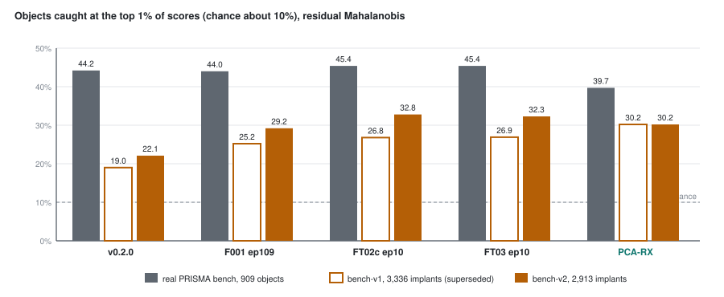

# 59 - The scoreboard

> **The one thing this part teaches:** every Indradhanu version on every benchmark fits in a few tables,
> and they read correctly only with chance and the model-free PCA-RX row beside them - and, since the
> 2026-10-18 fix to how the shipped model was read, they say that no new model measurably beats the
> shipped v0.2.0 on detection by the model alone; what the new work bought is masks (cloud exclusion,
> about a point for any model), native bands, better reconstruction and a benchmark you can trust.

> **Rewritten 2026-10-19.** The first version of this part (2026-10-18) said "pretraining was the big
> step, fine-tuning on the real sensors is what beats the classical detector". Both readings rested on
> v0.2.0's implant rows and on garbled signature implants, and both were a bug: the evaluator fed PRISMA's
> descending band list to `np.interp` unsorted (anomaly course, part 22). The superseded bench-v1 and
> bench-v2 tables are kept below, marked, so you can see what changed.

## Where we are

Parts 43 to 58 introduced the models one run at a time, each judged on whatever benchmark existed that
day; part 60 teaches the last run, FT04. This part puts them side by side, on 2026-10-19. Nothing here is
new measurement; every number comes from one of these files:

| table | source |
|---|---|
| real PRISMA bench | `C:/es/eval/stage3/report.md`, `cloud_only/report.md`, `ft05_ep5/report.md`, `ft04/report.md` (dev laptop) |
| bench-v2.1 | `C:/es/eval/v2.1/report.md`, `ft04/report.md`; the implant-bench README, "bench-v2.1 (2026-10-18)" |
| superseded benches | `C:/es/eval/stage3/report.md` (bench-v1), `C:/es/eval/v2/report.md` (bench-v2); the implant-bench README, "Corrections (2026-10-18)" |
| reconstruction and masks | the run READMEs under `research/experiments/indradhanu-finetune/` |

The models, in training order: **v0.2.0** (shipped; parts 01-30), **F001** epoch 109 (SpectralEarth
pretraining; part 43), **FT02c** epoch 10 (three sensors, mixed batches, edge term; parts 50-53),
**FT03** epoch 10 (joint with the segmentation head; part 55), **FT05** epoch 5 (implant-denoising, did
not pass; part 58), **FT04** epoch 10 (pseudo-labels and rare-class weights, the release candidate; part
60). Every row uses the default score, residual Mahalanobis (d = 30, window 21 / 61; parts 45-46),
unless it says otherwise. "Cloud excluded" means the model's own head masks cloud and those pixels are
scored 0 (anomaly course, part 21); for v0.2.0, which has no head, FT03's masks are used.

> **Analogy.** A league table means little on its own. You also need the score a team gets by turning
> up and doing nothing (chance), and the score of the amateur side down the road (PCA-RX). And you need
> the referee's watch to be right: if one team's matches were timed with a broken watch, its place in
> the table says nothing about the team.

## Table 1 - the real PRISMA bench (909 labelled objects, 4 scenes)

Chance: 10.2% of objects at the top 1%, 1.1% at the top 0.1% (anomaly course, part 19's analytic
chance). For fixed-grid models this bench was always read through the product's own band path, so the
sorting bug never touched it.

| model | caught top 1% | caught top 0.1% | pAUC to 1% | TPR at 0.1% | ROC-AUC |
|---|---|---|---|---|---|
| v0.2.0 (shipped) | 44.2% | 14.1% | 0.159 | 0.058 | 0.854 |
| F001 ep109 | 44.0% | 13.2% | 0.148 | 0.056 | 0.861 |
| FT02c ep10 | 45.4% | 14.4% | 0.159 | 0.059 | 0.855 |
| FT03 ep10 | 45.4% | 14.3% | 0.158 | 0.058 | 0.853 |
| FT05 ep5 | 44.8% | 14.3% | 0.158 | 0.059 | 0.853 |
| FT04 ep10 | 45.7% | 14.9% | 0.162 | 0.061 | 0.853 |
| FT03, cloud excluded | 46.1% | 15.8% | 0.166 | 0.064 | 0.850 |
| FT05 ep5, cloud excluded | 45.8% | 15.6% | 0.166 | 0.066 | 0.850 |
| **FT04, cloud excluded (release candidate)** | 46.0% | 15.8% | **0.170** | **0.065** | 0.852 |
| PCA-RX (no model) | 39.7% | 8.1% | 0.128 | 0.029 | 0.839 |

Read it: every model is far above chance (`14.3 / 1.1 = 13` times at the top 0.1% for FT03) and above
PCA-RX, but **the models tie each other**: pAUC 0.148-0.162 without exclusion, with F001 lowest. The
cloud mask moves the row more than any model does, and it is not a model. v0.2.0 + cloud exclusion was
never run here (only water + cloud: 0.165, stage-3 run), so the release candidate's lead over the
shipped model is partly the comparison's.

## Table 2 - bench-v2.1 (2,817 implants, 18 held-out hosts) - the implant benchmark now

Built 2026-10-18 after the fix: correct signatures, foreignness tolerance 1.2 (anomaly course, part 22).
Chance 10.5% / 1.1%.

| model | caught top 1% | top 0.1% | pAUC to 1% | TPR at 0.1% | EnMAP hosts | PRISMA hosts | AVIRIS-NG hosts |
|---|---|---|---|---|---|---|---|
| v0.2.0 | **35.5%** | 12.6% | 0.168 | 0.082 | 21.6% | **42.2%** | 41.0% |
| F001 ep109 | 33.1% | 11.7% | 0.157 | 0.078 | 20.5% | 37.7% | 40.7% |
| FT02c ep10 | 35.1% | 12.8% | 0.169 | **0.086** | 20.7% | 40.3% | 43.7% |
| FT03 ep10 | 34.9% | 12.7% | 0.168 | **0.086** | 20.6% | 40.1% | 43.4% |
| FT05 ep5 | 35.4% | 12.8% | **0.170** | 0.085 | 20.8% | 40.7% | **44.2%** |
| FT04 ep10 | 35.1% | 12.7% | 0.169 | 0.083 | 20.3% | 40.4% | 44.1% |
| v0.2.0, cloud excluded (FT03 masks) | 36.7% | 13.0% | 0.170 | 0.084 | 24.8% | 42.7% | 41.0% |
| FT04, cloud excluded (own masks) | 36.2% | 13.2% | 0.172 | 0.085 | 23.2% | 40.8% | 44.1% |
| PCA-RX (no model) | 33.2% | 9.8% | 0.154 | 0.069 | 19.8% | 37.7% | 41.5% |

Read it: **v0.2.0 ties or leads every new model** on the headline measures, as on the real bench. The
fine-tuned models lead only at TPR at 0.1% (0.086 against 0.082) and on AVIRIS-NG hosts, both small;
v0.2.0 leads on PRISMA hosts. Every model is above PCA-RX at the top 0.1% (11.7-12.8% against 9.8%), as
on the real bench - the ordering test still passes. F001 and PCA-RX tie at the top 1%. Cloud exclusion
adds about a point to every model alike (v0.2.0 +1.2, FT04 +1.1).



*Figure 59.1 - Share of objects caught at the top 1% for each model and PCA-RX, on the real bench
(grey) and bench-v2.1 (amber). Chance is about 10% on both. Read correctly, the shipped v0.2.0 sits
level with the fine-tuned models on both benchmarks.*

## Table 3 - the superseded benches, and what was wrong with them

Kept for history. Both were read with the bug: v0.2.0's rows measured a broken resample (every PRISMA
host turned into copies of two near-infrared bands), and every `signature` implant - half of bench-v1,
a third of bench-v2 - was a flat step instead of a real object's spectrum.

| model | bench-v1 caught top 1% | bench-v2 caught top 1% | bench-v2.1 caught top 1% |
|---|---|---|---|
| v0.2.0 | ~~19.0%~~ void | ~~22.1%~~ void | 35.5% |
| F001 ep109 | 25.2% | 29.2% | 33.1% |
| FT02c ep10 | 26.8% | 32.8% | 35.1% |
| FT03 ep10 | 26.9% | 32.3% | 34.9% |
| PCA-RX (no model) | 30.2% | 30.2% | 33.2% |

The wavelength-reading rows move together from bench to bench (each rebuild is a different bench);
v0.2.0's jumps by 13.4 points between v2 and v2.1 because only its reading was fixed. Note also that
PCA-RX beat every model on bench-v1 and that this - the reason bench-v1 was replaced (part 57) - was
measured with half its implants garbled; it was not re-tested on a fixed bench-v1.

## Table 4 - reconstruction and masks (the fine-tuning runs)

Per-sensor validation SAM in degrees (EnMAP / PRISMA / AVIRIS-NG, lower is better) and EnMAP test IoU for
water, cloud and shadow. Earlier models were validated differently (part 41), so their SAMs are not
comparable and are left out.

| run | SAM EnMAP | SAM PRISMA | SAM AVIRIS-NG | IoU water | IoU cloud | IoU shadow |
|---|---|---|---|---|---|---|
| FT01 (head only, F001 frozen) | - | - | - | 0.82 | 0.80 | 0.20 |
| FT02b ep9 | 3.99 | 4.37 | 5.57 | - | - | - |
| FT02c ep10 | 3.93 | 4.21 | 5.41 | - | - | - |
| FT03 ep10 | 3.92 | 4.21 | 5.48 | 0.841 | 0.815 | 0.205 |
| FT05 ep5 (best.pt) | 3.94 | 4.20 | 5.33 | 0.838 | 0.818 | - |
| FT05 ep10 (last.pt) | 3.90 | 4.20 | **5.67** | 0.844 | 0.814 | - |
| **FT04 ep10** | **3.88** | **4.11** | 5.46 | 0.839 | 0.810 | **0.223** |

FT04 is best or near-best everywhere: the best SAM on EnMAP and PRISMA, masks within 0.01 of FT03, shadow
up 0.02 from the 3x weight (part 60). FT05's epoch 10 lost 0.19 deg on AVIRIS-NG against FT03 (5.67 against
5.48), failing its reconstruction criterion - one of the two reasons it did not pass (part 58).

## What each step bought

Take bench-v2.1's caught-at-top-1% apart, step by step:

```
v0.2.0 -> F001       35.5 -> 33.1   -2.4 points    pretraining on SpectralEarth: slightly worse
F001   -> FT02c      33.1 -> 35.1   +2.0 points    three real sensors, mixed batches
FT02c  -> FT03       35.1 -> 34.9   -0.2 points    joint training: a tie
FT03   -> FT04       34.9 -> 35.1   +0.2 points    pseudo-labels, rare-class weights: a tie
FT04   -> + cloud    35.1 -> 36.2   +1.1 points    a mask, not a model
FT03   -> FT05 ep5   34.9 -> 35.4   +0.5 points    implant-denoising (real bench: tie; did not pass)
```

**How big is noise here?** Treat each of the 2,817 objects as a coin caught with probability `p`. The
standard error of a share is `sqrt(p x (1 - p) / n)`:

```
p x (1 - p)      = 0.35 x 0.65 = 0.2275
0.2275 / 2,817   = 0.0000808
sqrt(0.0000808)  = 0.0090        about 0.9 points
```

So -2.4 is about 2.7 standard errors and +2.0 about 2.2; every other step is under one and a half.
(Both models score the same objects, so the true uncertainty of a difference is smaller than this; it is
a rough ruler, not a test.) Read the two large steps together: **pretraining alone cost a little on
both benches** (bench-v2.1 -2.4 points; real bench pAUC 0.159 -> 0.148), and fine-tuning on the real
sensors won it back - to where v0.2.0 already was.

## Results still unexplained

1. **EnMAP hosts do not move.** About 21% for every model and for PCA-RX on bench-v2.1 (16% on v1 and
   v2), while the other sensors' hosts sit near 40%. Cloud exclusion lifts them (FT04 20.3% -> 23.2%), so
   some EnMAP false alarms are cloud; the rest is open.
2. **bench-v2.1's easy tier is too foreign.** Per-tier foreignness on PRISMA hosts is 1.05x / 1.15x /
   1.60x real; the README explains the easy tier as a selection effect of the tighter tolerance (anomaly
   course, part 22). Halo holds (0.92-1.06x).
3. **Whether v0.2.0 trained on scenes from the bench sites** is still unverified. It no longer has a gap
   to explain, but it would flatter v0.2.0 on the real bench only.

The question this part's first version listed first - "v0.2.0 ties FT03 on real objects and trails it
badly on implants" - is answered: it was the reading bug.

## What would change the board

- **Product wiring.** The next step in the log: FT04's checkpoint, its masks and cloud exclusion in
  `anomaly_scoring`. Detection does not change; what the analyst sees under cloud does.
- **A new lever for detection.** The log's conclusion: residual Mahalanobis absorbs what better
  reconstruction changes, so detection gains need scoring, masks or detection-targeted training (part 60).
- **A fair FT05 rerun.** Half its training implants had garbled signatures; the README says a rerun with
  correct ones "would be the fair test; nothing here suggests it would flip the result".
- **Implants on water.** bench-v2.1 still places none, though vessels are in scope.

## Common confusions

**"FT04 is the best detector."**
On the real bench by 0.003 pAUC without exclusion, and on bench-v2.1 it ties v0.2.0. It is the release
candidate because its masks, reconstruction and native bands are the best, not because it detects more.

**"Cloud exclusion is FT04's improvement."**
The mask is FT04's head, but the gain is the mask's: it lifts every model alike, v0.2.0 included.

**"Pretraining was the big step."**
That was the reading bug. Read correctly, pretraining alone sits a little below v0.2.0 on both benches.

**"A model above chance is a good detector."**
Chance is the floor. PCA-RX is the bar: on both current benches every model clears it at the top 0.1%.

**"Table 4 shows FT04 is better than v0.2.0."**
It shows FT04 reconstructs better than the other fine-tuning runs, on the fine-tuning validation ruler.
v0.2.0 is not on that ruler, and detection - Tables 1 and 2 - is a tie.

## Check yourself

1. FT04 + cloud exclusion catches 15.8% of 909 real objects at the top 0.1%, PCA-RX 8.1%. How many
   objects is that each, and how many times chance (1.1%) is each?
2. On bench-v2.1, how many more objects does v0.2.0 catch at the top 1% than F001? Is the gap more than
   two standard errors?
3. Split the real-bench pAUC gain from shipped v0.2.0 (0.159) to the release candidate (0.170) into the
   model's part and the exclusion's part. What share is the exclusion?
4. v0.2.0's bench-v2 row said 22.1%, its bench-v2.1 row 35.5%; FT03's said 32.3% and 34.9%. How much of
   v0.2.0's jump is "the bench was rebuilt", and how much is the fix?
5. Why does Table 4 leave out v0.2.0's and F001's SAM?

<details>
<summary>Answers</summary>

1. FT04 + exclusion: `0.158 x 909 = 143.6`, about 144; PCA-RX: `0.081 x 909 = 73.6`, about 74. Times
   chance: `15.8 / 1.1 = 14.4` and `8.1 / 1.1 = 7.4`.
2. `(0.355 - 0.331) x 2,817 = 0.024 x 2,817 = 67.6`, about 68 objects. With p about 0.34: `0.34 x 0.66 =
   0.2244`; `/ 2,817 = 0.0000797`; `sqrt = 0.0089`, about 0.9 points. `2.4 / 0.9 = 2.7` standard errors:
   yes, a little more than two.
3. Model: `0.162 - 0.159 = 0.003`. Exclusion: `0.170 - 0.162 = 0.008`. Total `0.011`; exclusion share
   `0.008 / 0.011 = 0.73`, about 73%.
4. FT03 moved `34.9 - 32.3 = 2.6` points with the rebuild alone. v0.2.0 moved `35.5 - 22.1 = 13.4`. If the
   rebuild gave v0.2.0 the same 2.6, the fix accounts for about `13.4 - 2.6 = 10.8` points. (A rough split:
   the rebuild changed the signatures and the tolerance for everyone, not by exactly the same amount.)
5. They were validated with a different setup (different data and score; part 41), so the numbers are not
   on the same ruler as the fine-tuning runs' per-sensor validation.

</details>

---

Next: [part 60](60-ft04-the-release-candidate.md) - FT04, the release candidate, and what the model did
and did not buy.
