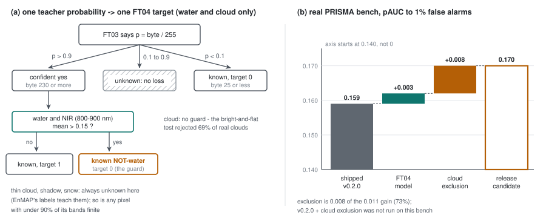

# 60 - FT04, the release candidate - and what the model did and did not buy

> **The one thing this part teaches:** FT04 taught the segmentation head on PRISMA and AVIRIS-NG from
> FT03's own confident calls - only where FT03 was more than 90% sure either way, only for water and
> cloud, and with a confident "water" overruled wherever the near-infrared is too bright for water -
> and weighted the rare classes three times; its masks held and its reconstruction improved on all
> three sensors, and with cloud exclusion on its own masks it is the best real-bench result so far -
> but by 0.011 pAUC over the shipped v0.2.0, of which the model itself is 0.003: no new model
> measurably beats v0.2.0 on detection alone.

## Where we are

FT03 (part 55) trained the segmentation head on EnMAP's provider labels only. PRISMA and AVIRIS-NG
tiles went through the segmentation pass, but no loss read their logits - they were there for the one
BatchNorm. So the head that would mask clouds on a PRISMA scene had never been graded on one.

Part 49's curriculum had an optional stage 4 for exactly this: **pseudo-labels**. On 2026-10-18 it ran
as FT04, the "final joint" run, and passed all three of its criteria. The same day two corrections
landed that change how its result reads: the anomaly course's part 22 (the sorting bug - read
correctly, v0.2.0 ties every new model on the implant benchmark) and the set4 correction (FT03's
"11% cloud" on set4 is haze, not desert). This part teaches FT04 and then the scoreboard as it stands.

| file | what it holds |
|---|---|
| `research/experiments/indradhanu-finetune/FT04-final-joint/README.md` and `config.json` | the run: question, setup, criteria, results |
| `scripts/pseudo_label.py` | runs the teacher over the training shards and saves its raw probabilities |
| `app/utils/segmentation/targets.py` | `pseudo_targets` and `PSEUDO_CONF` (the thresholds and the water guard), `masked_bce_dice` (the class weights), `cloud_plausible` (the dropped cloud guard) |
| `app/foundation_models/trainers/finetune_trainer.py` | `pseudo_sample_targets` (the loader's call), `single_thread_worker` |
| `app/models/training/training_config.py` | `labels: "pseudo"`, `pseudo_dir`, `seg_class_weights`, `loader_workers_per_source` |
| `C:/es/eval/ft04/report.md` (dev laptop) | FT04 against FT03, real bench and bench-v2.1, with each model's own masks |

> **Analogy.** An experienced birdwatcher takes a novice to a marsh she has never surveyed. She names
> only the birds she is sure of and says nothing about the rest, so the novice never learns a guess.
> And one standing rule overrides even her sure calls: "nothing that bright is a heron - herons are
> grey". The novice learns the new marsh from her certainties alone, minus the one mistake the rule
> knows she makes.

## 1. The teacher's raw output

A **pseudo-label** is a label made by a model rather than a person. The **teacher** here is FT03; the
**student** is FT04, which starts from FT03's own weights. `scripts/pseudo_label.py` runs FT03's
segmentation head over every PRISMA and AVIRIS-NG training tile and saves, per tile,

```
<tile key>.npy     (5, 128, 128) uint8 = round(255 x sigmoid(logit))     # water, cloud, thin_cloud, shadow, snow
```

A probability of 0.93 is stored as `round(255 x 0.93) = round(237.15) = 237`. The script keeps the raw
probabilities on purpose: "thresholds and guards live there [in `pseudo_targets`], so the teacher's raw
output is kept." Changing a threshold then needs no re-run of the teacher.

## 2. Keep only the confident calls

`pseudo_targets` turns the stored probabilities into the same two arrays EnMAP's labels become (part
47): **targets** (0 or 1 per class and pixel) and **known** (whether that pixel enters the loss at all).

```python
# app/utils/segmentation/targets.py
PSEUDO_CONF = 0.9          # a pseudo-label counts only where the teacher's probability is > 0.9 or < 0.1
p = probs.astype(np.float32) / 255.0
targets = (p > conf).astype(np.float32)
known = ((p > conf) | (p < 1 - conf)) & valid[None]    # valid: >= 90% of the pixel's bands finite
known[2:] = False                                      # thin cloud, shadow, snow: never taught here
```

So a pixel is taught "yes" above 0.9, "no" below 0.1, and nothing in between. In stored units, `0.9 x
255 = 229.5` and `0.1 x 255 = 25.5`, so "yes" means a byte of 230 or more and "no" a byte of 25 or less.

Only water and cloud are taught. Thin cloud, shadow and snow stay unknown on PRISMA and AVIRIS-NG -
"EnMAP's labels teach them" (docstring) - because FT01 to FT03 never got those classes good enough to
copy (thin cloud IoU 0.09 at the label ceiling, shadow 0.20, snow not measurable; parts 50 and 55).

## 3. The water guard

One confident mistake is overruled:

```python
not_water = (targets[0] > 0) & (band_mean(refl, wl, 800, 900) > 0.15)
targets[0][not_water] = 0.0                            # still known: a known NOT-water
```

Water is dark in the near-infrared (NIR); that is the rule the implant bench's builder uses too (anomaly
course, part 21, `NIR < 0.08`). A pixel the teacher calls water with a mean 800-900 nm reflectance above
0.15 is land-bright, so it becomes a **known not-water** - taught "no", not left out. The 0.15 is looser
than the builder's 0.08: it vetoes only calls that are clearly too bright. The source records the value
(the config's description, "water guarded by NIR <= 0.15") but not how it was chosen.

Work a 2 x 2 tile by hand. Stored water bytes and NIR means:

```
            byte   p = byte / 255   NIR     decision
pixel A     240    0.941            0.04    > 0.9, NIR <= 0.15        -> target 1, known
pixel B     128    0.502            0.05    between 0.1 and 0.9       -> unknown
pixel C      13    0.051            0.30    < 0.1                     -> target 0, known
pixel D     235    0.922            0.22    > 0.9 but NIR > 0.15      -> target 0, known (not-water)
```

Three of the four pixels teach; one says "water", two say "not water"; one is left out. Pixel D is the
guard at work.

The README records the check made before launch, on 150 EnMAP tiles, against EnMAP's own labels: the
guarded pseudo-label water scored **IoU 0.875**, the teacher's raw confident cloud **0.82**.

## 4. Why there is no cloud guard

A cloud guard was built and dropped. It was `cloud_plausible`, the label audit's test from part 48:
mean 450-650 nm reflectance above 0.2 **and** spectrally flat - the minimum of four window means
(460-500, 540-580, 640-680, 840-880 nm) over their maximum at least 0.7. It was meant to stop the
teacher teaching "bright desert is cloud", the reading of set4 at the time.

Two things killed it (`pseudo_targets` docstring and the log, 2026-10-18):

1. **It rejected 69% of EnMAP's labelled clouds** on a test shard, while the teacher's confident clouds
   matched those labels at IoU 0.82. A guard that throws out most of the true class costs more than the
   error it blocks.
2. **The error it targeted was not there.** Set4's "11% cloud" is a cloud / smoke streak and haze; its
   pixels are bluish (NIR over blue 0.54-0.65 for 75% of them).

Work the flatness test on a hazy pixel. Window means 0.30, 0.27, 0.24, 0.18 (falling: haze scatters
blue most):

```
min / max = 0.18 / 0.30 = 0.60       0.60 < 0.7  -> "not flat" -> rejected
visible mean about (0.30 + 0.27 + 0.24) / 3 = 0.27 > 0.2   (bright enough)
```

Thin cloud and haze are not flat, so a flatness test removes them along with whatever it was aimed at.
`cloud_plausible` is still in `targets.py` with its docstring ("Bright desert is red ... and fails the
flatness test"), but nothing calls it any more.

## 5. Rare classes, weighted three times

`seg_class_weights` is `[1, 1, 1, 3, 3]` (water, cloud, thin cloud, shadow, snow). In
`masked_bce_dice` each class's loss is computed over its known pixels, then

```python
return (w * per)[has].sum() / w[has].sum()        # has: classes with any known pixel in the batch
```

a weighted mean over the classes present. Work one batch. Per-class losses: water 0.20, cloud 0.30,
thin cloud 0.50, shadow 0.80; snow has no known pixel, so it drops out of both sums.

```
unweighted:  (0.20 + 0.30 + 0.50 + 0.80) / 4             = 1.80 / 4 = 0.450
weighted:    (0.20 + 0.30 + 0.50 + 3 x 0.80) / (1+1+1+3) = 3.40 / 6 = 0.567

shadow's share of the loss:   unweighted 0.80 / 1.80 = 44%     weighted 2.40 / 3.40 = 71%
```

The weight does not change the total scale much; it changes where the gradient goes. On a PRISMA or
AVIRIS-NG sub-batch only water and cloud are known, both weight 1, so the weights act on EnMAP's
batches only. Result: shadow IoU 0.205 -> 0.223.

## 6. The loader fix it inherited

FT05 had run at 2 h 41 min an epoch with the GPU idle (part 58). The cause, in `single_thread_worker`'s
docstring: "18 workers (3 sources x 6) on 8 vCPUs oversubscribed the CPU about 8-fold; the implant
transform ran 4.7 s per tile instead of 1.8 s" - every worker process had its own pool of maths-library
(BLAS) threads. The fix gives each worker one thread and sets `loader_workers_per_source: 2`:

```
workers:  3 sources x 2 = 6 processes, 1 thread each, on 8 vCPUs
FT05:     2 h 41 min = 161 min per epoch  ->  43 min        161 / 43 = 3.7 times faster
```

FT04 has no implants, but it uses the same loader and the same setting.

## 7. FT04's results

Criteria fixed before launch (README), and the epoch-10 results:

```
1. masks: EnMAP IoU not below FT03 by more than 0.01
   water  0.839 vs 0.841   -0.002   ok
   cloud  0.810 vs 0.815   -0.005   ok          (shadow 0.223 vs 0.205; thin cloud 0.110)
3. reconstruction: SAM within 0.1 deg of FT03
   EnMAP 3.88 vs 3.92  -0.04    PRISMA 4.11 vs 4.21  -0.10    AVIRIS-NG 5.46 vs 5.48  -0.02   all better
```

Criterion 2, detection on the real PRISMA bench (`C:/es/eval/ft04/report.md`):

| | pAUC to 1% | TPR at 0.1% | caught top 0.1% | caught top 1% | ROC-AUC |
|---|---|---|---|---|---|
| v0.2.0, default (stage-3 run) | 0.159 | 0.058 | 14.1% | 44.2% | 0.854 |
| FT03, default | 0.158 | 0.058 | 14.3% | 45.4% | 0.853 |
| FT04, default | 0.162 | 0.061 | 14.9% | 45.7% | 0.853 |
| FT03 + cloud excluded, FT03's masks | 0.166 | 0.064 | 15.8% | 46.1% | 0.850 |
| FT03 + cloud excluded, FT04's masks | 0.165 | 0.064 | 15.8% | 46.3% | 0.852 |
| FT04 + cloud excluded, FT03's masks | 0.170 | 0.066 | 16.0% | 45.9% | 0.850 |
| **FT04 + cloud excluded, FT04's masks** | **0.170** | **0.065** | 15.8% | 46.0% | 0.852 |

Met: FT04's default is at or above FT03 on all three measures, and exclusion with its own masks (0.170)
is at least as good as with FT03's. Two more readings from the swap rows:

- **The masks are interchangeable.** FT03 scores 0.165-0.166 with either head's masks; FT04 scores 0.170
  with either. FT04's masks exclude less (ROC-AUC 0.852 against 0.850), at no cost at the top.
- **The 0.166 -> 0.170 step is FT04's reconstruction under exclusion**, not its masks.

**Release candidate: FT04 + cloud exclusion on its own masks.**

## 8. The honest scoreboard

Take the real-bench gain over what ships today apart:

```
shipped v0.2.0, default             0.159
FT04, default                       0.162      model:      +0.003
FT04 + cloud exclusion              0.170      exclusion:  +0.008
total                                          +0.011      exclusion share 0.008 / 0.011 = 73%
TPR at 0.1%:   0.058 -> 0.061 -> 0.065         model +0.003, exclusion +0.004
```

Small, on four scenes. And the comparison is not like for like: v0.2.0 + cloud exclusion was never run
on the real bench. On bench-v2.1, where it was, v0.2.0 + cloud exclusion (FT03's masks) catches 36.7% at
the top 1% and FT04 + its own masks 36.2% - a tie.

*Update 2026-10-19:* the like-for-like run has since been made (`configs/eval/release_like_for_like.json`,
FT04 README): on the real bench, both with cloud exclusion on FT04's masks, v0.2.0 0.165 against FT04
0.170 pAUC - still a tie. FT04 then shipped as "Indradhanu V2" (part 61).



*Figure 60.1 - (a) How one teacher probability becomes a target: taught "yes" above 0.9, "no" below
0.1, nothing between, and a confident "water" over a bright NIR turned into a known not-water. (b) The
real-bench pAUC from the shipped v0.2.0 to the release candidate: the model adds 0.003, cloud exclusion
0.008.*

So what did the pretraining and the seven fine-tuning runs (FT01 to FT05) buy? From the log of 2026-10-18 and the tables:

| bought | evidence |
|---|---|
| **masks** - a cloud exclusion worth about a point for any model | real bench FT04 0.162 -> 0.170; bench-v2.1 +1.0 to 1.2 points for every model |
| **native bands** - each sensor read at its own bands | the trained-wavelength record (part 49); since FT02 all 185 bench PRISMA bands are read (F001 read 165, v0.2.0 its fixed 165-band grid) |
| **better reconstruction** | FT04 SAM 3.88 / 4.11 / 5.46 deg, best on every sensor |
| **a benchmark you can trust** | bench-v2.1 with the reading fixed and cross-checked against the product path |
| **not bought: detection by the model alone** | real bench 0.162 vs 0.159; bench-v2.1 35.1% vs 35.5% |

Why does better reconstruction not turn into detection? The log's answer: "Residual Mahalanobis absorbs
what better reconstruction changes." An illustration of the mechanism (this course's, not a
measurement): residual Mahalanobis scores a pixel's residual in units of the local background residual's
spread (parts 45-46). If a better model shrinks every residual alike,

```
old model:  background spread 0.010, target residual 0.050   ->  0.050 / 0.010 = 5.0 spreads
new model:  background spread 0.008, target residual 0.040   ->  0.040 / 0.008 = 5.0 spreads
```

the score does not move. Only a model that gets better on the background *and not* on the targets
raises it - which is what FT05 tried to teach, without effect (part 58). The log's conclusion: detection
gains need another lever - scoring, masks, or detection-targeted training. Next on the list is product
wiring: FT04's checkpoint, masks and cloud exclusion in `anomaly_scoring`.

## Common confusions

**"Pseudo-labels are as good as real labels."**
They are the teacher's confident calls, with its biases. That is why the confidence cut, the water
guard and EnMAP's real labels stay in the loss together, and why the pre-launch check compared them with
EnMAP's labels (water IoU 0.875).

**"Unknown means not-water."**
No. Unknown pixels never enter the loss. Pixel D in section 3 is different: it is *known* not-water,
taught as a 0.

**"The 3x weight makes the loss three times bigger."**
It is a weighted mean: the denominator grows too (6 instead of 4 in section 5). It moves the gradient's
share towards shadow and snow.

**"FT04 beat v0.2.0, so the new model is better at detection."**
By 0.003 pAUC on four scenes, and it ties on bench-v2.1. The release candidate's gain is mostly the
exclusion, which helps v0.2.0 as much.

**"The cloud guard was dropped because set4 turned out fine."**
Mainly because it rejected 69% of real labelled clouds. The set4 correction removed its reason to
exist; the 69% made it harmful.

## Check yourself

1. Stored water bytes 199, 231, 24 and 26. Which pixels are known, and what is each target?
2. The teacher calls a pixel water at p = 0.95; its 800-900 nm mean is 0.18. What do targets and known
   say for water there?
3. Per-class losses water 0.2, cloud 0.2, thin cloud 0.4, shadow 0.6, no known snow. Compute the
   unweighted and the `[1, 1, 1, 3, 3]`-weighted loss, by hand.
4. Real bench: FT03 + exclusion with FT03's masks 0.166, FT04 + exclusion with FT03's masks 0.170. What
   does that pair tell you that FT04's own-mask row cannot?
5. A hazy pixel has window means 0.26, 0.24, 0.21, 0.19. Does `cloud_plausible`'s flatness test pass it?
6. Why is "FT04 + exclusion 0.170 against v0.2.0 0.159" not a like-for-like comparison, and what number
   would make it one?

<details>
<summary>Answers</summary>

1. `199 / 255 = 0.780`: between 0.1 and 0.9, unknown. `231 / 255 = 0.906`: known, target 1. `24 / 255 =
   0.094`: known, target 0. `26 / 255 = 0.102`: not below 0.1, unknown. (Bytes: yes at 230 or more, no at
   25 or less.)
2. `0.95 > 0.9`, so known; NIR `0.18 > 0.15`, so the guard sets the target to 0: a known not-water.
3. Unweighted: `(0.2 + 0.2 + 0.4 + 0.6) / 4 = 1.4 / 4 = 0.35`. Weighted: `(0.2 + 0.2 + 0.4 + 3 x 0.6) /
   (1 + 1 + 1 + 3) = (0.8 + 1.8) / 6 = 2.6 / 6 = 0.433`.
4. With the masks held fixed, swapping FT03's model for FT04's moves pAUC 0.166 -> 0.170: that step is
   the model's reconstruction, not its masks. The own-mask row changes both at once.
5. `0.19 / 0.26 = 0.73`, at least 0.7: it passes flatness (and its visible mean, about 0.24, passes
   brightness). Haze that falls this little survives; set4-like haze at 0.54-0.65 would not.
6. v0.2.0 was scored without exclusion. The like-for-like number is v0.2.0 + cloud exclusion on the real
   bench, which had not been run when this part was written; on bench-v2.1, where it was, the two tie
   (36.7% against 36.2%). (Since run, 2026-10-19: 0.165 against 0.170 - a tie.)

</details>

---

Next: part 61, shipping FT04 in the product as Indradhanu V2.
