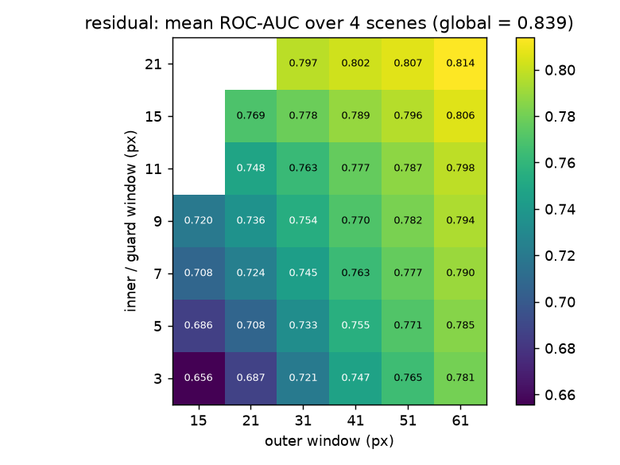
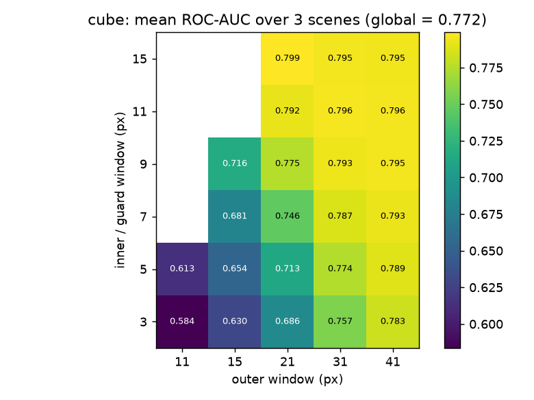
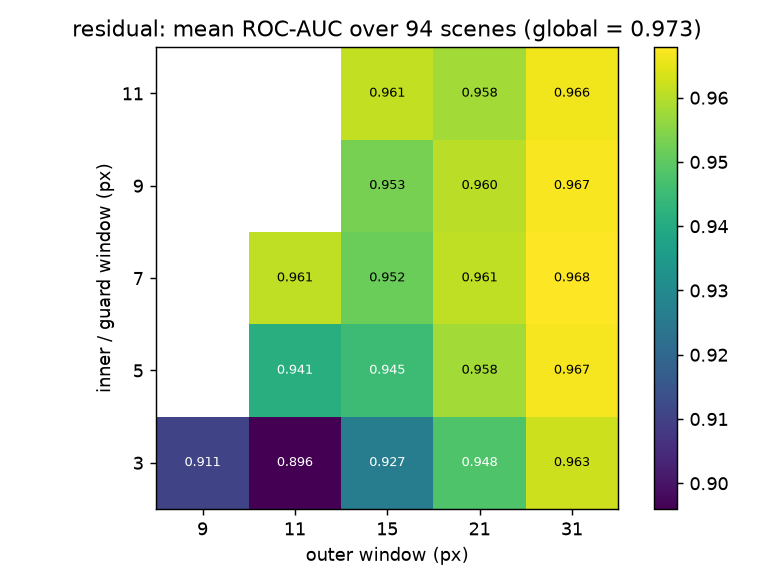

# Dual-window Mahalanobis on Indradhanu residuals

Follow-up to `indradhanu-fp-filter/step1b`, which found that scoring the Indradhanu residual
(cube − reconstruction) with a **global** Mahalanobis distance in its top-30 principal
components beats the product's L1 score and PCA30-RX on ROC-AUC. This experiment asks
whether a **local** background, the ring between an inner (guard) window and an outer
window, does better still.

## Why window size matters

A dual-window detector compares each pixel with the ring of pixels around it:

```
 outer window  ┌───────────────┐   ring = outer box minus inner box
               │   background  │   → mean and covariance of "local normal"
               │   ┌───────┐   │
               │   │ guard │   │   inner box: excluded, so a target's own
               │   │   ●   │   │   pixels do not pollute its background
               │   └───────┘   │
               └───────────────┘
```

- **Inner window too small:** the target's other pixels fall inside the ring, so the
  target becomes part of its own "normal" and its score drops (self-whitening).
- **Inner window too big:** the ring moves away from the pixel and is no longer local.
- **Outer window too small:** too few ring pixels to estimate a 30×30 covariance, so the
  inverse is noisy and false alarms rise.
- **Outer window too big:** the ring spans several land-cover types, and the detector
  reverts towards global RX.

## Rationale for the prior pick: inner 11 × outer 31 (PRISMA, 30 m pixels)

Chosen **before** looking at any sweep results.

**Inner = 11 px (330 m).** This size comes from the ground truth. Across the 4 scenes there
are 886 labelled objects:

| | median | 90th pct | 99th pct | max |
|---|---|---|---|---|
| object extent (px, longest side) | 2–5 | 8–9 | 9 | 11–21 |
| object area (px) | 2–3 | 6–11 | 22–33 | 25–100 |

An object counts as found when any one of its pixels is flagged, and its centre pixel is the
one best protected. For the centre pixel of an object L pixels across, the guard half-width
must be at least (L−1)/2, so a half-width of 5 (inner 11) protects the centre of every object
up to 11 px. That covers more than 99% of the objects. For the *edge* pixels of the median
2–5 px object, the far side is at most 4 px away, so those pixels are protected too. The
literature rule matches this: the guard window should be at least the expected target size
(Matteoli, Diani & Corsini, 2010, *IEEE AES Magazine* tutorial; Kwon, Der & Nasrabadi,
2003, the dual-window DWEST detector).

**Outer = 31 px (930 m).** This size comes from the statistics. The ring has to estimate a
covariance in d = 30 dimensions. Reed, Mallett & Brennan (1974) showed that about 2d samples
keep the estimation loss within 3 dB, and the hyperspectral literature generally asks for
several times that. A 31 × 31 box minus the 11 × 11 guard leaves 961 − 121 = **840 ring
pixels, about 28 d**. That still leaves at least 2d after losing pixels to scene edges,
nodata, and other targets inside the ring. On the ground, 930 m is about the scale of a
field or an urban block, so the ring usually holds one or two land-cover types.

The smallest ring that meets 10 d is 21 × 21 (441 − 121 = 320). The sweep tests whether the
extra pixels from 31 help more than the extra locality from 21.

## The sweep and how it is judged

- inner ∈ {3, 5, 7, 9, 11, 15, 21}, outer ∈ {15, 21, 31, 41, 51, 61}, outer ≥ inner + 6.
- Two inputs: the Indradhanu residual and the raw cube (classical local RX), each as 30
  whitened PCs.
- Baselines: Indradhanu L1 (product), global residual-Mahalanobis (last week's winner),
  global PCA30-RX.
- Metrics: pixel ROC-AUC, average precision, and the step5 object count (objects found and
  false-alarm spots with a 2 px neutral zone) at the top 0.5 / 1 / 2 %.
- Honest selection: besides the prior pick, the window is also chosen **leave-one-scene-out**
  (best mean AUC on 3 scenes, scored on the 4th). The best window per scene in hindsight
  is reported only as an upper bound.

## Results (2026-10-02)

The headline measure is **objects found with at most N false-alarm spots per scene**,
because a fixed "top 1 %" cut rewards detectors that flag more. Spots and objects are counted
as in step5, with a 2 px neutral zone.

### PRISMA, 4 scenes, 886 objects: dual-window loses

| detector | AUC (mean) | N=25 | N=50 | N=100 | N=200 |
|---|---|---|---|---|---|
| Indradhanu L1 (product) | 0.702 | 0 | 61 | 100 | 135 |
| **residual, global Mahalanobis** | **0.839** | **85** | **106** | **133** | **237** |
| residual, dual-window 11/31 (prior pick) | 0.763 | 21 | 63 | 98 | 126 |
| residual, dual-window, leave-one-scene-out | 0.814 | 35 | 61 | 98 | 144 |
| residual, dual-window 21/31 (hindsight best) | – | 48 | 69 | 112 | 151 |
| cube, global PCA30-RX | 0.831 | 10 | 22 | 136 | 211 |
| cube, dual-window 11/31 | 0.743 | 8 | 54 | 74 | 104 |



On both inputs, every bigger window does better, and none of the 38 windows reaches the
global score.

**Why: still open.** The first explanation was target clustering. With the 31 px window,
another labelled target lies inside a target's own window for 86 / 58 / 77 / 74 % of objects
(Sets 1–4). The public sets weaken that explanation. Measured the same way with a 15 px
window, PRISMA is at 52 %, HAD100 at 59 % and ABU/San Diego/HYDICE/River at 74 %, and
dual-window still helps on those public sets. The difference that remains is scene size and
clutter. A PRISMA scene is 1.4 M px of mixed land cover, so a local detector meets thousands
of land-cover edges that spend the false-alarm budget. The public scenes are 4–22 k px crops
around their targets. This is untested.

The one measure where dual-window wins is pixel average precision (0.039 against 0.024).
That measure is dominated by the few large objects, so it is not the analyst's view.

### MUUFL Gulfport (public), 3 flights, 189 panels: dual-window wins

The cube only, because MUUFL's 368–1043 nm range cannot feed Indradhanu.

| detector | AUC (mean) | N=25 | N=50 | N=100 | N=200 |
|---|---|---|---|---|---|
| cube, global | 0.772 | 19 | 24 | 46 | 53 |
| cube, dual-window 7/21 (prior pick) | 0.746 | 17 | 37 | 57 | 70 |
| **cube, dual-window, leave-one-scene-out** | 0.795 | **32** | **46** | **70** | **76** |



The best windows are small: guard 3–7, outer 15–21. That is +52 % objects at N=100 over
global, and the leave-one-scene-out pick holds up on the unseen flight. The panels are
isolated, mostly sub-pixel, and sit on varied backgrounds such as grass, asphalt and canopy
shade. These are the conditions dual-window detectors were designed for.

### Public benchmarks from the Drive folder (step 3)

Downloaded by hand from the shared folder. Window grid: inner 3–11, outer 9–31. The
**prior pick was 9/21**, chosen from ground-truth sizes before any results: the median
target is 3–5 px and almost all are under 9 px, and 21 is the smallest outer window with a
10d ring. The 5/9 window is excluded because its ring (56 px) is below the 2d minimum, so
every pixel fell back to the global score. The false-alarm budgets are smaller (1–10 spots
per scene) because the scenes are 64–150 px across.

**ABU ×13, San Diego, HYDICE Urban, WHU-Hi-River: 16 scenes, 213 objects.** These files have
no wavelengths, so only the cube is scored.

| detector | AUC (mean) | N=1 | N=2 | N=5 | N=10 |
|---|---|---|---|---|---|
| cube, global | **0.967** | 40 | 112 | 134 | 147 |
| cube, dual-window 9/21 (prior pick) | 0.952 | 30 | 111 | 143 | 163 |
| cube, dual-window, leave-one-scene-out | 0.957 | **91** | **142** | **152** | **164** |

**HAD100, 94 AVIRIS-NG tiles, 466 objects, with Indradhanu.** The radiance was mapped onto
the model's training statistics; see the step3 docstring for the caveats.

| detector | AUC (mean) | N=1 | N=2 | N=5 | N=10 |
|---|---|---|---|---|---|
| Indradhanu L1 (product) | 0.848 | 205 | 230 | 287 | 328 |
| **residual, global Mahalanobis** | **0.973** | 332 | 348 | 381 | 419 |
| residual, dual-window 9/21 (prior pick) | 0.960 | 289 | 316 | 346 | 389 |
| residual, dual-window, leave-one-scene-out (3/9, 7/11) | – | 360 | 358 | 394 | 437 |
| cube, global | 0.968 | 354 | 363 | 398 | 412 |
| **cube, dual-window, leave-one-scene-out (5/11, 7/11)** | – | **368** | **401** | **429** | **435** |



Readings:

- On public AVIRIS-NG data, Mahalanobis on the Indradhanu residual has the best AUC of
  everything tested (0.973, against L1's 0.848). Last week's PRISMA finding replicates, even
  though the input was radiance at 2–5 m that the model never trained on.
- At low false-alarm budgets, **small** dual windows beat global on every public set:
  ABU +13 % and HAD100 +8 % objects at N=5, MUUFL +52 % at N=100. On AUC, global is level
  with or ahead of every window.
- The hold-one-out picks were consistently **guard 5–7, outer 11–15**, smaller than both
  prior picks (9/21 and 11/31). The prior picks lost to global on the public sets.
  The 10d ring requirement was too conservative: with the relative ridge, a ring of
  about 2–4d (72–200 px) was enough.

### Conclusion

1. **Keep global residual-Mahalanobis as the product scoring.** It is the only method that is
   best or near-best everywhere: PRISMA by a wide margin, HAD100 on AUC, and never far behind
   on the others.
2. **The window rule, revised by the data:** guard ≈ the typical target size plus 2 px
   (5–7 px for 2–5 px targets), and outer = guard + 4–8 px, the smallest window that still
   gives a ring of at least 2d with a ridge. Bigger windows drift back towards global.
3. **Dual-window pays off for small, isolated targets in small, homogeneous scenes**, judged
   at a low false-alarm budget. That describes the airborne benchmarks. It does not describe
   a full 1.4 M px PRISMA scene. The likely reason is clutter at land-cover edges, and that
   is untested.

Next ideas, all untested: (a) a local mean with the global covariance; (b) a robust ring
that drops pixels in the global top few % before the local statistics are computed;
(c) a dual window inside a land-cover segment from scene_segmentation, so that rings do not
straddle edges.

### Step 4: land-cover-aware rings, local mean, and the product's detectors (PRISMA)

All variants score the Indradhanu residual. Objects found are counted out of 886.

| detector | mean AUC | N=25 | N=50 | N=100 | N=200 |
|---|---|---|---|---|---|
| Indradhanu combined (**product default**) | 0.662 | 0 | 42 | 70 | 110 |
| Indradhanu L1 | 0.702 | 0 | 61 | 100 | 135 |
| MNF-RX (product classical, 10 comps) | 0.752 | 67 | **111** | **149** | 200 |
| cube PCA30-RX | 0.831 | 10 | 22 | 136 | 211 |
| **residual, global Mahalanobis** | 0.839 | **85** | 106 | 133 | **237** |
| **residual, local mean + global cov, 21/61** | **0.854** | **85** | 102 | 134 | **237** |
| residual, dual-window 21/61 | 0.814 | 55 | 75 | 104 | 141 |
| residual, ring within product class, 21/61 | 0.795 | 62 | 88 | 122 | 161 |
| residual, ring within k-means class (K=8), 21/61 | 0.802 | 10 | 48 | 72 | 114 |

- **Land-cover-aware rings do not rescue dual-window.** The product classes recover part of
  the loss; finer k-means classes make it worse. The land-cover-edge explanation is refuted.
- **The local covariance is the problem, not locality.** Keeping the local mean but using the
  global covariance is the best AUC on every PRISMA scene average and never loses objects.
  A ring of a few hundred pixels cannot estimate a 30×30 covariance well enough. It is noisy,
  and it absorbs nearby targets.
- The same local-mean variant on the public sets (step 5) is level with or slightly above
  global everywhere: AUC +0.001 to +0.014, with object counts within ±3 %.

### Is Indradhanu + Mahalanobis better on ROC-AUC? (`compare_auc.py`)

| set | vs product default (combined) | vs Indradhanu L1 | vs MNF-RX (product) | vs PCA30-RX |
|---|---|---|---|---|
| PRISMA, 4 scenes | 0.839 vs 0.662, wins 3/4 | 0.839 vs 0.702, wins 4/4 | 0.839 vs 0.752, wins 4/4 | 0.839 vs 0.831, wins 3/4 |
| HAD100, 94 scenes | not run | 0.973 vs 0.848, wins 90/94, p≈1e-16 | 0.973 vs 0.888, wins 79/94, p≈2e-13 | 0.973 vs 0.968, wins 51/94, p=0.06 |

Yes against everything the product ships, and significantly so on HAD100. Against a plain
classical detector on 30 PCs it is a tie. With 4 PRISMA scenes no test can reach p < 0.125,
so the PRISMA rows rest on direction and size of the gap, not significance.

One caveat on the product's classical detector: MNF-RX has a lower AUC but finds the most
objects at the 50–100 spot budgets on PRISMA. AUC and "objects at a fixed false-alarm budget"
do not always agree.

### Against the published HAD100 leaderboard (step 6)

This uses the official protocol rebuilt from HAD100/main.py: 100 crops of 64×64, the 276
good bands, and mAUC (the mean per-image AUC). Published numbers come from Li et al., "You
Only Train Once", IEEE TGRS 2023, Table V (arXiv 2303.18001).

**Calibration.** Our GRX gives 0.9799 / 0.9714 / 0.9649 at 50 / 100 / 200 bands, which matches
the paper's GRX to four decimals. The harness is aligned with the published one.

| method | 50 bands | 100 bands | 200 bands |
|---|---|---|---|
| AETNet-KCSR (paper) | 0.9948 | 0.9897 | 0.9869 |
| KCSR (paper) | 0.9939 | 0.9865 | 0.9860 |
| CR (paper) | 0.9929 | 0.9859 | 0.9849 |
| AETNet (paper) | 0.9925 | 0.9875 | 0.9818 |
| **Indradhanu + local-mean Mahalanobis** (full spectrum) | 0.9748 | 0.9748 | 0.9748 |
| **Indradhanu + Mahalanobis** (full spectrum) | 0.9740 | 0.9740 | 0.9740 |
| LRX (paper) | 0.9775 | 0.9692 | 0.9720 |
| GRX (paper / ours) | 0.9799 / 0.9799 | 0.9714 / 0.9714 | 0.9649 / 0.9649 |
| AutoAD (paper) | 0.9688 | 0.9661 | 0.9642 |
| LREN (paper) | 0.9583 | 0.9286 | 0.9309 |
| RGAE (paper) | 0.9003 | 0.8876 | 0.8823 |
| Indradhanu L1 (full spectrum) | 0.8445 | 0.8445 | 0.8445 |

The Indradhanu rows take the full spectrum. The model cannot take a band subset, so the same
score is shown in every column. The closest setting is 200 bands, where Indradhanu +
Mahalanobis ranks **5th of 11**: above LRX, GRX and the two deep reconstruction baselines
(AutoAD, LREN), and 0.012 below the best (AETNet-KCSR).

Why the leaders lead:

- CR and KCSR are *dual-window collaborative representation* detectors. They are local, but
  they never estimate a local covariance; each pixel is represented as a combination of its
  ring pixels. That fits step 4's finding that the local covariance is the weak link.
- AETNet is trained on HAD100's own 260 anomaly-free AVIRIS-NG images. Indradhanu has never
  seen AVIRIS-NG, radiance, or 2–5 m pixels.

The obvious next test is Indradhanu residual + CR, the analogue of AETNet-KCSR.

### Recommendations

1. **Change Indradhanu's default score from "combined" to residual Mahalanobis.** That is the
   whitened top-30 PCs of (cube − reconstruction) with a local mean (21/61 on PRISMA) and a
   global covariance. It beats the current default on 3 of 4 PRISMA scenes and both L1 and
   MNF-RX on HAD100. It is a scoring change only, with no retraining.
2. **Do not ship dual-window with a local covariance for satellite scenes.** Offer it, if at
   all, as an airborne / small-target option with guard 5–7 and outer 11–15.
3. **Validate on more PRISMA/EnMAP scenes before switching the default.** Four scenes give
   direction, not proof.
4. **Revisit MNF-RX's 10 components.** PCA30-RX beats it on AUC on both PRISMA and HAD100,
   which suggests 10 components is too few. This is a hypothesis.

### Data notes

- Most of the Drive folder (Indian Pines, Salinas, Pavia, Houston, WHU-Hi, Chikusei, …) is
  land-cover classification data with no anomaly labels. Salinas_syn and 1_San_Diego
  (400×400) have no ground truth either. All of these were skipped.
- The Drive copies of the MUUFL label maps are all zero. The MUUFL truth comes from
  github.com/GatorSense/MUUFLGulfport.
- ABU, San Diego, HYDICE and WHU-River carry no wavelength list, so Indradhanu cannot be run
  on them without guessing the removed bands.
