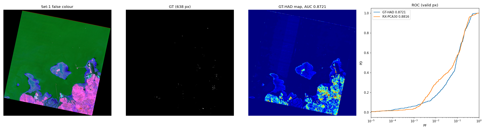
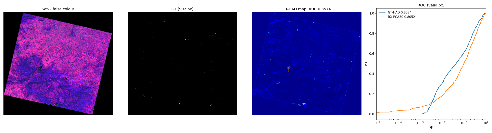
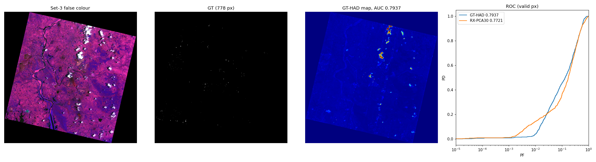
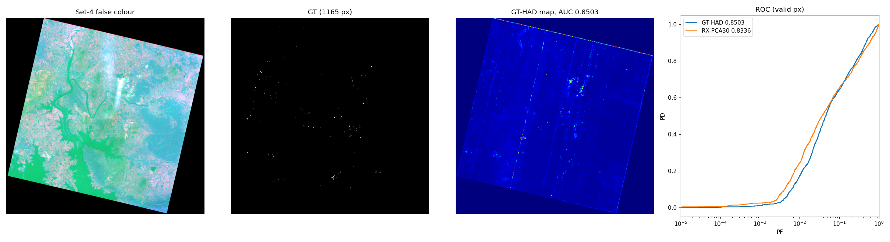

# gt-had-prisma: GT-HAD reproduced on the four Stage II PRISMA ground-truth scenes

Run 2026-10-15 on a Colab A100-80GB. Full outputs (logs, anomaly maps as `.npy`, ROC arrays,
code snapshot) are on Drive at
`MyDrive/PS_11/claude_experiments/gthad_prisma_2026-10-15/`. This folder keeps the script,
per-set `metrics.json`, `run.log`, `train_history.json` and `summary.png`, plus the
5- and 25-epoch diagnostic runs in `diag_epochs/`.

## Method

GT-HAD: Lian et al., "Gated Transformer for Hyperspectral Anomaly Detection", IEEE TNNLS
36(2), 2025. The network is the official `net.py`, imported unchanged from
github.com/jeline0110/GT-HAD at commit `c118ee0`. The paper's settings are used without
tuning: 9×9 cubes, stride 3, embed 64, mlp_ratio 2, Adam lr 1e-3, batch 64, 150 epochs, CMM
every 25 epochs, AvgPool3d(5,3,3) on the residual, and overlap-averaged fold.

[run_experiment.py](run_experiment.py) changes only memory and speed handling. At PRISMA
size (~160k cubes per scene) the official code would need about 12 GB just to hold the cubes,
and its CMM loops over cubes one at a time in Python. In this port:
- cubes are cut on the fly from a replicate-padded image;
- fold is an `index_add_` into an image buffer;
- CMM is a chunked fp32 nearest-neighbour search with TF32 off.

The maths is the same as the official code.

Input preparation:
- **Bands:** the HE5 `VNIR_Cube` and `SWIR_Cube` are converted to reflectance with
  `L2Scale*Min/Max` and concatenated (239 bands). 5 dead bands are dropped, leaving 234.
- **Normalisation:** global min–max to [0,1], as in the official code.
- **Seed:** 0. The official code fixes a seed per benchmark dataset; these scenes have none.

The ground truth is on the same grid as the L2D cube. The GT GeoTIFF's upper-left corner sits
exactly half a pixel off the HE5 `Product_ULcorner_*` coordinates, i.e. corner-versus-centre
convention.

**Two AUC columns.** L2D scenes are about 32% no-data fill outside the rotated swath.
"Full" is the paper's whole-image convention, where the easy fill pixels inflate AUC.
"Valid" excludes fill pixels; every GT anomaly lies inside the valid area. **Valid is the
honest number.**

RX-PCA30 is a reference baseline, not part of GT-HAD: global RX on the top 30 principal
components of valid pixels. Plain RX on all bands is not used, as it is unstable on HSI (see
CLAUDE.md).

## Results

| Set | Scene | Anomaly px | GT-HAD AUC (full) | **GT-HAD AUC (valid)** | RX-PCA30 AUC (valid) | PD @ PF=1e-3 | PD @ PF=1e-2 |
|---|---|---|---|---|---|---|---|
| 1 | PRS_L2D_STD_20201214060713 | 638 | 0.9096 | **0.8721** | 0.8816 | 0.063 | 0.169 |
| 2 | PRS_L2D_STD_20241205050514 | 992 | 0.8886 | **0.8574** | 0.8052 | 0.000 | 0.302 |
| 3 | PRS_L2D_STD_20210516050459 | 778 | 0.8579 | **0.7937** | 0.7721 | 0.008 | 0.040 |
| 4 | PRS_L2D_STD_20231229050902 | 1165 | 0.8951 | **0.8503** | 0.8336 | 0.011 | 0.172 |
| **mean** | | | 0.8878 | **0.8434** | 0.8231 | 0.020 | 0.171 |

PD and PF are on valid pixels. Each scene took about 75 min, with the four scenes running
concurrently on one A100. CMM took about 3–4 min per call and ran 5 times.

## Findings

1. **GT-HAD is a modest gain over a trivial baseline here.** Mean valid AUC is 0.843 against
   0.823 for RX-PCA30, and GT-HAD is behind on Set 1. The paper's ~0.99 AUCs come from
   ~100×100 benchmark scenes with a few large targets. These scenes are ~1200×1200 with
   600–1200 scattered anomaly pixels (<0.1% of the image).
2. **There is almost no detection at a usable false-alarm rate.** At PF = 1e-3, about 1,000
   false pixels per scene, PD is 0–6%. In `set*/summary.png`, the strongest GT-HAD responses
   are a handful of large compact blobs that are not in the ground truth, plus the swath edge.
   AUC is driven by the bulk ranking, not by finding the labelled targets.
3. **The result depends strongly on epoch count, and not in one direction.** Diagnostic
   runs at 5 and 25 epochs are in [diag_epochs/](diag_epochs/). No CMM runs at either length,
   because the search never fires on the final epoch. Valid AUC:

   | Set | 5 ep | 25 ep | 150 ep | RX-PCA30 |
   |---|---|---|---|---|
   | 1 | **0.952** | 0.908 | 0.872 | 0.882 |
   | 2 | 0.878 | **0.885** | 0.857 | 0.805 |
   | 3 | 0.779 | 0.480 | **0.794** | 0.772 |
   | 4 | **0.882** | 0.845 | 0.850 | 0.834 |
   | mean | **0.873** | 0.780 | 0.843 | 0.823 |

   PD at PF=1e-3 is also best at 5 epochs (mean 5.5%, against 2.0% at 150 epochs).
   - **Short training does best:** 5 epochs gives the best mean, and the reconstruction
     network seems to learn the anomalies as training goes on.
   - **Set 3 is unstable:** at 25 epochs it falls to chance (0.48). That map tracks land
     cover (bright soil high, water low) rather than targets, and the Set 3 loss rose between
     epochs 25 and 50. It recovers by 150.
   - **Not a tuned setting:** choosing the epoch count from these GT AUCs would leak labels,
     so 5 epochs is a diagnostic, not a recommendation. A deployable setting needs a
     label-free stopping rule.
4. **CMM behaves as described.** The number of blocks gated to the background branch (BFB)
   grows at each search (Set 1: 42k → 85k of 158k). On Sets 2 and 3 it saturates after the
   first search. Blocks made entirely of no-data fill can never "self-match", because
   identical cubes tie in the argmin; this is harmless for the valid AUC.

## Reproduce

```bash
git clone https://github.com/jeline0110/GT-HAD /content/GT-HAD
python run_experiment.py <set 1-4> <out_dir> [--epochs 150] [--search_iter 25] [--seed 0]
```

The script expects CUDA, because the official `net.py` hard-codes `.cuda()`.

## Panels

### Set 1

### Set 2

### Set 3

### Set 4

